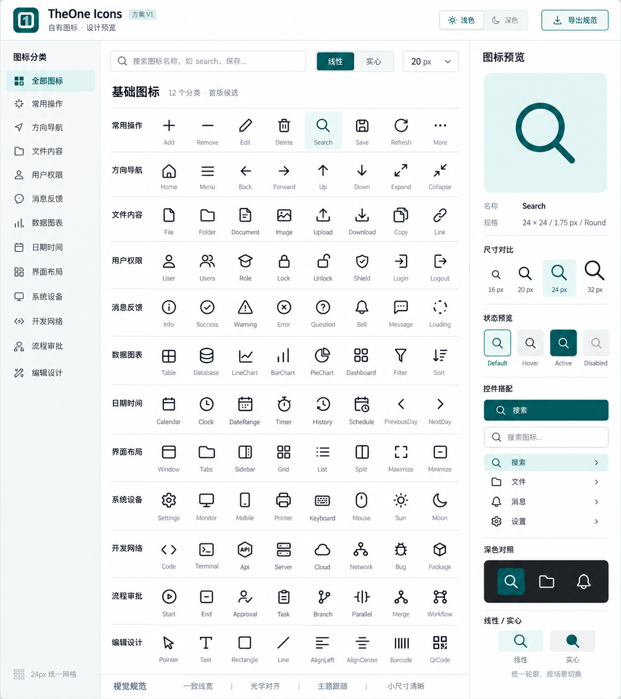

# TheOne 自有图标设计稿 V1

此目录保留 2026-10-19 最初的视觉评审稿。首版 96 个基础矢量图标已实现，随后持续扩充；当前 `OneIcon` 共 20 类 320 个，涵盖行业、交通、商业、教育与天气环境，见[控件用法](../../docs/controls/zh-cn/one-icon.md)及[几何源码](../../TheOne.Avalonia/Controls/OneIconCatalog.cs)。PNG 仍为最初概念图，不是当前运行截图。

## 设计方向

沿用 TheOne 品牌与主题，建立统一的圆角线性图标。24 × 24 为设计网格，1.75 为基准线宽，圆端点与圆连接。图稿显示搜索、分类、尺寸切换及单图标详情的预览页布局，作为后续 PreviewHost 图标页的设计参考。

默认图标保持单色；颜色由控件 Foreground 与语义主题资源决定。选中背景属于按钮/菜单容器，不固化进图标几何。实心样式只为必要状态补充，不承诺首版全部图标都有两个变体。

尺寸候选为 16 / 20 / 24 / 32，其中 32 用于预览或大图标。最终需要按现有 Small / Normal / Large 密度确认默认值；小尺寸允许光学校正，不能只做机械缩放。

## 首版设计范围：12 类、96 个候选

| 分类 | 候选名称 |
| --- | --- |
| 常用操作 | Add、Remove、Edit、Delete、Search、Save、Refresh、More |
| 方向导航 | Home、Menu、Back、Forward、Up、Down、Expand、Collapse |
| 文件内容 | File、Folder、Document、Image、Upload、Download、Copy、Link |
| 用户权限 | User、Users、Role、Lock、Unlock、Shield、Login、Logout |
| 消息反馈 | Info、Success、Warning、Error、Question、Bell、Message、Loading |
| 数据图表 | Table、Database、LineChart、BarChart、PieChart、Dashboard、Filter、Sort |
| 日期时间 | Calendar、Clock、DateRange、Timer、History、Schedule、PreviousDay、NextDay |
| 界面布局 | Window、Tabs、Sidebar、Grid、List、Split、Maximize、Minimize |
| 系统设备 | Settings、Monitor、Mobile、Printer、Keyboard、Mouse、Sun、Moon |
| 开发网络 | Code、Terminal、Api、Server、Cloud、Network、Bug、Package |
| 流程审批 | Start、End、Approval、Task、Branch、Parallel、Merge、Workflow |
| 编辑设计 | Pointer、Text、Rectangle、Line、AlignLeft、AlignCenter、Barcode、QrCode |

这是覆盖常见桌面业务类别的首轮清单，不代表穷尽所有行业。实际枚举与分类以 OneIconKind 和 OneIconCategory 为准。

## 现有项目接入建议

当前 PreviewHost 导航使用 Material 图标；ReportDesign 已有内部 ReportIcon 线性几何；IconButton 可以承载图标。首版自有图标应独立设计并统一视觉规范，不将第三方图标简单改名为自有资产。

后续实施建议：

1. 优先完成常用操作、导航、文件、反馈以及流程/报表需要的图标。
2. 使用可维护的矢量源及原生几何绘制，资源按需缓存；不把本 PNG 切片作为图标包。
3. 公开强类型图标名称与可绑定属性，具体命名待实现阶段确定；保留现有 Geometry、自定义模板与外部图标接入方式。
4. 优先接入独立图标预览页，再按授权范围逐步替换现有导航和业务工具栏。
5. 颜色跟随主题、禁用/选中状态由宿主控件提供；图标本身不劫持焦点、指针或按钮命令。
6. Loading 只在需要的宿主场景使用动画，并支持减少动画；静态图标不常驻计时器。

## 概念稿与已实现轮廓的差异

- Tabs 使用三段标签条，修正图稿中近似 Folder 的轮廓。
- Role 使用身份卡，修正学位帽容易被理解为教育功能的问题。
- Parallel 使用分叉/汇合栅栏、Merge 使用汇聚箭头，Branch 保留条件菱形与输出节点。
- PreviousDay / NextDay 使用日历内箭头，与 Back / Forward 区分。
- Warning / Error / Success 使用三角、叉号与勾号，不能只依赖颜色区分。
- QrCode、Barcode、Keyboard、Workflow 等密集图形按小尺寸保留关键特征；QrCode 图标不承担真实编码功能。

## 本轮交付与验证范围

本 PNG 为 AI 生成的静态 UI 概念图，用于评审图标家族风格和预览页组织，不是控件运行截图，也不是 SVG 图标集合。实现采用项目独立编写的 24 单位网格路径，没有提取 Material 或其他第三方图标数据。源码按项目 LICENSE 发布；不对通用几何符号宣称独占权利。

设计阶段仅保存本图与候选清单。实现后的主题、DPI、三档尺寸、绑定、交互和原生消费专项以控件文档与交付记录为准，不将此图当作验证证据。
