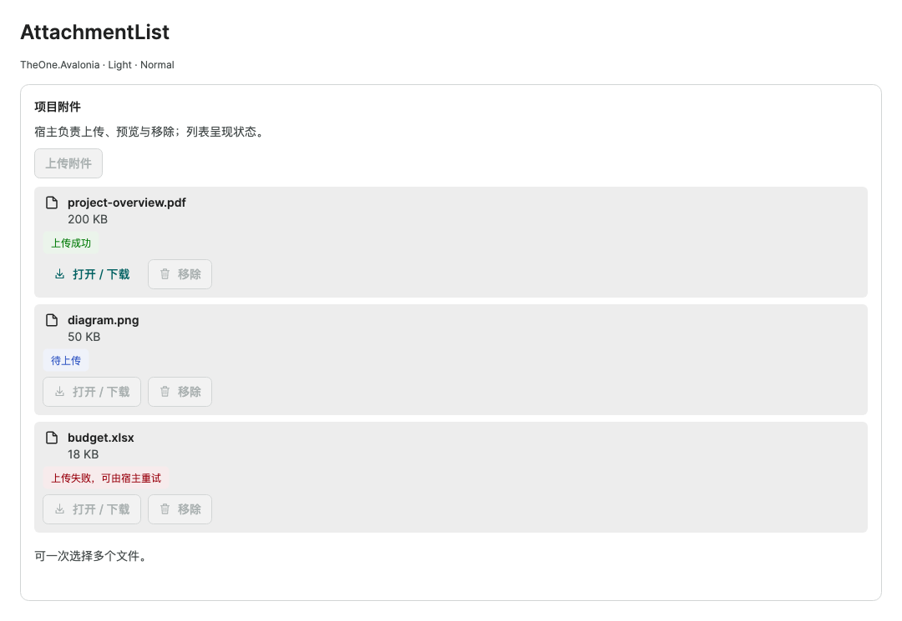

# AttachmentList

`AttachmentList` provides true multiple-file selection, empty state, attachment status, progress, open and remove actions. It sends no HTTP requests, deletes no server files and owns no business relationships. Use [Upload](upload.md) for a single-file selection.

<!-- visual-guide:start -->
## Appearance and example states

[Capture scope and visual index](visual-index.md). These are actual source-rendered examples; use this page’s usage notes for interaction and binding contracts.

### AttachmentList



Completed, uploading and failed file states; progress is fixture model data, not a simulated network transfer.

[View Dark comparison](../images/AttachmentList-dark.png)

<!-- visual-guide:end -->

## Usage

```xml
<one:AttachmentList Title="Attachments"
    Files="{CompiledBinding Attachments}"
    UploadCommand="{CompiledBinding UploadAttachmentsCommand}"
    RemoveCommand="{CompiledBinding RemoveAttachmentCommand}"
    IsBusy="{CompiledBinding IsLoading}"
    PreviewRequested="OnPreviewRequested" />
```

`Files` is `IEnumerable<IAttachmentItem>?`, normally an `ObservableCollection<AttachmentItem>`. Collection changes update the empty state; item changes update presentation and command availability. Existing business models may implement `IAttachmentItem`. Preview and remove actions receive the original object. The control never copies items or mutates the collection.

## Public contract

| Member | Behavior |
| --- | --- |
| `Title`, `Description`, `HintText` | Heading, description and supporting text |
| `UploadButtonText`, `EmptyText` | Selection button and empty-state text |
| `IsUploadVisible`, `IsRemoveVisible` | Selection and remove visibility; set both to `false` for a read-only list |
| `IsBusy` | Prevents selection, preview and removal; cancels selection results not yet accepted |
| `UploadCommand` | `ICommand` receiving one complete `IReadOnlyList<UploadFile>` batch |
| `RemoveCommand` | `ICommand` receiving the original `IAttachmentItem`; the host changes its relationship or collection |
| `PreviewRequested` | Routed event; `AttachmentPreviewRequestedEventArgs.Item` is the original item |
| `FilePicker` | Optional `IAttachmentFilePicker`: `Task<IReadOnlyList<UploadFile>> PickAsync(TopLevel, CancellationToken)` |
| `SelectFilesAsync(CancellationToken = default)` | Uses native multiple selection or the injected picker; cancellation preserves `Files` |
| `HasFiles`, `IsSelecting`, `ErrorMessage` | Read-only collection, selection and error state |
| `SelectCommand`, `RequestRemoveCommand`, `RequestPreviewCommand` | Template actions; removal and preview check that the original item remains in `Files` |

`IAttachmentItem : INotifyPropertyChanged` exposes read-only `FileName`, `FileUrl`, `FileSize`, `SizeText`, `StatusText`, `UploadProgress`, `IsUploading`, `CanOpen`, `CanRemove` and `Status`. `AttachmentStatus` is `Default / Uploading / Success / Error`.

`AttachmentItem` is a mutable presentation model with `MarkUploading()`, `MarkUploaded(string fileUrl, long fileSize)`, `MarkFailed(string message)`, `CreateUploaded(string fileName, string? fileUrl, long fileSize)` and `FormatSize(long size)`. It preserves the raw resource URL; the host validates business URLs. Upload start fabricates no transfer percentage. Zero progress is indeterminate; known progress must be finite and within 0–100.

## Ownership and cancellation

1. Native selection always uses `AllowMultiple=true`. It creates `UploadFile` instances owning their `IStorageFile`, without requiring local paths.
2. Before invoking the command, the control checks the active view, enablement, busy state and command. Cancellation, rejection, detachment and stale results dispose the complete unaccepted batch. Changing DataContext, the upload command, the Files source or its collection members invalidates an unaccepted selection.
3. After `CanExecute(batch)` accepts and `Execute(batch)` returns normally, the host owns the files. Asynchronous commands must dispose every file in their own `finally`. Detaching the control does not dispose an accepted batch.
4. Read with `await using var stream = await file.OpenReadAsync(token)`. The host tracks business versions and rejects stale upload responses after navigation.
5. Picker cancellation does not mutate `Files`. Native dialogs may not close immediately on every platform; late results never invoke upload.
6. Custom pickers dispose files that are never returned. Returned files transfer to the control. The control cannot revoke HTTP requests already issued by a host command.

## Business upload and preview

The host owns authentication, multipart field names, response DTOs, resource IDs, per-file state, save guards and relationship removal. An `UploadFile` is a local stream selection, not a persisted remote attachment. Never save a local path as a server URL.

```csharp
private async Task UploadAttachments(IReadOnlyList<UploadFile> files)
{
    try
    {
        foreach (var file in files)
        {
            var item = new AttachmentItem { FileName = file.Name, FileSize = file.Size ?? 0 };
            Attachments.Add(item);
            item.MarkUploading();
            try
            {
                await using var stream = await file.OpenReadAsync();
                var result = await uploadService.UploadAsync(stream, file.Name);
                item.MarkUploaded(result.Url, result.Size);
            }
            catch (Exception error) { item.MarkFailed(error.Message); }
        }
    }
    finally { foreach (var file in files) file.Dispose(); }
}
```

`uploadService` is provided by the host. Failed rows remain available for host-controlled retry, removal or save validation. Route `PreviewRequested` to [ImagePreview](image-preview.md), download or a system application. Read protected resources through the host service; consumer-supplied bitmaps remain consumer-owned.

## Themes and validation

The template uses `One.*` semantic resources and inherited `ControlSizing.Size` for Light / Dark and Small / Normal / Large. File names and action rows wrap within narrow containers. Validate selection, cancellation, stale results, ownership, collection/item notification and this control's theme/size behavior; a whole-library regression is unnecessary.
