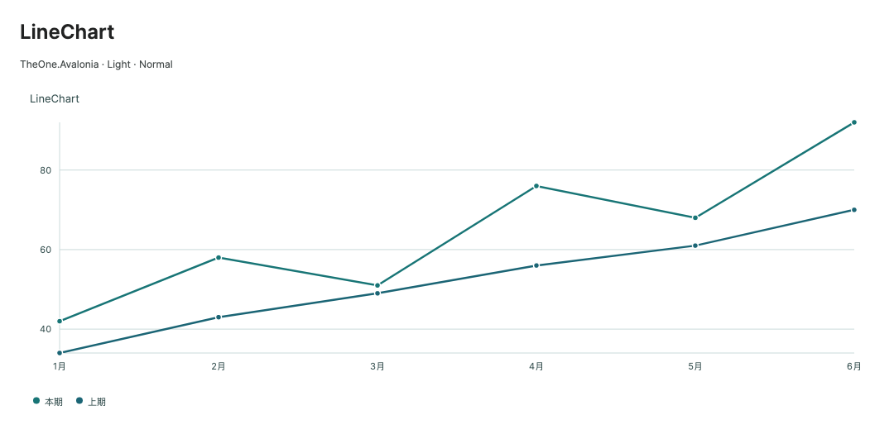
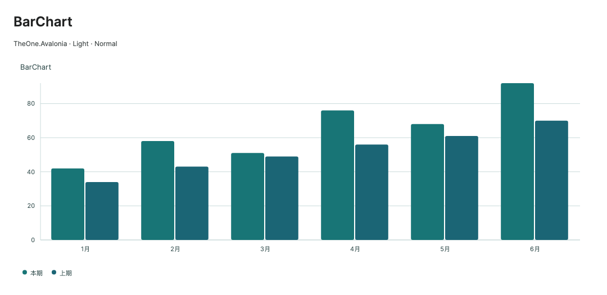
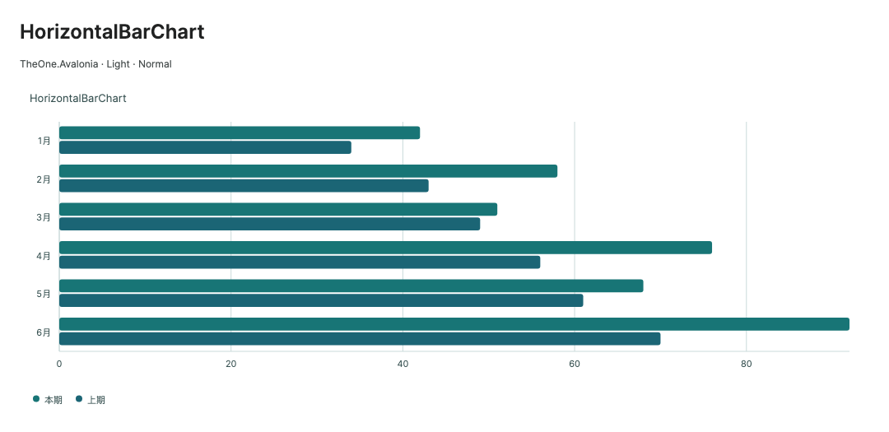
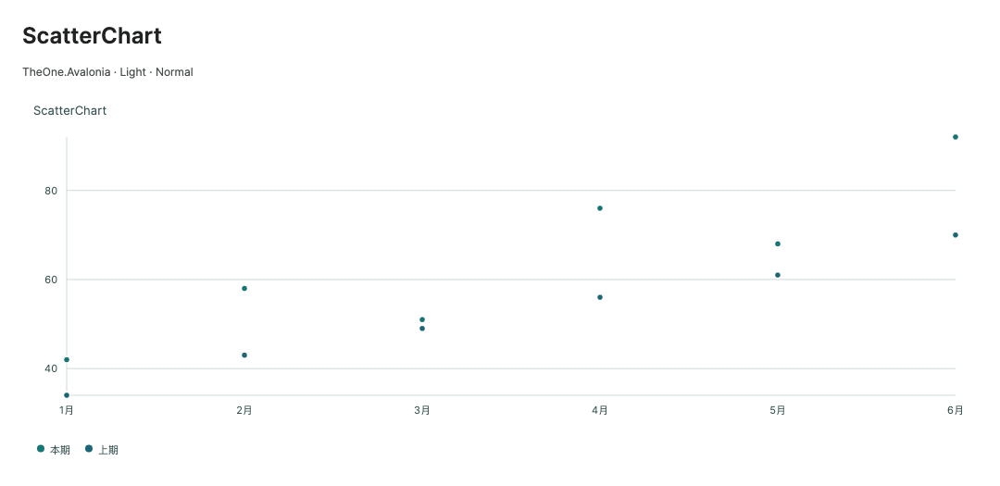
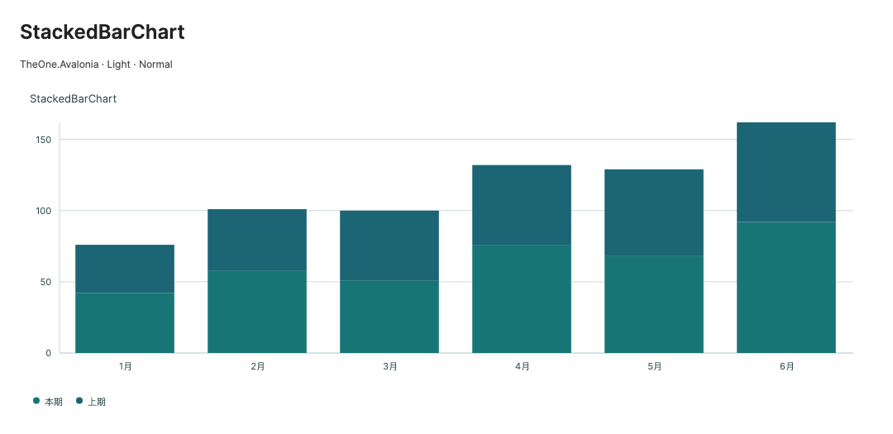
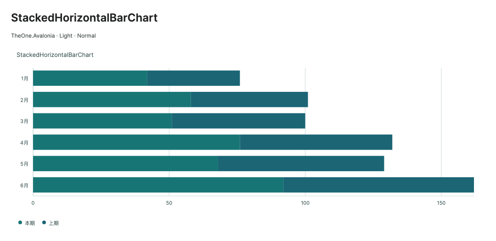
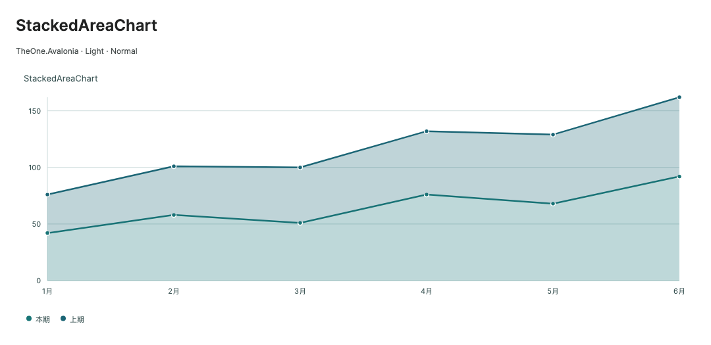
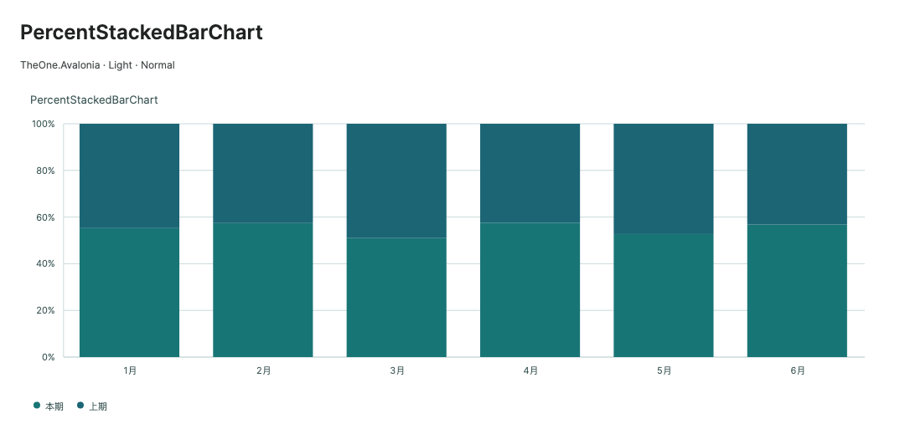
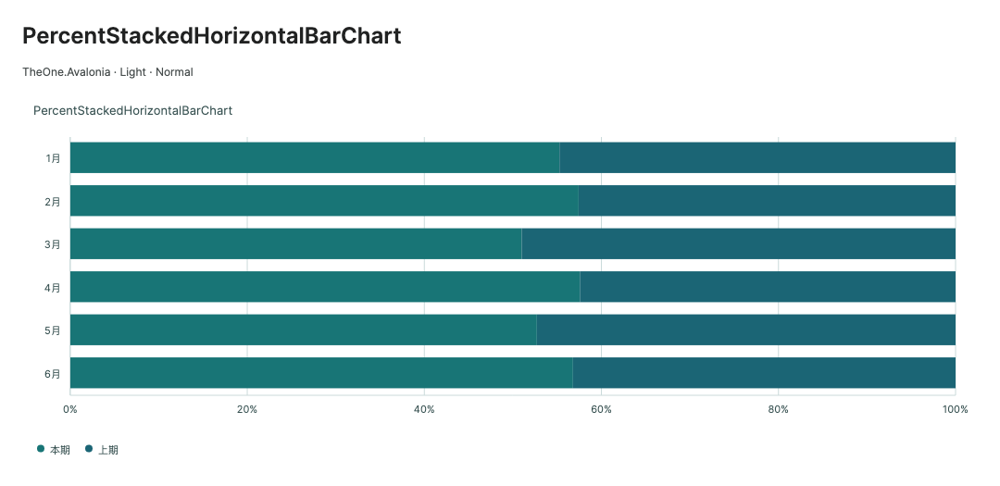
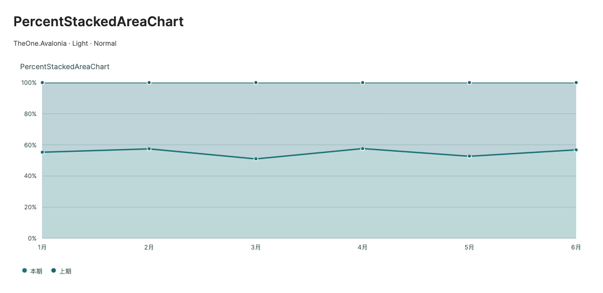

# Cartesian charts and sampling

Historical command-line checks and consumer test projects have been removed. Check coverage and measurements in this guide are historical records. Start PreviewHost normally and open the relevant control page; validate target-platform behavior in the consuming application.

[简体中文](../zh-cn/chart-cartesian.md) · **English**

See [charts](charts.md) for models and setup.

ScatterChart keeps individual ellipses, original source ordering, alpha overlap, outlines and original-point hit/selection rules. Built-in solid fills/outlines use cached marker snapshots and a batched drawing command; gradient, visual, tile and other custom brushes retain the native ellipse path. This does not reduce the sampled point set or change the soft budget. See [Scatter rendering tail latency](chart-rendering.md#scatter-rendering-tail) for measurements and tradeoffs. Scatter points remain visible when `ShowMarkers=False`, as before.

Selecting an omitted Scatter original uses an immutable one-point splice over the base sample, preserving source-order drawing without copying its coordinate array. Axis/data-label text layouts and stable pens/operations are also reused. Events and sampling diagnostics remain synchronous. See [selection p99](chart-rendering.md#scatter-selection-p99) for the measured boundary, cache lifecycle and remaining raster work.

<!-- visual-guide:start -->
## Appearance and example states

[Capture scope and visual index](visual-index.md). These are actual source-rendered examples; use this page’s usage notes for interaction and binding contracts.

### LineChart



Connects valid samples to show trends while preserving coordinate and legend meaning.

[View Dark comparison](../images/LineChart-dark.png)

### AreaChart


Area fill emphasizes trend magnitude without changing source values.

[View Dark comparison](../images/AreaChart-dark.png)

### BarChart



Vertical bars compare values across categories.

[View Dark comparison](../images/BarChart-dark.png)

### HorizontalBarChart



Horizontal bars accommodate longer category labels.

[View Dark comparison](../images/HorizontalBarChart-dark.png)

### ScatterChart



Points use continuous XY coordinates; dense data uses budgeted sampling rather than per-point controls.

[View Dark comparison](../images/ScatterChart-dark.png)

### StackedBarChart



Series values stack within categories; total height/length represents the aggregate.

[View Dark comparison](../images/StackedBarChart-dark.png)

### StackedHorizontalBarChart



Series values stack within categories; total height/length represents the aggregate.

[View Dark comparison](../images/StackedHorizontalBarChart-dark.png)

### StackedAreaChart



Series values stack within categories; total height/length represents the aggregate.

[View Dark comparison](../images/StackedAreaChart-dark.png)

### PercentStackedBarChart



Stacks normalize to proportions, comparing composition rather than absolute totals.

[View Dark comparison](../images/PercentStackedBarChart-dark.png)

### PercentStackedHorizontalBarChart



Stacks normalize to proportions, comparing composition rather than absolute totals.

[View Dark comparison](../images/PercentStackedHorizontalBarChart-dark.png)

### PercentStackedAreaChart



Stacks normalize to proportions, comparing composition rather than absolute totals.

[View Dark comparison](../images/PercentStackedAreaChart-dark.png)

<!-- visual-guide:end -->

## X-axis labels and narrow viewports

Line, column, and other Cartesian charts use actual text widths to determine label counts rather than skipping short labels because of a fixed 36 px minimum slot. The Small 240 px month example shows all six labels. Spacing is checked in screen order, including decreasing X data. Genuine crowding reduces labels while retaining all points, coordinates, and tooltip information.

Labels align within the available text area and clip against the whole axis-label region, removing the fixed 80 px window that truncated long text. Bottom space accounts for actual text height separately from legends. If one label exceeds the entire chart width, provide a shorter name or wider viewport.

## Smooth curves

```xml
<one:LineChart IsSmooth="True"
           SeriesSource="{CompiledBinding Revenue}" Height="320" />
```

`IsSmooth` defaults to `False` and applies only to `Line` and ordinary `Area`. Continuous segments with strictly increasing or decreasing X and no duplicate X use monotone cubic interpolation. Local extrema stay at input points and gaps remain. Duplicate or reversing X segments keep straight connections without reordering data. Ordinary area upper edges use the same curve; stacked / percent stacked areas retain straight edges so independently interpolated boundaries cannot cross.

Smoothing changes only drawing paths. Selection, sampling, tooltips, and shared-X queries still refer to original points; interpolated points are not queryable. This follows the tradeoff described by [Chart.js monotone interpolation](https://www.chartjs.org/docs/latest/charts/line.html) and [ECharts smooth lines](https://echarts.apache.org/handbook/en/how-to/chart-types/line/smooth-line/).

## Stacked charts

```xml
<one:StackedBarChart Title="月度营收构成"
           SeriesSource="{CompiledBinding Revenue}"
           IsZoomEnabled="True" IsPanEnabled="True" Height="300" />
```

`StackedBar` / `StackedHorizontalBar` align by source index. Visible same-axis positive values accumulate upward from zero; negatives accumulate downward. Primary / secondary axes stack independently and occupy separate category slots. Missing / nonfinite data is excluded. Different lengths are accepted, but each index should represent the same category. Labels / tooltips show individual contributions; selection returns original series and points.

`StackedArea` also aligns by index. At each axis / index, the first visible same-axis series with finite X defines the standard X. Mismatching X in other same-axis series becomes a gap; no searching or reordering occurs. Align sample positions beforehand. Missing data and sign changes split fill bands, with positive / negative contributions accumulated separately. Axes use stacked extents. Same-sign totals exceeding finite `double` range clamp to `±double.MaxValue` to keep geometry finite.

Multiple zero contributions at an index can share a baseline mark but remain separately selectable by keyboard. After totals reach finite limits, further contributions can have no visible thickness. Without a visible mark, `GetDataPointPosition` returns `null`, and location APIs can return `false`.

## Percent stacking

```xml
<one:PercentStackedBarChart Title="月度营收占比"
           SeriesSource="{CompiledBinding Revenue}"
           ShowDataLabels="True" Height="300" />
```

The three `PercentStacked*` types retain their stacking counterpart's index / X alignment. At each axis / index, positives normalize by positive totals to 100%, and negatives by absolute negative totals to -100%. Directions are independent; do not net opposite signs for the denominator. Zero contributes 0; invalid data is excluded. Values are scaled before summing to avoid overflow with large finite inputs.

Percentage axes use fixed percentage ranges, ignoring `YMinimum` / `YMaximum` and secondary numeric-range overrides. Viewport zoom / pan remains available. Labels show one decimal percentage; tooltips include raw values, series units, and signed shares. `GetStackPercentage(seriesIndex, pointIndex)` returns a signed `double?` ratio: `0.25` means 25%, `-0.25` means -25%. Other chart types or invalid contributions return `null`.

```csharp
var share = RevenueChart.GetStackPercentage(0, 3);
if (share is { } ratio) Console.WriteLine($"{ratio:P1}");
```

## Dual Y axes and series formatting

Set series `YAxis` to `ChartYAxis.Primary` (default) or `ChartYAxis.Secondary`. X / categories are shared; each value axis calculates its range from its own series. Columns still group by category across axes, and stacking occurs only within an axis. Secondary axes appear on the right for ordinary Cartesian charts and at the top for horizontal bars.

```csharp
viewModel.Revenue[1].Name = "转化率";
viewModel.Revenue[1].YAxis = ChartYAxis.Secondary;
viewModel.Revenue[1].ValueFormat = "0.0";
viewModel.Revenue[1].Unit = "%";
viewModel.Revenue[1].ItemsSource = new[]
{
    new ChartPoint(1, 3.5, "一月"), new ChartPoint(2, 4.6, "二月"),
    new ChartPoint(3, 4.9, "三月"), new ChartPoint(4, 6.1, "四月")
};
```

```xml
<one:LineChart Title="营收与转化率"
           SeriesSource="{CompiledBinding Revenue}"
           YAxisTitle="营收（万元）" Unit=" 万元"
           SecondaryYAxisTitle="转化率（%）"
           SecondaryValueFormat="0.0" SecondaryUnit="%"
           SecondaryYMinimum="0" Height="320" />
```

`SecondaryYMinimum` / `SecondaryYMaximum` default to `NaN` for automatic ranges; finite values override them. Primary settings are `YMinimum` / `YMaximum`, `ValueFormat` / `Unit`. Secondary settings are `SecondaryValueFormat` (default `0.##`) / `SecondaryUnit`. `YAxisTitle` / `SecondaryYAxisTitle` set titles.

`ShowSecondaryAxis` defaults to `True` and shows a secondary axis when valid `IsVisible=True` series use it. `False` hides its ticks / title while retaining independent scaling. An invalid final range suppresses only that axis's data; the other can remain visible. Both share normalized `Viewport`, mapping the same zoom fractions to their own numeric ranges. Series formatting overrides raw tooltip / label values, not tick formats; percentage labels remain percentages. Radial charts do not use dual-axis scaling.

## Large-data sampling

```xml
<one:LineChart SeriesSource="{CompiledBinding Revenue}"
           SamplingMode="MinMax" SamplingThreshold="2000"
           SamplingPointBudget="2000" IsZoomEnabled="True"
           IsPanEnabled="True" Height="320" />
```

`SamplingMode` is `ChartSamplingMode.None` or `MinMax`, default `MinMax`. `SamplingThreshold` and `SamplingPointBudget` both default to 2,000, with minimums 2 / 8 respectively. Line, area, scatter, and ordinary / percent stacked areas support sampling; categorical columns / bars remain exact. MinMax keeps local upper / lower extrema, boundaries, and selection in monotonic-X segments. It does not reorder input; nonmonotonic segments fall back to exact drawing.

The budget is a **soft target per series**, allocated by segment length. Boundaries, gaps, sign changes, and selected original points need additional retention; fragmented or unsampleable segments can exceed it. It is neither a shared all-series limit nor a strict vertex cap. Zoom prepares geometry for the current view; `SamplingMode=None` disables sampling.

Mapping-stable Y updates maintain only affected buckets' top/baseline extrema through an index tree; equal extrema retain the earliest source offset. Offscreen originals outside the cached interval do not rebuild the base sample. Gap/sign/X/range changes rebuild the affected frame as before. Selection still pins an omitted original outside the soft budget. See [incremental sampling and measurements](chart-rendering.md#incremental-sampling-buckets) for costs and verification.

Read-only `RenderedPointCount` totals prepared numeric-curve sample points and visible column / bar marks across series; pie, doughnut, and gauge report 0. It is not original data count, Control count, or low-level draw-command count. `SamplingActive` indicates whether prepared output actually reduces points. Both update after layout / geometry preparation. Notifications during drawing coalesce and defer to the next UI dispatch to prevent listeners / bindings from mutating charts while rendering; preparation outside rendering through geometry APIs updates synchronously.

Drawing geometry and the original-point spatial hit index are cached and reused by pointer queries. Data, axes, viewport, layout, or sampling changes rebuild them. `GetDataPointPosition`, hit testing, selection, and tooltips retain original series / point indices; visible original points excluded from sampled geometry can still be located and selected. Hit testing scans spatial buckets near the pointer; highly dense or overlapping data can increase candidate scans, so fixed query time is not guaranteed.

```csharp
Console.WriteLine($"绘制顶点：{RevenueChart.RenderedPointCount}，采样：{RevenueChart.SamplingActive}");
RevenueChart.SelectedIndex = 99_999; // 数据源须包含该项；选择仍指向原始模型。
```

Sampling does not preserve every point's visual detail. Disable it or zoom for point-by-point inspection. The preview includes 100,000 points and actual draw counts; performance depends on target hardware and data shape.

Cached base samples let an omitted selected original enter its segment without rebuilding the full frame. Switching or clearing selection removes the previous extra point; original model indices and soft-budget rules remain unchanged. Single-point Y updates reuse ranges/stacks and patch geometry when mapping and topology stay stable. See [cache rules and measurements](chart-rendering.md#cartesian-range-stack-and-drawing-caches) for fallbacks, memory costs and the scoped verification entry.

## Tick and label precision

Line / area / scatter labels avoid collisions across series, trying above, then below or beside points. At most 2,048 candidates and 512 drawn labels are considered. Unplaceable labels are omitted, but tooltips / selection retain values. `GetDataLabelBounds(seriesIndex, pointIndex)` returns the displayed label's target bounds; disabled labels, unsampled points, or unplaceable labels return `null`. Queries complete active animation first.

Numeric axes choose steps of 1, 2, 2.5, or 5 times an integer power of 10 according to visible range and available height, or width for horizontal charts. Ticks are in-range multiples: range 34–92 yields 40, 60, 80 rather than forcing divisions at 53.33 / 72.67. Ticks do not change data ranges, explicit YMinimum / YMaximum, or point positions. Zoom recalculates them. Percentage charts keep percentage text. Extreme / precision-boundary ranges use safe interpolation.

With default ValueFormat="0.##", ticks add fractional digits as required by step size. Tiny values use significant digits; narrow ranges at large magnitudes retain precision so distinct ticks do not share labels. Other explicit ValueFormat / SecondaryValueFormat settings are honored; integer formats discard decimals. Raw tooltips and data labels still use series formats.

X-axis capacity depends on measured label widths and spacing, preferring visible endpoints. Short labels allow more entries; long labels are thinned. Label density is independent of data sampling and never changes source indices or selection.

<!-- generated-contracts:start -->
## Control-specific properties, Classes usage and business APIs

This section lists project-added control-specific properties, public Classes usage, practical business actions and related models, without repeating inherited native APIs, constructors, property Get/Set wrappers or public identifiers. Registration defaults differ from themed values, and explicit local values take precedence. PreviewHost shows Classes through labeled examples rather than template-selector/setter inventories; properties and business actions in Description include short usage snippets. Shared ControlSizing and Motion settings are centralized on Home. Only Button, Input and Select share comparison pages; other controls retain independent complete demos.

### AreaChart

[Complete source contract](../../api/en/TheOne.Avalonia.Controls.AreaChart.md)

| Property | Type | Access/binding/inheritance | Registration/model default | Meaning and constraints |
| --- | --- | --- | --- | --- |
| [`Kind`](../../../TheOne.Avalonia/Controls/AreaChart.cs#L6) | `TheOne.Avalonia.Controls.ChartKind` | read-only; CLR / n/a | `accessor-defined / state` | Kind enum for the owning field/property/element; see its concrete enum for choices. Values: `Line`, `Area`, `Bar`, `HorizontalBar`, `Scatter`, `Pie`, `Doughnut`, `Gauge`, `StackedBar`, `StackedHorizontalBar`, `StackedArea`, `PercentStackedBar`, `PercentStackedHorizontalBar`, `PercentStackedArea`, `Heatmap`, `Radar`, `Funnel`, `BoxPlot`, `Candlestick`, `Treemap`, `Sunburst` |

### BarChart

[Complete source contract](../../api/en/TheOne.Avalonia.Controls.BarChart.md)

| Property | Type | Access/binding/inheritance | Registration/model default | Meaning and constraints |
| --- | --- | --- | --- | --- |
| [`Kind`](../../../TheOne.Avalonia/Controls/BarChart.cs#L6) | `TheOne.Avalonia.Controls.ChartKind` | read-only; CLR / n/a | `accessor-defined / state` | Kind enum for the owning field/property/element; see its concrete enum for choices. Values: `Line`, `Area`, `Bar`, `HorizontalBar`, `Scatter`, `Pie`, `Doughnut`, `Gauge`, `StackedBar`, `StackedHorizontalBar`, `StackedArea`, `PercentStackedBar`, `PercentStackedHorizontalBar`, `PercentStackedArea`, `Heatmap`, `Radar`, `Funnel`, `BoxPlot`, `Candlestick`, `Treemap`, `Sunburst` |

### CartesianChartBase

[Complete source contract](../../api/en/TheOne.Avalonia.Controls.CartesianChartBase.md)

No additional CLR/attached properties are declared on this type; see its base for inherited members.

### ChartBase

[Complete source contract](../../api/en/TheOne.Avalonia.Controls.ChartBase.md)

| Property | Type | Access/binding/inheritance | Registration/model default | Meaning and constraints |
| --- | --- | --- | --- | --- |
| [`AccentBrush`](../../../TheOne.Avalonia/Controls/ChartBase.cs#L297) | `Avalonia.Media.IBrush?` | writable; OneWay | `null` | Primary-series/accent brush; use One.* dynamic resources for themes. Explicit local values take precedence. |
| [`AnimationDuration`](../../../TheOne.Avalonia/Controls/ChartBase.Animation.cs#L52) | `System.TimeSpan` | writable; OneWay | `TimeSpan.FromMilliseconds(200)` | Duration of data transitions, also gated by the control animation switch and Motion.Enabled. Validation: `value => value >= TimeSpan.Zero && value <= TimeSpan.FromSeconds(10)` |
| [`AnimationProgress`](../../../TheOne.Avalonia/Controls/ChartBase.Animation.cs#L66) | `double` | read-only; OneWay | `computed / state` | Read-only runtime/derived state, updated by the control/model for display or command conditions; not a two-way input. |
| [`AnimationStyle`](../../../TheOne.Avalonia/Controls/ChartBase.Animation.cs#L59) | `TheOne.Avalonia.Controls.ChartAnimationStyle` | writable; OneWay | `0 / default` | First nonempty presentation ; Subsequent data changes Validation: `value => Enum.IsDefined(value)` Values: `Auto`, `None`, `Fade`, `Reveal` |
| [`Background`](../../../TheOne.Avalonia/Controls/ChartBase.cs#L273) | `Avalonia.Media.IBrush?` | writable; OneWay | `inherited registration` | Background brush; use DynamicResource for theme-dependent surfaces. |
| [`ChartPadding`](../../../TheOne.Avalonia/Controls/ChartBase.Sizing.cs#L53) | `double` | writable; OneWay | `12` | 8 ; 12 ; 16 Validation: `value => double.IsFinite(value) && value >= 0` |
| [`CrosshairPosition`](../../../TheOne.Avalonia/Controls/ChartBase.Interaction.cs#L54) | `Avalonia.Point?` | read-only; OneWay | `computed / state` | Read-only runtime/derived state, updated by the control/model for display or command conditions; not a two-way input. |
| [`DefaultChartHeight`](../../../TheOne.Avalonia/Controls/ChartBase.Sizing.cs#L47) | `double` | writable; OneWay | `280` | 320 / 224 ; 400 / 280 ; 480 / 336 Validation: `value => double.IsFinite(value) && value > 0` |
| [`DefaultChartWidth`](../../../TheOne.Avalonia/Controls/ChartBase.Sizing.cs#L40) | `double` | writable; OneWay | `400` | 320 / 224 ; 400 / 280 ; 480 / 336 Validation: `value => double.IsFinite(value) && value > 0` |
| [`EmptyText`](../../../TheOne.Avalonia/Controls/ChartBase.cs#L255) | `string` | writable; OneWay | `"暂无数据"` | `暂无数据`, the default Chinese no-data text |
| [`FifthBrush`](../../../TheOne.Avalonia/Controls/ChartBase.cs#L321) | `Avalonia.Media.IBrush?` | writable; OneWay | `null` | Fifth-series brush; use One.* dynamic resources for themes. Explicit local values take precedence. |
| [`FontFamily`](../../../TheOne.Avalonia/Controls/ChartBase.cs#L333) | `Avalonia.Media.FontFamily` | writable; OneWay | `inherited registration` | Font family for text rendering; Avalonia handles fallback and actual text metrics. |
| [`FontSize`](../../../TheOne.Avalonia/Controls/ChartBase.cs#L339) | `double` | writable; OneWay | `inherited registration` | 10 ; 11 ; 12 |
| [`Foreground`](../../../TheOne.Avalonia/Controls/ChartBase.cs#L279) | `Avalonia.Media.IBrush?` | writable; OneWay | `inherited registration` | Foreground brush; retain text, status and disabled contrast when overriding. |
| [`GaugeBandRatio`](../../../TheOne.Avalonia/Controls/ChartBase.Sizing.cs#L83) | `double` | writable; OneWay | `0.18` | Follows three theme densities; Basic, Progress, Grade, Barometer scale bands by structure; ratio is overridable Validation: `value => double.IsFinite(value) && value > 0 && value <= 0.5` |
| [`GaugeMajorTickCount`](../../../TheOne.Avalonia/Controls/ChartBase.Gauge.cs#L34) | `int` | writable; OneWay | `5` | Number of major ticks, including the minimum and maximum. Validation: `value => value >= 2 && value <= 25` |
| [`GaugeMinorTickCount`](../../../TheOne.Avalonia/Controls/ChartBase.Gauge.cs#L41) | `int` | writable; OneWay | `2` | Maximum minor marks between consecutive major ticks. Compact gauges reduce them to keep readable spacing. Validation: `value => value >= 0 && value <= 10` |
| [`GridBrush`](../../../TheOne.Avalonia/Controls/ChartBase.cs#L285) | `Avalonia.Media.IBrush?` | writable; OneWay | `null` | Plot grid-line brush; use One.* dynamic resources for themes. Explicit local values take precedence. |
| [`HoveredPoints`](../../../TheOne.Avalonia/Controls/ChartBase.Interaction.cs#L55) | `System.Collections.Generic.IReadOnlyList<TheOne.Avalonia.Controls.ChartSelection>` | read-only; OneWay | `computed / state` | Read-only runtime/derived state, updated by the control/model for display or command conditions; not a two-way input. |
| [`InnerRadius`](../../../TheOne.Avalonia/Controls/ChartBase.cs#L207) | `double` | writable; OneWay | `0.62` | Inner-radius ratio for radial charts, controlling the hole without changing sector values/proportions. Validation: `value => double.IsFinite(value) && value >= 0 && value < 1` |
| [`IsAnimating`](../../../TheOne.Avalonia/Controls/ChartBase.Animation.cs#L65) | `bool` | read-only; OneWay | `computed / state` | Read-only runtime/derived state, updated by the control/model for display or command conditions; not a two-way input. |
| [`IsAnimationEnabled`](../../../TheOne.Avalonia/Controls/ChartBase.Animation.cs#L46) | `bool` | writable; OneWay | `true` | Enables chart data transitions; global Motion.Enabled=False still disables them. |
| [`IsLegendInteractive`](../../../TheOne.Avalonia/Controls/ChartBase.Legend.cs#L27) | `bool` | writable; OneWay | `true` | `True`; Cartesian series toggling and legend keyboard input |
| [`IsPanEnabled`](../../../TheOne.Avalonia/Controls/ChartBase.Viewport.cs#L67) | `bool` | writable; OneWay | `false` | Default `False`; enables left-pointer dragging / keyboard pan |
| [`IsSmooth`](../../../TheOne.Avalonia/Controls/ChartBase.Smoothing.cs#L12) | `bool` | writable; OneWay | `false` | `False`; monotone smoothing for line / ordinary area |
| [`IsZoomEnabled`](../../../TheOne.Avalonia/Controls/ChartBase.Viewport.cs#L60) | `bool` | writable; OneWay | `false` | Default `False`; enables wheel / keyboard zoom |
| [`Kind`](../../../TheOne.Avalonia/Controls/ChartBase.cs#L163) | `TheOne.Avalonia.Controls.ChartKind` | read-only; CLR / n/a | `accessor-defined / state` | Kind enum for the owning field/property/element; see its concrete enum for choices. Values: `Line`, `Area`, `Bar`, `HorizontalBar`, `Scatter`, `Pie`, `Doughnut`, `Gauge`, `StackedBar`, `StackedHorizontalBar`, `StackedArea`, `PercentStackedBar`, `PercentStackedHorizontalBar`, `PercentStackedArea`, `Heatmap`, `Radar`, `Funnel`, `BoxPlot`, `Candlestick`, `Treemap`, `Sunburst` |
| [`LegendPageCount`](../../../TheOne.Avalonia/Controls/ChartBase.Legend.cs#L42) | `int` | read-only; CLR / n/a | `accessor-defined / state` | Read-only paging state; zero-based page index |
| [`LegendPageIndex`](../../../TheOne.Avalonia/Controls/ChartBase.Legend.cs#L33) | `int` | read-only; CLR / n/a | `accessor-defined / state` | Read-only paging state; zero-based page index |
| [`MarkerRadius`](../../../TheOne.Avalonia/Controls/ChartBase.Sizing.cs#L59) | `double` | writable; OneWay | `3.5` | 3 ; 3.5 ; 4.25 Validation: `value => double.IsFinite(value) && value > 0` |
| [`Maximum`](../../../TheOne.Avalonia/Controls/ChartBase.cs#L231) | `double` | writable; OneWay | `100` | Primary value-axis maximum; null uses automatic bounds without changing the underlying data. Validation: `double.IsFinite` |
| [`Minimum`](../../../TheOne.Avalonia/Controls/ChartBase.cs#L225) | `double` | writable; OneWay | `0 / default` | Primary value-axis minimum; null derives it from data. Explicit ranges must be consistent with the data and Maximum. Validation: `double.IsFinite` |
| [`MutedBrush`](../../../TheOne.Avalonia/Controls/ChartBase.cs#L291) | `Avalonia.Media.IBrush?` | writable; OneWay | `null` | Muted text/helper-mark brush; use One.* dynamic resources for themes. Explicit local values take precedence. |
| [`NavigationAxes`](../../../TheOne.Avalonia/Controls/ChartBase.Viewport.cs#L73) | `TheOne.Avalonia.Controls.ChartNavigationAxes` | writable; OneWay | `ChartNavigationAxes.Both` | Default `Both`; `None`, `Horizontal`, `Vertical` restrict navigation axes Validation: `value => (value & ~ChartNavigationAxes.Both) == 0` Values: `None`, `Horizontal`, `Vertical`, `Both` |
| [`QuaternaryBrush`](../../../TheOne.Avalonia/Controls/ChartBase.cs#L315) | `Avalonia.Media.IBrush?` | writable; OneWay | `null` | Fourth-series brush; use One.* dynamic resources for themes. Explicit local values take precedence. |
| [`RenderedPointCount`](../../../TheOne.Avalonia/Controls/ChartBase.Sampling.cs#L113) | `int` | read-only; OneWay | `computed / state` | Read-only runtime/derived state, updated by the control/model for display or command conditions; not a two-way input. |
| [`SamplingActive`](../../../TheOne.Avalonia/Controls/ChartBase.Sampling.cs#L114) | `bool` | read-only; OneWay | `computed / state` | Read-only runtime/derived state, updated by the control/model for display or command conditions; not a two-way input. |
| [`SamplingMode`](../../../TheOne.Avalonia/Controls/ChartBase.Sampling.cs#L94) | `TheOne.Avalonia.Controls.ChartSamplingMode` | writable; OneWay | `ChartSamplingMode.MinMax` | Sampling strategy for dense series; see enum choices. It reduces rendered points without replacing source data. Validation: `value => value is ChartSamplingMode.None or ChartSamplingMode.MinMax` Values: `None`, `MinMax` |
| [`SamplingPointBudget`](../../../TheOne.Avalonia/Controls/ChartBase.Sampling.cs#L107) | `int` | writable; OneWay | `2000` | A per-series sampling target; gap boundaries and selected originals can exceed it. Validation: `value => value >= 8` |
| [`SamplingThreshold`](../../../TheOne.Avalonia/Controls/ChartBase.Sampling.cs#L100) | `int` | writable; OneWay | `2000` | Point threshold for sampling, combined with the viewport and SamplingMode to bound rendering work. Validation: `value => value >= 2` |
| [`SecondaryBrush`](../../../TheOne.Avalonia/Controls/ChartBase.cs#L303) | `Avalonia.Media.IBrush?` | writable; OneWay | `null` | Second-series brush; use One.* dynamic resources for themes. Explicit local values take precedence. |
| [`SecondaryUnit`](../../../TheOne.Avalonia/Controls/ChartBase.Advanced.cs#L60) | `string?` | writable; OneWay | `null` | Unit suffix for the secondary value axis, independent of the primary unit. |
| [`SecondaryValueFormat`](../../../TheOne.Avalonia/Controls/ChartBase.Advanced.cs#L54) | `string` | writable; OneWay | `"0.##"` | Numeric format string for the secondary value axis, using .NET numeric formatting. |
| [`SecondaryYAxisTitle`](../../../TheOne.Avalonia/Controls/ChartBase.Advanced.cs#L48) | `string?` | writable; OneWay | `null` | Secondary value-axis title; it does not reassign series to that axis. |
| [`SecondaryYMaximum`](../../../TheOne.Avalonia/Controls/ChartBase.Advanced.cs#L36) | `double` | writable; OneWay | `double.NaN` | Secondary value-axis maximum; null is automatic, paired with SecondaryYMinimum. Validation: `value => !double.IsInfinity(value)` |
| [`SecondaryYMinimum`](../../../TheOne.Avalonia/Controls/ChartBase.Advanced.cs#L30) | `double` | writable; OneWay | `double.NaN` | Secondary value-axis minimum; null is automatic, paired with SecondaryYMaximum. Validation: `value => !double.IsInfinity(value)` |
| [`SelectedIndex`](../../../TheOne.Avalonia/Controls/ChartBase.cs#L267) | `int` | writable; TwoWay | `-1` | Zero-based series / point indices with TwoWay binding; point index `-1` clears selection |
| [`SelectedSeriesIndex`](../../../TheOne.Avalonia/Controls/ChartBase.cs#L261) | `int` | writable; TwoWay | `0 / default` | Zero-based series / point indices with TwoWay binding; point index `-1` clears selection |
| [`Selection`](../../../TheOne.Avalonia/Controls/ChartBase.cs#L345) | `TheOne.Avalonia.Controls.ChartSelection?` | read-only; OneWay | `computed / state` | Read-only `ChartSelection?`, with indices and original `Series` / `Point` references |
| [`SelectionThickness`](../../../TheOne.Avalonia/Controls/ChartBase.Sizing.cs#L65) | `double` | writable; OneWay | `2` | 1.5 ; 2 ; 2.5 Validation: `value => double.IsFinite(value) && value > 0` |
| [`SeriesSource`](../../../TheOne.Avalonia/Controls/ChartBase.cs#L165) | `System.Collections.Generic.IList<TheOne.Avalonia.Controls.ChartSeries>?` | writable; OneWay | `null` | Model/result collection; the signature defines element types. Dynamic business data needs notifications; control-owned read-only collections must not be replaced. |
| [`ShowCrosshair`](../../../TheOne.Avalonia/Controls/ChartBase.Interaction.cs#L42) | `bool` | writable; OneWay | `false` | `False`; enables pointer crosshairs in Cartesian charts |
| [`ShowDataLabels`](../../../TheOne.Avalonia/Controls/ChartBase.cs#L195) | `bool` | writable; OneWay | `false` | `False`; values for Cartesian charts, fitting percentages for pie / doughnut |
| [`ShowGaugeNeedle`](../../../TheOne.Avalonia/Controls/ChartBase.Gauge.cs#L21) | `bool` | writable; OneWay | `false` | Enum-based theme defaults; explicit False hides elements. Barometer tick visibility applies to both scales |
| [`ShowGaugeTicks`](../../../TheOne.Avalonia/Controls/ChartBase.Gauge.cs#L27) | `bool` | writable; OneWay | `false` | Enum-based theme defaults; explicit False hides elements. Barometer tick visibility applies to both scales |
| [`ShowGrid`](../../../TheOne.Avalonia/Controls/ChartBase.cs#L183) | `bool` | writable; OneWay | `true` | `True`; Cartesian grid |
| [`ShowLegend`](../../../TheOne.Avalonia/Controls/ChartBase.cs#L177) | `bool` | writable; OneWay | `true` | `True`; series legend for Cartesian charts, category legend for pie / doughnut |
| [`ShowMarkers`](../../../TheOne.Avalonia/Controls/ChartBase.cs#L189) | `bool` | writable; OneWay | `true` | `True`; point marks for line / area |
| [`ShowSecondaryAxis`](../../../TheOne.Avalonia/Controls/ChartBase.Advanced.cs#L66) | `bool` | writable; OneWay | `true` | Shows the secondary value axis; series models still determine axis assignment. |
| [`SixthBrush`](../../../TheOne.Avalonia/Controls/ChartBase.cs#L327) | `Avalonia.Media.IBrush?` | writable; OneWay | `null` | Sixth-series brush; use One.* dynamic resources for themes. Explicit local values take precedence. |
| [`SliceHoverOffset`](../../../TheOne.Avalonia/Controls/ChartBase.Sizing.cs#L71) | `double` | writable; OneWay | `6` | 4 ; 6 ; 8 Validation: `value => double.IsFinite(value) && value >= 0` |
| [`SliceHoverScale`](../../../TheOne.Avalonia/Controls/ChartBase.Sizing.cs#L77) | `double` | writable; OneWay | `1.025` | 1.02 ; 1.025 ; 1.03 Validation: `value => double.IsFinite(value) && value >= 1 && value <= 1.2` |
| [`StrokeThickness`](../../../TheOne.Avalonia/Controls/ChartBase.cs#L201) | `double` | writable; OneWay | `2.5` | `2.5`; finite and greater than zero Validation: `value => double.IsFinite(value) && value > 0` |
| [`TertiaryBrush`](../../../TheOne.Avalonia/Controls/ChartBase.cs#L309) | `Avalonia.Media.IBrush?` | writable; OneWay | `null` | Third-series brush; use One.* dynamic resources for themes. Explicit local values take precedence. |
| [`Title`](../../../TheOne.Avalonia/Controls/ChartBase.cs#L171) | `string?` | writable; OneWay | `null` | Optional title |
| [`TooltipMode`](../../../TheOne.Avalonia/Controls/ChartBase.Interaction.cs#L48) | `TheOne.Avalonia.Controls.ChartTooltipMode` | writable; OneWay | `0 / default` | `ChartTooltipMode.Single`; `Shared` shows multiple series at the same position Validation: `value => value is ChartTooltipMode.Single or ChartTooltipMode.Shared` Values: `Single`, `Shared` |
| [`Unit`](../../../TheOne.Avalonia/Controls/ChartBase.cs#L249) | `string?` | writable; OneWay | `null` | `0.##` / empty; numbers use current culture |
| [`Value`](../../../TheOne.Avalonia/Controls/ChartBase.cs#L237) | `double` | writable; OneWay | `0 / default` | Current value; units, range and null semantics are defined by its model and validation constraints. Validation: `double.IsFinite` |
| [`ValueFormat`](../../../TheOne.Avalonia/Controls/ChartBase.cs#L243) | `string` | writable; OneWay | `"0.##"` | `0.##` / empty; numbers use current culture |
| [`Viewport`](../../../TheOne.Avalonia/Controls/ChartBase.Viewport.cs#L53) | `Avalonia.Rect` | writable; TwoWay | `new Rect(0, 0, 1, 1)` | ZoomedLineChart, PannedBarChart, DualYAxisChart, LargeSamplingChart Validation: `value => double.IsFinite(value.X) && double.IsFinite(value.Y) && double.IsFinite(value.Width) && double.IsFinite(value.Height) && value.Width > 0 && value.Height > 0` |
| [`YAxisTitle`](../../../TheOne.Avalonia/Controls/ChartBase.Advanced.cs#L42) | `string?` | writable; OneWay | `null` | Primary value-axis title, included in text measurement and axis layout. |
| [`YMaximum`](../../../TheOne.Avalonia/Controls/ChartBase.cs#L219) | `double` | writable; OneWay | `double.NaN` | `NaN` for automatic ranges; finite overrides allowed Validation: `value => !double.IsInfinity(value)` |
| [`YMinimum`](../../../TheOne.Avalonia/Controls/ChartBase.cs#L213) | `double` | writable; OneWay | `double.NaN` | `NaN` for automatic ranges; finite overrides allowed Validation: `value => !double.IsInfinity(value)` |

### HorizontalBarChart

[Complete source contract](../../api/en/TheOne.Avalonia.Controls.HorizontalBarChart.md)

| Property | Type | Access/binding/inheritance | Registration/model default | Meaning and constraints |
| --- | --- | --- | --- | --- |
| [`Kind`](../../../TheOne.Avalonia/Controls/HorizontalBarChart.cs#L6) | `TheOne.Avalonia.Controls.ChartKind` | read-only; CLR / n/a | `accessor-defined / state` | Kind enum for the owning field/property/element; see its concrete enum for choices. Values: `Line`, `Area`, `Bar`, `HorizontalBar`, `Scatter`, `Pie`, `Doughnut`, `Gauge`, `StackedBar`, `StackedHorizontalBar`, `StackedArea`, `PercentStackedBar`, `PercentStackedHorizontalBar`, `PercentStackedArea`, `Heatmap`, `Radar`, `Funnel`, `BoxPlot`, `Candlestick`, `Treemap`, `Sunburst` |

### LineChart

[Complete source contract](../../api/en/TheOne.Avalonia.Controls.LineChart.md)

| Property | Type | Access/binding/inheritance | Registration/model default | Meaning and constraints |
| --- | --- | --- | --- | --- |
| [`Kind`](../../../TheOne.Avalonia/Controls/LineChart.cs#L6) | `TheOne.Avalonia.Controls.ChartKind` | read-only; CLR / n/a | `accessor-defined / state` | Kind enum for the owning field/property/element; see its concrete enum for choices. Values: `Line`, `Area`, `Bar`, `HorizontalBar`, `Scatter`, `Pie`, `Doughnut`, `Gauge`, `StackedBar`, `StackedHorizontalBar`, `StackedArea`, `PercentStackedBar`, `PercentStackedHorizontalBar`, `PercentStackedArea`, `Heatmap`, `Radar`, `Funnel`, `BoxPlot`, `Candlestick`, `Treemap`, `Sunburst` |

### PercentStackedAreaChart

[Complete source contract](../../api/en/TheOne.Avalonia.Controls.PercentStackedAreaChart.md)

| Property | Type | Access/binding/inheritance | Registration/model default | Meaning and constraints |
| --- | --- | --- | --- | --- |
| [`Kind`](../../../TheOne.Avalonia/Controls/PercentStackedAreaChart.cs#L6) | `TheOne.Avalonia.Controls.ChartKind` | read-only; CLR / n/a | `accessor-defined / state` | Kind enum for the owning field/property/element; see its concrete enum for choices. Values: `Line`, `Area`, `Bar`, `HorizontalBar`, `Scatter`, `Pie`, `Doughnut`, `Gauge`, `StackedBar`, `StackedHorizontalBar`, `StackedArea`, `PercentStackedBar`, `PercentStackedHorizontalBar`, `PercentStackedArea`, `Heatmap`, `Radar`, `Funnel`, `BoxPlot`, `Candlestick`, `Treemap`, `Sunburst` |

### PercentStackedBarChart

[Complete source contract](../../api/en/TheOne.Avalonia.Controls.PercentStackedBarChart.md)

| Property | Type | Access/binding/inheritance | Registration/model default | Meaning and constraints |
| --- | --- | --- | --- | --- |
| [`Kind`](../../../TheOne.Avalonia/Controls/PercentStackedBarChart.cs#L6) | `TheOne.Avalonia.Controls.ChartKind` | read-only; CLR / n/a | `accessor-defined / state` | Kind enum for the owning field/property/element; see its concrete enum for choices. Values: `Line`, `Area`, `Bar`, `HorizontalBar`, `Scatter`, `Pie`, `Doughnut`, `Gauge`, `StackedBar`, `StackedHorizontalBar`, `StackedArea`, `PercentStackedBar`, `PercentStackedHorizontalBar`, `PercentStackedArea`, `Heatmap`, `Radar`, `Funnel`, `BoxPlot`, `Candlestick`, `Treemap`, `Sunburst` |

### PercentStackedHorizontalBarChart

[Complete source contract](../../api/en/TheOne.Avalonia.Controls.PercentStackedHorizontalBarChart.md)

| Property | Type | Access/binding/inheritance | Registration/model default | Meaning and constraints |
| --- | --- | --- | --- | --- |
| [`Kind`](../../../TheOne.Avalonia/Controls/PercentStackedHorizontalBarChart.cs#L6) | `TheOne.Avalonia.Controls.ChartKind` | read-only; CLR / n/a | `accessor-defined / state` | Kind enum for the owning field/property/element; see its concrete enum for choices. Values: `Line`, `Area`, `Bar`, `HorizontalBar`, `Scatter`, `Pie`, `Doughnut`, `Gauge`, `StackedBar`, `StackedHorizontalBar`, `StackedArea`, `PercentStackedBar`, `PercentStackedHorizontalBar`, `PercentStackedArea`, `Heatmap`, `Radar`, `Funnel`, `BoxPlot`, `Candlestick`, `Treemap`, `Sunburst` |

### ScatterChart

[Complete source contract](../../api/en/TheOne.Avalonia.Controls.ScatterChart.md)

| Property | Type | Access/binding/inheritance | Registration/model default | Meaning and constraints |
| --- | --- | --- | --- | --- |
| [`Kind`](../../../TheOne.Avalonia/Controls/ScatterChart.cs#L6) | `TheOne.Avalonia.Controls.ChartKind` | read-only; CLR / n/a | `accessor-defined / state` | Kind enum for the owning field/property/element; see its concrete enum for choices. Values: `Line`, `Area`, `Bar`, `HorizontalBar`, `Scatter`, `Pie`, `Doughnut`, `Gauge`, `StackedBar`, `StackedHorizontalBar`, `StackedArea`, `PercentStackedBar`, `PercentStackedHorizontalBar`, `PercentStackedArea`, `Heatmap`, `Radar`, `Funnel`, `BoxPlot`, `Candlestick`, `Treemap`, `Sunburst` |

### StackedAreaChart

[Complete source contract](../../api/en/TheOne.Avalonia.Controls.StackedAreaChart.md)

| Property | Type | Access/binding/inheritance | Registration/model default | Meaning and constraints |
| --- | --- | --- | --- | --- |
| [`Kind`](../../../TheOne.Avalonia/Controls/StackedAreaChart.cs#L6) | `TheOne.Avalonia.Controls.ChartKind` | read-only; CLR / n/a | `accessor-defined / state` | Kind enum for the owning field/property/element; see its concrete enum for choices. Values: `Line`, `Area`, `Bar`, `HorizontalBar`, `Scatter`, `Pie`, `Doughnut`, `Gauge`, `StackedBar`, `StackedHorizontalBar`, `StackedArea`, `PercentStackedBar`, `PercentStackedHorizontalBar`, `PercentStackedArea`, `Heatmap`, `Radar`, `Funnel`, `BoxPlot`, `Candlestick`, `Treemap`, `Sunburst` |

### StackedBarChart

[Complete source contract](../../api/en/TheOne.Avalonia.Controls.StackedBarChart.md)

| Property | Type | Access/binding/inheritance | Registration/model default | Meaning and constraints |
| --- | --- | --- | --- | --- |
| [`Kind`](../../../TheOne.Avalonia/Controls/StackedBarChart.cs#L6) | `TheOne.Avalonia.Controls.ChartKind` | read-only; CLR / n/a | `accessor-defined / state` | Kind enum for the owning field/property/element; see its concrete enum for choices. Values: `Line`, `Area`, `Bar`, `HorizontalBar`, `Scatter`, `Pie`, `Doughnut`, `Gauge`, `StackedBar`, `StackedHorizontalBar`, `StackedArea`, `PercentStackedBar`, `PercentStackedHorizontalBar`, `PercentStackedArea`, `Heatmap`, `Radar`, `Funnel`, `BoxPlot`, `Candlestick`, `Treemap`, `Sunburst` |

### StackedHorizontalBarChart

[Complete source contract](../../api/en/TheOne.Avalonia.Controls.StackedHorizontalBarChart.md)

| Property | Type | Access/binding/inheritance | Registration/model default | Meaning and constraints |
| --- | --- | --- | --- | --- |
| [`Kind`](../../../TheOne.Avalonia/Controls/StackedHorizontalBarChart.cs#L6) | `TheOne.Avalonia.Controls.ChartKind` | read-only; CLR / n/a | `accessor-defined / state` | Kind enum for the owning field/property/element; see its concrete enum for choices. Values: `Line`, `Area`, `Bar`, `HorizontalBar`, `Scatter`, `Pie`, `Doughnut`, `Gauge`, `StackedBar`, `StackedHorizontalBar`, `StackedArea`, `PercentStackedBar`, `PercentStackedHorizontalBar`, `PercentStackedArea`, `Heatmap`, `Radar`, `Funnel`, `BoxPlot`, `Candlestick`, `Treemap`, `Sunburst` |

See [shared theme configuration](../../theme/en/README.md#shared-configuration) for common sizing and motion settings, demonstrated centrally on PreviewHost Home.

### Classes usage

- `ChartBase`: `Classes="animation-fade"` / `Classes="animation-none"` / `Classes="animation-reveal"`
These are individually supported public classes. Hover, pressed, disabled and selected states are control-owned; do not assign template classes manually. See the labeled PreviewHost examples for their appearance.

### Business APIs

| Type | Action signature | Purpose |
| --- | --- | --- |
| [`ChartBase`](../../api/en/TheOne.Avalonia.Controls.ChartBase.md) | `double? ChartBase.GetStackPercentage(int seriesIndex, int pointIndex)` | A signed share of the matching axis/category/sign total in a percentage stack, or null otherwise. |
| [`ChartBase`](../../api/en/TheOne.Avalonia.Controls.ChartBase.md) | `void ChartBase.ExportPng(Stream stream, Size? size = null, double dpi = 96, bool transparentBackground = false)` | Render a stable target-state PNG on the UI thread without altering this chart. Size is logical pixels; DPI scales the output. |
| [`ChartBase`](../../api/en/TheOne.Avalonia.Controls.ChartBase.md) | `void ChartBase.ExportPng(string path, Size? size = null, double dpi = 96, bool transparentBackground = false)` | Renders the chart to PNG; see size/scale/stream parameters in the signature. The caller owns stream lifetime. |
| [`ChartBase`](../../api/en/TheOne.Avalonia.Controls.ChartBase.md) | `IReadOnlyList<ChartSelection> ChartBase.GetSharedDataPoints(Point point)` | Nearest visible numeric X (exact matches per series), or the pointed categorical index. No interpolation. |
| [`ChartBase`](../../api/en/TheOne.Avalonia.Controls.ChartBase.md) | `Rect? ChartBase.GetDataLabelBounds(int seriesIndex, int pointIndex)` | Returns the target bounds of a visible numeric data label, or null when it is omitted or labels are disabled. |
| [`ChartBase`](../../api/en/TheOne.Avalonia.Controls.ChartBase.md) | `Rect? ChartBase.GetLegendItemBounds(int seriesIndex)` | Current-page local `Rect?` for a series |
| [`ChartBase`](../../api/en/TheOne.Avalonia.Controls.ChartBase.md) | `int? ChartBase.HitTestLegend(Point point)` | Hit series index, or `null` |
| [`ChartBase`](../../api/en/TheOne.Avalonia.Controls.ChartBase.md) | `Rect? ChartBase.GetLegendPageNavigationBounds(bool next)` | Local `Rect?` for next (True) / previous (False) navigation |
| [`ChartBase`](../../api/en/TheOne.Avalonia.Controls.ChartBase.md) | `bool ChartBase.PageLegend(int delta)` | Moves by pages and reports whether the page changed |
| [`ChartBase`](../../api/en/TheOne.Avalonia.Controls.ChartBase.md) | `bool ChartBase.ToggleSeriesVisibility(int seriesIndex)` | Toggle model visibility, retaining the series' binding. Independent of input/legend flags. |
| [`ChartBase`](../../api/en/TheOne.Avalonia.Controls.ChartBase.md) | `void ChartBase.Zoom(double factor, Point? anchor = null)` | Zoom by a positive factor around fractional coordinates in the current view. Factors above one zoom in. |
| [`ChartBase`](../../api/en/TheOne.Avalonia.Controls.ChartBase.md) | `void ChartBase.Pan(double horizontal, double vertical)` | Pan by fractions of the visible spans. Positive deltas move towards larger axis values/category indices. |
| [`ChartBase`](../../api/en/TheOne.Avalonia.Controls.ChartBase.md) | `void ChartBase.ResetViewport()` | Restores full data view |
| [`ChartBase`](../../api/en/TheOne.Avalonia.Controls.ChartBase.md) | `bool ChartBase.BringDataPointIntoView(int seriesIndex, int pointIndex)` | Reveal a valid data mark without changing the current zoom. This explicit operation can move both axes. |
| [`ChartBase`](../../api/en/TheOne.Avalonia.Controls.ChartBase.md) | `void ChartBase.RefreshData()` | Refresh a plain IList after modifying its contents. Use observable collections for automatic updates. |
| [`ChartBase`](../../api/en/TheOne.Avalonia.Controls.ChartBase.md) | `Point? ChartBase.GetDataPointPosition(int seriesIndex, int pointIndex)` | The center of a visible mark in local coordinates; null for a missing or clipped point. |
| [`ChartBase`](../../api/en/TheOne.Avalonia.Controls.ChartBase.md) | `ChartSelection? ChartBase.HitTestDataPoint(Point point)` | Find the data mark under a local-coordinate pointer. |

### Event subscriptions

Subscribe when needed and detach when the host is disposed. These are event entry points, not routed-event identifier fields.

| Type | Event | Purpose |
| --- | --- | --- |
| [`ChartBase`](../../api/en/TheOne.Avalonia.Controls.ChartBase.md) | `ViewportChanged` | State/operation notification; subscribe for the host lifetime and detach on disposal. The signature defines event arguments. |
| [`ChartBase`](../../api/en/TheOne.Avalonia.Controls.ChartBase.md) | `SelectionChanged` | State/operation notification; subscribe for the host lifetime and detach on disposal. The signature defines event arguments. |

### Related models

| Model | Properties/enum values |
| --- | ---: |
| [`TheOne.Avalonia.Controls.ChartAnimationStyle`](../../api/en/TheOne.Avalonia.Controls.ChartAnimationStyle.md) | 4 |
| [`TheOne.Avalonia.Controls.ChartHierarchyNode`](../../api/en/TheOne.Avalonia.Controls.ChartHierarchyNode.md) | 3 |
| [`TheOne.Avalonia.Controls.ChartKind`](../../api/en/TheOne.Avalonia.Controls.ChartKind.md) | 21 |
| [`TheOne.Avalonia.Controls.ChartNavigationAxes`](../../api/en/TheOne.Avalonia.Controls.ChartNavigationAxes.md) | 4 |
| [`TheOne.Avalonia.Controls.ChartPoint`](../../api/en/TheOne.Avalonia.Controls.ChartPoint.md) | 3 |
| [`TheOne.Avalonia.Controls.ChartSamplingMode`](../../api/en/TheOne.Avalonia.Controls.ChartSamplingMode.md) | 2 |
| [`TheOne.Avalonia.Controls.ChartSelection`](../../api/en/TheOne.Avalonia.Controls.ChartSelection.md) | 4 |
| [`TheOne.Avalonia.Controls.ChartSelectionChangedEventArgs`](../../api/en/TheOne.Avalonia.Controls.ChartSelectionChangedEventArgs.md) | 1 |
| [`TheOne.Avalonia.Controls.ChartSeries`](../../api/en/TheOne.Avalonia.Controls.ChartSeries.md) | 7 |
| [`TheOne.Avalonia.Controls.ChartTooltipMode`](../../api/en/TheOne.Avalonia.Controls.ChartTooltipMode.md) | 2 |
| [`TheOne.Avalonia.Controls.ChartViewportChangedEventArgs`](../../api/en/TheOne.Avalonia.Controls.ChartViewportChangedEventArgs.md) | 2 |
| [`TheOne.Avalonia.Controls.ChartYAxis`](../../api/en/TheOne.Avalonia.Controls.ChartYAxis.md) | 2 |

[Complete source contract (including constructors, property accessors and identifiers for precise lookup)](../../api/en/README.md)
<!-- generated-contracts:end -->
