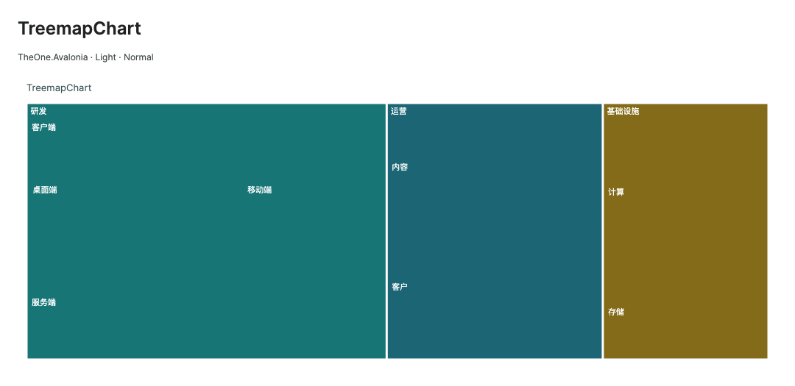
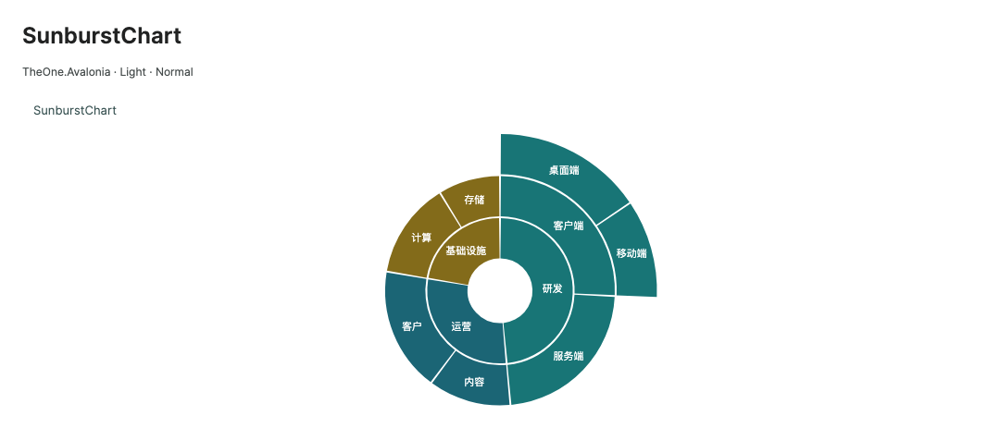

# TreemapChart and SunburstChart

`TreemapChart` represents hierarchy weights through nested rectangular areas. `SunburstChart` represents the same hierarchy through concentric sectors. Both draw natively and cache layout and hit information without creating a control for each node. See [Charts](charts.md) for common titles, themes, animation and PNG export.

<!-- visual-guide:start -->
## Appearance and example states

[Capture scope and visual index](visual-index.md). These are actual source-rendered examples; use this page’s usage notes for interaction and binding contracts.

### TreemapChart



Nested rectangle areas represent valid leaf weights; branches support drilling.

[View Dark comparison](../images/TreemapChart-dark.png)

### SunburstChart



Concentric rings express hierarchy and sector angles follow weights.

[View Dark comparison](../images/SunburstChart-dark.png)

<!-- visual-guide:end -->

## Data and binding

```csharp
using System.Collections.ObjectModel;
using TheOne.Avalonia.Controls;

public ObservableCollection<ChartHierarchyNode> Departments { get; } =
[
    new("Engineering", 0, "engineering")
    {
        Children = new ObservableCollection<ChartHierarchyNode>
        {
            new("Client", 45, "client"),
            new("Server", 55, "server")
        }
    },
    new("Operations", 30, "operations")
];
```

```xml
<one:TreemapChart ItemsSource="{CompiledBinding Departments}"
                  Title="Department allocation" Gap="3" HeaderHeight="20" />
<one:SunburstChart ItemsSource="{CompiledBinding Departments}"
                   Title="Department hierarchy" InnerRadius="0.18" RingGap="2" />
```

`ItemsSource` is the authoritative business source. The control owns the inherited `SeriesSource`, exposing a flattened projection for common selection, keyboard and export infrastructure; do not bind, replace or mutate that projection. `SelectedSeriesIndex` uses `0`. `SelectedIndex` is a depth-first preorder index and may change after structural edits. Prefer `SelectedNode` or `Key` in business code.

## ChartHierarchyNode

| Property | Type / default | Meaning |
| --- | --- | --- |
| `Label` | `string?` / `null` | Inherited from `ChartPoint`; node text and tooltip name. |
| `Y` | `double` / `0` | Leaf weight; only finite positive values participate. |
| `X` | `double` / `0` | Inherited member; hierarchy charts do not use it as a coordinate. |
| `Key` | `string?` / `null` | Optional case-sensitive application identity; keep it unique across the forest. |
| `Children` | `IList<ChartHierarchyNode>?` / separate `ObservableCollection` | Child items. A nonempty collection replaces the parent's own `Y` with the sum of valid child weights. |
| `Brush` | `IBrush?` / `null` | Optional branch color. Descendants inherit the closest explicit ancestor brush; otherwise the theme palette is used. |

Construct an item with `new ChartHierarchyNode("Client", 45, "client")`. Parent and child weights are never counted twice. Zero, negative, NaN and infinite leaf weights occupy no area or angle. A branch with children but no valid positive child weight is omitted. Scaled logarithmic aggregation avoids overflow when several very large finite weights are added.

## Navigation and selection

| Additional property / API | Meaning and short example |
| --- | --- |
| `Root` | Two-way `ChartHierarchyNode?`. Null displays the complete forest; a branch displays its descendants. Set `ItemsSource` before `Root`. Example: `Root="{CompiledBinding CurrentBranch, Mode=TwoWay}"`. |
| `SelectedNode` | Read-only original selected item, or null. `var key = chart.SelectedNode?.Key;`. |
| `CanDrillUp` | Read-only; true when `Root` is non-null. `backButton.IsEnabled = chart.CanDrillUp;`. |
| `HasInvalidHierarchy` | Read-only; cycles, repeated object references or duplicate keys were encountered. |
| `DrillDown(node)` | Returns whether a reachable branch containing positive children was opened. Leaves return false. Check for null before calling `chart.DrillDown(chart.SelectedNode!)`. |
| `DrillUp()` | Returns whether the previous level was restored; false at the complete forest. |
| `ResetRoot()` | Restores the complete forest. |
| `RefreshData()` | Refreshes ordinary `IList` structure and weights. Observable collections and node property changes refresh automatically. |
| `SelectionChanged` | Inherited event; `e.Selection?.Point` is the original `ChartHierarchyNode`. |

Double-click a hittable branch to drill down. In a treemap, use its header or exposed parent area. The application supplies a back action using `DrillUp()` or `ResetRoot()`. Keyboard navigation follows displayable flattened items. Cartesian pan, zoom and shared-X tooltips are not supported by these charts.

After add, remove, move, Reset, Replace or source replacement, selection follows object identity first. When the object is replaced, a key restores selection only if it was unique both before and after replacement. Duplicate keys never merge nodes. Removed, hidden or invalid-weight nodes clear selection. Removing the current root or turning it into a leaf resets to the forest and clears `CanDrillUp`; matching keys do not redirect the root to another object.

Traversal and layout use explicit stacks rather than recursion. When a graph contains a cycle or a shared node, only its first occurrence in source order is accepted; later edges are skipped and `HasInvalidHierarchy` is set. Fix the data and update the collection or call `RefreshData()` to clear the flag.

## TreemapChart options

| Property | Default | Meaning |
| --- | --- | --- |
| `Gap` | `3` | Logical-pixel space between sibling rectangles. `chart.Gap = 4;`. |
| `HeaderHeight` | `20` | Maximum parent header height. It shrinks when space is limited; disabling `ShowDataLabels` removes header reservation. |

The stable slice-and-dice layout alternates its splitting direction at each level and retains source order. This is not a squarified layout; skewed data can produce narrow rectangles. Weights determine allocated area before spacing and header reservation. Headers and gaps consume space inside that allocation rather than adding weight. Text is drawn only when it fits; tooltips and selection retain the complete name.

## SunburstChart options

| Property | Default | Meaning |
| --- | --- | --- |
| `RingGap` | `2` | Logical-pixel spacing between rings and adjacent sectors. |
| `StartAngle` | `-90` | Clockwise start angle in degrees; -90 starts at the top. |
| `InnerRadius` | `0.18` | Inherited property with a smaller Sunburst default; fraction of the outer radius, in `[0,1)`. |

Children subdivide only their parent's angular interval. The deepest visible descendant determines the ring count. Hit testing checks both radius and angle, excluding the central hole, ring gaps, sibling gaps and points outside tiny sectors. A label is drawn only when all four corners of its text bounds fit inside the sector.

## Updates, caches and export

A leaf `Y` change updates only its ancestor weight caches while retaining the tree index, flattened projection and existing subscriptions. Layout is rebuilt before the next draw. Structural edits rebuild preorder indexes while adding subscriptions only for new nodes and collections and releasing those that left; shared collections are observed once. Detaching releases observers, and attaching synchronizes again.

Layout preparation caches rectangles or sectors, text, brushes, pens and hit regions. Stable drawing does not enumerate the business tree or create per-node controls. Common `AnimationStyle`, `IsAnimationEnabled` and motion settings apply; charts over the soft budget present the target directly. Export clones the accepted hierarchy and current root, copies appearance settings and renders the final state without animation or mutations to the running chart.

A separate measurement cache retains up to 16,384 node labels. Weight changes reuse FormattedText when node identity, text, font, culture, direction and label paint match. Structural reconciliation removes departed nodes, and detaching releases the cache. Font, theme or foreground context changes invalidate it. Rectangle fitting still uses actual measured dimensions, and Sunburst still checks all four text corners against the sector; additional nodes are not hidden for performance.

When text still uses the default theme One.Chart.Text brush, opaque solid fills automatically choose whichever of black and white provides better contrast. Translucent solid fills over a known opaque background use their composite color. Gradients or unknown backgrounds retain the existing foreground. Explicit local or bound Foreground values, and custom style brushes that differ from the default theme text brush, preserve the consumer's choice. For complex transparency, set an explicit value such as Foreground="White". Automatic choices reuse shared brushes rather than allocating a brush per node.

Automatic contrast observes only the distinct mutable solid fills and background brushes actually used. In-place Color/Opacity edits refresh label paint; replacing a brush releases the old observer, and detaching releases every observer. Export snapshots preserve the source's automatic or explicit paint policy without subscribing to external brushes. Call RefreshData() for an off-tree chart or after changing the current thread culture before reading layout. Ancestor brush resolution for exceptionally deep trees remains a future optimization; inheritance rules are unchanged in this pass.

```csharp
chart.DrillDown(Departments[0]);
chart.ExportPng("department.png", new Avalonia.Size(1200, 800), dpi: 144);
chart.ResetRoot();
```

Validation is limited to the new hierarchy controls and their directly affected chart infrastructure. See the corresponding targeted report for measured results and desktop platform coverage.
