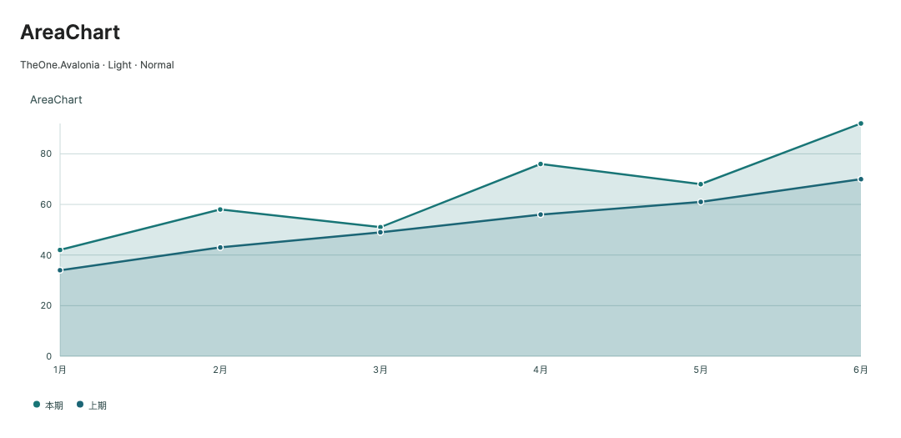
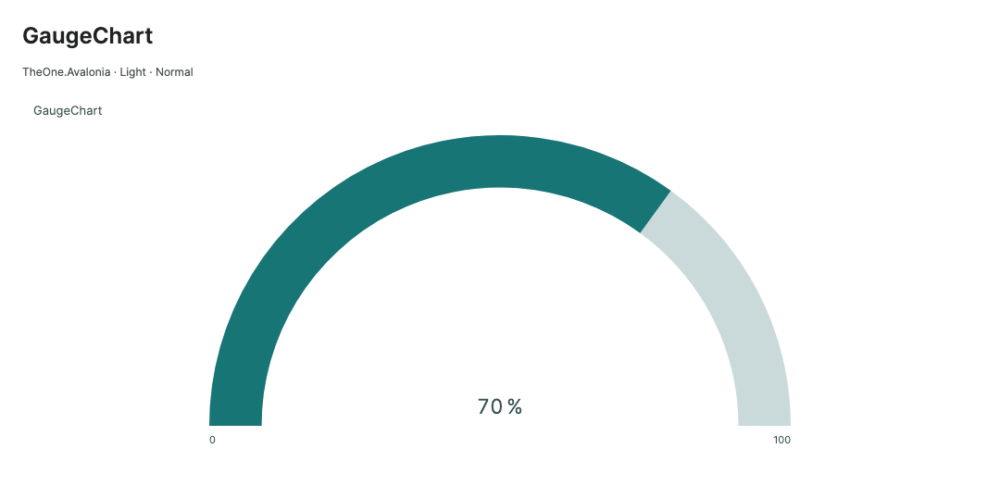

# Chart updates, export, and sizing

Historical command-line checks and consumer test projects have been removed. Check coverage and measurements in this guide are historical records. Start PreviewHost normally and open the relevant control page; validate target-platform behavior in the consuming application.

[简体中文](../zh-cn/chart-rendering.md) · **English**

See [charts](charts.md) for models and setup.

<!-- visual-guide:start -->
## Appearance and example states

[Capture scope and visual index](visual-index.md). These are actual source-rendered examples; use this page’s usage notes for interaction and binding contracts.

### AreaChart



Area fill emphasizes trend magnitude without changing source values.

[View Dark comparison](../images/AreaChart-dark.png)

### GaugeChart



Distinguishes the current value from the remaining range; the preview contains additional gauge styles.

[View Dark comparison](../images/GaugeChart-dark.png)

<!-- visual-guide:end -->

## Data update animation

All 21 chart controls derived from `ChartBase` share the same animation settings, including Heatmap, Radar, Funnel, BoxPlot, Candlestick, Treemap and Sunburst. `AnimationStyle` is a validated `ChartAnimationStyle` enum; the default is `Auto`.

| AnimationStyle | First nonempty presentation | Subsequent data changes |
| --- | --- | --- |
| `Auto` | Reveal the prepared plot from left to right | Compatible Cartesian frames interpolate coordinates; structural changes crossfade cached data layers. Pie / doughnut interpolate angles and gauges interpolate value, arc and needle. All specialized types, including the statistical and hierarchy charts, fade their prepared target plot. |
| `None` | Immediate target frame | Immediate target frame |
| `Fade` | Fade in the prepared plot | Fade in the prepared target plot |
| `Reveal` | Reveal from left to right | Reveal the prepared target plot from left to right |

```xml
<!-- The containing view declares x:DataType for the Revenue property. -->
<one:LineChart IsSmooth="True"
           SeriesSource="{CompiledBinding Revenue}"
           AnimationStyle="Reveal" AnimationDuration="0:0:0.2" />

<!-- Alternatively choose the same effect through a theme class. -->
<one:LineChart SeriesSource="{CompiledBinding Revenue}"
           Classes="animation-fade" />
```

The public animation classes are `animation-fade`, `animation-reveal` and `animation-none`. If several are present, precedence is **animation-none > animation-reveal > animation-fade**, independent of their order in `Classes`. An explicit local `AnimationStyle` value takes precedence over these class setters; remove the local value when classes should control the effect. No animation class means the default `Auto` behavior.

`IsAnimationEnabled` defaults to `True`; `AnimationDuration` is a `TimeSpan`, default 200 ms, accepting zero to 10 seconds. The first nonempty plot animates once, rather than replaying merely because the chart was detached and reattached. Geometry or legend queries before the first drawing prepare target coordinates without consuming this initial effect. In Cartesian `Auto` data transitions, axes show their target state immediately. Specialized `Auto` updates fade the complete prepared target plot, including their axes, just as `Fade` does; `Reveal` clips the prepared plot from left to right. Titles and legends remain stable. Continuous updates coalesce preparation without changing model values, original indices, sampling, hit testing, selection, or viewport. Radial sectors match original indices; new sectors grow from zero and removed sectors disappear in automatic data transitions. Keep source order stable in business code if identities must persist across reordering.

Animation is bounded to **6,000 prepared/rendered marks** across the chart, rather than 6,000 source rows or a separate budget per series. `Auto` also checks the old Cartesian/radial layer before capturing it. Larger layers show the target immediately. Charts with a logical side greater than **4,096**, or logical area greater than **4,194,304**, also skip motion. Sampling can reduce the rendered mark count; it does not make unrestricted source preparation free.

`AnimationStyle=None`, `IsAnimationEnabled=False`, zero duration, `Motion.Enabled=False`, disabling or hiding the chart immediately completes an active animation to the target frame. Detaching stops callbacks and releases transient animation state; queued callbacks from old transitions cannot restart it. Changing animation style ends the current transition; the new choice applies to the next data change. Size, theme, style, viewport, and navigation changes apply directly. Read-only `IsAnimating` / `AnimationProgress` expose state; progress notifications dispatch on the UI thread instead of synchronously changing bindings while drawing.

Hover overlays pause during animation. Pointer / keyboard input and geometry queries such as `GetDataPointPosition`, `HitTestDataPoint`, and `GetSharedDataPoints` first finish to target geometry, ensuring hits match display without changing selection. Disable update animation when business code needs per-frame coordinates.

Animation reuses prepared geometry instead of rebuilding data subscriptions. Compatible Cartesian transitions allocate their source-point lookup, frame, point arrays and label anchors once per transition; ticks update coordinates in place. Multiple render passes at the same progress reuse their prepared paths. Labels retain the target layout and interpolate existing anchors, without repeating label collision placement every tick. Scatter text layouts retain the active interpolation frame. Pie / doughnut reuse the latest sector geometry and formatted label; cache size is bounded by the current sectors. Fade / Reveal reuse target geometry, and the animation-frame callback is created once per transition. This reduces repeated preparation and allocations; it does not eliminate the raster work of visible marks or claim a guaranteed frame time. PNG export always renders an independent **target-state** snapshot, regardless of the current animation progress.

For the ECharts reference behavior, see [data transitions](https://echarts.apache.org/handbook/en/how-to/animation/transition/). Historical performance tables below retain their dates and original measurement conditions; they are not measurements of the new animation styles.

## PreviewHost construction and visible content

Each chart retains an independent page with labeled configuration variants. The first sample is created immediately; other variants, offscreen animation sections and highlighted code examples are created synchronously only when their reserved region intersects the actual viewport. Scrolling reveals every example; this does not replace the grid with a single selector or omit content. Temporary measurement estimates reserve space before creation; after creation, content uses its actual desired size without a forced placeholder height. Created content is reused on scrolling and reattachment.

Small display-only samples no longer construct the interactive editor view model for each chart. Each static chart owns its series wrappers, so legend visibility remains independent; the animated example uses separate point models. The interactive editor is still created on explicit expansion. The first visible highlighted code editor retains its real creation/layout cost; deferring offscreen examples reduces unnecessary work, without promising to remove visible rendering costs or moving them to a Dispatcher callback.

## PNG export

Call `ExportPng` on the UI thread to write a writable stream or file. `Size` uses logical pixels; output pixels equal `ceil(logical size × dpi / 96)`:

```csharp
using Avalonia;

// 800 × 560 逻辑像素，192 DPI，输出 1600 × 1120 PNG。
using var output = File.Create("revenue.png");
RevenueChart.ExportPng(output, new Size(800, 560), 192);

// 透明画布，保留系列、标签和图例的主题颜色。
RevenueChart.ExportPng("revenue-transparent.png", new Size(800, 560), 96, true);
```

Both overloads have `ExportPng(destination, Size? size = null, double dpi = 96, bool transparentBackground = false)`, where `destination` is a `Stream` or path. Omitted size uses valid current dimensions, or `DefaultChartWidth` / `DefaultChartHeight` before layout. An independent final-data snapshot exports the target frame even during animation, preserving viewport / legend page. Crosshairs, hover / selection emphasis, focus borders, and tooltip popups are omitted. Original size, viewport, animation, selection, and bindings remain unchanged. Transparent mode skips canvas background only, retaining semantic brushes needed by labels. Callers own supplied-stream lifetime.

Logical dimensions must be finite and positive; DPI must be `[16, 600]`. Output sides must not exceed 8,192 pixels or total area 16,777,216 pixels. Validation occurs before bitmap allocation and throws `ArgumentOutOfRangeException` for out-of-range requests. The limit represents about 64 MiB RGBA data, not total export memory. Streams must be non-null and writable. Export is synchronous; invoke large exports on an explicit user request.

Use Avalonia `StorageProvider.SaveFilePickerAsync` and pass the stream from `IStorageFile.OpenWriteAsync()` to export, supporting providers without local paths.

## Data updates and performance

`ChartPoint` and `ChartSeries` inherit `AvaloniaObject`; property changes refresh mounted charts. Observable `SeriesSource` and series `ItemsSource` collections update subscriptions by membership: Add / Remove / Replace touch changed references only; Move keeps subscriptions intact. Reset reconciles the notifying collection, retaining unchanged model subscriptions. Replacing a series `ItemsSource` inspects only that series's new source. Replacing `SeriesSource` or explicitly refreshing reconciles current series and point lists, preserving shared references. Detaching releases subscriptions; reattaching reads current data.

The same series, point, or point collection may appear more than once. Each distinct model is observed once per chart, and each point collection has one collection handler; subscriptions remain active until the last owner is removed. Removed sources and models no longer trigger updates. Subscription ownership uses reference identity; selection continues to use source indices.

Create / modify chart models and collections and call `RefreshData()` on the UI thread. After fetching data in the background, dispatch updates back to it:

```csharp
using Avalonia.Threading;

await Dispatcher.UIThread.InvokeAsync(() =>
{
    viewModel.Revenue[0].ItemsSource!.Add(new ChartPoint(5, 81, "五月"));
    viewModel.Revenue[0].ItemsSource![0].Y = 45;
});
```

`List<ChartPoint>` can also supply data; call `RevenueChart.RefreshData()` after list-content changes. Point property notifications remain automatic. For batches, replace `ItemsSource` once or mutate a plain list and refresh once to reduce notifications and invalidations. Cartesian charts cache data extents and per-index stacks independently of drawing frames; coordinate changes update affected columns, while structural/source changes rebuild membership. A selection that reveals an offscreen point can still prepare geometry synchronously.

Selection repaints emphasis using prepared positions, bars, and sectors. In sampled Cartesian charts, cached originals and a selection-independent base sample let a previously omitted original enter only its affected segment; axes, ranges, stacks and hit indices remain. Switching or clearing selection removes the old extra sample, so retained points do not accumulate. Labels are prepared again for the resulting visible sample. Revealing an offscreen original may change the viewport and rebuild transformed geometry. Selection ends an in-progress data animation before presenting the selected target data.

Charts have no per-point UI containers, so collection recycling panels do not apply. Preparation, original-point lookup indices, and model memory still grow with data. Sampling reduces drawn vertices but does not replace paging or remote virtualization. Bound data volume and chart dimensions in business code.

### First-stage subscription measurements (2026-10-18)

Historical first-stage results, before the range/stack/drawing caches described below. Scope: the 13 series charts; Gauge has no series subscriptions. Public properties and business APIs are unchanged. The baseline uses the chart implementation at `e083204` with the same measurement harness. macOS 27.0.1 / ARM64, .NET 10.0.0, Release, Skia headless, 900 × 420, three series of 1,000 or 10,000 points each; animations, markers and legends disabled. Ordinary scenarios disable sampling; sampled scenarios use MinMax, threshold 100 and budget 128. Each scenario warms up 8 operations and measures 32. The table fixes `DOTNET_TieredCompilation=0` for both processes; this is a measurement setting, not a recommended application setting.

Each cell is **before → after**. Notification time is synchronous mutation / selection time. Settled time includes that notification, dispatcher, layout and the headless render tick; it is not GPU or screen presentation latency. Allocations are median current-UI-thread bytes during the synchronous operation. Add/remove scenarios perform two notifications per operation; the extra series contains 8 points. Selection uses visible points and the default viewport.

| Points per series | Scenario | Notification median ms | Settled median ms | Notification allocation B |
| ---: | --- | ---: | ---: | ---: |
| 1,000 | `point-add-remove` | 0.3640 → 0.0118 | 4.257 → 5.487 | 1,320,616 → 1,312 |
| 1,000 | `point-replace` | 0.2399 → 0.0159 | 4.408 → 6.008 | 660,512 → 1,048 |
| 1,000 | `point-move` | 0.2133 → 0.0098 | 4.031 → 5.949 | 660,488 → 600 |
| 1,000 | `series-add-remove` | 0.3532 → 0.0212 | 3.977 → 5.995 | 1,322,168 → 3,880 |
| 1,000 | `select-line` | 1.5376 → 0.0117 | 3.253 → 2.784 | 1,331,304 → 936 |
| 1,000 | `select-bar` | 1.4792 → 0.0239 | 4.868 → 6.562 | 1,577,112 → 936 |
| 1,000 | `select-sampled-endpoints` | 1.6316 → 0.0121 | 2.734 → 1.992 | 1,367,536 → 968 |
| 1,000 | `select-sampled-interior` | 1.5876 → 2.8806 | 2.675 → 5.094 | 1,367,632 → 1,367,664 |
| 10,000 | `point-add-remove` | 10.5573 → 0.0257 | 35.440 → 36.817 | 12,884,568 → 1,312 |
| 10,000 | `point-replace` | 2.7012 → 0.0212 | 29.985 → 30.110 | 6,442,488 → 1,048 |
| 10,000 | `point-move` | 2.9542 → 0.0192 | 31.798 → 29.950 | 6,442,464 → 600 |
| 10,000 | `series-add-remove` | 12.2339 → 0.0299 | 37.938 → 31.290 | 12,886,120 → 3,880 |
| 10,000 | `select-line` | 8.7050 → 0.0252 | 24.042 → 19.489 | 6,813,888 → 936 |
| 10,000 | `select-bar` | 12.6793 → 0.0328 | 60.736 → 42.757 | 6,821,840 → 936 |
| 10,000 | `select-sampled-endpoints` | 12.1532 → 0.0090 | 17.767 → 4.450 | 6,947,976 → 968 |
| 10,000 | `select-sampled-interior` | 11.0652 → 11.6682 | 16.240 → 16.860 | 6,948,064 → 6,948,096 |

For 32 point-Replace / Move operations, enumeration of the existing source collections drops from 128 to 0 and their collection-handler additions/removals from 128/128 to 0/0. The same zero-churn result holds for existing collections in Add / Remove and series Add / Remove scenarios; initializing the new series source is intentionally excluded from those counters. Ordinary Line / Bar selection and retained sampled-endpoint selection reduce geometry invalidations and Cartesian-frame replacements from 32 to 0. Newly omitted sampled selections still produce 32 rebuilds.

This first stage improved notification work and allocations, without consistently reducing complete rendering. Two default-tiered-JIT runs also varied: 10,000-point-per-series Bar selection settled medians were 31.91–36.98 ms before and 25.73–42.10 ms after; omitted-sample selection at 1,000 points per series was 2.89–3.23 ms before and 5.24–5.27 ms after. These historical results motivated the next cache stage; they do not establish a frame-rate improvement for those first-stage paths.

The measurement entry records medians, p95, allocations, source enumerations, collection-handler changes, geometry invalidations and frame replacements. Before / after JSON, default-JIT repeat runs, logs and a comparison table are retained under `.preview/chart-refresh/`; this authored table is the repository record. Measurements are local headless observations, not Windows/Linux runs, NativeAOT results, or production latency guarantees.

### Cartesian range, stack and drawing caches

This stage affects the 11 Cartesian chart types: Line, Area, Scatter, Bar, HorizontalBar, the three Stacked variants and the three PercentStacked variants. It does not change Pie, Doughnut or Gauge rendering, properties, classes or business APIs.

- A range tree holds X and per-axis Y extents by original source index. A coordinate update recomputes only the affected columns and their aggregate ancestors. Stack/percentage calculations remain independent per axis and sign, preserving canonical-X gaps, zero values and overflow handling. Shared/duplicate points update each affected column once. Moving an extremum inward is handled by the aggregate tree without scanning all other columns.
- If a Y change preserves validity, segment topology, axis mapping and visible bar slots, it patches original positions, hit buckets/bars, and affected paths in the existing frame. Only marks on the affected stack axis need geometry changes. Numeric sampled segments use the incremental bucket index described below, without rescanning the original segment.
- Selecting an omitted original uses binary lookup in cached originals and insertion into the base sample, rather than resampling all original points. Only the previously/newly affected segment paths and sampled labels change. Clearing selection restores the base sample. Pointer/keyboard selection, original identity and viewport reveal retain their existing behavior.
- Line and area `StreamGeometry` objects are reused until their segment changes. Cartesian text drawing has a bounded 512-entry per-frame cache. Style, viewport, layout and font changes create fresh geometry; text/brushes continue to follow the theme. No per-point controls or screen-bitmap cache are introduced.

Fallbacks are deliberate: X changes, gaps becoming valid/invalid, stacked-area sign transitions, zero/nonzero bar transitions, changed axis ranges and newly appearing/disappearing clipped bars rebuild the drawing frame. The range/stack cache still updates only the affected columns. Collection Add / Remove / Move / Replace / Reset, source replacement, explicit `RefreshData()`, visibility/axis membership changes rebuild data membership. Detaching releases the model/range cache. Existing bounded data animations retain full animation-frame preparation when motion is enabled and the current frame has at most 6,000 marks; large exact frames that already suppress animation can take the patch path.

Caches retain model membership, range aggregates and original coordinates, increasing retained O(data volume) memory and initial preparation work. This is CPU/memory reuse, not data virtualization. Sampling and `ShowMarkers="False"` reduce drawing work, but rasterizing a long path or painting many bars still has a cost. Theme/font/layout changes intentionally invalidate drawing caches, without discarding unchanged data aggregates. Local/full-preparation pixel comparisons also cover a 260 × 240 narrow viewport across both themes and all three sizes.

```csharp
// Use the existing observable models on the UI thread; no new API is needed.
series.ItemsSource![index].Y = nextValue;
chart.SelectedIndex = originalIndex; // An omitted sample reuses the prepared frame.
// Call RefreshData() only after silently changing plain-list contents.
```

### Second-stage geometry-cache measurements (2026-10-18)

The baseline is the previous incremental-subscription implementation at the start of this stage, frozen in `before-artifacts`; it is not the earlier `e083204` implementation. Both runs use macOS 27.0.1 ARM64, .NET 10.0.0, Release, Skia headless, `DOTNET_TieredCompilation=0`, 900 × 420, three series and identical sine-wave data. Animations, markers and legends are disabled. Except `select-omitted` (MinMax, threshold 100, budget 128), scenarios disable sampling. Each warms up 16 operations and measures 32; median and nearest-rank p95 are recorded. Ordinary Y changes alternate 21/22 inside existing extents; `line-extremum` alternates 50/60 to change the automatic range, and `line-x` changes an interior X. `select-paint` switches existing endpoints without resampling.

Each value is **before → after**. Synchronous time includes the setter/notification and any synchronous selection work; settled time additionally includes dispatcher/layout/headless rendering. Settled allocation is current-UI-thread bytes across that whole interval. These figures exclude GPU/display presentation. Frame replacements count whole-frame object changes across 32 operations, not native raster draw calls.

| Points per series | Scenario | Sync median ms | Settled median ms | Settled p95 ms | Settled allocation B | Frame replacements |
| ---: | --- | ---: | ---: | ---: | ---: | ---: |
| 1,000 | `line-y` | 0.0056 → 0.0031 | 3.7089 → 1.3365 | 7.7179 → 1.6640 | 1,417,888 → 77,488 | 32 → 0 |
| 1,000 | `line-x` | 0.0026 → 0.0038 | 3.6178 → 3.3457 | 6.9697 → 7.2635 | 1,358,896 → 1,418,904 | 32 → 32 |
| 1,000 | `line-extremum` | 0.0028 → 0.0074 | 3.4599 → 3.2195 | 7.9621 → 6.8861 | 1,452,976 → 1,455,592 | 32 → 32 |
| 1,000 | `area-y` | 0.0028 → 0.0048 | 4.0124 → 1.6716 | 7.1083 → 2.2310 | 1,319,872 → 78,256 | 32 → 0 |
| 1,000 | `bar-y` | 0.0025 → 0.0058 | 5.2390 → 3.4257 | 6.7759 → 3.8791 | 1,703,552 → 90,992 | 32 → 0 |
| 1,000 | `stacked-bar-y` | 0.0025 → 0.0051 | 3.9355 → 1.4012 | 7.4242 → 1.8276 | 2,094,176 → 97,632 | 32 → 0 |
| 1,000 | `stacked-area-y` | 0.0023 → 0.0048 | 4.3504 → 2.0432 | 6.4923 → 4.4865 | 1,863,008 → 88,088 | 32 → 0 |
| 1,000 | `percent-bar-y` | 0.0035 → 0.0033 | 4.2589 → 1.4847 | 7.8183 → 1.8405 | 2,070,536 → 101,008 | 32 → 0 |
| 1,000 | `percent-area-y` | 0.0019 → 0.0036 | 3.6225 → 0.8801 | 7.5747 → 1.1873 | 1,847,512 → 91,512 | 32 → 0 |
| 1,000 | `select-omitted` | 1.7453 → 0.0030 | 2.9552 → 1.0034 | 6.4562 → 1.2988 | 1,463,832 → 80,064 | 32 → 0 |
| 1,000 | `select-paint` | 0.0028 → 0.0026 | 1.6558 → 1.3064 | 2.1664 → 1.5165 | 96,960 → 77,040 | 0 → 0 |
| 10,000 | `line-y` | 0.0075 → 0.0052 | 23.4702 → 11.9880 | 26.8788 → 12.4250 | 6,972,216 → 58,288 | 32 → 0 |
| 10,000 | `line-x` | 0.0060 → 0.0094 | 22.7644 → 20.0450 | 27.0378 → 22.4590 | 6,925,272 → 6,905,864 | 32 → 32 |
| 10,000 | `line-extremum` | 0.0060 → 0.0087 | 19.4625 → 16.8521 | 23.9716 → 19.6971 | 6,893,480 → 6,835,360 | 32 → 32 |
| 10,000 | `area-y` | 0.0101 → 0.0055 | 27.5882 → 13.8933 | 29.9900 → 14.2987 | 6,872,384 → 59,056 | 32 → 0 |
| 10,000 | `bar-y` | 0.0121 → 0.0057 | 43.6016 → 27.2284 | 52.2981 → 28.0128 | 7,057,032 → 220,456 | 32 → 0 |
| 10,000 | `stacked-bar-y` | 0.0118 → 0.0050 | 26.4908 → 9.0752 | 34.0675 → 9.8523 | 10,536,488 → 229,688 | 32 → 0 |
| 10,000 | `stacked-area-y` | 0.0079 → 0.0130 | 32.9540 → 15.4129 | 37.1892 → 15.8615 | 10,373,240 → 68,992 | 32 → 0 |
| 10,000 | `percent-bar-y` | 0.0070 → 0.0052 | 27.5493 → 9.5905 | 34.6526 → 10.4497 | 10,547,024 → 233,064 | 32 → 0 |
| 10,000 | `percent-area-y` | 0.0077 → 0.0050 | 25.1682 → 4.4891 | 30.7451 → 4.6916 | 10,282,248 → 72,192 | 32 → 0 |
| 10,000 | `select-omitted` | 9.4645 → 0.0033 | 13.4702 → 3.0072 | 20.5185 → 3.1740 | 6,981,264 → 61,920 | 32 → 0 |
| 10,000 | `select-paint` | 0.0083 → 0.0046 | 15.2876 → 11.3818 | 15.7846 → 11.7171 | 71,480 → 57,864 | 0 → 0 |

Interior Y updates and omitted-point selections eliminate all 32 whole-frame replacements in these immediate-rendering scenarios. At 10,000 points per series, Line Y updates reduce settled time from 23.470 to 11.988 ms and allocations from 6,972,216 to 58,288 B; StackedBar Y updates go from 26.491 to 9.075 ms. Omitted-point selection goes from 13.470 to 3.007 ms and from 6,981,264 to 61,920 B. X and automatic-extremum updates still replace 32 frames; they reuse data aggregates without promising constant-time remapping. Bar/path rasterization remains visible in settled time. This local run is not an FPS guarantee or Windows/Linux/GPU/NativeAOT result.

JSON, before/after binaries, logs and a full comparison (including synchronous allocation and p95) remain under `.preview/chart-geometry/`. The table above is the durable repository record. The separate first-stage table is retained for historical comparison; its omitted-selection rebuild behavior has been superseded by this stage.

<a id="incremental-sampling-buckets"></a>
### Incremental sampling buckets

This stage affects **LineChart, AreaChart, ScatterChart, StackedAreaChart and PercentStackedAreaChart** only. Public properties, classes and APIs are unchanged.

- Full preparation still uses the linear MinMax sampler. It additionally caches the monotonic-X visible interval (including its neighboring points), source-ordered bucket boundaries, and a tree of top/baseline extrema offsets. A mapping-stable Y update repairs only changed leaf paths and queries affected buckets. Shared models repair all changed leaves before any bucket query; all unchanged bucket representatives are reused.
- Bucket first/last points and both top/baseline minima/maxima remain retained. Equal extrema keep the earliest original source offset, including descending/equal X. Selection is applied after the base sample and may add one original point. Clearing selection restores that base sample. Gap/sign boundaries and the per-series, proportional **soft** budget are unchanged; heavily fragmented data can exceed it.
- Originals outside the cached interval reuse the base sample. Sampling disabled, below-threshold, short and nonmonotonic segments reuse exact originals without repeating the eligibility scan on each Y change. An initially unreduced sample still maintains its index, so later extrema changes can reduce it correctly. Nonfinite mapped coordinates retain the linear fallback.
- With V cached originals, B occupied buckets, k changed offsets and q affected buckets, sampling maintenance costs O(k log V + q log V + B log B), rather than scanning the entire segment. The final sample merge and affected path drawing still cost work proportional to retained samples. Stack changes can affect multiple series. These bounds describe sampling maintenance, not the entire frame or GPU latency.
- Initial preparation adds O(V) tree work/memory. Each tree stores four 32-bit source offsets per node; its array uses `32 × nextPowerOfTwo(V)` bytes (about 4 MiB for 100,000 visible originals in one segment), plus bucket/object overhead and existing original-coordinate caches. Unsampled segments have no tree. X/topology/range, viewport/layout and sampling-configuration changes prepare a new index; collection/source replacement and detach follow the existing cache lifecycle. No persistent bitmap or per-point control is added.

### Third-stage incremental-bucket measurements (2026-10-18)

The Release build and all **3,212** scoped checks passed on the host. No unrelated chart/control regression suite or native AOT publish was run for this private-cache change.

The baseline is the preceding range/stack/drawing-cache implementation, frozen in `.preview/chart-sampling/before-artifacts`. Both runs use macOS 27.0.1 ARM64, .NET 10.0.0, Release, Skia headless, `DOTNET_TieredCompilation=0`, 900 × 420, three series with 10,000/100,000 points each, and identical sine-wave data. MinMax threshold is 100 and per-series budget 128; animations, markers and legends are disabled. Y bounds are fixed at 0–150; interior Y alternates 21/22. `offscreen-y` uses LineChart and edits original index 10 after 8× zoom. Each case warms up 16 operations and measures 32. Initial index construction precedes warmup and is excluded from single-point update timing.

Each cell is **before → after**. Sync is property notification time. Settled time includes dispatcher/layout/headless drawing; allocation is current-UI-thread bytes over that interval. p95 uses nearest rank. The last column counts full-sampling loop iterations per operation (X-order checking and visible-bucket scanning), not indexed-query reads. Neither implementation replaces the whole frame in any of these 12 cases.

| Points per series | Scenario | Sync median ms | Sync p95 ms | Settled median ms | Settled p95 ms | Settled allocation B | Full-scan iterations/op |
| ---: | --- | ---: | ---: | ---: | ---: | ---: | ---: |
| 10,000 | `line-y` | 0.1687 → 0.0090 | 0.2113 → 0.0202 | 1.1218 → 0.9095 | 1.9954 → 1.5663 | 72,048 → 80,968 | 19,999 → 0 |
| 10,000 | `area-y` | 0.1644 → 0.0136 | 0.1784 → 0.0505 | 1.3065 → 1.2529 | 1.7880 → 1.8137 | 72,824 → 69,360 | 19,999 → 0 |
| 10,000 | `scatter-y` | 0.1580 → 0.0130 | 0.2007 → 0.0462 | 1.7535 → 1.7287 | 4.8027 → 4.3322 | 464,416 → 460,952 | 19,999 → 0 |
| 10,000 | `stacked-area-y` | 0.4743 → 0.0270 | 0.5143 → 0.0808 | 2.6304 → 2.3020 | 3.1013 → 2.6702 | 97,704 → 87,232 | 59,997 → 0 |
| 10,000 | `percent-area-y` | 0.4605 → 0.0144 | 0.4998 → 0.0528 | 0.9243 → 0.4941 | 1.3244 → 0.7506 | 94,584 → 97,872 | 59,997 → 0 |
| 10,000 | `offscreen-y` | 0.0697 → 0.0022 | 0.0826 → 0.0094 | 0.4120 → 0.3362 | 0.5005 → 0.4303 | 62,152 → 53,880 | 11,252 → 0 |
| 100,000 | `line-y` | 1.4753 → 0.0084 | 1.5100 → 0.0196 | 2.3470 → 0.8684 | 2.5056 → 0.9485 | 71,040 → 67,576 | 199,999 → 0 |
| 100,000 | `area-y` | 1.4826 → 0.0083 | 1.5325 → 0.0194 | 2.6150 → 1.1129 | 2.7682 → 1.3202 | 71,816 → 68,352 | 199,999 → 0 |
| 100,000 | `scatter-y` | 1.4755 → 0.0184 | 1.5067 → 0.0620 | 3.0988 → 1.8026 | 3.4598 → 4.0338 | 462,520 → 459,056 | 199,999 → 0 |
| 100,000 | `stacked-area-y` | 4.4181 → 0.0296 | 4.5017 → 0.0924 | 6.5371 → 2.2821 | 6.7417 → 2.6422 | 96,696 → 86,224 | 599,997 → 0 |
| 100,000 | `percent-area-y` | 4.4163 → 0.0142 | 4.5329 → 0.0396 | 4.9335 → 0.4670 | 5.1659 → 0.7693 | 105,656 → 95,184 | 599,997 → 0 |
| 100,000 | `offscreen-y` | 0.6460 → 0.0031 | 0.7860 → 0.0382 | 1.0432 → 0.3682 | 1.4949 → 0.6863 | 64,784 → 54,176 | 112,502 → 0 |

<a id="scatter-rendering-tail"></a>
### Scatter rendering tail latency

Only **ScatterChart** changes in this stage; public properties, classes and APIs are unchanged. Sampling, extrema/ties/gaps, the per-series soft budget, original-point hit testing, selected-point retention and selection reveal use the existing data paths. `ShowMarkers=False` still does not hide scatter points.

The previous 32-sample p95 observation alone does not establish a stable regression. This stage freezes the current library and records three rounds of 256 operations per scenario. At budget 2000, the baseline prepares 3,990 points across three series, records separate ellipses and creates a new mutable Pen for every visible point. The baseline median of round p95 values is 0.2109 ms for the update notification, 104.4647 ms for dispatcher/layout (which includes drawing-command recording), and 18.6441 ms for the render tick. All 39 samples in the slowest 5% of the combined baseline have an observed GC. These measurements support command/allocation pressure as a major source of tails; they do not attribute every delayed frame exclusively to GC.

- Built-in solid fills and null/solid outlines use one custom drawing operation per nonempty segment, sharing an immutable outline and cached coordinates. The compositor reads only immutable coordinates/brushes; it never reads a live data-model list. Mapping-stable selection now reuses the base coordinates and inserts the selected marker by source order; see the selection p99 section below.
- Rendering still issues separate ellipses in the original series/point order. It does not merge paths, quantize coordinates or combine transparent overlaps. Existing outer clipping, opacity/disabled states, radius/stroke settings and PNG export remain intact.
- Mutable built-in solid brushes are observed once per distinct brush. Color/opacity edits invalidate drawing; obsolete subscriptions are removed after the drawing pass, including when animations finish, and detach releases all subscriptions. Gradient, visual, tile and other custom brushes retain the original native ellipse path and its resource behavior.
- This reduces command recording and per-marker managed allocation, rather than eliminating raster work. The current base coordinate/index arrays add approximately 20 bytes per retained-sample capacity slot, plus small segment/operation overhead (the first batch implementation used coordinates only, at 16 bytes). With sampling disabled, that capacity may be the full original segment. Original indices, spatial hit buckets and sampling trees are unchanged. Large visible point sets still incur one ellipse fill/stroke per point; no bitmap cache or per-point controls are introduced.

#### Scatter measurements (2026-10-18)

Baseline: the current workspace library frozen before this change, with the preceding incremental-sampling optimization already present. Both versions use the same workload: macOS 27.0.1 ARM64, .NET 10.0.0, Release, Skia headless, `DOTNET_TieredCompilation=0`, 900 × 420 and three identical sine-wave series. Animations, legends and optional marker decoration are disabled; ScatterChart itself still draws the scatter points. MinMax threshold is 100, budget is 128 or 2000, and Y bounds are fixed at 0–150. `y` alternates the middle original's Y between 21/22; selection cases alternate omitted indices 50,013/50,017 or existing sample endpoints 0/99,999.

Each case has three rounds, each with 32 warmups followed by 256 samples; forced GC occurs before timing each round. Construction, warmup, JSON logging and PNG capture are excluded. Below, median/p95/p99 and allocation median use the pooled 768 samples per case, with nearest-rank quantiles. GC columns total observed collections across those samples for generations 0/1/2; counts overlap between generations. Every pair retains identical prepared point counts, zero full-sampling scans and zero whole-frame replacements.

Each cell is **before → after**; time is milliseconds, allocation is current-UI-thread bytes. Settled time includes the update, dispatcher/layout, drawing-command recording and headless render tick. It does not measure GPU/display latency or guarantee frame rate on another host.

| Scenario | Prepared points | Settled median ms | Settled p95 ms | Settled p99 ms | UI allocation median B | GC0/1/2 |
| --- | ---: | ---: | ---: | ---: | ---: | --- |
| `10k-y-128` | 252 | 1.6340 → 1.4590 | 4.1231 → 2.3327 | 5.5977 → 6.9196 | 460,912 → 66,568 | 62/40/20 → 23/22/18 |
| `100k-y-128` | 252 | 1.6133 → 1.3719 | 2.4394 → 1.6246 | 5.3314 → 4.5009 | 459,016 → 73,664 | 45/45/3 → 9/9/3 |
| `100k-y-2000` | 3,990 | 24.4545 → 17.0141 | 104.2413 → 17.7369 | 189.1705 → 18.5633 | 6,157,152 → 182,360 | 592/260/103 → 24/15/9 |
| `100k-select-omitted` | 253 | 1.5998 → 1.3731 | 2.4083 → 1.5557 | 4.3437 → 4.4983 | 457,112 → 70,336 | 45/21/3 → 9/6/3 |
| `100k-select-existing` | 252 | 1.5800 → 1.3619 | 2.4603 → 1.4900 | 4.2790 → 4.4625 | 452,304 → 65,448 | 42/18/3 → 6/3/3 |

For `100k-y-128`, per-round p95 ranges fall from 2.4165–2.6290 to 1.6031–1.6448 ms. At budget 2000, they fall from 104.2413–105.2264 to 17.6292–17.8710 ms. The median of round p95 dispatcher/layout times falls from 104.4647 to 0.1480 ms, while render-tick p95 remains 17.2819 ms. This separates the removed recording/allocation bottleneck from the remaining per-point raster work. Not every statistic improves: 10k Y and 100k selection p99 values remain noisy or increase, as shown above; this change does not promise uniformly lower extremes.

<a id="scatter-selection-p99"></a>
### Scatter selection p99 and allocation reuse

This follow-up changes **ScatterChart only**, without new public properties, classes or APIs. Its baseline is the preceding batched-ellipse implementation, not the earlier per-point Pen implementation. The drawing counters show three series batches for each settled selection in both versions, including the slow frames; an eight-change burst also settles in three batches. Reassigning the same selected index has zero recording/raster batches and zero measured allocation. No duplicate full drawing pass was found to remove.

The remaining avoidable work was preparation: copying the selected sample and coordinates, recreating stable pens/paint operations, and repeatedly formatting axis text. The sampled allocation profile showed glyph arrays, shaped runs and text lines. Avalonia's [FormattedText.Draw](https://github.com/AvaloniaUI/Avalonia/blob/12.1.4/src/Avalonia.Base/Media/FormattedText.cs) enumerates formatted lines when drawn; caching the FormattedText instance alone does not retain those lines. The fix uses [TextLayout](https://github.com/AvaloniaUI/Avalonia/blob/12.1.4/src/Avalonia.Base/Media/TextFormatting/TextLayout.cs) for retained axis/data-label lines, while keeping existing FormattedText metrics for layout decisions. The profiler is separate from timed measurements; allocation-tick estimates are sampling evidence, not exact per-type byte accounting.

- An omitted selected point is an immutable one-point splice over the base sample. Count and source-index order remain identical, including synchronous sampling diagnostics and selection events. The renderer retains base positions plus source indices and inserts the selected marker at its original drawing position. It copies no base coordinate array when selection alone changes. Clearing selection restores the same base sample; gaps, equal extrema, soft-budget overflow and original hit buckets are unchanged.
- Stable marker paint, drawing operations and the four axes/selected-ring/focus Pen slots are reused. Mutable pen brushes keep their normal native resource behavior. A changed color, opacity, radius, thickness, data source or mapping refreshes the appropriate state. Existing-sample selection can reuse all marker-operation instances; changing a pinned point replaces only its operation. Rasterization still draws all required ellipses in source order, preserving alpha overlap.
- Axis and data-label TextLayout caches are bounded to 512 entries per frame, with explicit culture, typeface, size and flow direction. Data-label measurements also reuse cached metrics. Layouts are disposed on eviction, when an obsolete frame leaves the active animation, on detach, and in export's finally block. Current frames, active animation sources and the reusable interpolation frame retain their layouts; obsolete interpolation frames are released. Title/legend text retains its previous path.
- Cached marker capacity now uses about 20 bytes per slot (position and source index); extra selection state has constant size rather than a sample-sized copy. Text caches add bounded retained glyph resources and first-use shaping work. A 512-entry bound is not a byte limit for arbitrarily long labels. No bitmap cache, skipped circles or extra per-point controls are introduced.

#### Selection measurement record (2026-10-18)

Both versions use macOS 27.0.1 ARM64, .NET 10.0.0, Release Skia headless, `DOTNET_TieredCompilation=0`, a 900 × 420 view and three series of 100,000 sine-wave points each. MinMax has threshold 100 and budget 128, or 2000 for the named variants; Y is fixed to 0–150, with legend and animation off. Existing-point selection alternates the endpoints; omitted-point selection alternates original indices 50013/50017. A burst changes selection eight times before one flush; no-op repeats index 0. Three rounds each warm up 32 operations and measure 256. The table pools all **768 operations per scenario**, using nearest-rank percentiles, rather than taking a median of round p99 values. GC columns sum collections observed inside timed windows across all three rounds; explicit pre-round collections are outside those windows.

Each cell is **before → after**. The complete cycle includes the synchronous update, dispatcher/layout and render tick. Allocation is the median byte count for the current UI thread over that cycle, excluding other threads and native memory. The point count is retained across all three series and is identical in both versions; a budget is a per-series soft limit, not an exact requested count.

| Scenario | Retained points | Cycle median ms | Cycle p95 ms | Cycle p99 ms | Cycle allocation B | GC 0/1/2 |
| --- | ---: | ---: | ---: | ---: | ---: | --- |
| `100k-select-omitted` | 253 | 1.3835 → 1.3026 | 1.6037 → 1.4222 | 4.5730 → 1.6409 | 70,360 → 13,144 | 9/9/3 → 3/3/3 |
| `100k-select-existing` | 252 | 1.4172 → 1.3518 | 1.7393 → 1.6572 | 2.3352 → 2.0820 | 65,472 → 12,960 | 6/3/3 → 3/3/3 |
| `100k-select-omitted-2000` | 3,991 | 17.0943 → 16.8964 | 17.9505 → 17.7998 | 19.0080 → 19.7188 | 140,400 → 13,408 | 21/15/9 → 9/9/9 |
| `100k-select-existing-2000` | 3,990 | 17.0967 → 16.9578 | 18.2200 → 17.5817 | 20.3327 → 18.0221 | 65,736 → 13,224 | 12/9/9 → 9/9/9 |
| `100k-select-noop` | 252 | 0.0000 → 0.0000 | 0.0001 → 0.0001 | 0.0001 → 0.0002 | 0 → 0 | 0/0/0 → 0/0/0 |
| `100k-select-burst` | 253 | 1.4085 → 1.3114 | 1.7252 → 1.4407 | 5.1392 → 1.7403 | 97,160 → 16,360 | 9/6/3 → 3/3/3 |

Budget-128 omitted selection reduces p99 by 64.1% and median allocation by 81.3%; bursts reduce them by 66.1% and 83.2%. Every scenario has zero full frame replacements and zero sampling scans in both versions. Omitted selection/bursts reduce coordinate snapshot builds from one per operation to zero; settled changes retain exactly three recording and raster batches, while no-op retains zero. These counters establish avoided preparation, without claiming fewer raster passes.

**Budget-2000 omitted selection p99 is still not resolved:** it increases from 19.0080 to 19.7188 ms, despite a 90.5% allocation reduction. After-change per-round p99 values are 17.7902, 17.7183 and 30.0700 ms. The eight slowest operations spend 99.64% of their aggregate cycle in the render-tick stage; the three longest operations have zero collections and zero measured allocation inside the ellipse loop, unchanged three batches, zero snapshot builds and zero frame replacements. The ellipse-loop p99 itself rises from 18.1675 to 19.0575 ms. This places the remaining tail in actual raster work and its scheduling interval; these measurements cannot distinguish native execution from an OS scheduling pause. They do not establish a duplicate-drawing or managed-allocation cause for that tail.

Occasional allocation during rasterization is still observable: in the after budget-2000 omitted case, 9/768 operations report nonzero ellipse-loop allocation (median 0 B, p99 2,024 B, maximum 6,264 B). Across all after scenarios the maximum is 6,896 B. The optimization does not make the entire frame allocation-free. Separate allocation sampling still observes dispatcher/render-context and Skia-related objects; it is not a stack-level attribution of those rare allocations. Do not infer uniformly lower p99, zero GC, or production frame-rate guarantees from this table.

The audited raw data and complete comparison are in `.preview/scatter-selection/audited-before.json`, `audited-after.json` and `comparison.md`. The same physical PreviewHost entry assembly is used in each host. Before/after library SHA-256 prefixes are `A63960DF4F35181C` / `0AE51A90D0C051B4`; JSON records the full hashes, paths and module IDs, and the harness checks that the loaded module matches the file. Intermediate `confirm-*.json` and `final-confirm-*.json` runs used symlinked entry assemblies and could resolve the wrong library: they are retained as invalid evidence and excluded from the table. Earlier direct-host `before.json`/`after.json` runs remain separate observations, not replacements for unfavorable audited samples.

Release builds with zero errors and two existing unrelated nullable warnings. **1,004 ScatterChart-only checks pass**, including 143 exact native-reference PNG comparisons. The native reference was recaptured through a physical host loading the original per-ellipse library (`7441CE01E5708203…`), independently of both measured versions; its full identity is in `capture-audited.log`, and the optimized identity is in `verify-audited.log`. No all-chart/control regression or AOT publish was run. These are current-host headless results; GPU/display latency and other operating systems remain unverified.

## Theme and three sizes

`OneTheme` sets background, text, grid, and six series brushes. Override `Background`, `Foreground`, `GridBrush`, `MutedBrush`, `AccentBrush`, `SecondaryBrush`, `TertiaryBrush`, `QuaternaryBrush`, `FifthBrush`, or `SixthBrush`. Defaults cycle through `One.Chart.Series1` to `One.Chart.Series6` and update with themes. `ChartSeries.Brush` takes precedence; export preserves all six brush properties. `Classes="small"` / `normal` / `large` or inherited `ControlSizing.Size` changes preferred dimensions, fonts, spacing, lines, marks, and gauge bands together.

| Property | Small | Normal | Large |
| --- | --- | --- | --- |
| `DefaultChartWidth` / `DefaultChartHeight` | 320 / 224 | 400 / 280 | 480 / 336 |
| `FontSize` | 10 | 11 | 12 |
| `ChartPadding` | 8 | 12 | 16 |
| `StrokeThickness` | 2 | 2.5 | 3 |
| `MarkerRadius` | 3 | 3.5 | 4.25 |
| `SelectionThickness` | 1.5 | 2 | 2.5 |
| `SliceHoverOffset` | 4 | 6 | 8 |
| `SliceHoverScale` | 1.02 | 1.025 | 1.03 |
| `GaugeBandRatio` | 0.14 | 0.18 | 0.22 |

Charts use compact fonts separate from standard forms. Gauge tick fonts are 9 / 10 / 11, center values 20 / 22 / 24. Titles add 2 to the base font; legends use the base. PreviewHost chart-style widths follow size at 240 / 300 / 360 rather than using one fixed width.

Override values per chart. `DefaultChartWidth` / `DefaultChartHeight` are preferred dimensions only; explicit `Width` / `Height` or Grid stretching determines actual size. Even at equal dimensions, density changes internally. Radial charts reserve space for lifted sectors; Cartesian charts recalculate plot area and tick / label capacity from fonts and spacing.

## Verification scenarios

The following table records the former targeted rendering scenarios; these entry points are no longer included.

| Need | Render targets |
| --- | --- |
| Viewport / dual axes / sampling | ZoomedLineChart, PannedBarChart, DualYAxisChart, LargeSamplingChart |
| Crosshairs / tooltips / legends | CrosshairChart, SharedTooltipChart, InteractiveLegendChart |
| Labels / smoothing / animation | LabeledLineChart, SmoothLineChart, AnimatedChart |
| Hover / gauges | PieHoverChart, DoughnutHoverChart, BarHoverChart, NeedleGaugeChart, PrecisionGaugeChart |

PNG export is verified independently of screenshot commands. Chart models need no additional metadata preservation. SeriesSource, selection, Viewport, and gauge values use compiled bindings. Dynamic switching creates concrete controls without changing read-only Kind.

<!-- generated-contracts:start -->
## Control-specific properties, Classes usage and business APIs

This section lists project-added control-specific properties, public Classes usage, practical business actions and related models, without repeating inherited native APIs, constructors, property Get/Set wrappers or public identifiers. Registration defaults differ from themed values, and explicit local values take precedence. PreviewHost shows Classes through labeled examples rather than template-selector/setter inventories; properties and business actions in Description include short usage snippets. Shared ControlSizing and Motion settings are centralized on Home. Only Button, Input and Select share comparison pages; other controls retain independent complete demos.

### ChartBase

[Complete source contract](../../api/en/TheOne.Avalonia.Controls.ChartBase.md)

| Property | Type | Access/binding/inheritance | Registration/model default | Meaning and constraints |
| --- | --- | --- | --- | --- |
| [`AccentBrush`](../../../TheOne.Avalonia/Controls/ChartBase.cs#L297) | `Avalonia.Media.IBrush?` | writable; OneWay | `null` | Primary-series/accent brush; use One.* dynamic resources for themes. Explicit local values take precedence. |
| [`AnimationDuration`](../../../TheOne.Avalonia/Controls/ChartBase.Animation.cs#L52) | `System.TimeSpan` | writable; OneWay | `TimeSpan.FromMilliseconds(200)` | Duration of data transitions, also gated by the control animation switch and Motion.Enabled. Validation: `value => value >= TimeSpan.Zero && value <= TimeSpan.FromSeconds(10)` |
| [`AnimationProgress`](../../../TheOne.Avalonia/Controls/ChartBase.Animation.cs#L66) | `double` | read-only; OneWay | `computed / state` | Read-only runtime/derived state, updated by the control/model for display or command conditions; not a two-way input. |
| [`AnimationStyle`](../../../TheOne.Avalonia/Controls/ChartBase.Animation.cs#L59) | `TheOne.Avalonia.Controls.ChartAnimationStyle` | writable; OneWay | `0 / default` | First nonempty presentation ; Subsequent data changes Validation: `value => Enum.IsDefined(value)` Values: `Auto`, `None`, `Fade`, `Reveal` |
| [`Background`](../../../TheOne.Avalonia/Controls/ChartBase.cs#L273) | `Avalonia.Media.IBrush?` | writable; OneWay | `inherited registration` | Background brush; use DynamicResource for theme-dependent surfaces. |
| [`ChartPadding`](../../../TheOne.Avalonia/Controls/ChartBase.Sizing.cs#L53) | `double` | writable; OneWay | `12` | 8 ; 12 ; 16 Validation: `value => double.IsFinite(value) && value >= 0` |
| [`CrosshairPosition`](../../../TheOne.Avalonia/Controls/ChartBase.Interaction.cs#L54) | `Avalonia.Point?` | read-only; OneWay | `computed / state` | Read-only runtime/derived state, updated by the control/model for display or command conditions; not a two-way input. |
| [`DefaultChartHeight`](../../../TheOne.Avalonia/Controls/ChartBase.Sizing.cs#L47) | `double` | writable; OneWay | `280` | 320 / 224 ; 400 / 280 ; 480 / 336 Validation: `value => double.IsFinite(value) && value > 0` |
| [`DefaultChartWidth`](../../../TheOne.Avalonia/Controls/ChartBase.Sizing.cs#L40) | `double` | writable; OneWay | `400` | 320 / 224 ; 400 / 280 ; 480 / 336 Validation: `value => double.IsFinite(value) && value > 0` |
| [`EmptyText`](../../../TheOne.Avalonia/Controls/ChartBase.cs#L255) | `string` | writable; OneWay | `"暂无数据"` | `暂无数据`, the default Chinese no-data text |
| [`FifthBrush`](../../../TheOne.Avalonia/Controls/ChartBase.cs#L321) | `Avalonia.Media.IBrush?` | writable; OneWay | `null` | Fifth-series brush; use One.* dynamic resources for themes. Explicit local values take precedence. |
| [`FontFamily`](../../../TheOne.Avalonia/Controls/ChartBase.cs#L333) | `Avalonia.Media.FontFamily` | writable; OneWay | `inherited registration` | Font family for text rendering; Avalonia handles fallback and actual text metrics. |
| [`FontSize`](../../../TheOne.Avalonia/Controls/ChartBase.cs#L339) | `double` | writable; OneWay | `inherited registration` | 10 ; 11 ; 12 |
| [`Foreground`](../../../TheOne.Avalonia/Controls/ChartBase.cs#L279) | `Avalonia.Media.IBrush?` | writable; OneWay | `inherited registration` | Foreground brush; retain text, status and disabled contrast when overriding. |
| [`GaugeBandRatio`](../../../TheOne.Avalonia/Controls/ChartBase.Sizing.cs#L83) | `double` | writable; OneWay | `0.18` | Follows three theme densities; Basic, Progress, Grade, Barometer scale bands by structure; ratio is overridable Validation: `value => double.IsFinite(value) && value > 0 && value <= 0.5` |
| [`GaugeMajorTickCount`](../../../TheOne.Avalonia/Controls/ChartBase.Gauge.cs#L34) | `int` | writable; OneWay | `5` | Number of major ticks, including the minimum and maximum. Validation: `value => value >= 2 && value <= 25` |
| [`GaugeMinorTickCount`](../../../TheOne.Avalonia/Controls/ChartBase.Gauge.cs#L41) | `int` | writable; OneWay | `2` | Maximum minor marks between consecutive major ticks. Compact gauges reduce them to keep readable spacing. Validation: `value => value >= 0 && value <= 10` |
| [`GridBrush`](../../../TheOne.Avalonia/Controls/ChartBase.cs#L285) | `Avalonia.Media.IBrush?` | writable; OneWay | `null` | Plot grid-line brush; use One.* dynamic resources for themes. Explicit local values take precedence. |
| [`HoveredPoints`](../../../TheOne.Avalonia/Controls/ChartBase.Interaction.cs#L55) | `System.Collections.Generic.IReadOnlyList<TheOne.Avalonia.Controls.ChartSelection>` | read-only; OneWay | `computed / state` | Read-only runtime/derived state, updated by the control/model for display or command conditions; not a two-way input. |
| [`InnerRadius`](../../../TheOne.Avalonia/Controls/ChartBase.cs#L207) | `double` | writable; OneWay | `0.62` | Inner-radius ratio for radial charts, controlling the hole without changing sector values/proportions. Validation: `value => double.IsFinite(value) && value >= 0 && value < 1` |
| [`IsAnimating`](../../../TheOne.Avalonia/Controls/ChartBase.Animation.cs#L65) | `bool` | read-only; OneWay | `computed / state` | Read-only runtime/derived state, updated by the control/model for display or command conditions; not a two-way input. |
| [`IsAnimationEnabled`](../../../TheOne.Avalonia/Controls/ChartBase.Animation.cs#L46) | `bool` | writable; OneWay | `true` | Enables chart data transitions; global Motion.Enabled=False still disables them. |
| [`IsLegendInteractive`](../../../TheOne.Avalonia/Controls/ChartBase.Legend.cs#L27) | `bool` | writable; OneWay | `true` | `True`; Cartesian series toggling and legend keyboard input |
| [`IsPanEnabled`](../../../TheOne.Avalonia/Controls/ChartBase.Viewport.cs#L67) | `bool` | writable; OneWay | `false` | Default `False`; enables left-pointer dragging / keyboard pan |
| [`IsSmooth`](../../../TheOne.Avalonia/Controls/ChartBase.Smoothing.cs#L12) | `bool` | writable; OneWay | `false` | `False`; monotone smoothing for line / ordinary area |
| [`IsZoomEnabled`](../../../TheOne.Avalonia/Controls/ChartBase.Viewport.cs#L60) | `bool` | writable; OneWay | `false` | Default `False`; enables wheel / keyboard zoom |
| [`Kind`](../../../TheOne.Avalonia/Controls/ChartBase.cs#L163) | `TheOne.Avalonia.Controls.ChartKind` | read-only; CLR / n/a | `accessor-defined / state` | Kind enum for the owning field/property/element; see its concrete enum for choices. Values: `Line`, `Area`, `Bar`, `HorizontalBar`, `Scatter`, `Pie`, `Doughnut`, `Gauge`, `StackedBar`, `StackedHorizontalBar`, `StackedArea`, `PercentStackedBar`, `PercentStackedHorizontalBar`, `PercentStackedArea`, `Heatmap`, `Radar`, `Funnel`, `BoxPlot`, `Candlestick`, `Treemap`, `Sunburst` |
| [`LegendPageCount`](../../../TheOne.Avalonia/Controls/ChartBase.Legend.cs#L42) | `int` | read-only; CLR / n/a | `accessor-defined / state` | Read-only paging state; zero-based page index |
| [`LegendPageIndex`](../../../TheOne.Avalonia/Controls/ChartBase.Legend.cs#L33) | `int` | read-only; CLR / n/a | `accessor-defined / state` | Read-only paging state; zero-based page index |
| [`MarkerRadius`](../../../TheOne.Avalonia/Controls/ChartBase.Sizing.cs#L59) | `double` | writable; OneWay | `3.5` | 3 ; 3.5 ; 4.25 Validation: `value => double.IsFinite(value) && value > 0` |
| [`Maximum`](../../../TheOne.Avalonia/Controls/ChartBase.cs#L231) | `double` | writable; OneWay | `100` | Primary value-axis maximum; null uses automatic bounds without changing the underlying data. Validation: `double.IsFinite` |
| [`Minimum`](../../../TheOne.Avalonia/Controls/ChartBase.cs#L225) | `double` | writable; OneWay | `0 / default` | Primary value-axis minimum; null derives it from data. Explicit ranges must be consistent with the data and Maximum. Validation: `double.IsFinite` |
| [`MutedBrush`](../../../TheOne.Avalonia/Controls/ChartBase.cs#L291) | `Avalonia.Media.IBrush?` | writable; OneWay | `null` | Muted text/helper-mark brush; use One.* dynamic resources for themes. Explicit local values take precedence. |
| [`NavigationAxes`](../../../TheOne.Avalonia/Controls/ChartBase.Viewport.cs#L73) | `TheOne.Avalonia.Controls.ChartNavigationAxes` | writable; OneWay | `ChartNavigationAxes.Both` | Default `Both`; `None`, `Horizontal`, `Vertical` restrict navigation axes Validation: `value => (value & ~ChartNavigationAxes.Both) == 0` Values: `None`, `Horizontal`, `Vertical`, `Both` |
| [`QuaternaryBrush`](../../../TheOne.Avalonia/Controls/ChartBase.cs#L315) | `Avalonia.Media.IBrush?` | writable; OneWay | `null` | Fourth-series brush; use One.* dynamic resources for themes. Explicit local values take precedence. |
| [`RenderedPointCount`](../../../TheOne.Avalonia/Controls/ChartBase.Sampling.cs#L113) | `int` | read-only; OneWay | `computed / state` | Read-only runtime/derived state, updated by the control/model for display or command conditions; not a two-way input. |
| [`SamplingActive`](../../../TheOne.Avalonia/Controls/ChartBase.Sampling.cs#L114) | `bool` | read-only; OneWay | `computed / state` | Read-only runtime/derived state, updated by the control/model for display or command conditions; not a two-way input. |
| [`SamplingMode`](../../../TheOne.Avalonia/Controls/ChartBase.Sampling.cs#L94) | `TheOne.Avalonia.Controls.ChartSamplingMode` | writable; OneWay | `ChartSamplingMode.MinMax` | Sampling strategy for dense series; see enum choices. It reduces rendered points without replacing source data. Validation: `value => value is ChartSamplingMode.None or ChartSamplingMode.MinMax` Values: `None`, `MinMax` |
| [`SamplingPointBudget`](../../../TheOne.Avalonia/Controls/ChartBase.Sampling.cs#L107) | `int` | writable; OneWay | `2000` | A per-series sampling target; gap boundaries and selected originals can exceed it. Validation: `value => value >= 8` |
| [`SamplingThreshold`](../../../TheOne.Avalonia/Controls/ChartBase.Sampling.cs#L100) | `int` | writable; OneWay | `2000` | Point threshold for sampling, combined with the viewport and SamplingMode to bound rendering work. Validation: `value => value >= 2` |
| [`SecondaryBrush`](../../../TheOne.Avalonia/Controls/ChartBase.cs#L303) | `Avalonia.Media.IBrush?` | writable; OneWay | `null` | Second-series brush; use One.* dynamic resources for themes. Explicit local values take precedence. |
| [`SecondaryUnit`](../../../TheOne.Avalonia/Controls/ChartBase.Advanced.cs#L60) | `string?` | writable; OneWay | `null` | Unit suffix for the secondary value axis, independent of the primary unit. |
| [`SecondaryValueFormat`](../../../TheOne.Avalonia/Controls/ChartBase.Advanced.cs#L54) | `string` | writable; OneWay | `"0.##"` | Numeric format string for the secondary value axis, using .NET numeric formatting. |
| [`SecondaryYAxisTitle`](../../../TheOne.Avalonia/Controls/ChartBase.Advanced.cs#L48) | `string?` | writable; OneWay | `null` | Secondary value-axis title; it does not reassign series to that axis. |
| [`SecondaryYMaximum`](../../../TheOne.Avalonia/Controls/ChartBase.Advanced.cs#L36) | `double` | writable; OneWay | `double.NaN` | Secondary value-axis maximum; null is automatic, paired with SecondaryYMinimum. Validation: `value => !double.IsInfinity(value)` |
| [`SecondaryYMinimum`](../../../TheOne.Avalonia/Controls/ChartBase.Advanced.cs#L30) | `double` | writable; OneWay | `double.NaN` | Secondary value-axis minimum; null is automatic, paired with SecondaryYMaximum. Validation: `value => !double.IsInfinity(value)` |
| [`SelectedIndex`](../../../TheOne.Avalonia/Controls/ChartBase.cs#L267) | `int` | writable; TwoWay | `-1` | Zero-based series / point indices with TwoWay binding; point index `-1` clears selection |
| [`SelectedSeriesIndex`](../../../TheOne.Avalonia/Controls/ChartBase.cs#L261) | `int` | writable; TwoWay | `0 / default` | Zero-based series / point indices with TwoWay binding; point index `-1` clears selection |
| [`Selection`](../../../TheOne.Avalonia/Controls/ChartBase.cs#L345) | `TheOne.Avalonia.Controls.ChartSelection?` | read-only; OneWay | `computed / state` | Read-only `ChartSelection?`, with indices and original `Series` / `Point` references |
| [`SelectionThickness`](../../../TheOne.Avalonia/Controls/ChartBase.Sizing.cs#L65) | `double` | writable; OneWay | `2` | 1.5 ; 2 ; 2.5 Validation: `value => double.IsFinite(value) && value > 0` |
| [`SeriesSource`](../../../TheOne.Avalonia/Controls/ChartBase.cs#L165) | `System.Collections.Generic.IList<TheOne.Avalonia.Controls.ChartSeries>?` | writable; OneWay | `null` | Model/result collection; the signature defines element types. Dynamic business data needs notifications; control-owned read-only collections must not be replaced. |
| [`ShowCrosshair`](../../../TheOne.Avalonia/Controls/ChartBase.Interaction.cs#L42) | `bool` | writable; OneWay | `false` | `False`; enables pointer crosshairs in Cartesian charts |
| [`ShowDataLabels`](../../../TheOne.Avalonia/Controls/ChartBase.cs#L195) | `bool` | writable; OneWay | `false` | `False`; values for Cartesian charts, fitting percentages for pie / doughnut |
| [`ShowGaugeNeedle`](../../../TheOne.Avalonia/Controls/ChartBase.Gauge.cs#L21) | `bool` | writable; OneWay | `false` | Enum-based theme defaults; explicit False hides elements. Barometer tick visibility applies to both scales |
| [`ShowGaugeTicks`](../../../TheOne.Avalonia/Controls/ChartBase.Gauge.cs#L27) | `bool` | writable; OneWay | `false` | Enum-based theme defaults; explicit False hides elements. Barometer tick visibility applies to both scales |
| [`ShowGrid`](../../../TheOne.Avalonia/Controls/ChartBase.cs#L183) | `bool` | writable; OneWay | `true` | `True`; Cartesian grid |
| [`ShowLegend`](../../../TheOne.Avalonia/Controls/ChartBase.cs#L177) | `bool` | writable; OneWay | `true` | `True`; series legend for Cartesian charts, category legend for pie / doughnut |
| [`ShowMarkers`](../../../TheOne.Avalonia/Controls/ChartBase.cs#L189) | `bool` | writable; OneWay | `true` | `True`; point marks for line / area |
| [`ShowSecondaryAxis`](../../../TheOne.Avalonia/Controls/ChartBase.Advanced.cs#L66) | `bool` | writable; OneWay | `true` | Shows the secondary value axis; series models still determine axis assignment. |
| [`SixthBrush`](../../../TheOne.Avalonia/Controls/ChartBase.cs#L327) | `Avalonia.Media.IBrush?` | writable; OneWay | `null` | Sixth-series brush; use One.* dynamic resources for themes. Explicit local values take precedence. |
| [`SliceHoverOffset`](../../../TheOne.Avalonia/Controls/ChartBase.Sizing.cs#L71) | `double` | writable; OneWay | `6` | 4 ; 6 ; 8 Validation: `value => double.IsFinite(value) && value >= 0` |
| [`SliceHoverScale`](../../../TheOne.Avalonia/Controls/ChartBase.Sizing.cs#L77) | `double` | writable; OneWay | `1.025` | 1.02 ; 1.025 ; 1.03 Validation: `value => double.IsFinite(value) && value >= 1 && value <= 1.2` |
| [`StrokeThickness`](../../../TheOne.Avalonia/Controls/ChartBase.cs#L201) | `double` | writable; OneWay | `2.5` | `2.5`; finite and greater than zero Validation: `value => double.IsFinite(value) && value > 0` |
| [`TertiaryBrush`](../../../TheOne.Avalonia/Controls/ChartBase.cs#L309) | `Avalonia.Media.IBrush?` | writable; OneWay | `null` | Third-series brush; use One.* dynamic resources for themes. Explicit local values take precedence. |
| [`Title`](../../../TheOne.Avalonia/Controls/ChartBase.cs#L171) | `string?` | writable; OneWay | `null` | Optional title |
| [`TooltipMode`](../../../TheOne.Avalonia/Controls/ChartBase.Interaction.cs#L48) | `TheOne.Avalonia.Controls.ChartTooltipMode` | writable; OneWay | `0 / default` | `ChartTooltipMode.Single`; `Shared` shows multiple series at the same position Validation: `value => value is ChartTooltipMode.Single or ChartTooltipMode.Shared` Values: `Single`, `Shared` |
| [`Unit`](../../../TheOne.Avalonia/Controls/ChartBase.cs#L249) | `string?` | writable; OneWay | `null` | `0.##` / empty; numbers use current culture |
| [`Value`](../../../TheOne.Avalonia/Controls/ChartBase.cs#L237) | `double` | writable; OneWay | `0 / default` | Current value; units, range and null semantics are defined by its model and validation constraints. Validation: `double.IsFinite` |
| [`ValueFormat`](../../../TheOne.Avalonia/Controls/ChartBase.cs#L243) | `string` | writable; OneWay | `"0.##"` | `0.##` / empty; numbers use current culture |
| [`Viewport`](../../../TheOne.Avalonia/Controls/ChartBase.Viewport.cs#L53) | `Avalonia.Rect` | writable; TwoWay | `new Rect(0, 0, 1, 1)` | ZoomedLineChart, PannedBarChart, DualYAxisChart, LargeSamplingChart Validation: `value => double.IsFinite(value.X) && double.IsFinite(value.Y) && double.IsFinite(value.Width) && double.IsFinite(value.Height) && value.Width > 0 && value.Height > 0` |
| [`YAxisTitle`](../../../TheOne.Avalonia/Controls/ChartBase.Advanced.cs#L42) | `string?` | writable; OneWay | `null` | Primary value-axis title, included in text measurement and axis layout. |
| [`YMaximum`](../../../TheOne.Avalonia/Controls/ChartBase.cs#L219) | `double` | writable; OneWay | `double.NaN` | `NaN` for automatic ranges; finite overrides allowed Validation: `value => !double.IsInfinity(value)` |
| [`YMinimum`](../../../TheOne.Avalonia/Controls/ChartBase.cs#L213) | `double` | writable; OneWay | `double.NaN` | `NaN` for automatic ranges; finite overrides allowed Validation: `value => !double.IsInfinity(value)` |

See [shared theme configuration](../../theme/en/README.md#shared-configuration) for common sizing and motion settings, demonstrated centrally on PreviewHost Home.

### Classes usage

- `ChartBase`: `Classes="animation-fade"` / `Classes="animation-none"` / `Classes="animation-reveal"`
These are individually supported public classes. Hover, pressed, disabled and selected states are control-owned; do not assign template classes manually. See the labeled PreviewHost examples for their appearance.

### Business APIs

| Type | Action signature | Purpose |
| --- | --- | --- |
| [`ChartBase`](../../api/en/TheOne.Avalonia.Controls.ChartBase.md) | `double? ChartBase.GetStackPercentage(int seriesIndex, int pointIndex)` | A signed share of the matching axis/category/sign total in a percentage stack, or null otherwise. |
| [`ChartBase`](../../api/en/TheOne.Avalonia.Controls.ChartBase.md) | `void ChartBase.ExportPng(Stream stream, Size? size = null, double dpi = 96, bool transparentBackground = false)` | Render a stable target-state PNG on the UI thread without altering this chart. Size is logical pixels; DPI scales the output. |
| [`ChartBase`](../../api/en/TheOne.Avalonia.Controls.ChartBase.md) | `void ChartBase.ExportPng(string path, Size? size = null, double dpi = 96, bool transparentBackground = false)` | Renders the chart to PNG; see size/scale/stream parameters in the signature. The caller owns stream lifetime. |
| [`ChartBase`](../../api/en/TheOne.Avalonia.Controls.ChartBase.md) | `IReadOnlyList<ChartSelection> ChartBase.GetSharedDataPoints(Point point)` | Nearest visible numeric X (exact matches per series), or the pointed categorical index. No interpolation. |
| [`ChartBase`](../../api/en/TheOne.Avalonia.Controls.ChartBase.md) | `Rect? ChartBase.GetDataLabelBounds(int seriesIndex, int pointIndex)` | Returns the target bounds of a visible numeric data label, or null when it is omitted or labels are disabled. |
| [`ChartBase`](../../api/en/TheOne.Avalonia.Controls.ChartBase.md) | `Rect? ChartBase.GetLegendItemBounds(int seriesIndex)` | Current-page local `Rect?` for a series |
| [`ChartBase`](../../api/en/TheOne.Avalonia.Controls.ChartBase.md) | `int? ChartBase.HitTestLegend(Point point)` | Hit series index, or `null` |
| [`ChartBase`](../../api/en/TheOne.Avalonia.Controls.ChartBase.md) | `Rect? ChartBase.GetLegendPageNavigationBounds(bool next)` | Local `Rect?` for next (True) / previous (False) navigation |
| [`ChartBase`](../../api/en/TheOne.Avalonia.Controls.ChartBase.md) | `bool ChartBase.PageLegend(int delta)` | Moves by pages and reports whether the page changed |
| [`ChartBase`](../../api/en/TheOne.Avalonia.Controls.ChartBase.md) | `bool ChartBase.ToggleSeriesVisibility(int seriesIndex)` | Toggle model visibility, retaining the series' binding. Independent of input/legend flags. |
| [`ChartBase`](../../api/en/TheOne.Avalonia.Controls.ChartBase.md) | `void ChartBase.Zoom(double factor, Point? anchor = null)` | Zoom by a positive factor around fractional coordinates in the current view. Factors above one zoom in. |
| [`ChartBase`](../../api/en/TheOne.Avalonia.Controls.ChartBase.md) | `void ChartBase.Pan(double horizontal, double vertical)` | Pan by fractions of the visible spans. Positive deltas move towards larger axis values/category indices. |
| [`ChartBase`](../../api/en/TheOne.Avalonia.Controls.ChartBase.md) | `void ChartBase.ResetViewport()` | Restores full data view |
| [`ChartBase`](../../api/en/TheOne.Avalonia.Controls.ChartBase.md) | `bool ChartBase.BringDataPointIntoView(int seriesIndex, int pointIndex)` | Reveal a valid data mark without changing the current zoom. This explicit operation can move both axes. |
| [`ChartBase`](../../api/en/TheOne.Avalonia.Controls.ChartBase.md) | `void ChartBase.RefreshData()` | Refresh a plain IList after modifying its contents. Use observable collections for automatic updates. |
| [`ChartBase`](../../api/en/TheOne.Avalonia.Controls.ChartBase.md) | `Point? ChartBase.GetDataPointPosition(int seriesIndex, int pointIndex)` | The center of a visible mark in local coordinates; null for a missing or clipped point. |
| [`ChartBase`](../../api/en/TheOne.Avalonia.Controls.ChartBase.md) | `ChartSelection? ChartBase.HitTestDataPoint(Point point)` | Find the data mark under a local-coordinate pointer. |

### Event subscriptions

Subscribe when needed and detach when the host is disposed. These are event entry points, not routed-event identifier fields.

| Type | Event | Purpose |
| --- | --- | --- |
| [`ChartBase`](../../api/en/TheOne.Avalonia.Controls.ChartBase.md) | `ViewportChanged` | State/operation notification; subscribe for the host lifetime and detach on disposal. The signature defines event arguments. |
| [`ChartBase`](../../api/en/TheOne.Avalonia.Controls.ChartBase.md) | `SelectionChanged` | State/operation notification; subscribe for the host lifetime and detach on disposal. The signature defines event arguments. |

### Related models

| Model | Properties/enum values |
| --- | ---: |
| [`TheOne.Avalonia.Controls.ChartAnimationStyle`](../../api/en/TheOne.Avalonia.Controls.ChartAnimationStyle.md) | 4 |
| [`TheOne.Avalonia.Controls.ChartHierarchyNode`](../../api/en/TheOne.Avalonia.Controls.ChartHierarchyNode.md) | 3 |
| [`TheOne.Avalonia.Controls.ChartKind`](../../api/en/TheOne.Avalonia.Controls.ChartKind.md) | 21 |
| [`TheOne.Avalonia.Controls.ChartNavigationAxes`](../../api/en/TheOne.Avalonia.Controls.ChartNavigationAxes.md) | 4 |
| [`TheOne.Avalonia.Controls.ChartPoint`](../../api/en/TheOne.Avalonia.Controls.ChartPoint.md) | 3 |
| [`TheOne.Avalonia.Controls.ChartSamplingMode`](../../api/en/TheOne.Avalonia.Controls.ChartSamplingMode.md) | 2 |
| [`TheOne.Avalonia.Controls.ChartSelection`](../../api/en/TheOne.Avalonia.Controls.ChartSelection.md) | 4 |
| [`TheOne.Avalonia.Controls.ChartSelectionChangedEventArgs`](../../api/en/TheOne.Avalonia.Controls.ChartSelectionChangedEventArgs.md) | 1 |
| [`TheOne.Avalonia.Controls.ChartSeries`](../../api/en/TheOne.Avalonia.Controls.ChartSeries.md) | 7 |
| [`TheOne.Avalonia.Controls.ChartTooltipMode`](../../api/en/TheOne.Avalonia.Controls.ChartTooltipMode.md) | 2 |
| [`TheOne.Avalonia.Controls.ChartViewportChangedEventArgs`](../../api/en/TheOne.Avalonia.Controls.ChartViewportChangedEventArgs.md) | 2 |
| [`TheOne.Avalonia.Controls.ChartYAxis`](../../api/en/TheOne.Avalonia.Controls.ChartYAxis.md) | 2 |

[Complete source contract (including constructors, property accessors and identifiers for precise lookup)](../../api/en/README.md)
<!-- generated-contracts:end -->
