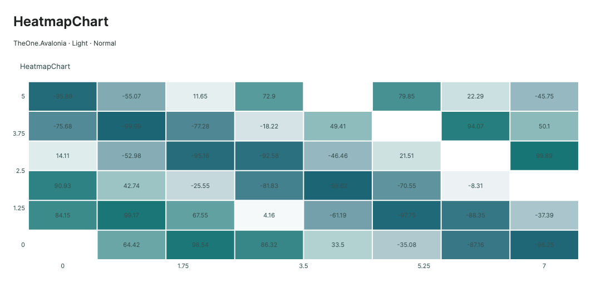
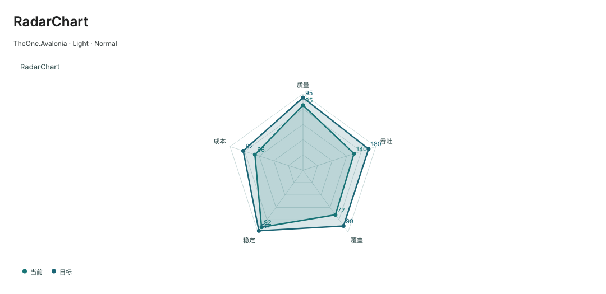
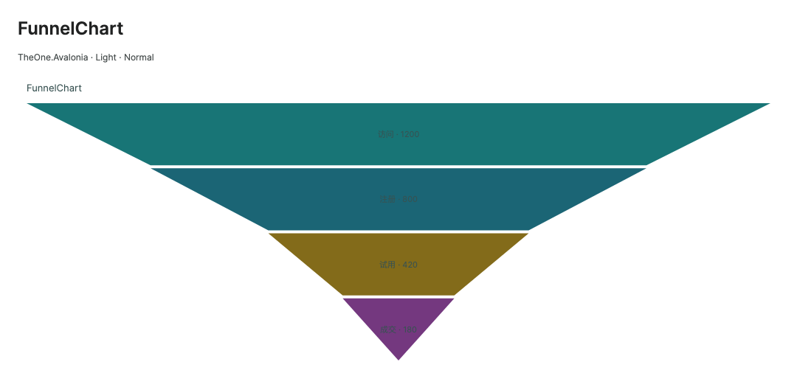

# Heatmap, radar and funnel

[简体中文](../zh-cn/chart-specialized.md) · **English** · [Charts](charts.md)

These native direct-drawing controls derive from `SpecializedChartBase`, without WebView or an ECharts runtime dependency. They implement the first batch of the [roadmap](../../plans/chart-echarts-gap-and-optimization.md), informed by ECharts [heatmap](https://echarts.apache.org/en/llms-documents/option-parts/option.series-heatmap.md), [radar](https://echarts.apache.org/en/llms-documents/option-parts/option.series-radar.md) and [funnel](https://echarts.apache.org/en/llms-documents/option-parts/option.series-funnel.md), using strongly typed Avalonia APIs and compiled bindings.

Load `OneTheme` to use Light / Dark, small / normal / large density, `SeriesSource`, two-way `SelectedSeriesIndex` / `SelectedIndex`, keyboard selection, legends, single-point tooltips and `ExportPng`. See [animation](chart-rendering.md). This edition does not implement geo/calendar coordinates, Cartesian viewport navigation, dual Y axes, stacking, shared-X tooltips or sampling for these three types.

<!-- visual-guide:start -->
## Appearance and example states

[Capture scope and visual index](visual-index.md). These are actual source-rendered examples; use this page’s usage notes for interaction and binding contracts.

### HeatmapChart



X/Y locate cells and Value independently controls color; blank cells are gaps.

[View Dark comparison](../images/HeatmapChart-dark.png)

### RadarChart



Each dimension normalizes against its own limits while models retain original values.

[View Dark comparison](../images/RadarChart-dark.png)

### FunnelChart



Stage width represents value; business stage order is preserved by default.

[View Dark comparison](../images/FunnelChart-dark.png)

<!-- visual-guide:end -->

## HeatmapChart

Supply `HeatmapPoint` objects through `ChartSeries.ItemsSource`; ordinary `ChartPoint` objects do not produce cells.

| Added property | Type / default | Meaning |
| --- | --- | --- |
| `CellWidth` | `double`, 1 | Cell width in X data units; finite and positive |
| `CellHeight` | `double`, 1 | Cell height in Y data units; finite and positive |
| `CellGap` | `double`, 2 | Visual gap in DIPs; finite, nonnegative, bounded by cell dimensions |
| `ValueMinimum` | `double`, NaN | Color minimum; NaN derives it from visible finite values |
| `ValueMaximum` | `double`, NaN | Color maximum; NaN derives it; reversed endpoints are ordered |
| `LowColor` | `Color?`, null | Minimum color; null derives it from the theme |
| `MidColor` | `Color?`, null | Zero color for a range crossing zero; null uses a neutral background color |
| `HighColor` | `Color?`, null | Maximum color; null uses the primary series color |

Visible cells share one color scale. Configure LowColor/MidColor/HighColor rather than treating each series Brush as an independent scale.

`HeatmapPoint : ChartPoint` adds observable `double Value`. X/Y locate the cell center, Value is the independent color dimension, and Label names the tooltip.

```csharp
public ObservableCollection<ChartSeries> LoadSeries { get; } =
[
    new() { Name = "Deviation", ItemsSource = new ObservableCollection<ChartPoint>
    {
        new HeatmapPoint(0, 0, -25), new HeatmapPoint(1, 0, 80),
        new HeatmapPoint(0, 1, 15), new HeatmapPoint(1, 1, double.NaN)
    } }
];
```

With the actual ViewModel declared by `x:DataType` on the view root:

```xml
<one:HeatmapChart SeriesSource="{CompiledBinding LoadSeries}"
                  ValueMinimum="-100" ValueMaximum="100"
                  CellGap="2" ShowDataLabels="True"
                  AnimationStyle="Fade" MinHeight="260" />
```

Finite coordinates with non-finite Value leave a gap but still contribute to coordinate extents. Ranges crossing zero use a diverging scale centered on zero; single-sided ranges use linear mapping. Drawing quantizes colors to 256 levels and can batch disjoint cells by color. Overlaps, transparent colors and labels retain source painter order; selection and tooltips keep the exact original Value. Overlapping hits favor the last drawn cell. There is no separate color legend control; fix color endpoints for comparable charts. Cell labels must fit and are omitted above 5,000 valid cells; coordinate ticks remain.

## RadarChart

| Added property | Type / default | Meaning |
| --- | --- | --- |
| `Axes` | `IList<RadarAxis>?`, per-instance observable empty collection | At least three independently scaled dimensions |
| `GridLevels` | `int`, 5 | Polygon grid levels, 1–20 |
| `FillOpacity` | `double`, 0.16 | Closed polygon fill opacity, 0–1; zero draws outlines |

`RadarAxis : AvaloniaObject` exposes observable Name (Axis), Minimum (0) and Maximum (100). Bounds must be finite; a valid dimension needs Maximum > Minimum. Point order corresponds to axis order. Y is the raw dimension value; X must be finite but does not sort dimensions. Extra points beyond the axis count are neither drawn nor selectable. Missing values or invalid axes break adjacent edges and prevent a misleading filled polygon. Values outside an axis range are clipped visually while tooltips retain raw values.

```csharp
public ObservableCollection<RadarAxis> Dimensions { get; } =
[
    new() { Name = "Quality", Maximum = 100 },
    new() { Name = "Throughput", Maximum = 200 },
    new() { Name = "Coverage", Maximum = 100 }
];
public ObservableCollection<ChartSeries> Capabilities { get; } =
[
    new() { Name = "Current", ItemsSource = new ObservableCollection<ChartPoint>
    { new(0, 85), new(1, 140), new(2, 72) } }
];
```

```xml
<one:RadarChart Axes="{CompiledBinding Dimensions}"
                SeriesSource="{CompiledBinding Capabilities}"
                GridLevels="5" FillOpacity="0.16"
                ShowDataLabels="True" AnimationStyle="Reveal" />
```

Observable axes support collection additions/removals, Reset/Replace, source replacement and property updates. Detach releases subscriptions; reattach restores them. Call shared `RefreshData()` after mutating a plain IList to reread data and dimensions.

## FunnelChart

| Added property | Type / default | Meaning |
| --- | --- | --- |
| `SortMode` | `FunnelSortMode`, None | None preserves business order; Ascending/Descending explicitly sort Y with stable equal-value order |
| `Gap` | `double`, 4 | Vertical stage gap in DIPs; finite, nonnegative and bounded to fit |
| `MinimumWidthRatio` | `double`, 0 | Minimum width relative to the widest stage, 0–1; zero preserves ratios, nonzero explicitly exaggerates small values |

Point Y is the stage value and Label is its name. Negative Y or non-finite X / Y are skipped; negative X is valid, while zero Y gets no positive area by default. Visible series are drawn side by side, each scaled to its own maximum, so widths across separate funnels do not encode a shared absolute scale. Sorting changes presentation, not source indices used by selection or tooltips.

```csharp
public ObservableCollection<ChartSeries> Conversions { get; } =
[
    new() { Name = "Conversion", ItemsSource = new ObservableCollection<ChartPoint>
    { new(0, 1200, "Visits"), new(1, 800, "Signups"), new(2, 420, "Trials"), new(3, 180, "Sales") } }
];
```

```xml
<one:FunnelChart SeriesSource="{CompiledBinding Conversions}"
                 SortMode="None" MinimumWidthRatio="0" Gap="4"
                 ShowDataLabels="True" AnimationStyle="Fade" />
```

The top width encodes the current stage and tapers to the next value; the last stage tapers to a tip. Labels are drawn only when they fit. Hit testing uses the real trapezoid rather than its bounding rectangle. Calculate business conversion rates in the consuming model; there is no implicit conversion-rate API or automatic sorting.

## Updates, interaction and export

- Existing reference-counted subscriptions observe ChartSeries/ChartPoint and collections. Heatmap Value, axis range and stage value changes do not rebuild all data subscriptions.
- Call `RefreshData()` for plain IList mutations. Radar rereads plain axes during refresh and reconciles subscriptions on reattachment.
- Use selection properties, pointer or arrow keys and read `Selection`. Cast `Selection.Point` to `HeatmapPoint` for Value. Selection does not rebuild all geometry, layout or color batches.
- Existing index-based selection rules remain. Applications may restore selection by their own business key after Reset/source replacement; this is not a stable-key drilldown API.
- Auto uses Reveal on first presentation and Fade on data updates. None, disabled Motion or disabled animation presents the target immediately. Animation is skipped above 6,000 drawn marks.
- `ExportPng(Stream, Size?, double, bool)` creates a complete target snapshot of the same concrete type, copying added properties without waiting for or altering live animation/selection.

Each type has its own PreviewHost page, with Description rows containing added properties and short examples, update buttons, animation selection and variants. See [current verification and measurements](chart-echarts-performance-20261020.md).
