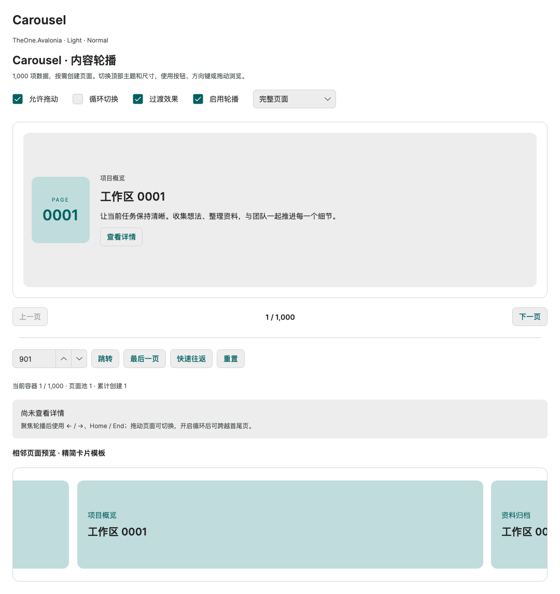
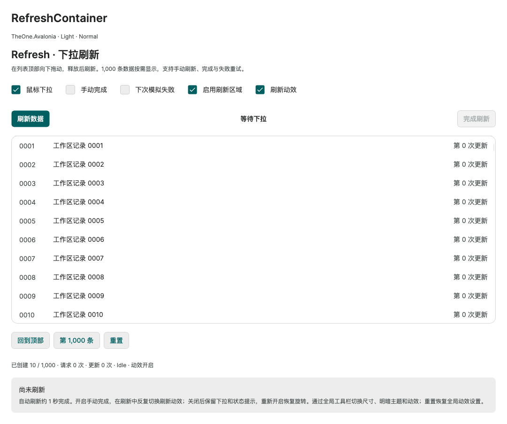

# Carousel and pull-to-refresh

[简体中文](../zh-cn/collection-content.md) · **English**

See [collections](collections.md) for lists, trees, and grids.

<!-- visual-guide:start -->
## Appearance and example states

[Capture scope and visual index](visual-index.md). These are actual source-rendered examples; use this page’s usage notes for interaction and binding contracts.

### Carousel



Current content, previous/next navigation and multiple-item presentation; the host retains data ownership.

[View Dark comparison](../images/Carousel-dark.png)

### RefreshContainer



Refreshable-list host in a static state; the host still completes the refresh lifecycle.

[View Dark comparison](../images/RefreshContainer-dark.png)

<!-- visual-guide:end -->

## Carousel

```xml
<Grid RowDefinitions="*,Auto" Height="360">
  <Carousel Name="SlidesCarousel" Classes="normal"
            ItemsSource="{Binding Slides}"
            SelectedItem="{Binding ActiveSlide, Mode=TwoWay}"
            IsSwipeEnabled="True" WrapSelection="True">
    <Carousel.ItemTemplate>
      <DataTemplate x:DataType="vm:Slide">
        <StackPanel VerticalAlignment="Center" Spacing="12">
          <TextBlock Text="{Binding Title}" FontSize="24" FontWeight="SemiBold" />
          <TextBlock Text="{Binding Description}" TextWrapping="Wrap" />
        </StackPanel>
      </DataTemplate>
    </Carousel.ItemTemplate>
  </Carousel>
  <TextBlock Grid.Row="1" Text="{Binding ActiveSlide.Title}" />
</Grid>
```

The native VirtualizingCarouselPanel is the default. Supply data models and let ItemTemplate create views on demand; no IsVirtualized property is needed. Provide a bounded viewport. small / normal / large use font sizes 12 / 14 / 16, padding 12 / 16 / 20, and minimum heights 180 / 220 / 260. Local Height, MinHeight, Padding, FontSize, colors, and radius can override these.

Switch programmatically with `SlidesCarousel.Next()`, `Previous()`, or `SelectedIndex`. Focused controls support arrows, Home / End. `WrapSelection=True` loops the ends; `ViewportFraction="0.72"` reveals adjacent pages. Native Carousel ScrollIntoView does not change the current page.

Default page transitions slide horizontally for 200 ms. `styling:Motion.Enabled="False"` disables subsequent theme transitions; consumers can supply PageTransition. `IsSwipeEnabled=True` enables dragging; this theme also enables mouse input in the native recognizer. Set `one:CarouselOptions.IsMouseSwipeEnabled="False"` to retain only touch / pen swiping.

PreviewHost's Carousel page includes a thousand items, looping, dragging, adjacent pages, rapid switching, target navigation, and actual page-pool counts.


## RefreshContainer

```xml
<RefreshContainer Height="420" Classes="normal" IsMouseEnabled="True"
                  RefreshRequested="OnRefreshRequested">
  <ListBox ItemsSource="{Binding Records}" SelectedItem="{Binding SelectedRecord, Mode=TwoWay}"
           BorderThickness="0" CornerRadius="0">
    <ListBox.ItemTemplate>
      <DataTemplate x:DataType="vm:Record">
        <TextBlock Text="{Binding Title}" />
      </DataTemplate>
    </ListBox.ItemTemplate>
  </ListBox>
</RefreshContainer>
```

The container needs a bounded viewport. Embed a collection control with its own virtualization, such as ListBox / DataGrid, without another ScrollViewer that measures it at infinite height. RefreshContainer has a single child and does not automatically virtualize arbitrary Content. PullDirection defaults to TopToBottom and supports other native directions. Mouse pulling defaults to disabled; enable IsMouseEnabled=True. RequestRefresh() provides a button or shortcut entry point.

For asynchronous work, obtain the native deferral and complete it in finally:

```csharp
private async void OnRefreshRequested(object? sender, RefreshRequestedEventArgs args)
{
    var deferral = args.GetDeferral();
    try { await ViewModel.ReloadAsync(); }
    catch (Exception error) { ViewModel.ShowError(error.Message); }
    finally { deferral.Complete(); }
}
```

The application implements ViewModel.ReloadAsync / ShowError and can prevent duplicate requests in business logic. The default Visualizer uses this theme and need not be created explicitly. small / normal / large indicator sizes are 64 / 80 / 96 and icon sizes 18 / 22 / 26. Override icon sizing with `one:RefreshOptions.IndicatorSize`. Custom Visualizer or Content must preserve native loading, rotation, and deferral behavior. Read state through `visualizer.GetValue(RefreshVisualizer.RefreshVisualizerStateProperty)`.

RefreshOptions.UseThemeVisualizerSizing defaults to enabled and handles native container-created Visualizer local sizes. Set False to use native sizes; explicitly supplied Visualizer instances are not managed by this default. RefreshVisualizer composition motion inherits `Motion.Enabled`. False keeps pull displacement and status while stopping rotation, pulsing, and transitions. Re-enabling during refresh resumes animation without another request. Custom Content is supported; `RefreshMotion.UseMotionSettings=False` opts out.

PreviewHost's Refresh page has thousand-item virtual data, real pulling, manual / automatic completion, failure / retry, distant navigation, and container counts. The refresh-motion switch can toggle repeatedly during refresh. Global controls select theme and size; reset restores inherited global motion.

PreviewHost keeps only a RefreshContainer page. Its built-in RefreshVisualizer participates in pulling, refresh, and Motion checks while retaining public themes and custom Visualizer APIs.

<!-- generated-contracts:start -->
## Control-specific properties, Classes usage and business APIs

This section lists project-added control-specific properties, public Classes usage, practical business actions and related models, without repeating inherited native APIs, constructors, property Get/Set wrappers or public identifiers. Registration defaults differ from themed values, and explicit local values take precedence. PreviewHost shows Classes through labeled examples rather than template-selector/setter inventories; properties and business actions in Description include short usage snippets. Shared ControlSizing and Motion settings are centralized on Home. Only Button, Input and Select share comparison pages; other controls retain independent complete demos.

### CarouselOptions

[Complete source contract](../../api/en/TheOne.Avalonia.Controls.CarouselOptions.md)

| Property | Type | Access/binding/inheritance | Registration/model default | Meaning and constraints |
| --- | --- | --- | --- | --- |
| [`IsMouseSwipeEnabled`](../../../TheOne.Avalonia/Controls/CarouselOptions.cs#L11) | `bool` | writable; OneWay; attached | `false` | Allows mouse dragging to swipe the carousel, while touch/native navigation follow Carousel semantics. |

### RefreshMotion

[Complete source contract](../../api/en/TheOne.Avalonia.Controls.RefreshMotion.md)

| Property | Type | Access/binding/inheritance | Registration/model default | Meaning and constraints |
| --- | --- | --- | --- | --- |
| [`UseMotionSettings`](../../../TheOne.Avalonia/Controls/RefreshMotion.cs#L20) | `bool` | writable; OneWay; attached | `false` | Uses shared motion configuration without forcing animation when globally/locally disabled. |

### RefreshOptions

[Complete source contract](../../api/en/TheOne.Avalonia.Controls.RefreshOptions.md)

| Property | Type | Access/binding/inheritance | Registration/model default | Meaning and constraints |
| --- | --- | --- | --- | --- |
| [`IndicatorSize`](../../../TheOne.Avalonia/Controls/RefreshOptions.cs#L12) | `double` | writable; OneWay; attached | `22` | Refresh-indicator size in DIPs, independent of the pull threshold. |
| [`UseThemeVisualizerSizing`](../../../TheOne.Avalonia/Controls/RefreshOptions.cs#L15) | `bool` | writable; OneWay; attached | `false` | Makes the refresh visualizer follow shared theme density; disable for explicit sizing. |

See [shared theme configuration](../../theme/en/README.md#shared-configuration) for common sizing and motion settings, demonstrated centrally on PreviewHost Home.

### Classes usage

No added public appearance classes; use the default theme and control-specific properties.
These are individually supported public classes. Hover, pressed, disabled and selected states are control-owned; do not assign template classes manually. See the labeled PreviewHost examples for their appearance.

### Business APIs

No additional business methods; configure the control-specific properties above.

### Related models

| Model | Properties/enum values |
| --- | ---: |
| [`TheOne.Avalonia.Controls.CarouselOptions`](../../api/en/TheOne.Avalonia.Controls.CarouselOptions.md) | 1 |
| [`TheOne.Avalonia.Controls.RefreshMotion`](../../api/en/TheOne.Avalonia.Controls.RefreshMotion.md) | 1 |
| [`TheOne.Avalonia.Controls.RefreshOptions`](../../api/en/TheOne.Avalonia.Controls.RefreshOptions.md) | 2 |

[Complete source contract (including constructors, property accessors and identifiers for precise lookup)](../../api/en/README.md)
<!-- generated-contracts:end -->
