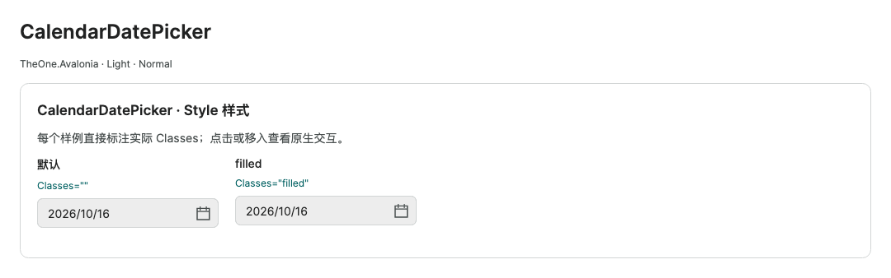
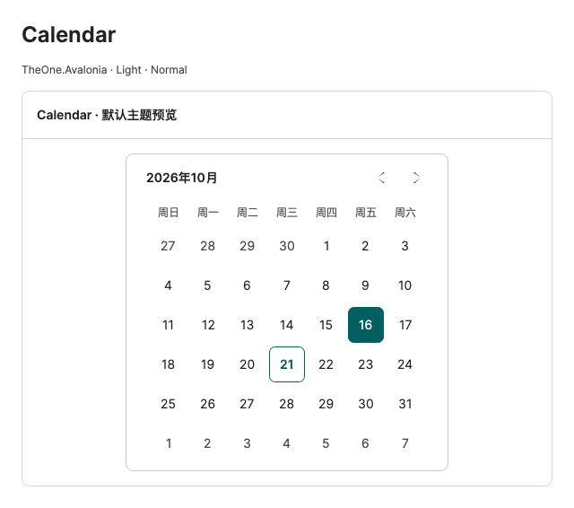
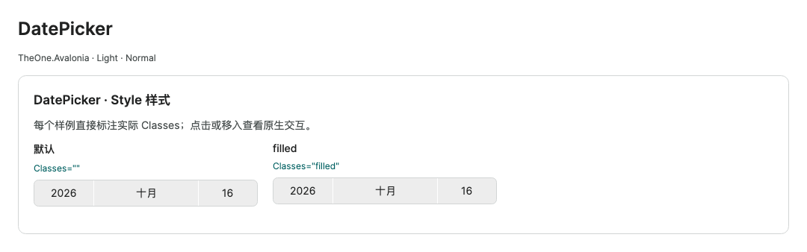
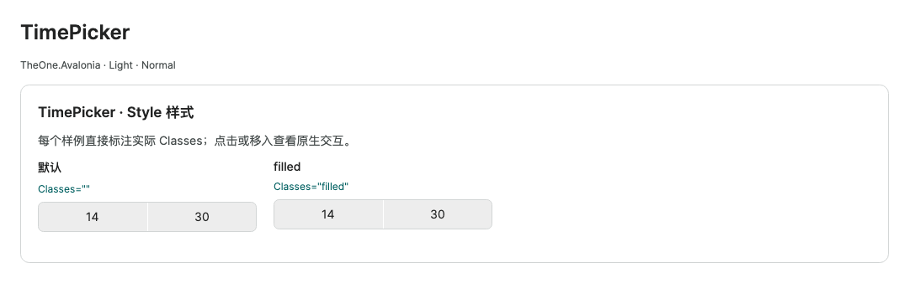

# Dates and times

For a dedicated combined control, see [DateTimePicker](datetime-picker.md), with direct `Format` and `Time` properties. The existing attached mode remains supported.

Historical command-line checks and consumer test projects have been removed. Check coverage and measurements in this guide are historical records. Start PreviewHost normally and open the relevant control page; validate target-platform behavior in the consuming application.

[简体中文](../zh-cn/date-time.md) · **English**

CalendarItem, CalendarButton, and CalendarDayButton belong to calendar templates; DatePickerPresenter and TimePickerPresenter belong to picker popups. They receive themes from their parent and are not created independently. Replacement templates must preserve native PART_* and binding contracts.

[Back to control documentation](README.md). Extension properties use `xmlns:one="using:TheOne.Avalonia.Controls"`.

<!-- visual-guide:start -->
## Appearance and example states

[Capture scope and visual index](visual-index.md). These are actual source-rendered examples; use this page’s usage notes for interaction and binding contracts.

### CalendarDatePicker



Three date-field appearances; the popup reuses native calendar selection without changing date semantics.

[View Dark comparison](../images/CalendarDatePicker-dark.png)

### Calendar



Selected-day and today indicators; month/year/day modes keep the outer height stable.

[View Dark comparison](../images/Calendar-dark.png)

### DatePicker



Native segmented date picker across the three input appearances.

[View Dark comparison](../images/DatePicker-dark.png)

### TimePicker



Hour/minute field appearances; native clock configuration determines formatting.

[View Dark comparison](../images/TimePicker-dark.png)

<!-- visual-guide:end -->

## CalendarDatePicker

```xml
<CalendarDatePicker SelectedDate="{Binding Date, Mode=TwoWay}"
                    SelectedDateFormat="Custom"
                    CustomDateFormatString="yyyy-MM-dd"
                    PlaceholderText="yyyy-MM-dd"
                    one:CalendarInput.OpenOnClick="False" />
```

`SelectedDate` is `DateTime?`. Keyboard entry and Enter commit are supported; invalid input uses the native `DateValidationError` event. Clicking the editor opens the calendar by default. `OpenOnClick="False"` disables automatic opening while keeping the calendar button available. Use `DisplayDateStart`, `DisplayDateEnd`, and `BlackoutDates` to constrain selection.

## Date/time, month, and year input

```xml
<CalendarDatePicker one:CalendarOptions.DisplayStyle="DateTime"
                    one:CalendarOptions.Format="yyyy/MM/dd HH:mm"
                    SelectedDate="{Binding Appointment, Mode=TwoWay}" />
<CalendarDatePicker one:CalendarOptions.DisplayStyle="Month"
                    SelectedDate="{Binding ReportingMonth, Mode=TwoWay}" />
<CalendarDatePicker one:CalendarOptions.DisplayStyle="Year"
                    SelectedDate="{Binding ReportingYear, Mode=TwoWay}" />
```

| Attached property | Usage |
| --- | --- |
| `CalendarOptions.DisplayStyle` | `Date` is the default date mode; `DateTime` adds time; `Month` selects months; `Year` selects years |
| `CalendarOptions.Format` | .NET date/time format string, overriding DisplayStyle's automatic format |
| `CalendarOptions.InitialView` | `Month` date grid; `Year` month grid; `Decade` year grid; explicit settings take precedence |
| `CalendarOptions.Time` | `TimeSpan?`, synchronized with SelectedDate's time in DateTime mode; valid range `[00:00, 24:00)` |
| `CalendarOptions.WheelNavigation` | Set on Calendar to control wheel navigation through months / years / decades; enabled by the theme |

DateTime, Month, and Year default to `yyyy-MM-dd HH:mm`, `yyyy-MM`, and `yyyy`. Month / Year change display format and initial view; `SelectedDate` remains a full date, from which business code extracts year / month. DateTime adds a time editor and preserves time when changing dates. Date mode uses native formatting properties.

## Standalone Calendar

```xml
<Calendar SelectedDate="{Binding Date, Mode=TwoWay}"
          SelectionMode="SingleDate"
          one:CalendarOptions.WheelNavigation="False" />
```

Native month paging, year / decade views, ranges, blackout dates, and keyboard selection remain available. Today has an outline; selection uses the accent color. Use native `SelectionMode` and `SelectedDates` for multiple dates. The date grid has a fixed layout bound.

## DatePicker and TimePicker

```xml
<DatePicker SelectedDate="{Binding OffsetDate, Mode=TwoWay}" />
<TimePicker ClockIdentifier="24HourClock" MinuteIncrement="5"
            SelectedTime="{Binding Time, Mode=TwoWay}" />
```

Date, month, time, and period fields are centered horizontally and vertically in every size, with the same layout for null and disabled states.

Item / selection-strip heights are 32 / 40 / 48 px, popup fonts 12 / 14 / 16 px, and maximum heights 288 / 340 / 400 px. Confirm commits; cancel preserves the old value. Arrows support hold-to-repeat.

PickerScroll.Enabled is enabled internally: wheel scrolling snaps to whole rows after 140 ms of inactivity; gesture completion aligns immediately; confirm / Enter aligns before committing. Non-looping lists remain within range. Separate clipping inside and outside the selection strip prevents fractional scrolling from showing state text on the wrong background. Native selection is unchanged; unloading stops timers and subscriptions.

Date/time popups contain unconsumed fractional horizontal, vertical and diagonal input plus gesture inertia/end phases, including blank areas and scroll boundaries. Native calendar navigation, picker scrolling, inertia and completion snapping remain active. Tails originating in a closed popup stay isolated, while new page scrolling works normally.

<!-- generated-contracts:start -->
## Control-specific properties, Classes usage and business APIs

This section lists project-added control-specific properties, public Classes usage, practical business actions and related models, without repeating inherited native APIs, constructors, property Get/Set wrappers or public identifiers. Registration defaults differ from themed values, and explicit local values take precedence. PreviewHost shows Classes through labeled examples rather than template-selector/setter inventories; properties and business actions in Description include short usage snippets. Shared ControlSizing and Motion settings are centralized on Home. Only Button, Input and Select share comparison pages; other controls retain independent complete demos.

### CalendarInput

[Complete source contract](../../api/en/TheOne.Avalonia.Controls.CalendarInput.md)

| Property | Type | Access/binding/inheritance | Registration/model default | Meaning and constraints |
| --- | --- | --- | --- | --- |
| [`OpenOnClick`](../../../TheOne.Avalonia/Controls/CalendarInput.cs#L14) | `bool` | writable; OneWay; attached | `false` | Opens the native date popup when clicking the input, retaining text and keyboard behavior. |

### CalendarOptions

[Complete source contract](../../api/en/TheOne.Avalonia.Controls.CalendarOptions.md)

| Property | Type | Access/binding/inheritance | Registration/model default | Meaning and constraints |
| --- | --- | --- | --- | --- |
| [`DisplayStyle`](../../../TheOne.Avalonia/Controls/CalendarOptions.cs#L25) | `TheOne.Avalonia.Controls.DateInputDisplayStyle` | writable; OneWay; attached | `0 / default` | `Date` is the default date mode; `DateTime` adds time; `Month` selects months; `Year` selects years Values: `Date`, `DateTime`, `Month`, `Year` |
| [`Format`](../../../TheOne.Avalonia/Controls/CalendarOptions.cs#L22) | `string?` | writable; OneWay; attached | `null` | .NET date/time format string, overriding DisplayStyle's automatic format |
| [`InitialView`](../../../TheOne.Avalonia/Controls/CalendarOptions.cs#L28) | `Avalonia.Controls.CalendarMode` | writable; OneWay; attached | `0 / default` | `Month` date grid; `Year` month grid; `Decade` year grid; explicit settings take precedence Values: `Month`, `Year`, `Decade` |
| [`ShowTime`](../../../TheOne.Avalonia/Controls/CalendarOptions.cs#L38) | `bool` | read-only; OneWay; attached | `false` | Read-only runtime/derived state, updated by the control/model for display or command conditions; not a two-way input. |
| [`Time`](../../../TheOne.Avalonia/Controls/CalendarOptions.cs#L34) | `System.TimeSpan?` | writable; OneWay; attached | `null` | `TimeSpan?`, synchronized with SelectedDate's time in DateTime mode; valid range `[00:00, 24:00)` Validation: `value => value is null &#124;&#124; (value >= TimeSpan.Zero && value < TimeSpan.FromDays(1))` |
| [`WheelNavigation`](../../../TheOne.Avalonia/Controls/CalendarOptions.cs#L31) | `bool` | writable; OneWay; attached | `false` | Set on Calendar to control wheel navigation through months / years / decades; enabled by the theme |

### PickerScroll

[Complete source contract](../../api/en/TheOne.Avalonia.Styling.PickerScroll.md)

| Property | Type | Access/binding/inheritance | Registration/model default | Meaning and constraints |
| --- | --- | --- | --- | --- |
| [`Enabled`](../../../TheOne.Avalonia/Styling/PickerScroll.cs#L17) | `bool` | writable; OneWay; attached | `false` | Interaction switch for picker wheels, retaining native commit/cancel/focus behavior. |
| [`HighlightClip`](../../../TheOne.Avalonia/Styling/PickerScroll.cs#L20) | `Avalonia.Media.Geometry` | writable; OneWay; attached | `new RectangleGeometry(new Rect())` | Clipping configuration for the wheel highlight, normally maintained by picker templates. |

### PickerSizing

[Complete source contract](../../api/en/TheOne.Avalonia.Styling.PickerSizing.md)

| Property | Type | Access/binding/inheritance | Registration/model default | Meaning and constraints |
| --- | --- | --- | --- | --- |
| [`ItemHeight`](../../../TheOne.Avalonia/Styling/PickerSizing.cs#L9) | `double` | writable; OneWay; attached | `40` | Item/wheel-cell height in DIPs; theme density or explicit values may override registration defaults. |
| [`PopupHeight`](../../../TheOne.Avalonia/Styling/PickerSizing.cs#L12) | `double` | writable; OneWay; attached | `340` | Picker-popup height in DIPs, coordinated with ItemHeight and ViewportHeight. |
| [`ViewportHeight`](../../../TheOne.Avalonia/Styling/PickerSizing.cs#L15) | `double` | writable; OneWay; attached | `200` | Visible picker-wheel height in DIPs, distinct from item count. |

See [shared theme configuration](../../theme/en/README.md#shared-configuration) for common sizing and motion settings, demonstrated centrally on PreviewHost Home.

### Classes usage

- `CalendarDatePicker`: `Classes="filled"`
- `DatePicker`: `Classes="filled"`
- `TimePicker`: `Classes="filled"`
These are individually supported public classes. Hover, pressed, disabled and selected states are control-owned; do not assign template classes manually. See the labeled PreviewHost examples for their appearance.

### Business APIs

No additional business methods; configure the control-specific properties above.

### Related models

| Model | Properties/enum values |
| --- | ---: |
| [`TheOne.Avalonia.Controls.CalendarInput`](../../api/en/TheOne.Avalonia.Controls.CalendarInput.md) | 1 |
| [`TheOne.Avalonia.Controls.CalendarOptions`](../../api/en/TheOne.Avalonia.Controls.CalendarOptions.md) | 6 |
| [`TheOne.Avalonia.Controls.DateInputDisplayStyle`](../../api/en/TheOne.Avalonia.Controls.DateInputDisplayStyle.md) | 4 |
| [`TheOne.Avalonia.Styling.PickerScroll`](../../api/en/TheOne.Avalonia.Styling.PickerScroll.md) | 2 |
| [`TheOne.Avalonia.Styling.PickerSizing`](../../api/en/TheOne.Avalonia.Styling.PickerSizing.md) | 3 |

[Complete source contract (including constructors, property accessors and identifiers for precise lookup)](../../api/en/README.md)
<!-- generated-contracts:end -->
