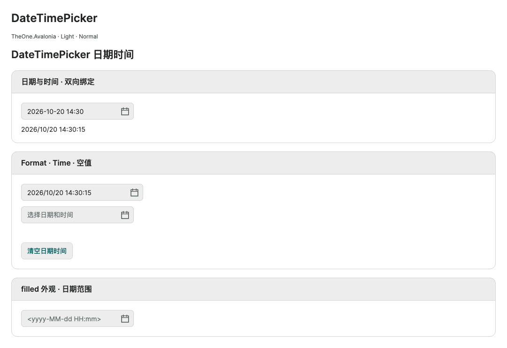

# DateTimePicker

[简体中文](../zh-cn/datetime-picker.md) · **English** · [Control index](README.md)

`TheOne.Avalonia.Controls.DateTimePicker` derives from native `CalendarDatePicker` and enables the integrated 24-hour time editor. No `CalendarOptions.DisplayStyle="DateTime"` setup is required. It shares native text parsing, validation, date restrictions, focus and popup scroll isolation.

```xml
<one:DateTimePicker xmlns:one="using:TheOne.Avalonia.Controls"
    SelectedDate="{CompiledBinding Appointment, Mode=TwoWay}"
    Format="yyyy-MM-dd HH:mm:ss" />
```

`Appointment` is a nullable `DateTime` containing both parts. Changing the display format itself does not truncate seconds or milliseconds; the control performs no time zone conversion. The default format is `yyyy-MM-dd HH:mm`. Text submission parses the formatted value using native precision and `DateTime.Kind` rules: include `ss` to edit seconds and `fffffff` for fractional seconds. Parsing and `DateValidationError` retain native behavior. Picking a calendar date preserves the time; editing the time preserves the date.

<!-- visual-guide:start -->
## Appearance and example states

[Capture scope and visual index](visual-index.md). These are actual source-rendered examples; use this page’s usage notes for interaction and binding contracts.

### DateTimePicker



Date and time in one field; format configuration and independent time-binding limits are explained below.

[View Dark comparison](../images/DateTimePicker-dark.png)

<!-- visual-guide:end -->

## Additional properties

| Property | Type / default | Behavior |
| --- | --- | --- |
| `Format` | `string?` / `null` | .NET date/time format; null restores the default. Invalid formats retain native exception behavior. |
| `Time` | `TimeSpan?` / `null`, TwoWay by default | Synchronized time of day, restricted to `[00:00,24:00)`. Invalid values are rejected. |

```xml
<one:DateTimePicker SelectedDate="{CompiledBinding Appointment, Mode=TwoWay}"
                    Time="{CompiledBinding AppointmentTime, Mode=TwoWay}" />
<one:DateTimePicker Classes="filled" Format="yyyy/MM/dd HH:mm" />
```

Binding only `SelectedDate` is normally sufficient. Bind `Time` separately when needed, without forcing conflicting values from the two sources. Setting time on an empty picker does not create a date; a subsequent calendar selection combines it with the new date. An externally assigned full `SelectedDate` supplies its own time. Clearing a selected date also clears time; setting `Time=null` with an existing date resets it to midnight.

`filled`, Light / Dark, disabled states and the three shared densities reuse the calendar input theme. See [shared theme configuration](../../theme/en/README.md). There are no additional business methods or models. Existing `CalendarOptions` usage remains supported; use the direct `Format` and `Time` properties on this control and leave `DisplayStyle` unchanged.

## Native interaction and limits

- `DisplayDateStart`, `DisplayDateEnd` and `BlackoutDates` constrain calendar dates, not precise timestamps.
- Enter commits text. The calendar button opens the popup; input clicks also open it by default. Set `one:CalendarInput.OpenOnClick="False"` for text-only editing.
- The nested time picker retains its native accept / cancel behavior. Calendar selection commits immediately, rather than applying a combined transaction. Escape on the calendar restores the date/time captured when it opened through the existing `CalendarInput` behavior.
- Calendar and nested time popups retain wheel, touchpad and inertia isolation.

The independent PreviewHost **DateTimePicker** page demonstrates binding, custom formatting, nullable time and `filled`. See [Dates and times](date-time.md) for the native controls and attached mode.

## Focused verification

Managed and macOS ARM64 NativeAOT consumer runs each passed 55 checks covering compiled TwoWay bindings, clear and preset time, time limits, Enter submission, pointer date selection preserving time, Escape restoration, calendar synchronization after reopening or external assignment, both themes and three densities, `filled`, disabled input and preview loading. Input used Avalonia Headless with Skia rendering; this is not a Windows / Linux native-window run or a full-library regression. The Release build passed with the existing unrelated LoginDemoViewModel nullability warning.

<!-- generated-contracts:start -->
## Control-specific properties, Classes usage and business APIs

This section lists project-added control-specific properties, public Classes usage, practical business actions and related models, without repeating inherited native APIs, constructors, property Get/Set wrappers or public identifiers. Registration defaults differ from themed values, and explicit local values take precedence. PreviewHost shows Classes through labeled examples rather than template-selector/setter inventories; properties and business actions in Description include short usage snippets. Shared ControlSizing and Motion settings are centralized on Home. Only Button, Input and Select share comparison pages; other controls retain independent complete demos.

### DateTimePicker

[Complete source contract](../../api/en/TheOne.Avalonia.Controls.DateTimePicker.md)

| Property | Type | Access/binding/inheritance | Registration/model default | Meaning and constraints |
| --- | --- | --- | --- | --- |
| [`Format`](../../../TheOne.Avalonia/Controls/DateTimePicker.cs#L71) | `string?` | writable; OneWay | `null` | `string?` / `null` ; .NET date/time format; null restores the default. Invalid formats retain native exception behavior. |
| [`Time`](../../../TheOne.Avalonia/Controls/DateTimePicker.cs#L77) | `System.TimeSpan?` | writable; TwoWay | `inherited registration` | `TimeSpan?` / `null`, TwoWay by default ; Synchronized time of day, restricted to `[00:00,24:00)`. Invalid values are rejected. |

See [shared theme configuration](../../theme/en/README.md#shared-configuration) for common sizing and motion settings, demonstrated centrally on PreviewHost Home.

### Classes usage

No added public appearance classes; use the default theme and control-specific properties.
These are individually supported public classes. Hover, pressed, disabled and selected states are control-owned; do not assign template classes manually. See the labeled PreviewHost examples for their appearance.

### Business APIs

No additional business methods; configure the control-specific properties above.

### Related models

No additional related data models.

[Complete source contract (including constructors, property accessors and identifiers for precise lookup)](../../api/en/README.md)
<!-- generated-contracts:end -->
