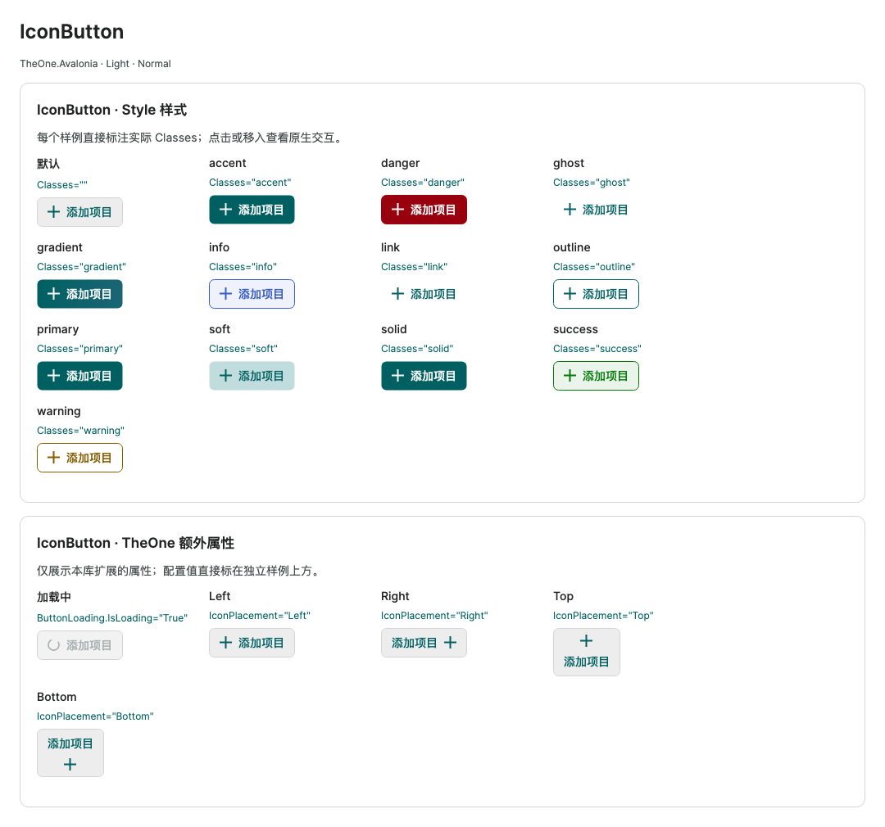

# Icon buttons and action hierarchy

Historical command-line checks and consumer test projects have been removed. Check coverage and measurements in this guide are historical records. Start PreviewHost normally and open the relevant control page; validate target-platform behavior in the consuming application.

[简体中文](../zh-cn/icon-button.md) · **English**

IconButton inherits Avalonia Button and keeps Command, CommandParameter, Click, keyboard input, focus, Flyout, and disabled behavior. Load OneTheme to use it. Icon is a separate property; Content remains text / content, and IconTemplate renders data icons. IconPlacement supports Left (default), Right, Top, and Bottom. Icons and text stay centered, with no empty gap when either is missing. IsLoading replaces the icon with a loading indicator and blocks repeated actions; see [loading controls](loading.md). Override IconSize and IconSpacing through styles or bindings. Default icons are 13 / 15 / 19 px for small / normal / large. A null Icon reserves no space; empty Content produces a square icon button. Icon-only buttons need AutomationProperties.Name and Tooltip.

```xml
<one:IconButton Icon="{Binding AddGeometry}" Content="新建" Classes="primary"
                Command="{Binding AddCommand}" />
<one:IconButton AutomationProperties.Name="收藏" ToolTip.Tip="收藏">
  <one:IconButton.Icon><PathIcon Data="M8,1 L10,6 L15,6 L11,9 L13,15 L8,12 L3,15 L5,9 L1,6 L6,6 Z" /></one:IconButton.Icon>
</one:IconButton>
```

The default PathIcon template renders Geometry. You can also assign an existing PathIcon or another icon Control to Icon. A control instance can have only one visual parent; use Geometry or a template for shared icon data.

The consuming application can reference [Material.Icons.Avalonia](https://www.nuget.org/packages/Material.Icons.Avalonia/) and load MaterialIconStyles in Application.Styles. The library does not require a third-party icon package. PreviewHost references 3.0.2 to demonstrate a compiled template:

```xml
<!-- material: Material.Icons.Avalonia；kinds: Material.Icons -->
<one:IconButton Icon="{Binding IconKind}" Content="工作区">
  <one:IconButton.IconTemplate>
    <DataTemplate x:DataType="kinds:MaterialIconKind">
      <material:MaterialIcon Kind="{Binding}" />
    </DataTemplate>
  </one:IconButton.IconTemplate>
</one:IconButton>
```

Native Button and IconButton share primary/accent, soft, gradient, outline, ghost, link, success, info, warning, and danger styles. The default style suits secondary actions; primary advances the main workflow, ghost is lightweight, outline emphasizes a boundary, and success/info/warning/danger indicate completion, information, risk, and destructive actions. Hover, pressed, focus, and disabled states keep native behavior and TheOne semantic colors. Prefer one primary action per group and explicit action labels.

`Icon` now accepts a bound `OneIconKind` or `Icon="{x:Static one:OneIconKind.Save}"`; the built-in template creates a separate OneIcon. Custom `IconTemplate` values still take precedence for Filled, business models and third-party icons. See [OneIcon hosts](one-icon.md#icon-hosts-and-icontemplate).

<!-- visual-guide:start -->
## Appearance and example states

[Capture scope and visual index](visual-index.md). These are actual source-rendered examples; use this page’s usage notes for interaction and binding contracts.

### IconButton



Icons and content align across Classes; icon source, placement and spacing can be configured independently.

[View Dark comparison](../images/IconButton-dark.png)

<!-- visual-guide:end -->

## Semantic colors and appearances

IconButton shares [composition and precedence rules](basic.md#button-semantic-colors-and-appearances) with Button, ToggleButton and RepeatButton. Combine `primary/accent`, `danger`, `success`, `warning` or `info` with `solid`, `ghost`, `link`, `outline`, `soft` or `gradient`:

```xml
<one:IconButton Classes="danger outline" Icon="{CompiledBinding DeleteIcon}"
                Content="Delete" Command="{CompiledBinding DeleteCommand}" />
<one:IconButton Classes="success soft" Icon="{CompiledBinding CheckIcon}"
                Content="Done" IsLoading="{CompiledBinding IsSaving}" />
```

Standalone classes keep their legacy enabled appearances. Disabled combinations use DisabledSurface / DisabledText / Line. Color conflicts resolve as info > warning > success > danger > primary/accent; appearances resolve as gradient > soft > outline > link > ghost > solid, independently of class order. Switching Classes, Light/Dark or ColorTheme refreshes icon and label foreground without changing IconPlacement, explicit IconSize/IconSpacing, IconTemplate or native commands. Loading still replaces the icon and blocks repeated actions. The separate PreviewHost IconButton page demonstrates combinations, disabled states, placement and loading.

<!-- generated-contracts:start -->
## Control-specific properties, Classes usage and business APIs

This section lists project-added control-specific properties, public Classes usage, practical business actions and related models, without repeating inherited native APIs, constructors, property Get/Set wrappers or public identifiers. Registration defaults differ from themed values, and explicit local values take precedence. PreviewHost shows Classes through labeled examples rather than template-selector/setter inventories; properties and business actions in Description include short usage snippets. Shared ControlSizing and Motion settings are centralized on Home. Only Button, Input and Select share comparison pages; other controls retain independent complete demos.

### ButtonLoading

[Complete source contract](../../api/en/TheOne.Avalonia.Controls.ButtonLoading.md)

| Property | Type | Access/binding/inheritance | Registration/model default | Meaning and constraints |
| --- | --- | --- | --- | --- |
| [`IsLoading`](../../../TheOne.Avalonia/Controls/ButtonLoading.cs#L12) | `bool` | writable; OneWay; attached | `false` | Shows busy feedback; buttons retain size and prevent repeated actions, while containers show a loading layer. The host resets it when work finishes. |

### IconButton

[Complete source contract](../../api/en/TheOne.Avalonia.Controls.IconButton.md)

| Property | Type | Access/binding/inheritance | Registration/model default | Meaning and constraints |
| --- | --- | --- | --- | --- |
| [`HasIcon`](../../../TheOne.Avalonia/Controls/IconButton.cs#L89) | `bool` | read-only; OneWay | `computed / state` | Read-only runtime/derived state, updated by the control/model for display or command conditions; not a two-way input. |
| [`HasLabel`](../../../TheOne.Avalonia/Controls/IconButton.cs#L95) | `bool` | read-only; OneWay | `computed / state` | Read-only runtime/derived state, updated by the control/model for display or command conditions; not a two-way input. |
| [`Icon`](../../../TheOne.Avalonia/Controls/IconButton.cs#L65) | `object?` | writable; OneWay | `null` | Icon content/vector geometry as defined by the signature; the host owns external bitmap lifetimes. |
| [`IconPlacement`](../../../TheOne.Avalonia/Controls/IconButton.cs#L53) | `TheOne.Avalonia.Controls.IconPlacement` | writable; OneWay | `0 / default` | Icon position relative to text; the template arranges horizontal/vertical placement. Validation: `value => Enum.IsDefined(value)` Values: `Left`, `Right`, `Top`, `Bottom` |
| [`IconSize`](../../../TheOne.Avalonia/Controls/IconButton.cs#L77) | `double` | writable; OneWay | `15` | Icon drawing size in DIPs, independent of font size and button hit area. Validation: `value => double.IsFinite(value) && value > 0` |
| [`IconSpacing`](../../../TheOne.Avalonia/Controls/IconButton.cs#L83) | `double` | writable; OneWay | `8` | DIP spacing between the icon and adjacent text/content. Validation: `value => double.IsFinite(value) && value >= 0` |
| [`IconTemplate`](../../../TheOne.Avalonia/Controls/IconButton.cs#L71) | `Avalonia.Controls.Templates.IDataTemplate?` | writable; OneWay | `null` | Native data-template extension point; retain the correct x:DataType and follow the control's template data scope. |
| [`IsLoading`](../../../TheOne.Avalonia/Controls/IconButton.cs#L59) | `bool` | writable; OneWay | `false` | Shows busy feedback; buttons retain size and prevent repeated actions, while containers show a loading layer. The host resets it when work finishes. |
| [`ShowIcon`](../../../TheOne.Avalonia/Controls/IconButton.cs#L47) | `bool` | read-only; OneWay | `computed / state` | Read-only runtime/derived state, updated by the control/model for display or command conditions; not a two-way input. |

### ThemeButton

[Complete source contract](../../api/en/TheOne.Avalonia.Controls.ThemeButton.md)

| Property | Type | Access/binding/inheritance | Registration/model default | Meaning and constraints |
| --- | --- | --- | --- | --- |
| [`Scope`](../../../TheOne.Avalonia/Controls/ThemeButton.cs#L30) | `TheOne.Avalonia.Controls.ThemeButtonScope` | writable; OneWay | `0 / default` | Scope of Light/Dark switching; does not change the ThemeColor palette enum. Values: `Window`, `Application` |

See [shared theme configuration](../../theme/en/README.md#shared-configuration) for common sizing and motion settings, demonstrated centrally on PreviewHost Home.

### Classes usage

- `IconButton`: `Classes="danger"` / `Classes="ghost"` / `Classes="gradient"` / `Classes="info"` / `Classes="link"` / `Classes="outline"` / `Classes="soft"` / `Classes="solid"` / `Classes="success"` / `Classes="warning"`
These are individually supported public classes. Hover, pressed, disabled and selected states are control-owned; do not assign template classes manually. See the labeled PreviewHost examples for their appearance.

### Business APIs

No additional business methods; configure the control-specific properties above.

### Related models

| Model | Properties/enum values |
| --- | ---: |
| [`TheOne.Avalonia.Controls.ButtonLoading`](../../api/en/TheOne.Avalonia.Controls.ButtonLoading.md) | 1 |
| [`TheOne.Avalonia.Controls.IconPlacement`](../../api/en/TheOne.Avalonia.Controls.IconPlacement.md) | 4 |
| [`TheOne.Avalonia.Controls.ThemeButtonScope`](../../api/en/TheOne.Avalonia.Controls.ThemeButtonScope.md) | 2 |

[Complete source contract (including constructors, property accessors and identifiers for precise lookup)](../../api/en/README.md)
<!-- generated-contracts:end -->
