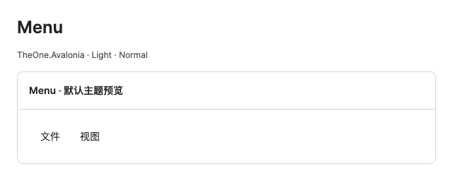
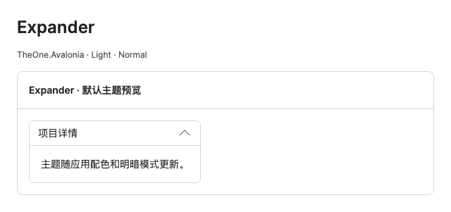
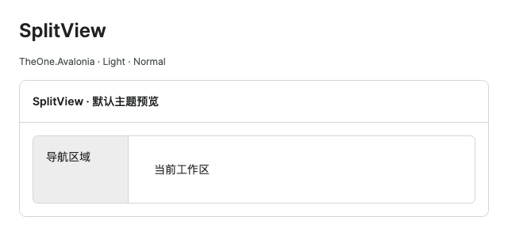
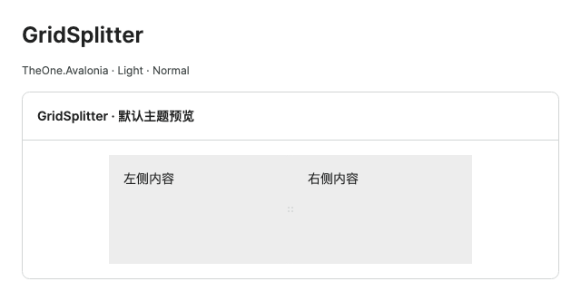
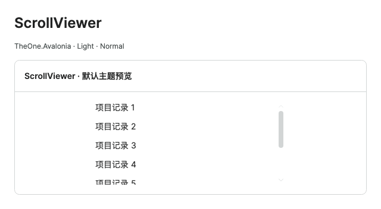
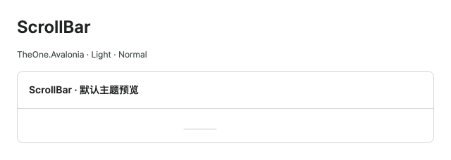
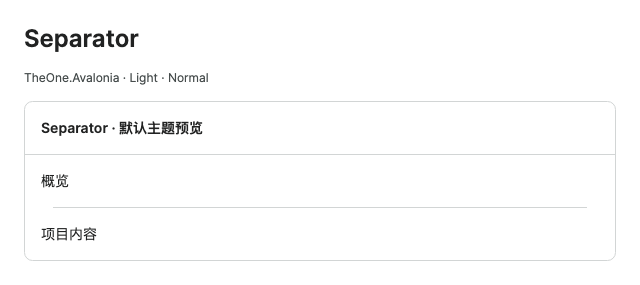
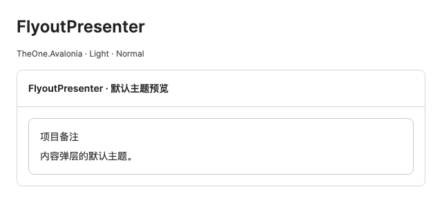

# Menus and layout

Historical command-line checks and consumer test projects have been removed. Check coverage and measurements in this guide are historical records. Start PreviewHost normally and open the relevant control page; validate target-platform behavior in the consuming application.

[简体中文](../zh-cn/layout.md) · **English**

[Back to control documentation](README.md). The host implements bound commands and state below.

<!-- visual-guide:start -->
## Appearance and example states

[Capture scope and visual index](visual-index.md). These are actual source-rendered examples; use this page’s usage notes for interaction and binding contracts.

### Menu



Default menu bar theme; submenus use separate popup containers.

[View Dark comparison](../images/Menu-dark.png)

### ContextMenu


An open context menu with both items fully visible and backgrounds inset from the frame.

[View Dark comparison](../images/ContextMenu-dark.png)

### Expander



Expanded header and body; motion affects the transition rather than the content contract.

[View Dark comparison](../images/Expander-dark.png)

### SplitView



Default pane/body separation; DisplayMode determines collapse behavior.

[View Dark comparison](../images/SplitView-dark.png)

### GridSplitter



The splitter sits between two content regions and resizes their layout allocation.

[View Dark comparison](../images/GridSplitter-dark.png)

### ScrollViewer



Content and scrollbar in a bounded viewport; scroll boundaries and popup isolation are explained below.

[View Dark comparison](../images/ScrollViewer-dark.png)

### ScrollBar



Standalone horizontal scrollbar; thumb length represents the viewport.

[View Dark comparison](../images/ScrollBar-dark.png)

### Separator



A separator distinguishes neighboring content and is not an action.

[View Dark comparison](../images/Separator-dark.png)

### FlyoutPresenter



The themed content popup frame, corners and padding.

[View Dark comparison](../images/FlyoutPresenter-dark.png)

### ToolTip


Actual hover tooltip content and themed frame; the tooltip is anchored to its target.

[View Dark comparison](../images/ToolTip-dark.png)

<!-- visual-guide:end -->

## Menu and shortcuts

```xml
<Menu>
  <MenuItem Header="文件">
    <MenuItem Header="新建" Command="{Binding NewCommand}" InputGesture="Ctrl+N" />
    <Separator />
    <MenuItem Header="导出">
      <MenuItem Header="CSV" Command="{Binding ExportCsvCommand}" />
      <MenuItem Header="JSON" Command="{Binding ExportJsonCommand}" />
    </MenuItem>
  </MenuItem>
</Menu>
```

InputGesture displays a shortcut hint; bind the same command in Window.KeyBindings for the actual shortcut:

```xml
<Window.KeyBindings>
  <KeyBinding Gesture="Ctrl+N" Command="{Binding NewCommand}" />
  <KeyBinding Gesture="Meta+N" Command="{Binding NewCommand}" />
</Window.KeyBindings>
```

## ContextMenu and MenuFlyout

```xml
<Border Background="{DynamicResource One.Subtle}" Padding="16">
  <Border.ContextMenu>
    <ContextMenu>
      <MenuItem Header="查看" Command="{Binding InspectCommand}" />
      <MenuItem Header="删除" Command="{Binding DeleteCommand}" />
    </ContextMenu>
  </Border.ContextMenu>
  <TextBlock Text="右键打开菜单" />
</Border>

<Button Content="更多操作">
  <Button.Flyout>
    <MenuFlyout>
      <MenuItem Header="刷新" Command="{Binding RefreshCommand}" />
    </MenuFlyout>
  </Button.Flyout>
</Button>
```

Declare children directly for small static menus. Dynamic / growing menus use ItemsSource, on-demand templates, and models instead of prebuilt MenuItem lists. The theme selects a native panel by collection size: short menus of up to 32 items currently measure all content, including separators, different row heights and wide headings; larger menus retain virtualization. Menu bars, submenus, ContextMenu and MenuFlyoutPresenter use this policy without application configuration.

Short menus use their actual content size on the first opening; closing and reopening is unnecessary. Scroll buttons stay hidden when content fits. Screen constraints or an explicit MaxHeight can require compact 16-DIP buttons, with native commands, wheel input and keyboard behavior preserved. Long popups default to `One.DataFlyoutMaxHeight` (360 DIP). Replacing ItemsPanel or the whole template overrides this behavior; custom layouts must provide accurate first measurement and large-list performance.

Add/remove, Replace, Reset and ItemsSource changes synchronize containers, selection and data ownership. Crossing the short/large menu boundary releases the old panel before preparing new containers. Models still need property notifications, and commands bind to the current data context; applications need not move MenuItem controls manually or force popup refreshes.

## Expander and motion

```xml
<Expander Header="高级设置" IsExpanded="{Binding ShowAdvanced, Mode=TwoWay}"
          ExpandDirection="Down">
  <StackPanel Spacing="8">
    <TextBox PlaceholderText="可选说明" />
    <CheckBox Content="启用高级选项" />
  </StackPanel>
</Expander>
```

ExpandDirection supports Down / Up / Left / Right. The theme continuously changes layout reservation through clipping, supports reversal, and keeps full child layout. Disable with `styling:Motion.Enabled="False"` and the Styling namespace on the root. Defaults: brushes 120 ms, expand 200 ms, collapse 140 ms. The application handles system reduced-motion preferences.

Expander does not bound business lists internally; large lists still need Height / MaxHeight or bounded layout.

## SplitView

```xml
<SplitView Height="420" IsPaneOpen="{Binding IsNavigationOpen, Mode=TwoWay}"
           DisplayMode="CompactInline" PanePlacement="Left"
           OpenPaneLength="248" CompactPaneLength="56">
  <SplitView.Pane>
    <ListBox ItemsSource="{Binding NavigationItems}"
             Background="Transparent" BorderThickness="0" CornerRadius="0" />
  </SplitView.Pane>
  <TextBlock Text="页面内容" />
</SplitView>
```

IsPaneOpen controls the pane; DisplayMode supports native Inline / Overlay / CompactInline / CompactOverlay, and PanePlacement supports Left / Right / Top / Bottom. Vertical placements measure height. Bindable OpenPaneLength / CompactPaneLength override size themes. Main-content reservation stays synchronized; pane content keeps expanded dimensions and clips when collapsed instead of squeezing child controls. Compact mode does not automatically turn business panes into icon menus: bind labels to IsPaneOpen or use NavMenu collapsing.

| Mode | Expanded reservation | Collapsed reservation | Light dismiss |
| --- | --- | --- | --- |
| Inline | OpenPaneLength | 0 | No |
| Overlay | 0, overlays content | 0 | Yes |
| CompactInline | OpenPaneLength | CompactPaneLength | No |
| CompactOverlay | CompactPaneLength; remaining pane overlays content | CompactPaneLength | Yes |

Overlay LightDismissLayer is active only while open; UseLightDismissOverlayMode=True shows its color. Layout synchronizes native IsPaneOpen / TemplateSettings directly, without delayed reservation. small / normal / large open lengths are 220 / 248 / 280; compact lengths 48 / 56 / 64. Override One.SplitView.* in Metrics.axaml.

Large-data panes need bounded SplitView height and native ListBox virtualization. Embedded lists use transparent backgrounds / zero borders for continuous PaneBackground and outer borders; override for separate surfaces. PreviewHost has 1,000 items, last-item navigation, four modes / placements, and icons when collapsed with labels restored on expansion.

## GridSplitter

```xml
<Grid ColumnDefinitions="*,Auto,2*" Height="360">
  <Border Grid.Column="0" Background="{DynamicResource One.Subtle}" />
  <GridSplitter Grid.Column="1" Width="10"
                HorizontalAlignment="Center" VerticalAlignment="Stretch"
                ResizeDirection="Columns" ResizeBehavior="PreviousAndNext"
                ShowsPreview="True" />
  <Border Grid.Column="2" Background="{DynamicResource One.Surface}" />
</Grid>
```

Native dragging, keyboard resizing, and previews remain. For vertical layout splitting, use RowDefinitions and `ResizeDirection="Rows"` with the splitter in the middle row. Parent Grid must have bounded layout space; set row / column minimums in business layout.

## ScrollViewer, ScrollBar, Separator

```xml
<ScrollViewer Height="240" HorizontalScrollBarVisibility="Disabled"
              VerticalScrollBarVisibility="Auto">
  <TextBlock Text="长篇说明文本" TextWrapping="Wrap" />
</ScrollViewer>
<Separator />
```

ScrollViewer suits ordinary content; its ScrollBar is themed automatically. Standalone ScrollBar can bind Minimum, Maximum, Value, and ViewportSize. For controls already providing virtualized viewports, such as ListBox, TreeView, DataGrid, bound the control itself instead of adding an infinite outer scrolling viewport.

## Flyout and FlyoutPresenter

Flyout is popup behavior; FlyoutPresenter is the content container it creates. OneTheme applies its templates without replacing native controls.

```xml
<Button Content="编辑工作区" Classes="small">
  <Button.Flyout>
    <Flyout Placement="Bottom">
      <StackPanel Width="280" Spacing="12">
        <TextBlock Text="工作区设置" FontWeight="SemiBold" />
        <TextBox PlaceholderText="工作区名称" />
        <CheckBox Content="通知成员" />
        <Button Content="应用" Classes="primary" />
      </StackPanel>
    </Flyout>
  </Button.Flyout>
</Button>
```

Size inherits from the trigger by default: fonts 12 / 14 / 16 px and padding 12 / 16 / 20 px. To size independently, add a size class to FlyoutPresenterClasses:

```csharp
var flyout = (Flyout)editButton.Flyout!;
flyout.FlyoutPresenterClasses.Add("large");
// 改变类后，下次打开时由原生 Flyout 应用。
flyout.ShowAt(editButton);
flyout.Hide();
```

Standard mode focuses content; Transient retains trigger focus. Esc, outside clicks, or Hide() close it. Closing supports e.Cancel. Hosts implement apply / cancel / validation; the sample apply button has no business binding yet. FlyoutPresenterTheme based on the native theme overrides appearance. See [theme implementation](../../theme/en/README.md) for resources and examples.

Ordinary long content scrolls with default MaxHeight=480. Large Content still needs a finite-height ListBox or bounded DataGrid rather than unbounded ItemsControl in a popup. PreviewHost uses 10,000 models with real viewport recycling and stable source bindings preserving selection after close.

<!-- generated-contracts:start -->
## Control-specific properties, Classes usage and business APIs

This section lists project-added control-specific properties, public Classes usage, practical business actions and related models, without repeating inherited native APIs, constructors, property Get/Set wrappers or public identifiers. Registration defaults differ from themed values, and explicit local values take precedence. PreviewHost shows Classes through labeled examples rather than template-selector/setter inventories; properties and business actions in Description include short usage snippets. Shared ControlSizing and Motion settings are centralized on Home. Only Button, Input and Select share comparison pages; other controls retain independent complete demos.

These native controls have no same-name TheOne wrappers; project-added capabilities come from the styles below.

See [shared theme configuration](../../theme/en/README.md#shared-configuration) for common sizing and motion settings, demonstrated centrally on PreviewHost Home.

### Classes usage

No added public appearance classes; use the default theme and control-specific properties.
These are individually supported public classes. Hover, pressed, disabled and selected states are control-owned; do not assign template classes manually. See the labeled PreviewHost examples for their appearance.

### Business APIs

No additional business methods; configure the control-specific properties above.

### Related models

No additional related data models.

[Complete source contract (including constructors, property accessors and identifiers for precise lookup)](../../api/en/README.md)
<!-- generated-contracts:end -->
