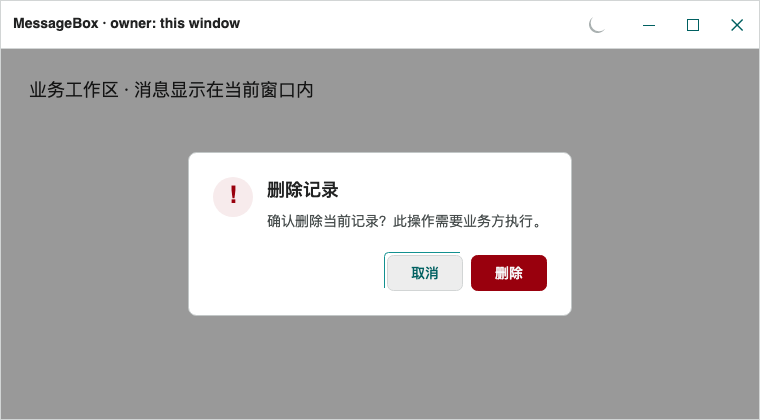

# MessageBox

`OneMessageBox` is a simple confirm/cancel prompt. It reuses the dialog layer installed by `OneWindow` and `LoginWindow`; it does not create another native window. Use `OneDialog` for forms or custom content.

```csharp
// Invoke from a ViewModel's asynchronous ICommand.
var confirmed = await OneMessageBox.ConfirmAsync(
    "Delete this file?",
    "The file and its preview will be permanently deleted.",
    new MessageBoxOptions
    {
        ConfirmText = "Delete file",
        CancelText = "Keep file",
        IsDangerous = true
    });
if (confirmed)
    await fileService.DeleteAsync(fileId);
```

Only the confirm command returns `true`. The cancel command, Escape, or owner closure returns `false`. The cancel button receives initial focus, including for dangerous operations; Tab changes focus and Enter activates the focused button. Clicking the overlay keeps the prompt open. Closing restores the previously focused control through the existing dialog host.

`MessageBoxOptions` provides `ConfirmText` (default `确认`), `CancelText` (default `取消`), `IsDangerous` (default `false`), and an optional `ControlSize? Size`. Omit `Size` to inherit the window's Small / Normal / Large density. Text and actions use `One.*` resources for Light and Dark themes. Title, message and action labels must be non-empty.

The optional `owner` parameter selects an open `OneWindow` or `LoginWindow`. Without it, the registered default owner is used, matching `OneDialog`. Requests share the existing per-window queue. `cancellationToken` cancellation cancels the returned task and releases the dialog; it does not return a user decision.

The PreviewHost MessageBox page binds its launch buttons to ViewModel commands and shows both a configurable confirmation and a dangerous confirmation. It demonstrates awaiting the boolean result before applying business work, with compiled bindings throughout.

<!-- visual-guide:start -->
## Appearance and example states

[Capture scope and visual index](visual-index.md). These are actual source-rendered examples; use this page’s usage notes for interaction and binding contracts.

### MessageBox



Dangerous-action confirmation distinguishes cancel and delete; the host still owns the actual deletion.

[View Dark comparison](../images/MessageBox-dark.png)

<!-- visual-guide:end -->

<!-- generated-contracts:start -->
## Control-specific properties, Classes usage and business APIs

This section lists project-added control-specific properties, public Classes usage, practical business actions and related models, without repeating inherited native APIs, constructors, property Get/Set wrappers or public identifiers. Registration defaults differ from themed values, and explicit local values take precedence. PreviewHost shows Classes through labeled examples rather than template-selector/setter inventories; properties and business actions in Description include short usage snippets. Shared ControlSizing and Motion settings are centralized on Home. Only Button, Input and Select share comparison pages; other controls retain independent complete demos.

### DialogContext

[Complete source contract](../../api/en/TheOne.Avalonia.Controls.DialogContext.md)

No additional CLR/attached properties are declared on this type; see its base for inherited members.

### DialogOptions

[Complete source contract](../../api/en/TheOne.Avalonia.Controls.DialogOptions.md)

| Property | Type | Access/binding/inheritance | Registration/model default | Meaning and constraints |
| --- | --- | --- | --- | --- |
| [`Buttons`](../../../TheOne.Avalonia/Controls/DialogOptions.cs#L16) | `TheOne.Avalonia.Controls.OneDialogButtons` | writable; CLR / init-only | `OneDialogButtons.OkCancel` | Dialog button configuration/flags, interpreted according to the options type and close-result contract. Values: `Ok`, `OkCancel`, `YesNo`, `YesNoCancel` |
| [`CloseOnEscape`](../../../TheOne.Avalonia/Controls/DialogOptions.cs#L14) | `bool` | writable; CLR / init-only | `true` | Allows Escape to close a dialog, following its cancellation/result semantics. |
| [`CloseOnOverlayClick`](../../../TheOne.Avalonia/Controls/DialogOptions.cs#L13) | `bool` | writable; CLR / init-only | `false` | Allows overlay clicks to close the dialog, following cancellation/result options. |
| [`MotionEnabled`](../../../TheOne.Avalonia/Controls/DialogOptions.cs#L9) | `bool?` | writable; CLR / init-only | `null` | Dialog-specific motion switch, also respecting inherited Motion.Enabled. |
| [`ShowButtons`](../../../TheOne.Avalonia/Controls/DialogOptions.cs#L15) | `bool` | writable; CLR / init-only | `false` | Shows the default button area; does not control buttons in custom content. |
| [`ShowCloseButton`](../../../TheOne.Avalonia/Controls/DialogOptions.cs#L12) | `bool` | writable; CLR / init-only | `true` | Shows the close button; the host and associated commands retain control over closing. |
| [`ShowTitle`](../../../TheOne.Avalonia/Controls/DialogOptions.cs#L11) | `bool` | writable; CLR / init-only | `true` | Shows the dialog title area while retaining its configured title value. |
| [`Size`](../../../TheOne.Avalonia/Controls/DialogOptions.cs#L8) | `TheOne.Avalonia.Styling.ControlSize?` | writable; CLR / init-only | `null` | Dialog size enum using the library's supported size presets. Values: `Small`, `Normal`, `Large` |
| [`Title`](../../../TheOne.Avalonia/Controls/DialogOptions.cs#L10) | `string?` | writable; CLR / init-only | `null` | Display title, distinct from business identity or a localization key. |

### OneDialog

[Complete source contract](../../api/en/TheOne.Avalonia.Controls.OneDialog.md)

| Property | Type | Access/binding/inheritance | Registration/model default | Meaning and constraints |
| --- | --- | --- | --- | --- |
| [`Owner`](../../../TheOne.Avalonia/Controls/OneMessages.cs#L217) | `Avalonia.Controls.Window?` | writable; CLR / n/a | `accessor-defined / state` | The native relationship established by `child.Show(parent)` / `child.ShowDialog<T>(parent)`, affecting platform window lifetime. |

See [shared theme configuration](../../theme/en/README.md#shared-configuration) for common sizing and motion settings, demonstrated centrally on PreviewHost Home.

### Classes usage

No added public appearance classes; use the default theme and control-specific properties.
These are individually supported public classes. Hover, pressed, disabled and selected states are control-owned; do not assign template classes manually. See the labeled PreviewHost examples for their appearance.

### Business APIs

| Type | Action signature | Purpose |
| --- | --- | --- |
| [`DialogContext`](../../api/en/TheOne.Avalonia.Controls.DialogContext.md) | `void DialogContext.RequestClose(OneDialogResult result = OneDialogResult.Ok)` | Requests completion of this dialog, including when it is still queued. |
| [`OneDialog`](../../api/en/TheOne.Avalonia.Controls.OneDialog.md) | `static Task<OneDialogResult> OneDialog.ShowAsync<TView, TViewModel>(TViewModel viewModel, DialogOptions? options = null, Window? owner = null, CancellationToken cancellationToken = default(CancellationToken)) where TView : UserControl, new() where TViewModel : class` | Creates a typed view lazily on the UI thread; compiled bindings and NativeAOT are supported. |
| [`OneDialog`](../../api/en/TheOne.Avalonia.Controls.OneDialog.md) | `static Task<OneDialogResult> OneDialog.ShowAsync(string title, string message, OneDialogButtons buttons = OneDialogButtons.Ok, Window? owner = null, CancellationToken cancellationToken = default(CancellationToken))` | Dispatches to the UI thread internally. |
| [`OneDialog`](../../api/en/TheOne.Avalonia.Controls.OneDialog.md) | `static Task<OneDialogResult> OneDialog.ShowContentAsync(object? content, string? title = null, OneDialogButtons buttons = OneDialogButtons.OkCancel, IDataTemplate? contentTemplate = null, Window? owner = null, CancellationToken cancellationToken = default(CancellationToken))` | Dispatches to the UI thread internally. |

### Event subscriptions

Subscribe when needed and detach when the host is disposed. These are event entry points, not routed-event identifier fields.

| Type | Event | Purpose |
| --- | --- | --- |
| [`DialogContext`](../../api/en/TheOne.Avalonia.Controls.DialogContext.md) | `PropertyChanged` | State/operation notification; subscribe for the host lifetime and detach on disposal. The signature defines event arguments. |
| [`DialogContext`](../../api/en/TheOne.Avalonia.Controls.DialogContext.md) | `CloseRequested` | State/operation notification; subscribe for the host lifetime and detach on disposal. The signature defines event arguments. |

### Related models

| Model | Properties/enum values |
| --- | ---: |
| [`TheOne.Avalonia.Controls.DialogCloseRequestedEventArgs`](../../api/en/TheOne.Avalonia.Controls.DialogCloseRequestedEventArgs.md) | 1 |
| [`TheOne.Avalonia.Controls.DialogOptions`](../../api/en/TheOne.Avalonia.Controls.DialogOptions.md) | 9 |
| [`TheOne.Avalonia.Controls.OneDialogButtons`](../../api/en/TheOne.Avalonia.Controls.OneDialogButtons.md) | 4 |
| [`TheOne.Avalonia.Controls.OneDialogResult`](../../api/en/TheOne.Avalonia.Controls.OneDialogResult.md) | 5 |
| [`TheOne.Avalonia.Styling.ControlSize`](../../api/en/TheOne.Avalonia.Styling.ControlSize.md) | 3 |

[Complete source contract (including constructors, property accessors and identifiers for precise lookup)](../../api/en/README.md)
<!-- generated-contracts:end -->
