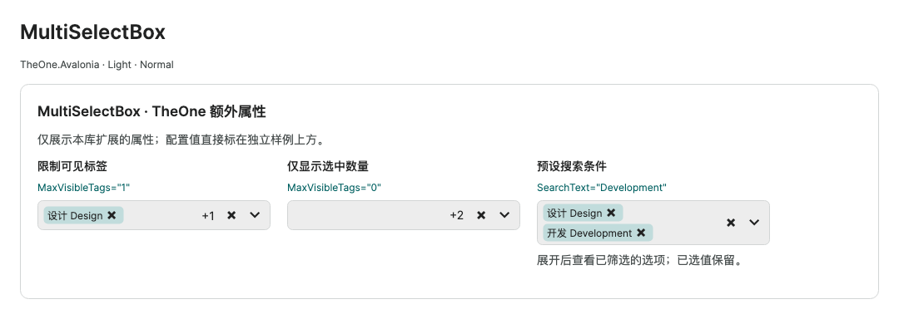
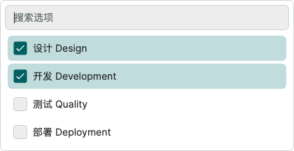

# MultiSelectBox

Historical command-line checks and consumer test projects have been removed. Check coverage and measurements in this guide are historical records. Start PreviewHost normally and open the relevant control page; validate target-platform behavior in the consuming application.

The popup owns a bounded viewport: overflow displays a native vertical scrollbar, while a short list correctly has none. Wheel input, fractional vertical/horizontal/diagonal touchpad deltas, and gesture inertia/end phases stay inside the popup over results, search, empty results and scroll boundaries. Native internal scrolling remains available. Closing restores ordinary page scrolling while tails originating in the old popup remain isolated.

`MultiSelectBox` combines local search, selected-item tags, clearing, and a native virtualized results list. Selection contains model objects and survives filtering, including queries that hide every selected item. Load `OneTheme` to use it.

<!-- visual-guide:start -->
## Appearance and example states

[Capture scope and visual index](visual-index.md). These are actual source-rendered examples; use this page’s usage notes for interaction and binding contracts.

### MultiSelectBox



Compares tag limits, read-only and disabled-option configuration; extra selections collapse into +N.

[View Dark comparison](../images/MultiSelectBox-dark.png)

### MultiSelectBox · Search and checkable list



Search and checkable items use a separate scroll viewport; closing the popup retains selected data.

[View Dark comparison](../images/MultiSelectBoxPopup-dark.png)

<!-- visual-guide:end -->

## Compiled bindings

```csharp
public ObservableCollection<Choice> Choices { get; } = [];
public ObservableCollection<Choice> Selected { get; } = [];
public MultiSelectItemAdapter Adapter { get; } =
    MultiSelectItemAdapter.Create<Choice>(item => item.Name, item => item.Available);
```

```xml
<one:MultiSelectBox ItemsSource="{Binding Choices}"
                    SelectedItems="{Binding Selected, Mode=TwoWay}"
                    ItemAdapter="{Binding Adapter}"
                    PlaceholderText="Choose applicable items"
                    AutomationProperties.Name="Applicable items" />
```

Declare `xmlns:one="using:TheOne.Avalonia.Controls"` and the view's concrete `x:DataType`, keeping compiled bindings enabled. The adapter supplies explicit typed getters for search, tag text, and availability, without reflection paths or additional metadata registration. Without an adapter, items use `ToString()` and are all enabled.

## Selection and disabled items

- `SelectedItems` accepts `IList`; `ObservableCollection<T>` works directly. The control edits the host collection instead of replacing its binding. Collection replacement and notifications also synchronize.
- Each instance creates its own mutable selection by default. An explicitly bound null, readonly, or fixed-size list is display-only. `IsReadOnly=True` also blocks selection, removal, and clearing while allowing search and browsing.
- Disabled options cannot be selected or removed by the user. Externally selected disabled values appear as locked tags. Clearing removes only editable values and retains locked selection.
- Filtering and empty results preserve selection. Ctrl / Cmd + A in results adds only enabled, loaded matches from the current query while retaining hidden selection. In search, the shortcut retains native text selection.
- Items use `Equals` / `GetHashCode`. Equal duplicates represent one option/selection, and null entries are ignored. Equality and hash semantics must remain stable while the items are in use.
- Removing an option from the source does not silently rewrite the external selection. Its tag remains removable when enabled. Removing a selected value removes all equal occurrences from the host list.
- This version filters loaded models synchronously using current-culture case-insensitive text matching and a trimmed query. It does not provide remote queries, server paging, or data virtualization.

## Public contract

| API | Behavior |
| --- | --- |
| `ItemsSource` | Optional model `IEnumerable`; do not populate it with pre-created controls |
| `SelectedItems` | Optional `IList`, with default two-way binding and synchronization in both directions |
| `ItemAdapter` | Explicit text and availability getters; text also drives search and default tags |
| `ItemTemplate` / `SelectedItemTemplate` | Templates for original result/tag models; declare their corresponding `x:DataType` |
| `SearchText` | Defaults to empty, supports two-way binding; closing retains the query |
| `PlaceholderText` / `SearchPlaceholderText` / `EmptyText` | Selection placeholder, search placeholder, and empty-results text; override for the host language |
| `ClearText` / `OpenText` / `RemoveTextFormat` | Accessible button names; removal format defaults to `移除 {0}`, with model text as its argument |
| `MaxVisibleTags` | Defaults to `3`, range `0–100`; remaining selection is represented by its count |
| `MaxDropDownHeight` | Defaults to `320`, finite and at least 80; popup bounds also follow the host |
| `IsReadOnly` / `IsDropDownOpen` | Selection readonly state and two-way popup state; disabling/detaching closes the popup |
| `SelectedCount` / `HasSelection` | Read-only distinct selection count and nonempty state |
| `HiddenSelectedCount` / `HasHiddenSelection` | Read-only count/state for selections without visible tags |
| `VisibleItems` / `DisplayTags` | Read-only template data; `MultiSelectBoxItem.Item` is the original model, with text, enabled/selected state, and template content |
| `HasNoResults` / `CanClear` / `ItemHeight` | Read-only empty-results state, editable-selection availability, and density minimum height |
| `ToggleItem(object)` | Toggles an editable value; adding requires source membership, removal also supports selected external values; returns `false` if unchanged |
| `ClearSelection()` | Batch-removes editable values, retaining disabled selections; returns `false` if unchanged |
| `RefreshItems()` | Refreshes plain collections, models without notifications, or getters dependent on other state |
| `OpenDropDown()` / `CloseDropDown()` | Opens and focuses search, or closes and returns focus to the field; opening requires attachment and enabled state |
| `SelectionChanged` | Bubbling event with original models in AddedItems / RemovedItems; batch user edits produce one event |

Use `INotifyCollectionChanged` and model `INotifyPropertyChanged` for automatic updates, raised on the UI thread. Detaching releases subscriptions; reattaching reads current data. Call `RefreshItems()` for changes without notifications. Custom templates change presentation only; search and availability still use the adapter.

Search filters cached entry text without enumerating `ItemsSource` or `SelectedItems`, calling adapter getters, or rebuilding model subscriptions. Filtering remains synchronous and linear over loaded data. A model notification refreshes that entry's text and availability; collection changes reconcile entries and update model subscriptions only for added or removed models. If a getter depends on external state that does not raise notifications, call `RefreshItems()` explicitly instead of relying on a search edit to refresh models.

## Keyboard and focus

| Location and key | Behavior |
| --- | --- |
| Focused field, Enter / Space / Down | Opens and focuses search |
| Focused field, F4 / Alt + Down | Toggles the popup |
| Search, Down / Up | Moves to an enabled result, skipping disabled options |
| Results, Up / Down / Home / End | Moves focus without changing selection |
| Search, Enter | Toggles the active result, or the first enabled result if none is active |
| Results, Enter / Space | Toggles the focused result while retaining other selections |
| Results, Ctrl / Cmd + A | Adds enabled results in the current query |
| Popup, Esc | Closes and restores field focus |
| Popup, Tab / Shift + Tab | Closes and follows native Tab navigation |
| Field or empty search, Backspace | Removes the last editable selection, skipping locked values |

Remove and clear buttons retain native keyboard/focus support. During composition, the native text input owns key handling. Light-dismiss does not steal outside focus. The field exposes the ComboBox automation role and expand/collapse provider; the native list retains row selection automation. Validate screen-reader behavior on target platforms separately.

## Themes and scale

Colors use `One.*` resources: a visible `One.InputLine` field border and `One.AccentSoft` selected tags with `One.Text` foreground. Small / Normal / Large single-line field and default result-row heights are 30 / 36 / 44; wrapped tags or custom content can increase actual height. Results have a 4px gap between items. Open popups synchronize theme and density, with width constrained to the host client area.

The bounded native `ListBox` and `VirtualizingStackPanel` create UI only for visible rows. Tags create at most `MaxVisibleTags` controls. Model storage, filtering, and subscriptions still cover loaded data; UI virtualization does not reduce business data size. Preserve the finite results viewport when customizing the template.

## Preview and focused checks

PreviewHost: **Extensions → MultiSelectBox**, with ten thousand models, preselected disabled values, and compiled bindings.

The check runs only MultiSelectBox: real key/pointer input, search, locked tags, clearing, collection replacement, readonly/disabled state, template and attachment lifetime, empty results, distant recycling of ten thousand options, bounded tags for bulk selection, and layout/pixels across light/dark × three densities × wide/narrow viewports.

<!-- generated-contracts:start -->
## Control-specific properties, Classes usage and business APIs

This section lists project-added control-specific properties, public Classes usage, practical business actions and related models, without repeating inherited native APIs, constructors, property Get/Set wrappers or public identifiers. Registration defaults differ from themed values, and explicit local values take precedence. PreviewHost shows Classes through labeled examples rather than template-selector/setter inventories; properties and business actions in Description include short usage snippets. Shared ControlSizing and Motion settings are centralized on Home. Only Button, Input and Select share comparison pages; other controls retain independent complete demos.

### MultiSelectBox

[Complete source contract](../../api/en/TheOne.Avalonia.Controls.MultiSelectBox.md)

| Property | Type | Access/binding/inheritance | Registration/model default | Meaning and constraints |
| --- | --- | --- | --- | --- |
| [`CanClear`](../../../TheOne.Avalonia/Controls/MultiSelectBox.cs#L223) | `bool` | read-only; OneWay | `computed / state` | Read-only empty-results state, editable-selection availability, and density minimum height |
| [`ClearText`](../../../TheOne.Avalonia/Controls/MultiSelectBox.cs#L174) | `string` | writable; OneWay | `"清空可编辑选择"` | Accessible button names; removal format defaults to `移除 {0}`, with model text as its argument |
| [`DisplayTags`](../../../TheOne.Avalonia/Controls/MultiSelectBox.cs#L217) | `System.Collections.Generic.IReadOnlyList<TheOne.Avalonia.Controls.MultiSelectBoxItem>` | read-only; OneWay | `computed / state` | Read-only template data; `MultiSelectBoxItem.Item` is the original model, with text, enabled/selected state, and template content |
| [`EmptyText`](../../../TheOne.Avalonia/Controls/MultiSelectBox.cs#L168) | `string` | writable; OneWay | `"无匹配选项"` | Selection placeholder, search placeholder, and empty-results text; override for the host language |
| [`HasHiddenSelection`](../../../TheOne.Avalonia/Controls/MultiSelectBox.cs#L221) | `bool` | read-only; OneWay | `computed / state` | Read-only count/state for selections without visible tags |
| [`HasNoResults`](../../../TheOne.Avalonia/Controls/MultiSelectBox.cs#L222) | `bool` | read-only; OneWay | `computed / state` | Read-only empty-results state, editable-selection availability, and density minimum height |
| [`HasSelection`](../../../TheOne.Avalonia/Controls/MultiSelectBox.cs#L220) | `bool` | read-only; OneWay | `computed / state` | Read-only distinct selection count and nonempty state |
| [`HiddenSelectedCount`](../../../TheOne.Avalonia/Controls/MultiSelectBox.cs#L219) | `int` | read-only; OneWay | `computed / state` | Read-only count/state for selections without visible tags |
| [`IsDropDownOpen`](../../../TheOne.Avalonia/Controls/MultiSelectBox.cs#L198) | `bool` | writable; TwoWay | `false` | Selection readonly state and two-way popup state; disabling/detaching closes the popup |
| [`IsReadOnly`](../../../TheOne.Avalonia/Controls/MultiSelectBox.cs#L192) | `bool` | writable; OneWay | `false` | Selection readonly state and two-way popup state; disabling/detaching closes the popup |
| [`ItemAdapter`](../../../TheOne.Avalonia/Controls/MultiSelectBox.cs#L132) | `TheOne.Avalonia.Controls.MultiSelectItemAdapter?` | writable; OneWay | `null` | Explicit text and availability getters; text also drives search and default tags |
| [`ItemHeight`](../../../TheOne.Avalonia/Controls/MultiSelectBox.cs#L224) | `double` | read-only; OneWay | `computed / state` | Read-only empty-results state, editable-selection availability, and density minimum height |
| [`ItemTemplate`](../../../TheOne.Avalonia/Controls/MultiSelectBox.cs#L138) | `Avalonia.Controls.Templates.IDataTemplate?` | writable; OneWay | `null` | Templates for original result/tag models; declare their corresponding `x:DataType` |
| [`ItemsSource`](../../../TheOne.Avalonia/Controls/MultiSelectBox.cs#L120) | `System.Collections.IEnumerable?` | writable; OneWay | `null` | Optional model `IEnumerable`; do not populate it with pre-created controls |
| [`MaxDropDownHeight`](../../../TheOne.Avalonia/Controls/MultiSelectBox.cs#L210) | `double` | writable; OneWay | `320` | Defaults to `320`, finite and at least 80; popup bounds also follow the host Validation: `value => double.IsFinite(value) && value >= 80` |
| [`MaxVisibleTags`](../../../TheOne.Avalonia/Controls/MultiSelectBox.cs#L204) | `int` | writable; OneWay | `3` | Defaults to `3`, range `0–100`; remaining selection is represented by its count Validation: `value => value is >= 0 and <= 100` |
| [`OpenText`](../../../TheOne.Avalonia/Controls/MultiSelectBox.cs#L180) | `string` | writable; OneWay | `"展开或收起选项"` | Accessible button names; removal format defaults to `移除 {0}`, with model text as its argument |
| [`PlaceholderText`](../../../TheOne.Avalonia/Controls/MultiSelectBox.cs#L156) | `string` | writable; OneWay | `"请选择"` | Selection placeholder, search placeholder, and empty-results text; override for the host language |
| [`RemoveTextFormat`](../../../TheOne.Avalonia/Controls/MultiSelectBox.cs#L186) | `string` | writable; OneWay | `"移除 {0}"` | Accessible button names; removal format defaults to `移除 {0}`, with model text as its argument |
| [`SearchPlaceholderText`](../../../TheOne.Avalonia/Controls/MultiSelectBox.cs#L162) | `string` | writable; OneWay | `"搜索选项"` | Selection placeholder, search placeholder, and empty-results text; override for the host language |
| [`SearchText`](../../../TheOne.Avalonia/Controls/MultiSelectBox.cs#L150) | `string` | writable; TwoWay | `""` | Defaults to empty, supports two-way binding; closing retains the query |
| [`SelectedCount`](../../../TheOne.Avalonia/Controls/MultiSelectBox.cs#L218) | `int` | read-only; OneWay | `computed / state` | Read-only distinct selection count and nonempty state |
| [`SelectedItemTemplate`](../../../TheOne.Avalonia/Controls/MultiSelectBox.cs#L144) | `Avalonia.Controls.Templates.IDataTemplate?` | writable; OneWay | `null` | Templates for original result/tag models; declare their corresponding `x:DataType` |
| [`SelectedItems`](../../../TheOne.Avalonia/Controls/MultiSelectBox.cs#L126) | `System.Collections.IList?` | writable; TwoWay | `null` | Optional `IList`, with default two-way binding and synchronization in both directions |
| [`VisibleItems`](../../../TheOne.Avalonia/Controls/MultiSelectBox.cs#L216) | `System.Collections.Generic.IReadOnlyList<TheOne.Avalonia.Controls.MultiSelectBoxItem>` | read-only; OneWay | `computed / state` | Read-only template data; `MultiSelectBoxItem.Item` is the original model, with text, enabled/selected state, and template content |

### MultiSelectBoxItem

[Complete source contract](../../api/en/TheOne.Avalonia.Controls.MultiSelectBoxItem.md)

| Property | Type | Access/binding/inheritance | Registration/model default | Meaning and constraints |
| --- | --- | --- | --- | --- |
| [`CanRemove`](../../../TheOne.Avalonia/Controls/MultiSelectItemAdapter.cs#L59) | `bool` | read-only; CLR / n/a | `accessor-defined / state` | Read-only runtime/derived state, updated by the control/model for display or command conditions; not a two-way input. |
| [`ContentTemplate`](../../../TheOne.Avalonia/Controls/MultiSelectItemAdapter.cs#L62) | `Avalonia.Controls.Templates.IDataTemplate?` | read-only; CLR / n/a | `accessor-defined / state` | Native data-template extension point; retain the correct x:DataType and follow the control's template data scope. |
| [`DisplayContent`](../../../TheOne.Avalonia/Controls/MultiSelectItemAdapter.cs#L61) | `object` | read-only; CLR / n/a | `accessor-defined / state` | Read-only runtime/derived state, updated by the control/model for display or command conditions; not a two-way input. |
| [`IsEnabled`](../../../TheOne.Avalonia/Controls/MultiSelectItemAdapter.cs#L57) | `bool` | read-only; CLR / n/a | `accessor-defined / state` | Business availability; selection, removal and commands follow the control's disabled-item rules. |
| [`IsSelected`](../../../TheOne.Avalonia/Controls/MultiSelectItemAdapter.cs#L58) | `bool` | read-only; CLR / n/a | `accessor-defined / state` | Current-item selection state, synchronized with the selected model and not shared with unrelated items. |
| [`Item`](../../../TheOne.Avalonia/Controls/MultiSelectItemAdapter.cs#L55) | `object` | read-only; CLR / n/a | `accessor-defined / state` | Read-only runtime/derived state, updated by the control/model for display or command conditions; not a two-way input. |
| [`RemoveLabel`](../../../TheOne.Avalonia/Controls/MultiSelectItemAdapter.cs#L60) | `string` | read-only; CLR / n/a | `accessor-defined / state` | Read-only runtime/derived state, updated by the control/model for display or command conditions; not a two-way input. |
| [`TagContent`](../../../TheOne.Avalonia/Controls/MultiSelectItemAdapter.cs#L63) | `object` | read-only; CLR / n/a | `accessor-defined / state` | Read-only runtime/derived state, updated by the control/model for display or command conditions; not a two-way input. |
| [`TagTemplate`](../../../TheOne.Avalonia/Controls/MultiSelectItemAdapter.cs#L64) | `Avalonia.Controls.Templates.IDataTemplate?` | read-only; CLR / n/a | `accessor-defined / state` | Native data-template extension point; retain the correct x:DataType and follow the control's template data scope. |
| [`Text`](../../../TheOne.Avalonia/Controls/MultiSelectItemAdapter.cs#L56) | `string` | read-only; CLR / n/a | `""` | Input/display text; notifications and validation follow the model/native editor contract. |

### MultiSelectItemAdapter

[Complete source contract](../../api/en/TheOne.Avalonia.Controls.MultiSelectItemAdapter.md)

No additional CLR/attached properties are declared on this type; see its base for inherited members.

See [shared theme configuration](../../theme/en/README.md#shared-configuration) for common sizing and motion settings, demonstrated centrally on PreviewHost Home.

### Classes usage

No added public appearance classes; use the default theme and control-specific properties.
These are individually supported public classes. Hover, pressed, disabled and selected states are control-owned; do not assign template classes manually. See the labeled PreviewHost examples for their appearance.

### Business APIs

| Type | Action signature | Purpose |
| --- | --- | --- |
| [`MultiSelectBox`](../../api/en/TheOne.Avalonia.Controls.MultiSelectBox.md) | `bool MultiSelectBox.OpenDropDown()` | Opens and focuses search, or closes and returns focus to the field; opening requires attachment and enabled state |
| [`MultiSelectBox`](../../api/en/TheOne.Avalonia.Controls.MultiSelectBox.md) | `void MultiSelectBox.CloseDropDown()` | Opens and focuses search, or closes and returns focus to the field; opening requires attachment and enabled state |
| [`MultiSelectBox`](../../api/en/TheOne.Avalonia.Controls.MultiSelectBox.md) | `void MultiSelectBox.RefreshItems()` | Refreshes plain collections and models that do not provide change notifications. |
| [`MultiSelectBox`](../../api/en/TheOne.Avalonia.Controls.MultiSelectBox.md) | `bool MultiSelectBox.ToggleItem(object item)` | Toggles an editable value; adding requires source membership, removal also supports selected external values; returns `false` if unchanged |
| [`MultiSelectBox`](../../api/en/TheOne.Avalonia.Controls.MultiSelectBox.md) | `bool MultiSelectBox.ClearSelection()` | Removes editable selections, retaining selected disabled items. |
| [`MultiSelectItemAdapter`](../../api/en/TheOne.Avalonia.Controls.MultiSelectItemAdapter.md) | `abstract string MultiSelectItemAdapter.GetText(object item)` | Reads original-model display/search text through the configured typed adapter. |
| [`MultiSelectItemAdapter`](../../api/en/TheOne.Avalonia.Controls.MultiSelectItemAdapter.md) | `virtual bool MultiSelectItemAdapter.IsEnabled(object item)` | Uses the adapter to determine whether an original model permits user selection. |

### Event subscriptions

Subscribe when needed and detach when the host is disposed. These are event entry points, not routed-event identifier fields.

| Type | Event | Purpose |
| --- | --- | --- |
| [`MultiSelectBox`](../../api/en/TheOne.Avalonia.Controls.MultiSelectBox.md) | `SelectionChanged` | Bubbling event with original models in AddedItems / RemovedItems; batch user edits produce one event |
| [`MultiSelectBoxItem`](../../api/en/TheOne.Avalonia.Controls.MultiSelectBoxItem.md) | `PropertyChanged` | State/operation notification; subscribe for the host lifetime and detach on disposal. The signature defines event arguments. |

### Related models

| Model | Properties/enum values |
| --- | ---: |
| [`TheOne.Avalonia.Controls.MultiSelectBoxItem`](../../api/en/TheOne.Avalonia.Controls.MultiSelectBoxItem.md) | 10 |

[Complete source contract (including constructors, property accessors and identifiers for precise lookup)](../../api/en/README.md)
<!-- generated-contracts:end -->
