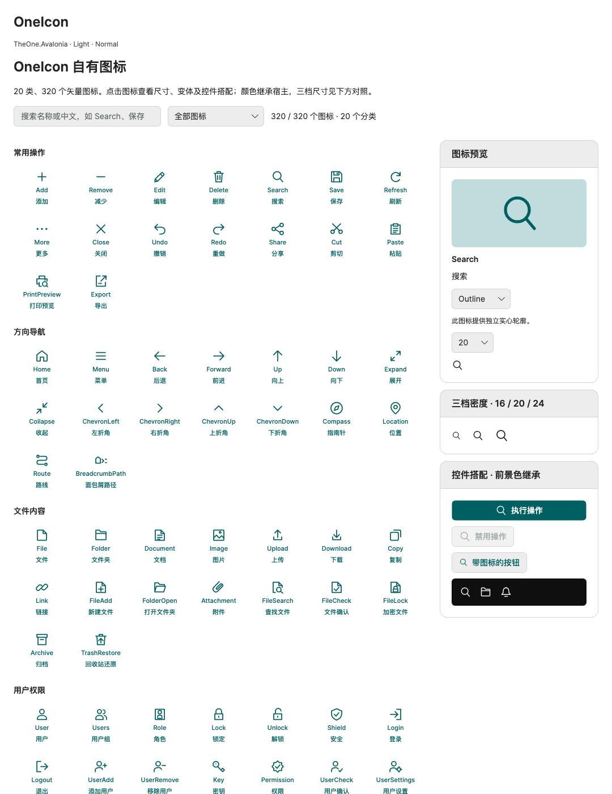

# OneIcon built-in icons

[简体中文](../zh-cn/one-icon.md) · [Control index](README.md)

`OneIcon` directly draws native vectors: 320 basic glyphs in 20 categories, with no icon font, network, Material, or other external icon dependency. Project-authored paths live in `OneIconCatalog.cs`. Outlines are parsed on first use and shared per glyph; dedicated filled geometry is parsed only when Filled is first requested, rather than per instance or frame.

This page describes current development source. OneIcon is not included in the previously released `1.0.0-preview.7` package; reference source or a subsequent release that explicitly includes this feature.

This expansion adds Transport, Commerce, Education and Weather with 16 glyphs each: 64 additions. New identities are 256–319; existing identities 0–255, geometry and categories remain unchanged. Category values are also appended. There are 32 dedicated filled variants; the others retain outline fallback.

```xml
<one:OneIcon Kind="Wallet" />
<one:OneIcon Kind="Factory" />
<one:OneIcon Kind="Stethoscope" />
<one:OneIcon Kind="PowerTower" />
```

These examples use the `one` namespace below. New glyphs use the same enum bindings, foreground inheritance and sizing configuration as existing glyphs.

<!-- visual-guide:start -->
## Appearance and example states

[Capture scope and visual index](visual-index.md). These are actual source-rendered examples; use this page’s usage notes for interaction and binding contracts.

### OneIcon



Visible portion of the real icon gallery and inspector; use the preview for the complete enum/catalog.

[View Dark comparison](../images/OneIcon-dark.png)

<!-- visual-guide:end -->

## Usage and compiled binding

After loading `OneTheme`:

```xml
<!-- xmlns:one="using:TheOne.Avalonia.Controls" -->
<one:OneIcon Kind="Search" />
<Button Classes="primary" AutomationProperties.Name="Search">
    <one:OneIcon Kind="Search" />
</Button>
```

Declare the consumer view's data type and return an enum from the view model, rather than a string property name:

```xml
<UserControl xmlns="https://github.com/avaloniaui"
             xmlns:x="http://schemas.microsoft.com/winfx/2006/xaml"
             xmlns:one="using:TheOne.Avalonia.Controls"
             xmlns:vm="using:MyApp.ViewModels"
             x:Class="MyApp.Views.IconView" x:DataType="vm:IconViewModel">
    <one:OneIcon Kind="{CompiledBinding CurrentIcon}"
                 Variant="{CompiledBinding IconVariant}" />
</UserControl>
```

```csharp
using System.ComponentModel;
using TheOne.Avalonia.Controls;

namespace MyApp.ViewModels;

public sealed class IconViewModel : INotifyPropertyChanged
{
    private OneIconKind _currentIcon = OneIconKind.Search;
    public OneIconKind CurrentIcon
    {
        get => _currentIcon;
        set
        {
            if (_currentIcon == value) return;
            _currentIcon = value;
            PropertyChanged?.Invoke(this, new PropertyChangedEventArgs(nameof(CurrentIcon)));
        }
    }
    public OneIconVariant IconVariant => OneIconVariant.Outline;
    public event PropertyChangedEventHandler? PropertyChanged;
}
```

The consumer assigns the view's DataContext. Kind/Variant changes reuse the control; no reflection-based member lookup or assembly preservation rule is required.

## Additional properties

| Property | Type / default | Behavior and short example |
| --- | --- | --- |
| `Kind` | `OneIconKind` / `Add` | One of 320 defined values; `Kind="Save"`. Undefined enum values are rejected. |
| `Variant` | `OneIconVariant` / `Outline` | `Outline` or `Filled`; unsupported filled variants use the same glyph's outline. `Variant="Filled"`. |
| `IconSize` | `double` / `20` | Positive finite desired size in DIPs; theme density applies unless explicitly overridden. `IconSize="18"`. |
| `StrokeThickness` | `double` / `1.75` | Outline width in the 24-unit grid, range `(0, 3]`, scaled with the glyph; does not affect filled silhouettes. `StrokeThickness="1.5"`. |
| `Foreground` | `IBrush?` / inherited text brush | Inherits the host by default; supports bindings and dynamic resources. Null draws nothing. Override with `Foreground="{DynamicResource One.Accent}"`. |

There are no additional appearance Classes. Shared `small / normal / large` and inherited `ControlSizing.Size` use **16 / 20 / 24 DIP**; see [shared theme and sizing](../../theme/en/README.md). Dynamic class/ancestor changes update the glyph. Default horizontal/vertical alignment is Center, so star-sized grids do not inflate the glyph. A local IconSize wins over density; explicit Width/Height constrain layout, with uniform centered drawing inside the actual bounds.

## Theme, state, and hosting

- Foreground shares the native inheritable text property. Window and button/menu content can provide their colors without a default icon setter masking selected or pressed text.
- The disabled theme uses `One.DisabledText`; a local Foreground retains normal Avalonia priority. Host opacity can also affect the glyph.
- Backgrounds and accent colors are not baked into geometry. Light/Dark and palette updates flow through inherited brushes and dynamic resources.
- By default the glyph neither intercepts hit tests nor takes keyboard focus. It preserves its host's pointer and command behavior and is not itself a button.
- Icons are decorative by default. Set `AutomationProperties.Name` on icon-only buttons; the Chinese catalog label is not automatically a screen-reader label.
- Loading is a static radial glyph with no timer. Host animation should respect Motion settings.
- Direction icons express fixed directions; choose the appropriate enum for RTL rather than relying on automatic mirroring.

With IconButton:

```xml
<one:IconButton Content="Save" IconSize="20">
    <one:IconButton.Icon><one:OneIcon Kind="Save" /></one:IconButton.Icon>
</one:IconButton>
```

A OneIcon control instance can belong to only one host. Share enum values and metadata, and create separate instances in templates. Existing [IconButton](icon-button.md) Geometry, custom templates, and third-party icon integration remain supported.

## Variants and complete catalog

Dedicated filled geometry is provided for 32 glyphs: `Search`, `Home`, `File`, `Folder`, `User`, `Lock`, `Shield`, `Info`, `Success`, `Warning`, `Error`, `Question`, `Bell`, `Message`, `Start`, `End`, `Heart`, `Star`, `Camera`, `Battery`, `Wallet`, `Bank`, `Factory`, `HardHat`, `MedicalCross`, `FirstAid`, `Building`, `WaterDrop`, `Car`, `ShoppingBag`, `Book`, and `Leaf`. All others explicitly fall back to Outline; open paths are never blindly filled. Changing Kind/Variant removes stale fills.

| `OneIconCategory` | `OneIconKind` — sixteen per category |
| --- | --- |
| Actions | Add, Remove, Edit, Delete, Search, Save, Refresh, More, Close, Undo, Redo, Share, Cut, Paste, PrintPreview, Export |
| Navigation | Home, Menu, Back, Forward, Up, Down, Expand, Collapse, ChevronLeft, ChevronRight, ChevronUp, ChevronDown, Compass, Location, Route, BreadcrumbPath |
| Files | File, Folder, Document, Image, Upload, Download, Copy, Link, FileAdd, FolderOpen, Attachment, FileSearch, FileCheck, FileLock, Archive, TrashRestore |
| People | User, Users, Role, Lock, Unlock, Shield, Login, Logout, UserAdd, UserRemove, Key, Permission, UserCheck, UserSettings, Organization, Fingerprint |
| Feedback | Info, Success, Warning, Error, Question, Bell, Message, Loading, BellOff, Mail, Send, Flag, NotificationRead, ChatReply, Heart, Star |
| Data | Table, Database, LineChart, BarChart, PieChart, Dashboard, Filter, Sort, SortAscending, SortDescending, Statistics, TrendUp, ScatterPlot, AreaChart, Heatmap, DataImport |
| DateTime | Calendar, Clock, DateRange, Timer, History, Schedule, PreviousDay, NextDay, Alarm, CalendarCheck, CalendarAdd, CalendarRemove, ClockCheck, ClockForward, CalendarWeek, TimeZone |
| Layout | Window, Tabs, Sidebar, Grid, List, Split, Maximize, Minimize, Fullscreen, FullscreenExit, Pin, Unpin, DockBottom, PanelLeftClose, PanelLeftOpen, Layers |
| Devices | Settings, Monitor, Mobile, Printer, Keyboard, Mouse, Sun, Moon, Play, Pause, Stop, Volume, Camera, Microphone, Headphones, Battery |
| Development | Code, Terminal, Api, Server, Cloud, Network, Bug, Package, Wifi, WifiOff, Connection, Disconnect, GitBranch, GitCommit, Braces, Container |
| Workflow | Start, End, Approval, Task, Branch, Parallel, Merge, Workflow, Approve, Reject, Transfer, Pending, Reassign, ApprovalChain, WorkflowValidate, WorkflowPublish |
| Design | Pointer, Text, Rectangle, Line, AlignLeft, AlignCenter, Barcode, QrCode, ZoomIn, ZoomOut, AlignRight, Crop, AlignTop, AlignBottom, DistributeHorizontal, Palette |
| Finance | Wallet, CreditCard, Bank, Cash, Coins, Receipt, Invoice, Calculator, Payment, Refund, Exchange, CurrencyYuan, CurrencyDollar, Safe, FinancialReport, StockTrend |
| Industry | Factory, Gear, Wrench, Hammer, RobotArm, Conveyor, Valve, Pump, Motor, Sensor, Gauge, Crane, Forklift, HardHat, Welding, Toolbox |
| Medical | MedicalCross, Hospital, Stethoscope, HeartPulse, Pill, Syringe, Thermometer, FirstAid, Ambulance, Wheelchair, Microscope, TestTube, Dna, Lungs, Tooth, Bandage |
| Infrastructure | Building, Bridge, Road, Railway, Airport, PowerTower, PowerPlug, WaterDrop, WaterPipe, WindTurbine, SolarPanel, StreetLight, TrafficLight, FireHydrant, Warehouse, Recycle |
| Transport | Truck, DeliveryVan, Car, Bus, Bicycle, Train, Ship, FlightTakeoff, DeliveryBox, DeliveryTracking, Map, NavigationArrow, Parking, Fuel, Anchor, TrafficCone |
| Commerce | ShoppingCart, ShoppingBag, Store, TagLabel, Discount, Gift, Product, Scan, ShoppingBasket, Order, OrderCheck, OrderCancel, Coupon, LoyaltyCard, CustomerService, ShoppingCompare |
| Education | Book, BookOpen, GraduationCap, School, Pen, Notebook, Library, Certificate, Lightbulb, Flask, Ruler, Globe, Language, Presentation, ReadAloud, Backpack |
| Weather | CloudSun, CloudMoon, Rain, Snow, Thunderstorm, Wind, Fog, Tornado, Rainbow, Umbrella, TemperatureHigh, Leaf, Tree, Flower, Mountain, Earth |

New sectors use distinct silhouettes: Bank has a pediment and columns, Factory a sawtooth roof, Hospital a medical cross and side wings, and Building a window grid. Gear differs from Settings, HeartPulse differs from Heart, and ClockForward differs from History. MedicalCross is a generic medical glyph, not a certification mark.

Role uses an identity card, Tabs a tab strip, and PreviousDay/NextDay a calendar. Parallel uses fork/join bars; Merge uses converging inputs and an output arrow. Warning/Success/Error differ by shape as well as color. QrCode and Barcode are decorative icons, not data encoders. Use [QRCode](qr-code.md) for actual QR symbols.

## Catalog API and model

```csharp
IReadOnlyList<OneIconInfo> icons = OneIconCatalog.All;
OneIconInfo search = OneIconCatalog.Get(OneIconKind.Search);
var workflowIcons = icons.Where(icon => icon.Category == OneIconCategory.Workflow);
var financeIcons = icons.Where(icon => icon.Category == OneIconCategory.Finance);
bool supportsFilled = search.HasFilledVariant;
```

All is read-only, in stable enum order. Get throws `ArgumentOutOfRangeException` for undefined values; it does not silently return another glyph. Shared geometries cannot be globally registered or replaced through a public API.

`OneIconInfo` is an immutable record containing Kind, Category, Name (stable English enum name), DisplayName (built-in Chinese label), and HasFilledVariant. Localize labels by Kind in the consumer. Enum numeric identities remain stable; future glyphs are appended without reusing existing numbers.

## Preview and focused verification

### Rendering and page-open performance

Each icon retains one `DrawGeometry`, with no controls per subpath. Outlines are shared and cached; filled resources are parsed separately on demand. Pens remain instance-owned, preserving mutable brushes and theme updates without a global brush cache. Existing appearance and public APIs are unchanged.

The old gallery eagerly created all buttons, text elements and templates through nested nonvirtualizing ItemsControls; its wrapper also built hidden API/enum tables. Native VirtualizingStackPanel rows now realize and recycle visible cards, regrouping only when the column count changes. Height stays natural with no new nested scroller. Hidden tables on manually documented pages are created only on first access through Details.

Measured 2026-10-20 on macOS ARM64 Release, Avalonia Headless + Skia, 1100×850. Each group used a separate process: one first open after app initialization, then 15 full opens. Timing includes construction, layout and RenderTargetBitmap drawing. Allocation counts UI-thread managed bytes, not peak memory or GPU memory. Nearest-rank p95 is the maximum of 15 samples.

| Metric | Before, 256 | After, 256 | Expanded, 320 |
| --- | ---: | ---: | ---: |
| Open p50 (ms) | 264.74 | 71.72 | 74.79 |
| Open p95 (ms) | 768.96 | 321.63 | 304.45 |
| Median UI-thread allocation (MB) | 137.08 | 29.00 | 29.02 |
| Realized visual controls | 3,082 | 779 | 779 |
| Realized icons, including inspector samples | 267 | 50 | 50 |
| First open, single observation (ms) | 1,384.78 | 695.11 | 512.75 |

At equal catalog size, median opening time fell about 73% and allocation about 79%; expansion to 320 did not increase realized instances. First-open observations include JIT, font and theme initialization and do not establish stable tail latency. These are page CPU/layout/offscreen drawing measurements, not physical-window frame rates or per-icon GPU raster speedups. Desktop-compositor stacks were not collected for this earlier measurement; see the separate desktop follow-up below.

PreviewHost → 基础控件 → **OneIcon** provides all 320 glyphs, category/English/Chinese search, click selection, variant and size selectors, density comparison, Light/Dark samples, button hosting, Description entries, and embedded compiled-binding source. The gallery virtualizes visible rows, regroups columns with width changes and recycles offscreen views while retaining the complete metadata and selection. Narrow windows use one column; gallery height grows naturally with no fixed height or nested scrollbar.

Focused checks cover catalog completeness, nonempty/in-bounds drawing, variant fallback/reversal, themes/palettes, density/override priority, pointer and focus behavior, PNG atlases, actual preview bindings, and native AOT consumption. Execution results belong to the task delivery; a static concept mockup is not runtime evidence.

2026-10-19: Release builds passed; managed and native AOT macOS ARM64 Skia headless runs each passed **4,847** checks. Six Light/Dark × density atlases were byte-identical between managed/AOT. Pixels for the original 96 glyphs in all six atlases were unchanged from the earlier catalog. All 144 glyphs were checked at 1×/2× DPI and 16/20/24 DIP, including maximum-stroke bounds. Actual preview enum bindings, category search, and pointer clicks through glyphs passed. Native compilation used clang and the SDK from the same Xcode, without new trim/AOT warnings. No full-library regression, Windows/Linux runtime, or physical-display presentation checks were performed.

2026-10-20: Expanded to **256 glyphs in 16 categories**. Managed and macOS ARM64 NativeAOT icon-only runs each passed **8,547 checks**; the Release build passed. Coverage includes all glyphs at three sizes and 1×/2× DPI, bounds, maximum stroke, unique outlines, variant changes, themes/palettes, bindings, four new category filters, narrow layouts and pointer routing through icons. Conveyor, Sensor and Forklift maximum-stroke overflow was corrected, and ClockForward was distinguished from History. Original 144 definitions and identities remain unchanged; their pixels match across all six atlases, and the six complete managed/NativeAOT atlases are byte-identical. Only OneIcon and its preview/host integration were verified, with no new dependencies or trim/AOT warnings. No full-library regression, Windows/Linux runtime or physical-display checks were performed.

2026-10-20 follow-up expansion and performance checks: added Transport, Commerce, Education and Weather, reaching 320 glyphs in 20 categories. Managed and macOS ARM64 NativeAOT runs each passed **10,705 checks**; the Release build passed. Additional coverage includes bounded realization, scrolling down/back, current recycled labels/enums, empty/restored filters, retained selection, search focus, keyboard activation and narrow/wide regrouping. The five manually documented pages affected by deferred construction retained accessible contract entry points. Corrected the new CloudMoon bounds. Original 256 definitions and identities are unchanged, pixels in all six old atlas regions match, and six complete managed/NativeAOT atlases are byte-identical. No new dependencies or trim/AOT warnings; no full-library, Windows/Linux or physical-display run.

### Native desktop follow-up: opening and scrolling tails

The remaining cost was in gallery control construction, styling, binding and layout. The preview now retains native virtualized row containers and Button slots, avoiding generic ItemsControl wrappers for each row. Each gallery Button draws through the existing OneIcon renderer and caches its two text layouts, replacing the nested presenter/text visual tree. Native Button pointer, keyboard, focus and automation behavior remain in use. Initial column grouping happens before the first measure; unchanged search/category assignments do not rebuild rows. Catalog entries held by pooled slots are immutable and replaced before reuse. No library API, glyph geometry, theme resources or dependency changed.

Measured 2026-10-20, macOS ARM64 Release, actual `Avalonia.Native.WindowImpl`, 1100×850 DIP at 2× scale, 320 icons in both versions. Each separate process recorded one cold opening, 30 subsequent openings, then 420 deterministic scroll-offset updates covering three down/up sweeps. Timings end at the native render-thread composition batch's `Rendered` completion, including UI work and scheduling. They do **not** measure physical-display presentation or hardware wheel/touchpad latency. Allocation is cumulative managed allocation on the UI thread, not total process/GPU memory. p95 uses nearest rank. Profiling ran separately from these timing runs.

| Metric | Before | After |
| --- | ---: | ---: |
| First opening, one observation (ms) | 713.07 | 356.62 |
| Subsequent opening p50 / p95 (ms), n=30 | 76.55 / 310.50 | 43.22 / 143.56 |
| Median opening UI allocation (MB) | 28.80 | 8.16 |
| Visual controls at opening | 779 | 359 |
| Scroll update p50 / p95 (ms), n=420 | 16.77 / 33.48 | 16.18 / 17.46 |
| Median scroll-update UI allocation (bytes) | 3,552,744 | 114,896 |
| Glyph instances created during all scroll updates | 1,693 | 26 |
| Glyph Measure / Arrange calls during scrolling | 1,693 / 1,693 | 26 / 26 |
| Glyph drawing recordings during scrolling | 1,693 | 1,693 |

Measure/Arrange counts refer to OneIcon instances, not every layout pass. Gallery glyphs now use private drawing instances rather than visual children, so counting visual-tree OneIcon controls alone undercounts them. Necessary glyph recording remains unchanged; the gain comes from removing construction, layout and binding churn. A 500ms idle check recorded zero glyph creation, layout or drawing calls in both versions.

Managed CPU sampling located the original styling/template/binding and virtualized-layout work. Native macOS samples include AGX Metal command-buffer/render-encoder stacks, confirming collection from the desktop rendering backend. The before trace includes opening and scrolling, whereas the after trace covers scrolling; their inclusive sample times are not directly comparable CPU percentages. Temporary captures and probes are isolated under `.preview/one-icons-desktop/`, with no benchmark startup arguments added to PreviewHost.

Scoped managed and macOS ARM64 NativeAOT runs each passed **10,709 checks**; the normal Release build passed, with one existing unrelated LoginDemoViewModel nullability warning. Added checks cover reused Button metadata, no-op filter assignments, drawing after recycling and mutable brush changes, plus native Button pointer/Space activation and focus. Existing coverage retains all 320 glyphs, three sizes, 1×/2× DPI, Light/Dark, responsive layouts, search and selection. All six glyph atlases are pixel-identical to the previous version. An actual desktop interaction run also verified Factory search, click/Space selection, clearing search and wheel scrolling down/back with search focus retained. Opening p95 still has a 143.56ms tail; these results do not establish Windows/Linux performance or eliminate cold-start costs. No full-library regression was run.

<!-- generated-contracts:start -->
## Control-specific properties, Classes usage and business APIs

This section lists project-added control-specific properties, public Classes usage, practical business actions and related models, without repeating inherited native APIs, constructors, property Get/Set wrappers or public identifiers. Registration defaults differ from themed values, and explicit local values take precedence. PreviewHost shows Classes through labeled examples rather than template-selector/setter inventories; properties and business actions in Description include short usage snippets. Shared ControlSizing and Motion settings are centralized on Home. Only Button, Input and Select share comparison pages; other controls retain independent complete demos.

### OneIcon

[Complete source contract](../../api/en/TheOne.Avalonia.Controls.OneIcon.md)

| Property | Type | Access/binding/inheritance | Registration/model default | Meaning and constraints |
| --- | --- | --- | --- | --- |
| [`Foreground`](../../../TheOne.Avalonia/Controls/OneIcon.cs#L45) | `Avalonia.Media.IBrush?` | writable; OneWay | `inherited registration` | `IBrush?` / inherited text brush ; Inherits the host by default; supports bindings and dynamic resources. Null draws nothing. Override with `Foreground="{DynamicResource One.Accent}"`. |
| [`IconSize`](../../../TheOne.Avalonia/Controls/OneIcon.cs#L41) | `double` | writable; OneWay | `20` | `double` / `20` ; Positive finite desired size in DIPs; theme density applies unless explicitly overridden. `IconSize="18"`. Validation: `value => double.IsFinite(value) && value > 0` |
| [`Kind`](../../../TheOne.Avalonia/Controls/OneIcon.cs#L37) | `TheOne.Avalonia.Controls.OneIconKind` | writable; OneWay | `OneIconKind.Add` | `OneIconKind` / `Add` ; One of 320 defined values; `Kind="Save"`. Undefined enum values are rejected. Validation: `value => Enum.IsDefined(value)` Values: `Add`, `Remove`, `Edit`, `Delete`, `Search`, `Save`, `Refresh`, `More`, `Home`, `Menu`, `Back`, `Forward`, `Up`, `Down`, `Expand`, `Collapse`, `File`, `Folder`, `Document`, `Image`, `Upload`, `Download`, `Copy`, `Link`, `User`, `Users`, `Role`, `Lock`, `Unlock`, `Shield`, `Login`, `Logout`, `Info`, `Success`, `Warning`, `Error`, `Question`, `Bell`, `Message`, `Loading`, `Table`, `Database`, `LineChart`, `BarChart`, `PieChart`, `Dashboard`, `Filter`, `Sort`, `Calendar`, `Clock`, `DateRange`, `Timer`, `History`, `Schedule`, `PreviousDay`, `NextDay`, `Window`, `Tabs`, `Sidebar`, `Grid`, `List`, `Split`, `Maximize`, `Minimize`, `Settings`, `Monitor`, `Mobile`, `Printer`, `Keyboard`, `Mouse`, `Sun`, `Moon`, `Code`, `Terminal`, `Api`, `Server`, `Cloud`, `Network`, `Bug`, `Package`, `Start`, `End`, `Approval`, `Task`, `Branch`, `Parallel`, `Merge`, `Workflow`, `Pointer`, `Text`, `Rectangle`, `Line`, `AlignLeft`, `AlignCenter`, `Barcode`, `QrCode`, `Close`, `Undo`, `Redo`, `Share`, `ChevronLeft`, `ChevronRight`, `ChevronUp`, `ChevronDown`, `FileAdd`, `FolderOpen`, `Attachment`, `FileSearch`, `UserAdd`, `UserRemove`, `Key`, `Permission`, `BellOff`, `Mail`, `Send`, `Flag`, `SortAscending`, `SortDescending`, `Statistics`, `TrendUp`, `Alarm`, `CalendarCheck`, `CalendarAdd`, `CalendarRemove`, `Fullscreen`, `FullscreenExit`, `Pin`, `Unpin`, `Play`, `Pause`, `Stop`, `Volume`, `Wifi`, `WifiOff`, `Connection`, `Disconnect`, `Approve`, `Reject`, `Transfer`, `Pending`, `ZoomIn`, `ZoomOut`, `AlignRight`, `Crop`, `Cut`, `Paste`, `PrintPreview`, `Export`, `Compass`, `Location`, `Route`, `BreadcrumbPath`, `FileCheck`, `FileLock`, `Archive`, `TrashRestore`, `UserCheck`, `UserSettings`, `Organization`, `Fingerprint`, `NotificationRead`, `ChatReply`, `Heart`, `Star`, `ScatterPlot`, `AreaChart`, `Heatmap`, `DataImport`, `ClockCheck`, `ClockForward`, `CalendarWeek`, `TimeZone`, `DockBottom`, `PanelLeftClose`, `PanelLeftOpen`, `Layers`, `Camera`, `Microphone`, `Headphones`, `Battery`, `GitBranch`, `GitCommit`, `Braces`, `Container`, `Reassign`, `ApprovalChain`, `WorkflowValidate`, `WorkflowPublish`, `AlignTop`, `AlignBottom`, `DistributeHorizontal`, `Palette`, `Wallet`, `CreditCard`, `Bank`, `Cash`, `Coins`, `Receipt`, `Invoice`, `Calculator`, `Payment`, `Refund`, `Exchange`, `CurrencyYuan`, `CurrencyDollar`, `Safe`, `FinancialReport`, `StockTrend`, `Factory`, `Gear`, `Wrench`, `Hammer`, `RobotArm`, `Conveyor`, `Valve`, `Pump`, `Motor`, `Sensor`, `Gauge`, `Crane`, `Forklift`, `HardHat`, `Welding`, `Toolbox`, `MedicalCross`, `Hospital`, `Stethoscope`, `HeartPulse`, `Pill`, `Syringe`, `Thermometer`, `FirstAid`, `Ambulance`, `Wheelchair`, `Microscope`, `TestTube`, `Dna`, `Lungs`, `Tooth`, `Bandage`, `Building`, `Bridge`, `Road`, `Railway`, `Airport`, `PowerTower`, `PowerPlug`, `WaterDrop`, `WaterPipe`, `WindTurbine`, `SolarPanel`, `StreetLight`, `TrafficLight`, `FireHydrant`, `Warehouse`, `Recycle`, `Truck`, `DeliveryVan`, `Car`, `Bus`, `Bicycle`, `Train`, `Ship`, `FlightTakeoff`, `DeliveryBox`, `DeliveryTracking`, `Map`, `NavigationArrow`, `Parking`, `Fuel`, `Anchor`, `TrafficCone`, `ShoppingCart`, `ShoppingBag`, `Store`, `TagLabel`, `Discount`, `Gift`, `Product`, `Scan`, `ShoppingBasket`, `Order`, `OrderCheck`, `OrderCancel`, `Coupon`, `LoyaltyCard`, `CustomerService`, `ShoppingCompare`, `Book`, `BookOpen`, `GraduationCap`, `School`, `Pen`, `Notebook`, `Library`, `Certificate`, `Lightbulb`, `Flask`, `Ruler`, `Globe`, `Language`, `Presentation`, `ReadAloud`, `Backpack`, `CloudSun`, `CloudMoon`, `Rain`, `Snow`, `Thunderstorm`, `Wind`, `Fog`, `Tornado`, `Rainbow`, `Umbrella`, `TemperatureHigh`, `Leaf`, `Tree`, `Flower`, `Mountain`, `Earth` |
| [`StrokeThickness`](../../../TheOne.Avalonia/Controls/OneIcon.cs#L43) | `double` | writable; OneWay | `1.75` | `double` / `1.75` ; Outline width in the 24-unit grid, range `(0, 3]`, scaled with the glyph; does not affect filled silhouettes. `StrokeThickness="1.5"`. Validation: `value => double.IsFinite(value) && value is > 0 and <= 3` |
| [`Variant`](../../../TheOne.Avalonia/Controls/OneIcon.cs#L39) | `TheOne.Avalonia.Controls.OneIconVariant` | writable; OneWay | `OneIconVariant.Outline` | `OneIconVariant` / `Outline` ; `Outline` or `Filled`; unsupported filled variants use the same glyph's outline. `Variant="Filled"`. Validation: `value => Enum.IsDefined(value)` Values: `Outline`, `Filled` |

### OneIconCatalog

[Complete source contract](../../api/en/TheOne.Avalonia.Controls.OneIconCatalog.md)

| Property | Type | Access/binding/inheritance | Registration/model default | Meaning and constraints |
| --- | --- | --- | --- | --- |
| [`All`](../../../TheOne.Avalonia/Controls/OneIconCatalog.cs#L402) | `System.Collections.Generic.IReadOnlyList<TheOne.Avalonia.Controls.OneIconInfo>` | read-only; CLR / n/a | `Array.AsReadOnly(Entries.Select(entry => entry.Info).ToArray())` | Read-only metadata for all glyphs, in stable enum order. |

### OneIconCategory

[Complete source contract](../../api/en/TheOne.Avalonia.Controls.OneIconCategory.md)

No additional CLR/attached properties are declared on this type; see its base for inherited members.

### OneIconInfo

[Complete source contract](../../api/en/TheOne.Avalonia.Controls.OneIconInfo.md)

| Property | Type | Access/binding/inheritance | Registration/model default | Meaning and constraints |
| --- | --- | --- | --- | --- |
| [`Category`](../../../TheOne.Avalonia/Controls/OneIconCatalog.cs#L6) | `TheOne.Avalonia.Controls.OneIconCategory` | writable; CLR / init-only | `required constructor argument` | Category name organizing node definitions in the library. Values: `Actions`, `Navigation`, `Files`, `People`, `Feedback`, `Data`, `DateTime`, `Layout`, `Devices`, `Development`, `Workflow`, `Design`, `Finance`, `Industry`, `Medical`, `Infrastructure`, `Transport`, `Commerce`, `Education`, `Weather` |
| [`DisplayName`](../../../TheOne.Avalonia/Controls/OneIconCatalog.cs#L6) | `string` | writable; CLR / init-only | `required constructor argument` | DisplayName configuration on OneIconInfo; type and initial value are listed here. Read/write uses the model's public accessor. See the usage contract and linked declaration/accessor for its context. |
| [`HasFilledVariant`](../../../TheOne.Avalonia/Controls/OneIconCatalog.cs#L6) | `bool` | writable; CLR / init-only | `required constructor argument` | HasFilledVariant configuration on OneIconInfo; type and initial value are listed here. Read/write uses the model's public accessor. See the usage contract and linked declaration/accessor for its context. |
| [`Kind`](../../../TheOne.Avalonia/Controls/OneIconCatalog.cs#L6) | `TheOne.Avalonia.Controls.OneIconKind` | writable; CLR / init-only | `required constructor argument` | `OneIconKind` / `Add` ; One of 320 defined values; `Kind="Save"`. Undefined enum values are rejected. Values: `Add`, `Remove`, `Edit`, `Delete`, `Search`, `Save`, `Refresh`, `More`, `Home`, `Menu`, `Back`, `Forward`, `Up`, `Down`, `Expand`, `Collapse`, `File`, `Folder`, `Document`, `Image`, `Upload`, `Download`, `Copy`, `Link`, `User`, `Users`, `Role`, `Lock`, `Unlock`, `Shield`, `Login`, `Logout`, `Info`, `Success`, `Warning`, `Error`, `Question`, `Bell`, `Message`, `Loading`, `Table`, `Database`, `LineChart`, `BarChart`, `PieChart`, `Dashboard`, `Filter`, `Sort`, `Calendar`, `Clock`, `DateRange`, `Timer`, `History`, `Schedule`, `PreviousDay`, `NextDay`, `Window`, `Tabs`, `Sidebar`, `Grid`, `List`, `Split`, `Maximize`, `Minimize`, `Settings`, `Monitor`, `Mobile`, `Printer`, `Keyboard`, `Mouse`, `Sun`, `Moon`, `Code`, `Terminal`, `Api`, `Server`, `Cloud`, `Network`, `Bug`, `Package`, `Start`, `End`, `Approval`, `Task`, `Branch`, `Parallel`, `Merge`, `Workflow`, `Pointer`, `Text`, `Rectangle`, `Line`, `AlignLeft`, `AlignCenter`, `Barcode`, `QrCode`, `Close`, `Undo`, `Redo`, `Share`, `ChevronLeft`, `ChevronRight`, `ChevronUp`, `ChevronDown`, `FileAdd`, `FolderOpen`, `Attachment`, `FileSearch`, `UserAdd`, `UserRemove`, `Key`, `Permission`, `BellOff`, `Mail`, `Send`, `Flag`, `SortAscending`, `SortDescending`, `Statistics`, `TrendUp`, `Alarm`, `CalendarCheck`, `CalendarAdd`, `CalendarRemove`, `Fullscreen`, `FullscreenExit`, `Pin`, `Unpin`, `Play`, `Pause`, `Stop`, `Volume`, `Wifi`, `WifiOff`, `Connection`, `Disconnect`, `Approve`, `Reject`, `Transfer`, `Pending`, `ZoomIn`, `ZoomOut`, `AlignRight`, `Crop`, `Cut`, `Paste`, `PrintPreview`, `Export`, `Compass`, `Location`, `Route`, `BreadcrumbPath`, `FileCheck`, `FileLock`, `Archive`, `TrashRestore`, `UserCheck`, `UserSettings`, `Organization`, `Fingerprint`, `NotificationRead`, `ChatReply`, `Heart`, `Star`, `ScatterPlot`, `AreaChart`, `Heatmap`, `DataImport`, `ClockCheck`, `ClockForward`, `CalendarWeek`, `TimeZone`, `DockBottom`, `PanelLeftClose`, `PanelLeftOpen`, `Layers`, `Camera`, `Microphone`, `Headphones`, `Battery`, `GitBranch`, `GitCommit`, `Braces`, `Container`, `Reassign`, `ApprovalChain`, `WorkflowValidate`, `WorkflowPublish`, `AlignTop`, `AlignBottom`, `DistributeHorizontal`, `Palette`, `Wallet`, `CreditCard`, `Bank`, `Cash`, `Coins`, `Receipt`, `Invoice`, `Calculator`, `Payment`, `Refund`, `Exchange`, `CurrencyYuan`, `CurrencyDollar`, `Safe`, `FinancialReport`, `StockTrend`, `Factory`, `Gear`, `Wrench`, `Hammer`, `RobotArm`, `Conveyor`, `Valve`, `Pump`, `Motor`, `Sensor`, `Gauge`, `Crane`, `Forklift`, `HardHat`, `Welding`, `Toolbox`, `MedicalCross`, `Hospital`, `Stethoscope`, `HeartPulse`, `Pill`, `Syringe`, `Thermometer`, `FirstAid`, `Ambulance`, `Wheelchair`, `Microscope`, `TestTube`, `Dna`, `Lungs`, `Tooth`, `Bandage`, `Building`, `Bridge`, `Road`, `Railway`, `Airport`, `PowerTower`, `PowerPlug`, `WaterDrop`, `WaterPipe`, `WindTurbine`, `SolarPanel`, `StreetLight`, `TrafficLight`, `FireHydrant`, `Warehouse`, `Recycle`, `Truck`, `DeliveryVan`, `Car`, `Bus`, `Bicycle`, `Train`, `Ship`, `FlightTakeoff`, `DeliveryBox`, `DeliveryTracking`, `Map`, `NavigationArrow`, `Parking`, `Fuel`, `Anchor`, `TrafficCone`, `ShoppingCart`, `ShoppingBag`, `Store`, `TagLabel`, `Discount`, `Gift`, `Product`, `Scan`, `ShoppingBasket`, `Order`, `OrderCheck`, `OrderCancel`, `Coupon`, `LoyaltyCard`, `CustomerService`, `ShoppingCompare`, `Book`, `BookOpen`, `GraduationCap`, `School`, `Pen`, `Notebook`, `Library`, `Certificate`, `Lightbulb`, `Flask`, `Ruler`, `Globe`, `Language`, `Presentation`, `ReadAloud`, `Backpack`, `CloudSun`, `CloudMoon`, `Rain`, `Snow`, `Thunderstorm`, `Wind`, `Fog`, `Tornado`, `Rainbow`, `Umbrella`, `TemperatureHigh`, `Leaf`, `Tree`, `Flower`, `Mountain`, `Earth` |
| [`Name`](../../../TheOne.Avalonia/Controls/OneIconCatalog.cs#L6) | `string` | writable; CLR / init-only | `required constructor argument` | Name used for presentation/identity; keep it consistent with templates and keys. |

### OneIconKind

[Complete source contract](../../api/en/TheOne.Avalonia.Controls.OneIconKind.md)

No additional CLR/attached properties are declared on this type; see its base for inherited members.

### OneIconVariant

[Complete source contract](../../api/en/TheOne.Avalonia.Controls.OneIconVariant.md)

No additional CLR/attached properties are declared on this type; see its base for inherited members.

See [shared theme configuration](../../theme/en/README.md#shared-configuration) for common sizing and motion settings, demonstrated centrally on PreviewHost Home.

### Classes usage

No added public appearance classes; use the default theme and control-specific properties.
These are individually supported public classes. Hover, pressed, disabled and selected states are control-owned; do not assign template classes manually. See the labeled PreviewHost examples for their appearance.

### Business APIs

| Type | Action signature | Purpose |
| --- | --- | --- |
| [`OneIconCatalog`](../../api/en/TheOne.Avalonia.Controls.OneIconCatalog.md) | `static OneIconInfo OneIconCatalog.Get(OneIconKind kind)` | Gets metadata for a valid enum value. Throws for undefined values. |

### Related models

| Model | Properties/enum values |
| --- | ---: |
| [`TheOne.Avalonia.Controls.OneIconCategory`](../../api/en/TheOne.Avalonia.Controls.OneIconCategory.md) | 20 |
| [`TheOne.Avalonia.Controls.OneIconInfo`](../../api/en/TheOne.Avalonia.Controls.OneIconInfo.md) | 5 |
| [`TheOne.Avalonia.Controls.OneIconKind`](../../api/en/TheOne.Avalonia.Controls.OneIconKind.md) | 320 |
| [`TheOne.Avalonia.Controls.OneIconVariant`](../../api/en/TheOne.Avalonia.Controls.OneIconVariant.md) | 2 |

[Complete source contract (including constructors, property accessors and identifiers for precise lookup)](../../api/en/README.md)
<!-- generated-contracts:end -->
