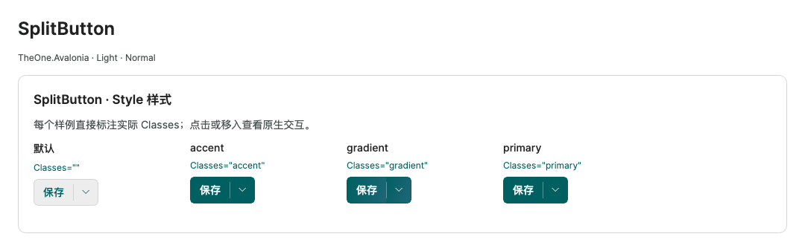

# PreviewHost return after a full browse (2026-10-20, phase two)

[简体中文](../zh-cn/preview-return-performance-20261020.md) · [Phase one](preview-performance-20261020.md) · [Control documentation](README.md)

<!-- visual-guide:start -->
## Appearance and example states

[Capture scope and visual index](visual-index.md). These are actual source-rendered examples; use this page’s usage notes for interaction and binding contracts.

### SplitButton

Primary action and dropdown affordance are separate; default, accent, gradient and primary are compared.

[View Dark comparison](../images/SplitButton-dark.png)

### NavPage

Default header, navigation pane and card tabs form a workspace; navigation opens the right-hand pages.

[View Dark comparison](../images/NavPage-dark.png)

<!-- visual-guide:end -->

## Changes

Phase one reduced first-opening work, but fully visited pages still reattached their documentation and editors on return. The preview-only `PreviewPageHost` now retains visited pages in the tree and hides inactive frames. Only the active frame is measured and arranged; hidden frames do not draw, receive hits or participate in keyboard navigation. Normal navigation preserves page, description, editor and business-model instances.

The shared bottom “示例代码 · AXAML / C#” expander, file selector and loader have been removed from control pages. The complete Views / ViewModels source inventory is no longer embedded. Home and necessary business examples retain inline editors; short property and business-API snippets remain in their `Description` entries.

Documentation placeholders are created only if the filtered properties, business APIs or models contain actual rows. Pages such as SplitButton no longer reserve an empty 320px area, and empty supplement containers no longer add spacing. Nonempty descriptions retain deferred creation and natural height; real content is neither compressed nor hidden. Canvas editors continue to receive bounded viewports.

## State and focus

- Selection, editing drafts, editor documents, code selection, carets and undo history stay with the original instances.
- Native TextBox focus can collapse selection. The host tracks only the last editing target per page and synchronously preserves/restores its text selection and caret. Ranges are clamped if text becomes shorter; targets moved out of the page are rejected.
- Content-initiated navigation can resume the destination page's prior editing focus and position. Menus, search and other external navigation retain their own focus. Text selection can be restored without taking menu focus. No asynchronous focus-restoration callbacks are used.
- Hiding a cached page is not detachment. The host tracks only open Popups belonging to the active page and closes those transient surfaces on navigation or detachment, preserving bindings and selection. Navigation does not scan all descriptions/editors to find popups.
- Actual host detachment still follows Avalonia's normal lifecycle and releases the popup observer.

## Desktop measurement method

macOS / Apple M4, .NET 10, Avalonia 12.1.4, Release, 1100 × 820 window, native desktop backend. Both versions use the same probe, control library and dependencies, replacing only PreviewHost. Each run opens and fully scrolls the target before alternating Home / target; full traversal and Home navigation are outside the return timer. Statistics use 30 subsequent warm returns and nearest-rank p95.

Timing runs from `GalleryViewModel.Select` to the first native animation-frame callback, including synchronous navigation and layout; **it is not GPU presentation completion time**. Tree counts are collected only on the first and last samples to avoid per-iteration traversal allocations and GC noise. Do not directly subtract these results from phase one's small sample set. This measures the combined changes to hosting, footer removal and empty placeholders; removing the footer also slightly increases usable content height at the same window size.

Raw samples, mount counts, logs, screenshots and temporary probes are under `.preview/preview-return-20261020/`. Normal Program / App startup has no test branches and PreviewHost remains WinExe. Public control APIs, compiled bindings and business-model contracts are unchanged.

## Desktop results

Milliseconds, returning after a full browse, with 30 warm samples per case. Synchronous allocation covers the navigation call and synchronous layout, not total frame or GPU allocation.

| Page | Median, before → after | p95, before → after | Median synchronous allocation, before → after |
| --- | ---: | ---: | ---: |
| LineChart | 213.9 → 15.6 | 941.8 → 19.9 | 16417.6 → 3.7 KiB |
| Grouped Button | 267.6 → 16.5 | 948.2 → 19.8 | 42079.0 → 4.8 KiB |
| NavPage with multiple inline editors | 159.1 → 15.6 | 316.3 → 17.2 | 25031.7 → 3.7 KiB |

Across 30 returns, created documentation roots and editors reattached **90 → 0** times for Line, **180 → 0** for Button and **270 → 0** for NavPage, with matching detach counts. Removing empty documentation placeholders also reduces Button's number of tracked roots. These are targeted counts, not all-control lifecycle totals.

After timings approach the desktop frame-scheduling interval. They are not pure CPU execution times or latency guarantees for other machines; they demonstrate that reattachment no longer dominates returns under these conditions.

Verification files: `before-final-{line,buttons,navpage}/metrics.json` and `after-final-{line,buttons,navpage}/metrics.json`. Shared control-library SHA-256: `9d6789be57564a7fd7c85f62d9ed502165698b7bacdfec5bc890f7206a6a4cde`; before/after PreviewHost: `ef7695030e078b82d00ddf0e2a76402328ee4a9da49f6c2e32951c285ad9c0a6` / `54c8ae07eea6ea7e2cf1a8972e6b4ad342e0e79495fcb3bdd34d358a2244ab5c`.

## Targeted validation

Only PreviewHost was built. **151 checks** passed on the native desktop backend: complete scrolling/return for Line / Gauge / Button / Input / Select / NavPage, retained chart selection, rows and editor instances; natural SplitButton height and pixel inspection in light/dark, three densities and a narrow window; TextBox drafts, selection, caret and focus; external navigation retaining its own focus; ComboBox and MultiSelectBox popups closing on departure while multiple selection remains; inline editor drafts, selection, caret, focus and undo history following actual text input.

Real pointer/keyboard checks also used the final MainWindow with Home / Input returns. Both drafts remained; after selecting the final three characters and navigating away/back, typing `XYZ` replaced that same range. Focus returned to the original field, and Tab reached the next Home control rather than an inactive page. Editor focus and undo state were covered by the native desktop checks above. The diagnostic shortcut exists only in the temporary `.preview` probe, and the validation window was closed.

## Limits

Only already visited pages are retained; the cache does not eagerly create every page. Created views and native rendering resources remain alive longer, without an added LRU eviction policy, so memory needs observation when many pages are visited. Hidden pages are not laid out or drawn, but model subscriptions may still receive business updates; hiding is not destruction or cancellation of background work.

Validation is limited to affected preview hosting, descriptions, code and representative pages. It is not a library-wide regression, AOT consumer validation, or Windows/Linux runtime test.
