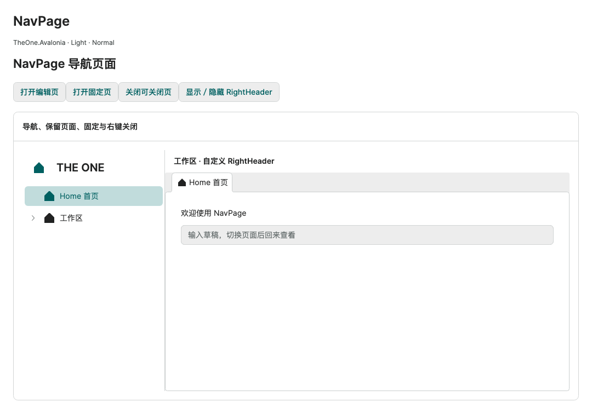
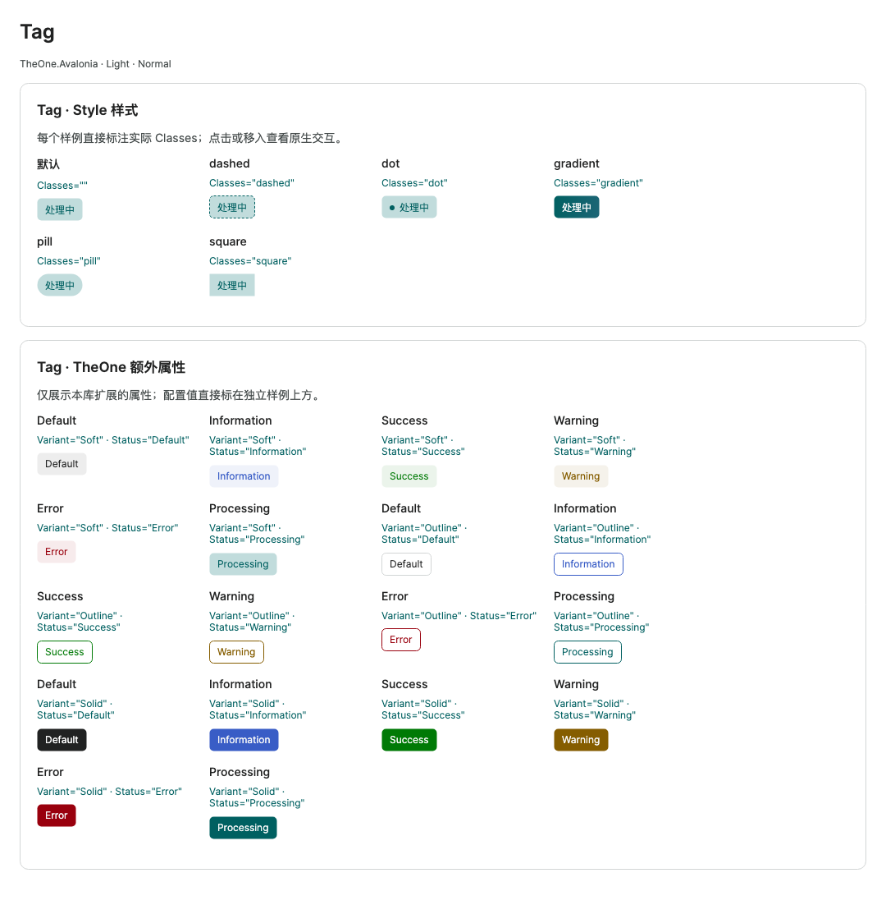

# Control visual index and capture notes

[简体中文](../zh-cn/visual-index.md) · [Control guides](README.md)

Images render actual library controls and PreviewHost samples through Avalonia 12.1.4 Headless + Skia. They are not mockups or browser recreations. Window images include the client area and custom title bar, not OS decorations. Stills document appearance, not native input, animation frame rate, printing or cross-platform execution.

The baseline is Nova, Normal and Light / Dark; explicitly labeled Classes/local configuration take precedence. Shared images retain PreviewHost’s Chinese fixture labels; English guides supply English captions. Lists/icon galleries show the visible range rather than a complete data inventory. Popups are framed separately with their actual theme, selection and item insets.

Business data is fixture data. Attachment states/progress are model inputs, with no upload; confirmation performs no deletion; reports/workflows call no external business endpoint. Public properties, snippets, models and behavior in the guides remain the contract.

## Visual overview

| Navigation workspace | States and appearances |
| --- | --- |
|  |  |
|  |  |

## Reading order

1. Inspect the appearance and Light/Dark comparison below.
2. Open the guide, read its caption, then adapt the minimal code and library-specific options.
3. Check signatures in the full API reference and exercise PreviewHost with your data, theme and target platform.

## Controls and states

| Control / state | Light | Dark | Usage |
| --- | --- | --- | --- |
| AreaChart | [Light](../images/AreaChart-light.png) | [Dark](../images/AreaChart-dark.png) | [Guide](chart-cartesian.md) |
| AttachmentList | [Light](../images/AttachmentList-light.png) | [Dark](../images/AttachmentList-dark.png) | [Guide](attachment-list.md) |
| AutoCompleteBox | [Light](../images/AutoCompleteBox-light.png) | [Dark](../images/AutoCompleteBox-dark.png) | [Guide](basic.md) |
| Avatar | [Light](../images/Avatar-light.png) | [Dark](../images/Avatar-dark.png) | [Guide](avatar.md) |
| BarChart | [Light](../images/BarChart-light.png) | [Dark](../images/BarChart-dark.png) | [Guide](chart-cartesian.md) |
| BoxPlotChart | [Light](../images/BoxPlotChart-light.png) | [Dark](../images/BoxPlotChart-dark.png) | [Guide](chart-statistical.md) |
| Breadcrumb | [Light](../images/Breadcrumb-light.png) | [Dark](../images/Breadcrumb-dark.png) | [Guide](breadcrumb.md) |
| Button | [Light](../images/Button-light.png) | [Dark](../images/Button-dark.png) | [Guide](basic.md) |
| ButtonSpinner | [Light](../images/ButtonSpinner-light.png) | [Dark](../images/ButtonSpinner-dark.png) | [Guide](basic.md) |
| Calendar | [Light](../images/Calendar-light.png) | [Dark](../images/Calendar-dark.png) | [Guide](date-time.md) |
| CalendarDatePicker | [Light](../images/CalendarDatePicker-light.png) | [Dark](../images/CalendarDatePicker-dark.png) | [Guide](date-time.md) |
| CandlestickChart | [Light](../images/CandlestickChart-light.png) | [Dark](../images/CandlestickChart-dark.png) | [Guide](chart-statistical.md) |
| Carousel | [Light](../images/Carousel-light.png) | [Dark](../images/Carousel-dark.png) | [Guide](collection-content.md) |
| CheckBox | [Light](../images/CheckBox-light.png) | [Dark](../images/CheckBox-dark.png) | [Guide](basic.md) |
| ColorPicker | [Light](../images/ColorPicker-light.png) | [Dark](../images/ColorPicker-dark.png) | [Guide](color-picker.md) |
| ColorView | [Light](../images/ColorView-light.png) | [Dark](../images/ColorView-dark.png) | [Guide](color-picker.md) |
| ColorView · Custom editor | [Light](../images/ColorViewCustom-light.png) | [Dark](../images/ColorViewCustom-dark.png) | [Guide](color-picker.md) |
| ComboBox | [Light](../images/ComboBox-light.png) | [Dark](../images/ComboBox-dark.png) | [Guide](basic.md) |
| ComboBox · Open dropdown | [Light](../images/ComboBoxPopup-light.png) | [Dark](../images/ComboBoxPopup-dark.png) | [Guide](basic.md) |
| ContextMenu | [Light](../images/ContextMenu-light.png) | [Dark](../images/ContextMenu-dark.png) | [Guide](layout.md) |
| DataGrid | [Light](../images/DataGrid-light.png) | [Dark](../images/DataGrid-dark.png) | [Guide](collections.md) |
| DataGridTree | [Light](../images/DataGridTree-light.png) | [Dark](../images/DataGridTree-dark.png) | [Guide](datagrid-tree.md) |
| DatePicker | [Light](../images/DatePicker-light.png) | [Dark](../images/DatePicker-dark.png) | [Guide](date-time.md) |
| DateTimePicker | [Light](../images/DateTimePicker-light.png) | [Dark](../images/DateTimePicker-dark.png) | [Guide](datetime-picker.md) |
| Description | [Light](../images/Description-light.png) | [Dark](../images/Description-dark.png) | [Guide](description.md) |
| Dialog | [Light](../images/Dialog-light.png) | [Dark](../images/Dialog-dark.png) | [Guide](window-owners.md) |
| DoughnutChart | [Light](../images/DoughnutChart-light.png) | [Dark](../images/DoughnutChart-dark.png) | [Guide](chart-radial.md) |
| Expander | [Light](../images/Expander-light.png) | [Dark](../images/Expander-dark.png) | [Guide](layout.md) |
| FlowStep | [Light](../images/FlowStep-light.png) | [Dark](../images/FlowStep-dark.png) | [Guide](flow-step.md) |
| FlyoutPresenter | [Light](../images/FlyoutPresenter-light.png) | [Dark](../images/FlyoutPresenter-dark.png) | [Guide](layout.md) |
| Form | [Light](../images/Form-light.png) | [Dark](../images/Form-dark.png) | [Guide](form.md) |
| FunnelChart | [Light](../images/FunnelChart-light.png) | [Dark](../images/FunnelChart-dark.png) | [Guide](chart-specialized.md) |
| GanttChart | [Light](../images/GanttChart-light.png) | [Dark](../images/GanttChart-dark.png) | [Guide](gantt-chart.md) |
| GaugeChart | [Light](../images/GaugeChart-light.png) | [Dark](../images/GaugeChart-dark.png) | [Guide](chart-radial.md) |
| GridSplitter | [Light](../images/GridSplitter-light.png) | [Dark](../images/GridSplitter-dark.png) | [Guide](layout.md) |
| HeatmapChart | [Light](../images/HeatmapChart-light.png) | [Dark](../images/HeatmapChart-dark.png) | [Guide](chart-specialized.md) |
| HorizontalBarChart | [Light](../images/HorizontalBarChart-light.png) | [Dark](../images/HorizontalBarChart-dark.png) | [Guide](chart-cartesian.md) |
| IconButton | [Light](../images/IconButton-light.png) | [Dark](../images/IconButton-dark.png) | [Guide](icon-button.md) |
| ImagePreview | [Light](../images/ImagePreview-light.png) | [Dark](../images/ImagePreview-dark.png) | [Guide](image-preview.md) |
| ImageUpload | [Light](../images/ImageUpload-light.png) | [Dark](../images/ImageUpload-dark.png) | [Guide](image-upload.md) |
| InfoCard | [Light](../images/InfoCard-light.png) | [Dark](../images/InfoCard-dark.png) | [Guide](info-card.md) |
| ItemsControl | [Light](../images/ItemsControl-light.png) | [Dark](../images/ItemsControl-dark.png) | [Guide](collections.md) |
| Label | [Light](../images/Label-light.png) | [Dark](../images/Label-dark.png) | [Guide](text-display.md) |
| LineChart | [Light](../images/LineChart-light.png) | [Dark](../images/LineChart-dark.png) | [Guide](chart-cartesian.md) |
| ListBox | [Light](../images/ListBox-light.png) | [Dark](../images/ListBox-dark.png) | [Guide](collections.md) |
| LoadingContainer | [Light](../images/LoadingContainer-light.png) | [Dark](../images/LoadingContainer-dark.png) | [Guide](loading.md) |
| LoginWindow | [Light](../images/LoginWindow-light.png) | [Dark](../images/LoginWindow-dark.png) | [Guide](login-window.md) |
| Menu | [Light](../images/Menu-light.png) | [Dark](../images/Menu-dark.png) | [Guide](layout.md) |
| MessageBox | [Light](../images/MessageBox-light.png) | [Dark](../images/MessageBox-dark.png) | [Guide](message-box.md) |
| MultiSelectBox | [Light](../images/MultiSelectBox-light.png) | [Dark](../images/MultiSelectBox-dark.png) | [Guide](multi-select-box.md) |
| MultiSelectBox · Search and checkable list | [Light](../images/MultiSelectBoxPopup-light.png) | [Dark](../images/MultiSelectBoxPopup-dark.png) | [Guide](multi-select-box.md) |
| NavMenu | [Light](../images/NavMenu-light.png) | [Dark](../images/NavMenu-dark.png) | [Guide](nav-menu-motion.md) |
| NavMenu · Collapsed flyout | [Light](../images/NavMenuPopup-light.png) | [Dark](../images/NavMenuPopup-dark.png) | [Guide](nav-menu-popups.md) |
| NavMenu · Multilevel search | [Light](../images/NavMenuSearch-light.png) | [Dark](../images/NavMenuSearch-dark.png) | [Guide](nav-menu-search.md) |
| NavPage | [Light](../images/NavPage-light.png) | [Dark](../images/NavPage-dark.png) | [Guide](nav-page.md) |
| NotificationCard | [Light](../images/NotificationCard-light.png) | [Dark](../images/NotificationCard-dark.png) | [Guide](content-feedback.md) |
| NumericUpDown | [Light](../images/NumericUpDown-light.png) | [Dark](../images/NumericUpDown-dark.png) | [Guide](basic.md) |
| OneIcon | [Light](../images/OneIcon-light.png) | [Dark](../images/OneIcon-dark.png) | [Guide](one-icon.md) |
| OneNotification | [Light](../images/OneNotification-light.png) | [Dark](../images/OneNotification-dark.png) | [Guide](content-feedback.md) |
| OneWindow | [Light](../images/OneWindow-light.png) | [Dark](../images/OneWindow-dark.png) | [Guide](window-owners.md) |
| Pagination | [Light](../images/Pagination-light.png) | [Dark](../images/Pagination-dark.png) | [Guide](pagination.md) |
| PercentStackedAreaChart | [Light](../images/PercentStackedAreaChart-light.png) | [Dark](../images/PercentStackedAreaChart-dark.png) | [Guide](chart-cartesian.md) |
| PercentStackedBarChart | [Light](../images/PercentStackedBarChart-light.png) | [Dark](../images/PercentStackedBarChart-dark.png) | [Guide](chart-cartesian.md) |
| PercentStackedHorizontalBarChart | [Light](../images/PercentStackedHorizontalBarChart-light.png) | [Dark](../images/PercentStackedHorizontalBarChart-dark.png) | [Guide](chart-cartesian.md) |
| PieChart | [Light](../images/PieChart-light.png) | [Dark](../images/PieChart-dark.png) | [Guide](chart-radial.md) |
| ProgressBar | [Light](../images/ProgressBar-light.png) | [Dark](../images/ProgressBar-dark.png) | [Guide](basic.md) |
| QRCode | [Light](../images/QRCode-light.png) | [Dark](../images/QRCode-dark.png) | [Guide](qr-code.md) |
| RadarChart | [Light](../images/RadarChart-light.png) | [Dark](../images/RadarChart-dark.png) | [Guide](chart-specialized.md) |
| RadioButton | [Light](../images/RadioButton-light.png) | [Dark](../images/RadioButton-dark.png) | [Guide](basic.md) |
| RefreshContainer | [Light](../images/RefreshContainer-light.png) | [Dark](../images/RefreshContainer-dark.png) | [Guide](collection-content.md) |
| RelationGraph | [Light](../images/RelationGraph-light.png) | [Dark](../images/RelationGraph-dark.png) | [Guide](relation-graph.md) |
| RepeatButton | [Light](../images/RepeatButton-light.png) | [Dark](../images/RepeatButton-dark.png) | [Guide](basic.md) |
| ReportDesign | [Light](../images/ReportDesign-light.png) | [Dark](../images/ReportDesign-dark.png) | [Guide](report-design.md) |
| ReportPreview | [Light](../images/ReportPreview-light.png) | [Dark](../images/ReportPreview-dark.png) | [Guide](report-preview.md) |
| ScatterChart | [Light](../images/ScatterChart-light.png) | [Dark](../images/ScatterChart-dark.png) | [Guide](chart-cartesian.md) |
| ScrollBar | [Light](../images/ScrollBar-light.png) | [Dark](../images/ScrollBar-dark.png) | [Guide](layout.md) |
| ScrollViewer | [Light](../images/ScrollViewer-light.png) | [Dark](../images/ScrollViewer-dark.png) | [Guide](layout.md) |
| SelectableTextBlock | [Light](../images/SelectableTextBlock-light.png) | [Dark](../images/SelectableTextBlock-dark.png) | [Guide](text-display.md) |
| Separator | [Light](../images/Separator-light.png) | [Dark](../images/Separator-dark.png) | [Guide](layout.md) |
| Slider | [Light](../images/Slider-light.png) | [Dark](../images/Slider-dark.png) | [Guide](basic.md) |
| SplitButton | [Light](../images/SplitButton-light.png) | [Dark](../images/SplitButton-dark.png) | [Guide](split-button.md) |
| SplitView | [Light](../images/SplitView-light.png) | [Dark](../images/SplitView-dark.png) | [Guide](layout.md) |
| StackedAreaChart | [Light](../images/StackedAreaChart-light.png) | [Dark](../images/StackedAreaChart-dark.png) | [Guide](chart-cartesian.md) |
| StackedBarChart | [Light](../images/StackedBarChart-light.png) | [Dark](../images/StackedBarChart-dark.png) | [Guide](chart-cartesian.md) |
| StackedHorizontalBarChart | [Light](../images/StackedHorizontalBarChart-light.png) | [Dark](../images/StackedHorizontalBarChart-dark.png) | [Guide](chart-cartesian.md) |
| SunburstChart | [Light](../images/SunburstChart-light.png) | [Dark](../images/SunburstChart-dark.png) | [Guide](chart-hierarchy.md) |
| TabControl | [Light](../images/TabControl-light.png) | [Dark](../images/TabControl-dark.png) | [Guide](collections.md) |
| TabStrip | [Light](../images/TabStrip-light.png) | [Dark](../images/TabStrip-dark.png) | [Guide](collections.md) |
| Tag | [Light](../images/Tag-light.png) | [Dark](../images/Tag-dark.png) | [Guide](tag-verification-step.md) |
| TextBox | [Light](../images/TextBox-light.png) | [Dark](../images/TextBox-dark.png) | [Guide](basic.md) |
| ThemeButton | [Light](../images/ThemeButton-light.png) | [Dark](../images/ThemeButton-dark.png) | [Guide](windows.md) |
| ThemeColorPicker | [Light](../images/ThemeColorPicker-light.png) | [Dark](../images/ThemeColorPicker-dark.png) | [Guide](../../theme/en/theme-color-picker.md) |
| ThemeColorPicker · Palette list | [Light](../images/ThemeColorPickerPopup-light.png) | [Dark](../images/ThemeColorPickerPopup-dark.png) | [Guide](../../theme/en/theme-color-picker.md) |
| TimePicker | [Light](../images/TimePicker-light.png) | [Dark](../images/TimePicker-dark.png) | [Guide](date-time.md) |
| Timeline | [Light](../images/Timeline-light.png) | [Dark](../images/Timeline-dark.png) | [Guide](timeline.md) |
| Toast | [Light](../images/Toast-light.png) | [Dark](../images/Toast-dark.png) | [Guide](window-owners.md) |
| ToggleButton | [Light](../images/ToggleButton-light.png) | [Dark](../images/ToggleButton-dark.png) | [Guide](basic.md) |
| ToggleSplitButton | [Light](../images/ToggleSplitButton-light.png) | [Dark](../images/ToggleSplitButton-dark.png) | [Guide](split-button.md) |
| ToggleSwitch | [Light](../images/ToggleSwitch-light.png) | [Dark](../images/ToggleSwitch-dark.png) | [Guide](basic.md) |
| ToolTip | [Light](../images/ToolTip-light.png) | [Dark](../images/ToolTip-dark.png) | [Guide](basic.md) |
| TransitioningContentControl | [Light](../images/TransitioningContentControl-light.png) | [Dark](../images/TransitioningContentControl-dark.png) | [Guide](content-feedback.md) |
| TreeSelect | [Light](../images/TreeSelect-light.png) | [Dark](../images/TreeSelect-dark.png) | [Guide](tree-select.md) |
| TreeSelect · Tree popup | [Light](../images/TreeSelectPopup-light.png) | [Dark](../images/TreeSelectPopup-dark.png) | [Guide](tree-select.md) |
| TreeView | [Light](../images/TreeView-light.png) | [Dark](../images/TreeView-dark.png) | [Guide](collections.md) |
| TreemapChart | [Light](../images/TreemapChart-light.png) | [Dark](../images/TreemapChart-dark.png) | [Guide](chart-hierarchy.md) |
| Upload | [Light](../images/Upload-light.png) | [Dark](../images/Upload-dark.png) | [Guide](upload.md) |
| VerificationStep | [Light](../images/VerificationStep-light.png) | [Dark](../images/VerificationStep-dark.png) | [Guide](tag-verification-step.md) |
| WorkflowEditor | [Light](../images/WorkflowEditor-light.png) | [Dark](../images/WorkflowEditor-dark.png) | [Guide](workflow-editor.md) |

## Maintenance and evidence

The [capture manifest](../images/capture-manifest.json) records scenes, themes and dimensions. Capture source and temporary builds live under `.preview/docs-illustrated-20261021/`, without changing normal Program/App startup. Visual sections use `visual-guide` markers outside generated contract regions, so API regeneration preserves captions.

When appearance changes, recapture only affected images and check both themes, captions, provenance and links. Read-only state, nonvisual models and helper APIs do not receive fabricated standalone screenshots; their examples link to the actual consuming control.
