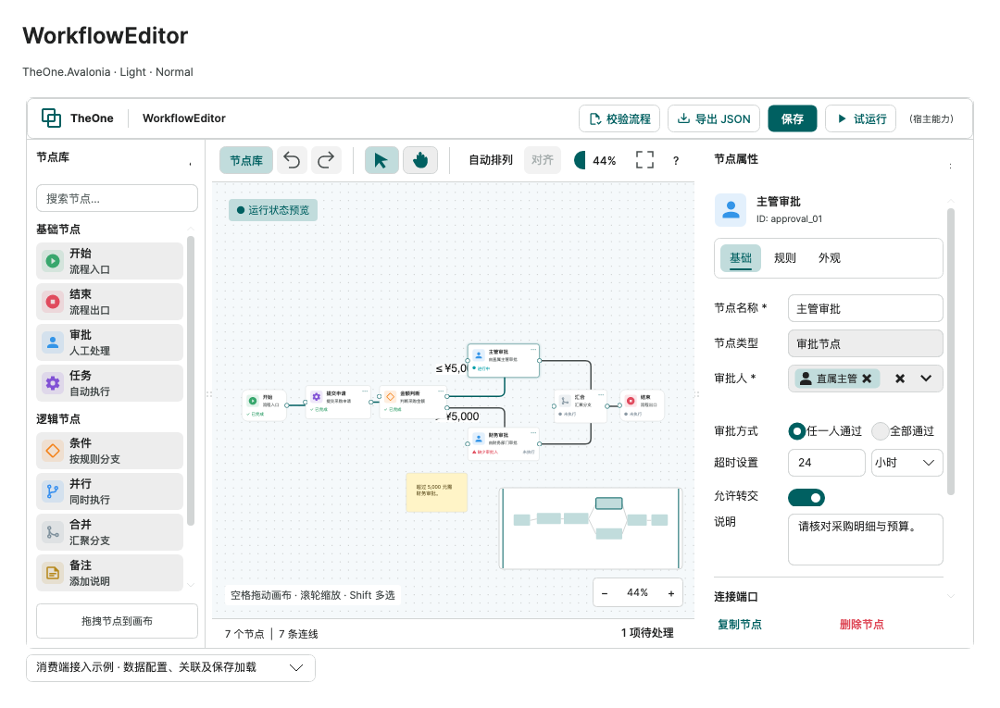

# WorkflowEditor

Historical command-line checks and consumer test projects have been removed. Check coverage and measurements in this guide are historical records. Start PreviewHost normally and open the relevant control page; validate target-platform behavior in the consuming application.

[简体中文](../zh-cn/workflow-editor.md) · [Index](README.md)

WorkflowEditor edits a bound WorkflowDocument: nodes, named ports, edges and business data references. It includes default templates; the host supplies factories, data, persistence and execution, and can replace individual templates. There is no built-in approval, HTTP or script engine.

<!-- visual-guide:start -->
## Appearance and example states

[Capture scope and visual index](visual-index.md). These are actual source-rendered examples; use this page’s usage notes for interaction and binding contracts.

### WorkflowEditor



Node library, canvas, property inspector and minimap; the approval example uses business models and stable identities.

[View Dark comparison](../images/WorkflowEditor-dark.png)

<!-- visual-guide:end -->

## Contracts

### Host connection factories and node policies

`ConnectionFactory` is an optional `Func<WorkflowNode, WorkflowPort, WorkflowNode, WorkflowPort, WorkflowConnection?>`: source node, output port, target node and input port. The factory creates a candidate without changing the document; it may initialize `Label` and `Properties`, or return `null` to reject creation. Endpoints must match the requested ports and the identity must be nonempty and unique. Direction, type, capacity, duplicate-edge and cycle checks still apply. `WorkflowDocument.TryConnect(WorkflowConnection, out string?, bool allowCycles = false)` adds the complete candidate and metadata in one undoable edit. Do not populate fields in `DocumentEdited`: direct external mutation clears history.

`NodeCreationValidator: Func<WorkflowNode,string?>?` checks palette/toolbar additions and paste candidates. A non-null message rejects the candidate. Paste retains only accepted nodes and edges with two accepted endpoints; references to rejected nodes retain their original identities. `NodeDeletionValidator` has the same signature: rejected nodes remain while other selected nodes may be removed, with incident edges managed by the document. These policies guard editor entry points, not a security boundary; hosts still validate submitted data and should not bypass editor operations by mutating collections. The default has no node-type restrictions or application-specific approval semantics.

`ConnectionPropertyTemplate: IDataTemplate?` defaults to `null`. When supplied and a connection is selected, the existing inspector presents this template with the original `WorkflowConnection` as data context and a connection heading. Node selection continues to use `PropertyTemplate` with its original `WorkflowNode`. Host setters should use `SetConnectionProperty` or `Document.Edit` to preserve history; no replacement canvas or separate fixed inspector is needed.

Loading requires explicit camelCase `nodes` and `connections` keys in valid v1/v2 snapshots. `{}`, missing keys, null collections and incompatible versions throw `JsonException`; explicit empty arrays remain valid drafts. An application's historical graphJson format must be detected and converted before loading; it is not automatically a library v1 snapshot.

Models live in TheOne.Avalonia.Workflow, independently of visual controls.

| Type | Responsibility |
| --- | --- |
| WorkflowDocument | Observable Nodes / Connections, title, revision and reversible edits |
| WorkflowNodeDefinition | Registered TypeId, title, description, category and CreateNode factory |
| WorkflowNode | Stable Id / TypeId, title, description, logical coordinates, width / shape, annotation flag, ports, properties, state and presentation Content |
| WorkflowPort | Node-local ID, direction, DataType, maximum connections; nonpositive means unlimited |
| WorkflowConnection | Stable edge ID, source/target node and port IDs, label |
| WorkflowProperty | Key, title, DataType, Text/Number/Boolean/MultiSelect kind, required flag, literal/reference or SelectedKeys |
| WorkflowChoiceAdapter / WorkflowChoice | Compiled host key/text projections and runtime choice presentation |
| WorkflowDataReference | NodeId + OutputPortId + FieldPath, independent of display titles |
| WorkflowOutputField | Host-declared field path, title and data type |

Number/Boolean literals are stored as strings and validated using invariant numeric/boolean semantics. DataType is a host token such as email, never a reflected CLR type. Treat port/output records as immutable; replace Ports entries when changing metadata. Renaming and sorting do not change IDs.

## Consumer binding

```xml
<Grid>
<one:WorkflowEditor Document="{CompiledBinding Document, Mode=TwoWay}"
                    NodeDefinitions="{CompiledBinding NodeDefinitions}"
                    SelectedNode="{CompiledBinding SelectedNode, Mode=TwoWay}"
                    SaveCommand="{CompiledBinding SaveCommand}" />
</Grid>
```

Use concrete notifying ViewModels and correct x:DataType declarations for compiled binding. A single document keeps nodes and edges consistent during replacement. The editor stretches to a finite parent by default, without a fixed width/height or minimum height. Use a Grid or DockPanel viewport; an unconstrained StackPanel or scrolling parent cannot provide a height to fill.

```csharp
var document = new WorkflowDocument();
var source = new WorkflowNode { TypeId = "request", Title = "Submit" };
source.Ports.Add(new("out", "Request", WorkflowPortDirection.Output,
    "flow", 0, [new("applicant.email", "Applicant email", "email")]));
var target = new WorkflowNode { TypeId = "notification", Title = "Notify", X = 300 };
target.Ports.Add(new("in", "Input", WorkflowPortDirection.Input));
target.Properties.Add(new() {
    Key = "recipient", Title = "Recipient", DataType = "email", IsRequired = true,
    Reference = new(source.Id, "out", "applicant.email")
});
document.AddNode(source);
document.AddNode(target);
document.TryConnect(source.Id, "out", target.Id, "in", out var error);
```

The host registers NodeDefinitions. Each factory returns an independent instance with a fresh ID and matching TypeId. Search the category-grouped library, click/drag items, or call AddNode(definition, position). NodeDefinitionTemplate receives a definition for custom library icons and content. The demo supplies the approval types and icons as consumer data.

## Bound approvers and multiple choices

Use `WorkflowValueKind.MultiSelect` for approvers or other identity lists. Bind `WorkflowEditor.ChoiceItemsSource` to host records and supply `ChoiceItemAdapter` with compiled key/text getters. This selects your model's properties without reflection-based member paths. Labels may repeat; keys must be nonempty and unique across the catalog. Prefixing keys such as `user:42` and `role:finance` lets the host distinguish people from roles. Items and selected tags use a built-in person icon; no icon field is required.

```csharp
public sealed record ApprovalTarget(string Key, string DisplayName);
// In a notifying ViewModel; the source can be replaced and an ObservableCollection can change in place.
private IEnumerable<ApprovalTarget> _approverItems = new ObservableCollection<ApprovalTarget>
{
    new("user:42", "Alex"), new("role:finance", "Finance reviewers")
};
public IEnumerable<ApprovalTarget> ApproverItems
{
    get => _approverItems;
    set => Set(ref _approverItems, value); // Inherit WorkflowObservable or use your own notifying base.
}
public WorkflowChoiceAdapter ApproverAdapter { get; } =
    WorkflowChoiceAdapter.Create<ApprovalTarget>(item => item.Key, item => item.DisplayName);

var field = new WorkflowProperty
{
    Key = "approvers", Title = "Approvers", DataType = "principal",
    Kind = WorkflowValueKind.MultiSelect, IsRequired = true
};
approvalNode.Properties.Add(field);
document.SetSelectedKeys(field, ["user:42", "role:finance"]); // One undoable edit
```

```xml
<one:WorkflowEditor Document="{CompiledBinding Document, Mode=TwoWay}"
    ChoiceItemsSource="{CompiledBinding ApproverItems, Mode=TwoWay}"
    ChoiceItemAdapter="{CompiledBinding ApproverAdapter}" />
```

The default inspector shows the multiple-choice picker on its Data tab. UI changes update `WorkflowProperty.SelectedKeys`; host changes to this observable collection update selection. Prefer `document.SetSelectedKeys(field, keys)` for an undoable host edit; direct collection changes follow the existing direct-model-edit history reset contract. Catalog changes, source replacement and notifying label changes update presentation without editing the document or resetting history. Notify the source property when replacing it. `SelectedKeys` belongs to each node property, so selecting another node restores that node's choices instead of sharing one global selection.

Custom property templates can use `WorkflowPropertyEditor`: call `ConfigureChoices(source, adapter)` and bind a `MultiSelectBox` to `Choices` / `SelectedChoices` (`Mode=TwoWay`). `SelectedChoices` contains `WorkflowChoice` models with `Key`, `Text` and `IsAvailable`. Dispose standalone field editors when no longer used; WorkflowEditor disposes its own editors. The preview's approver inspector demonstrates this with the same built-in text adapter and person template.

PreviewHost's basic approver inspector, Rules fields and association example share the same field-editor behavior. Multi-select fields hide literal/reference inputs, display `ChoiceError` and missing-key warnings, and explicitly use `MaxVisibleTags="1"` per picker without changing the actual selection. Custom templates are independent of the default template; a local property value on one instance does not configure others. Readonly mode disables field writes while keeping tabs and scrolling available. Node titles bind directly to `SelectedNodeEditor.Title`, committing immediately and refreshing on undo/redo without a separate blur-commit draft. Replacing property collections or switching nodes disposes old field editors and binds the current properties. Approval modes, timeout limits and units remain host-owned business settings.

Selected keys missing from a filtered/replaced catalog remain saved and visible as unresolved choices; they are removable and resolve again if the catalog returns. Duplicate/empty catalog keys show `ChoiceError` instead of guessing an identity. An empty required multi-selection is invalid. Search does not clear hidden selections; readonly mode blocks UI edits. The JSON property has an explicit `selectedKeys` string array. Save/load, undo/redo and copy/paste retain those exact keys, not display labels, catalog records or delegates. Host execution uses these keys to find the current person/role; the library does not execute approval rules. The old Text/Number/Boolean values and enum numbers remain unchanged; older libraries cannot load the new `MultiSelect = 3` kind. The demo migrates its older single `roleId` literal into a one-key selection; general host migrations remain explicit.

## Associate business data

Edges represent graph relationships, without automatically transmitting every output. GetReferenceOptions(node, property) filters declared fields by upstream reachability and matching DataType (any accepts all field types). The host resolves the stable triple against output tables or explicit compiled getters. FieldPath is not evaluated as an expression or reflection path.

The demo's reference-resolution action uses a host dictionary to provide request amount and applicant email to approval amount and notification recipient. Resolving again reads current source values.

## Templates

`WorkflowCanvas` and `WorkflowMiniMap` are drawing/interaction helpers in the WorkflowEditor template. Integrate business pages through WorkflowEditor and the extension points below, rather than treating these helpers as standalone editors. When replacing the full template, retain `PART_Canvas` and bind the minimap's `Editor` to the current WorkflowEditor; consult the same-version [WorkflowEditor.axaml](../../../TheOne.Avalonia/Themes/Controls/WorkflowEditor.axaml).

- The control includes its shell, header, node library, canvas, inspector, toolbar and minimap. No host templates are required.
- HeaderTemplate receives WorkflowEditor; the default displays document title, validation and save. Set it to null to hide the header or supply an IDataTemplate to replace it. A null template uses an explicit empty presenter template, so the editor is never inserted into its own visual tree; switching between null and a template after showing the editor is supported.
- NodeTemplate receives WorkflowNode; the default displays title, description and state. Ports and selection chrome remain outside it.
- NodeDefinitionTemplate receives WorkflowNodeDefinition; the default displays title and description in the node library.
- ContentTemplate receives typed host Content. Declare the concrete x:DataType. Content is not persisted; the host restores it by TypeId after loading.
- PropertyTemplate receives the selected node. The default uses native TabStrip tabs for basic metadata, data and ports; it edits name, description, literals and upstream references through document undo history, and respects IsReadOnly. SelectedNodeEditor exposes WorkflowNodeEditor and WorkflowPropertyEditor adapters for custom templates. A host can supply specialized business UI or hide the panel and bind SelectedNode externally. Templates own their scroll container; delete stays outside the default scrolling region.
- SelectedConnection exposes the selected edge for external label or business-condition editing. The default inspector displays nodes.

Native `GridSplitter` controls separate the node library and property inspector from the canvas. Drag with the pointer, or focus a splitter and use the left/right arrow keys. Initial side widths are 195/296 DIP, with maximum widths of 420/560 DIP and normal minimums of 140/280 DIP; the canvas keeps at least 160 DIP when space permits. Narrow windows proportionally reduce the side panels and restore preferred widths when expanded again. Collapsing a panel releases both its width and splitter space; reopening retains the width for this control instance. Widths are not stored in workflow JSON. Readonly mode permits layout resizing without changing document revisions, selection or the property editor. Library items use compact padding, with 18 DIP icons on 24 DIP surfaces in the demo. Full control-template replacements must retain the five `PART_PanelGrid` columns (library, splitter, canvas, splitter, inspector) and both native splitters to keep this behavior; custom node/property content templates need no changes.

Node and connection selection are exclusive, including external `SelectedNode` / `SelectedConnection` assignments. Selecting a connection clears all selected nodes and the node inspector; selecting a node clears the selected connection. Models outside the current document normalize to null, even when they share an ID with a document model.

The demo supplies typed field rows and literal/reference ComboBoxes. SetProperty and document Edit integrate host edits with the same graph undo history. The host rebuilds Content by TypeId after loading or copying rather than persisting presentation objects or sharing mutable business objects with the original node.

## Editing and validation

Update models and controls on the UI thread. Collection/property notifications refresh views; replacing Document detaches old subscriptions and clears selection. Direct host data changes reset stale history. For reversible changes use Edit(title, redo, undo); callbacks must be deterministic and must not throw. Presentation Content and runtime State updates do not change persistence revision or discard history.

Supports dragging, snapping, box/Shift selection, arrow nudges (Shift=10), Delete/Backspace, Ctrl/Cmd+Z / Shift+Z and editor-local Ctrl/Cmd+C/V/D. Copies generate fresh node/edge IDs, remap internal references and retain external references for validation. The clipboard is local to the editor instance.

Drag output to input or use Tab/Enter on native port buttons. Escape cancels. Space+drag or middle-drag pans; pointer-centered wheel zoom ranges from 25% to 200%. Native text controls keep their editing shortcuts.

IsPanMode selects the canvas tool; alignment moves selected nodes to a common top coordinate. Click/drag the minimap to navigate. FitPadding reserves space when fitting, including room for the demo runtime badge. Validation opens a list with clickable issue navigation. IsAnnotation nodes are excluded from the execution-node count.

IsReadOnly blocks editor writes while permitting selection and viewport interaction. Hosts must disable custom inspector writes, as demonstrated; host model updates remain allowed. ShowNodeLibrary / ShowProperties let the host collapse panels for narrow views. After the library's collapse button hides the panel, a persistent "节点库" (node library) toggle in the canvas toolbar reopens it with a pointer or keyboard. Its two-way binding updates ShowNodeLibrary without replacing the host binding.

The document indexes node IDs, connection adjacency, endpoint counts and cycle components. Only collection structure changes invalidate the corresponding index; title, position, runtime state and edge-label updates retain it. Node and endpoint IDs are init-only, so replace the model to change an ID. Reset, Replace, Move and replacing Document resolve against the current models; invalid duplicate IDs still resolve to the first collection item and produce validation errors. Node removal and selection matching use set lookups, and the canvas and minimap share the document indexes.

## Canvas caching and offscreen nodes

The canvas caches full-graph node sizes, port endpoints and connection routes, reusing world-coordinate results during pan and zoom. Node size, port, position and connection changes update the affected results. Offscreen connections are culled using their route bounds; a connection crossing the viewport remains drawn and selectable even when both endpoints are offscreen. FitToView, the minimap and validation always use the full document rather than only attached node views.

The first layout still measures every node to capture actual wrapped-text heights and port positions. These changes primarily improve subsequent panning, repainting and steady-state default-view retention, rather than first-layout cost. At most 64 inactive default views are cached; older views are released. A cached view is reused only for the same model, never rebound to another node. Custom templates and editor content prioritize state preservation and are not subject to this limit. Models, metrics and edge caches still grow with the full document; this is not business-data virtualization. Pure panning reuses edge geometry and labels; zooming rebuilds the corresponding geometry while preserving screen-sized corners and text. Font and density changes remeasure nodes.

Default stateless nodes can be unloaded outside the viewport and its overscan area, then reused or rebuilt from the current model on return. Selection belongs to models and survives offscreen recycling. Custom NodeTemplate / ContentTemplate views may contain drafts, caret positions or other local state, so their view identity is retained. Nodes with active editing, keyboard focus, pointer capture or an open context menu also remain attached throughout the interaction. Removing a node, replacing it with a new object, or switching Document releases the previous view so a new model with the same ID cannot inherit its drafts or selection. Explicitly replacing a template rebuilds its content; local drafts are not preserved across template replacement.

These behaviors add no public switches and preserve the existing binding API. State preservation takes priority over unloading custom templates; hosts with many stateful nodes still own their business data and editing scope.

Connections reject missing endpoints, wrong direction/type, duplicates, self-edges, capacity overflow and cycles. AllowCycles explicitly permits cycles; ConnectionValidator adds host constraints. Validate(allowCycles) checks structure, properties and references. Domain validation and permissions belong to the host; no specific business start/end node types are mandatory.

## Persistence

`SaveCommand` is a bindable host `ICommand`. The default save button passes the current `Document` and respects `CanExecute` / `CanExecuteChanged`; it is disabled when no command is supplied. The control never opens a picker or writes a file itself. The PreviewHost ViewModel uses an awaitable command and an injected `IWorkflowEditorFileService`; export and open are commands too. Canceled/failed saves do not mark the document saved, and changes made while an older snapshot is being written remain dirty.

```csharp
string json = WorkflowSerializer.Save(document);
WorkflowDocument loaded = WorkflowSerializer.Load(json);
```

Saving now writes schema version 2 (`WorkflowSerializer.CurrentVersion`) with source-generated System.Text.Json metadata. Loading accepts versions 1 and 2; version 1 edges receive empty Properties, while version 2 requires an edge Properties array. Older readers cannot read the new format: coordinate consumer upgrades rather than changing the version number to downgrade a document. Nodes, ports, fields, references, coordinates, edges and edge business properties persist; Content, templates, runtime state, services, selection, viewport and history do not. A host envelope DTO may persist additional document metadata.

`WorkflowConnection.Properties` reuses `WorkflowProperty` for literals, multiple choices and upstream references. Hosts define stable keys for route type, condition and priority; Label remains display text. Edge references are validated against the target node's upstream scope, and execution remains host-owned. Edit an existing field with `document.SetConnectionProperty(connection, property, value, reference)` to retain undo, redo, Changed and Revision. Use `SetSelectedKeys` for multiple choices and `Edit` for an atomic collection change. Direct model changes retain the existing history-reset behavior.

```csharp
var branch = new WorkflowProperty { Key = "routeKind", Title = "Route", Value = "approved" };
connection.Properties.Add(branch);
document.SetConnectionProperty(connection, branch, "rejected");
```

Copy and paste deep-copy edge properties and remap references to copied nodes while retaining references to external nodes. Validate reports invalid keys, kinds, required values, choices, numbers and references with ConnectionId; it does not interpret approval expressions. Loading rejects duplicate property keys, unknown kinds and malformed reference identities rather than dropping fields.

Unsupported versions or invalid identities/coordinates are rejected. Draft unresolved references/endpoints are retained for Validate to report. Parse a new document before replacing the bound one; the example preserves the current workflow on failure.

## Example and verification

PreviewHost: **Extensions → WorkflowEditor**. The primary view follows the approved seven-node design, with a note, icons, ports and states; inspector tabs use the built-in `TabStrip`. The library, toolbar, inspector and example actions default to Small sizing (body and input font size 12), while canvases retain host density and node proportions. The collapsible consumer section includes default/custom templates, typed Content, configuration, reference selection/resolution, read-only mode, editable JSON and native file save/open. A separate request → approval → notification example demonstrates recipient references.

Routing uses directly drawn rounded orthogonal edges and layered arrangement, with offscreen culling and safe node-view recycling. Full obstacle routing and bend editing are not included. The host owns rule execution and output evaluation.

<!-- generated-contracts:start -->
## Control-specific properties, Classes usage and business APIs

This section lists project-added control-specific properties, public Classes usage, practical business actions and related models, without repeating inherited native APIs, constructors, property Get/Set wrappers or public identifiers. Registration defaults differ from themed values, and explicit local values take precedence. PreviewHost shows Classes through labeled examples rather than template-selector/setter inventories; properties and business actions in Description include short usage snippets. Shared ControlSizing and Motion settings are centralized on Home. Only Button, Input and Select share comparison pages; other controls retain independent complete demos.

### WorkflowCanvas

[Complete source contract](../../api/en/TheOne.Avalonia.Controls.WorkflowCanvas.md)

No additional CLR/attached properties are declared on this type; see its base for inherited members.

### WorkflowEditor

[Complete source contract](../../api/en/TheOne.Avalonia.Controls.WorkflowEditor.md)

| Property | Type | Access/binding/inheritance | Registration/model default | Meaning and constraints |
| --- | --- | --- | --- | --- |
| [`AddNodeCommand`](../../../TheOne.Avalonia/Controls/WorkflowEditor.cs#L356) | `System.Windows.Input.ICommand` | read-only; CLR / n/a | `accessor-defined / state` | Host command entry; business code owns the operation/authorization and the paired CommandParameter supplies its argument. |
| [`AlignCommand`](../../../TheOne.Avalonia/Controls/WorkflowEditor.cs#L365) | `System.Windows.Input.ICommand` | read-only; CLR / n/a | `accessor-defined / state` | Host command entry; business code owns the operation/authorization and the paired CommandParameter supplies its argument. |
| [`AllowCycles`](../../../TheOne.Avalonia/Controls/WorkflowEditor.cs#L324) | `bool` | writable; OneWay | `false` | Allows cyclic connections; otherwise editor validation rejects cycles. Runners still own business-loop semantics. |
| [`ArrangeCommand`](../../../TheOne.Avalonia/Controls/WorkflowEditor.cs#L364) | `System.Windows.Input.ICommand` | read-only; CLR / n/a | `accessor-defined / state` | Host command entry; business code owns the operation/authorization and the paired CommandParameter supplies its argument. |
| [`ChoiceItemAdapter`](../../../TheOne.Avalonia/Controls/WorkflowEditor.cs#L41) | `TheOne.Avalonia.Workflow.WorkflowChoiceAdapter?` | writable; OneWay | `null` | Typed key and label projections from WorkflowChoiceAdapter.Create<T>, without reflection member paths. When omitted, records must be WorkflowChoice instances. |
| [`ChoiceItemsSource`](../../../TheOne.Avalonia/Controls/WorkflowEditor.cs#L35) | `System.Collections.IEnumerable?` | writable; OneWay | `null` | Default choice catalog for multi-select fields; supports two-way binding and collection notifications. ChoiceItemAdapter supplies stable keys and labels; the host loads people or roles. |
| [`ConnectionFactory`](../../../TheOne.Avalonia/Controls/WorkflowEditor.cs#L374) | `System.Func<TheOne.Avalonia.Workflow.WorkflowNode, TheOne.Avalonia.Workflow.WorkflowPort, TheOne.Avalonia.Workflow.WorkflowNode, TheOne.Avalonia.Workflow.WorkflowPort, TheOne.Avalonia.Workflow.WorkflowConnection?>?` | writable; CLR / n/a | `null` | Creates connection metadata before its single history edit. Endpoints must match the requested ports; null rejects creation. |
| [`ConnectionPropertyTemplate`](../../../TheOne.Avalonia/Controls/WorkflowEditor.cs#L249) | `Avalonia.Controls.Templates.IDataTemplate?` | writable; OneWay | `null` | Optional connection inspector; its data context is the original SelectedConnection. |
| [`ConnectionValidator`](../../../TheOne.Avalonia/Controls/WorkflowEditor.cs#L371) | `System.Func<TheOne.Avalonia.Workflow.WorkflowNode, TheOne.Avalonia.Workflow.WorkflowPort, TheOne.Avalonia.Workflow.WorkflowNode, TheOne.Avalonia.Workflow.WorkflowPort, string?>?` | writable; CLR / n/a | `null` | Host can reject business-specific connections in addition to structural checks. |
| [`ContentTemplate`](../../../TheOne.Avalonia/Controls/WorkflowEditor.cs#L236) | `Avalonia.Controls.Templates.IDataTemplate?` | writable; OneWay | `null` | Native data-template extension point; retain the correct x:DataType and follow the control's template data scope. |
| [`DeleteCommand`](../../../TheOne.Avalonia/Controls/WorkflowEditor.cs#L359) | `System.Windows.Input.ICommand` | read-only; CLR / n/a | `accessor-defined / state` | Host command entry; business code owns the operation/authorization and the paired CommandParameter supplies its argument. |
| [`Document`](../../../TheOne.Avalonia/Controls/WorkflowEditor.cs#L206) | `TheOne.Avalonia.Workflow.WorkflowDocument?` | writable; TwoWay | `null` | Current business document model; editor documentation defines subscription, selection and history behavior on replacement. |
| [`FitCommand`](../../../TheOne.Avalonia/Controls/WorkflowEditor.cs#L360) | `System.Windows.Input.ICommand` | read-only; CLR / n/a | `accessor-defined / state` | Host command entry; business code owns the operation/authorization and the paired CommandParameter supplies its argument. |
| [`FitPadding`](../../../TheOne.Avalonia/Controls/WorkflowEditor.cs#L348) | `Avalonia.Thickness` | writable; OneWay | `new Thickness(32)` | DIP padding reserved when fitting content to the viewport. Validation: `p => new[] { p.Left, p.Top, p.Right, p.Bottom }.All(x => double.IsFinite(x) && x >= 0)` |
| [`GraphSummary`](../../../TheOne.Avalonia/Controls/WorkflowEditor.cs#L303) | `string` | read-only; OneWay | `computed / state` | Read-only runtime/derived state, updated by the control/model for display or command conditions; not a two-way input. |
| [`HeaderTemplate`](../../../TheOne.Avalonia/Controls/WorkflowEditor.cs#L262) | `Avalonia.Controls.Templates.IDataTemplate?` | writable; OneWay | `null` | Header content receives this editor. The default exposes document title, validation and SaveCommand. |
| [`IsPanMode`](../../../TheOne.Avalonia/Controls/WorkflowEditor.cs#L283) | `bool` | writable; OneWay | `false` | Uses pointer dragging to pan the canvas, following workflow selection/edit gesture rules. |
| [`IsReadOnly`](../../../TheOne.Avalonia/Controls/WorkflowEditor.cs#L306) | `bool` | writable; OneWay | `false` | Whether editing is blocked; the control's read-only contract determines remaining display, selection and navigation behavior. |
| [`LibraryGroups`](../../../TheOne.Avalonia/Controls/WorkflowEditor.cs#L301) | `System.Collections.Generic.IReadOnlyList<TheOne.Avalonia.Workflow.WorkflowNodeGroup>` | read-only; OneWay | `computed / state` | Read-only runtime/derived state, updated by the control/model for display or command conditions; not a two-way input. |
| [`LocateIssueCommand`](../../../TheOne.Avalonia/Controls/WorkflowEditor.cs#L368) | `System.Windows.Input.ICommand` | read-only; CLR / n/a | `accessor-defined / state` | Host command entry; business code owns the operation/authorization and the paired CommandParameter supplies its argument. |
| [`NodeCreationValidator`](../../../TheOne.Avalonia/Controls/WorkflowEditor.cs#L377) | `System.Func<TheOne.Avalonia.Workflow.WorkflowNode, string?>?` | writable; CLR / n/a | `null` | Optional host policy for adding and pasting nodes. A non-null message rejects that candidate. |
| [`NodeDefinitionTemplate`](../../../TheOne.Avalonia/Controls/WorkflowEditor.cs#L255) | `Avalonia.Controls.Templates.IDataTemplate?` | writable; OneWay | `null` | Native data-template extension point; retain the correct x:DataType and follow the control's template data scope. |
| [`NodeDefinitions`](../../../TheOne.Avalonia/Controls/WorkflowEditor.cs#L212) | `System.Collections.Generic.IEnumerable<TheOne.Avalonia.Workflow.WorkflowNodeDefinition>?` | writable; OneWay | `null` | Model/result collection; the signature defines element types. Dynamic business data needs notifications; control-owned read-only collections must not be replaced. |
| [`NodeDeletionValidator`](../../../TheOne.Avalonia/Controls/WorkflowEditor.cs#L380) | `System.Func<TheOne.Avalonia.Workflow.WorkflowNode, string?>?` | writable; CLR / n/a | `null` | Optional host policy for deletion. Rejected nodes are retained while other selected nodes may be removed. |
| [`NodeTemplate`](../../../TheOne.Avalonia/Controls/WorkflowEditor.cs#L230) | `Avalonia.Controls.Templates.IDataTemplate?` | writable; OneWay | `null` | Native data-template extension point; retain the correct x:DataType and follow the control's template data scope. |
| [`Pan`](../../../TheOne.Avalonia/Controls/WorkflowEditor.cs#L342) | `Avalonia.Vector` | writable; TwoWay | `new Vector(24, 24)` | Canvas pan vector, affecting the viewport without rewriting node coordinates. Validation: `x => double.IsFinite(x.X) && double.IsFinite(x.Y)` |
| [`PropertyTemplate`](../../../TheOne.Avalonia/Controls/WorkflowEditor.cs#L242) | `Avalonia.Controls.Templates.IDataTemplate?` | writable; OneWay | `null` | Native data-template extension point; retain the correct x:DataType and follow the control's template data scope. |
| [`RedoCommand`](../../../TheOne.Avalonia/Controls/WorkflowEditor.cs#L358) | `System.Windows.Input.ICommand` | read-only; CLR / n/a | `accessor-defined / state` | Host command entry; business code owns the operation/authorization and the paired CommandParameter supplies its argument. |
| [`SaveCommand`](../../../TheOne.Avalonia/Controls/WorkflowEditor.cs#L269) | `System.Windows.Input.ICommand?` | writable; OneWay | `null` | Host-owned persistence command. The default save button passes Document as its parameter. |
| [`SearchText`](../../../TheOne.Avalonia/Controls/WorkflowEditor.cs#L277) | `string` | writable; OneWay | `""` | Current search text, independent of selection and model identity. |
| [`SelectedConnection`](../../../TheOne.Avalonia/Controls/WorkflowEditor.cs#L224) | `TheOne.Avalonia.Workflow.WorkflowConnection?` | writable; TwoWay | `null` | Selected connection model, following the editor's node/connection selection rules. |
| [`SelectedNode`](../../../TheOne.Avalonia/Controls/WorkflowEditor.cs#L218) | `TheOne.Avalonia.Workflow.WorkflowNode?` | writable; TwoWay | `null` | Selected node model; null clears node selection. |
| [`SelectedNodeEditor`](../../../TheOne.Avalonia/Controls/WorkflowEditor.cs#L275) | `TheOne.Avalonia.Workflow.WorkflowNodeEditor?` | read-only; OneWay | `computed / state` | Read-only runtime/derived state, updated by the control/model for display or command conditions; not a two-way input. |
| [`SelectedNodes`](../../../TheOne.Avalonia/Controls/WorkflowEditor.cs#L204) | `System.Collections.ObjectModel.ReadOnlyObservableCollection<TheOne.Avalonia.Workflow.WorkflowNode>` | read-only; CLR / n/a | `accessor-defined / state` | Model/result collection; the signature defines element types. Dynamic business data needs notifications; control-owned read-only collections must not be replaced. |
| [`ShowNodeLibrary`](../../../TheOne.Avalonia/Controls/WorkflowEditor.cs#L312) | `bool` | writable; OneWay | `true` | Shows the library panel of node definitions available to add. |
| [`ShowProperties`](../../../TheOne.Avalonia/Controls/WorkflowEditor.cs#L318) | `bool` | writable; OneWay | `true` | Shows the selected object's property editor panel. |
| [`ShowRuntimePreview`](../../../TheOne.Avalonia/Controls/WorkflowEditor.cs#L289) | `bool` | writable; OneWay | `false` | Shows runtime preview; the host runner owns actual business execution. |
| [`ShowValidation`](../../../TheOne.Avalonia/Controls/WorkflowEditor.cs#L295) | `bool` | writable; OneWay | `false` | Shows document validation results; hiding the panel does not bypass validation. |
| [`SnapToGrid`](../../../TheOne.Avalonia/Controls/WorkflowEditor.cs#L330) | `bool` | writable; OneWay | `true` | Snaps moved nodes to the grid; existing coordinates remain until edited. |
| [`Status`](../../../TheOne.Avalonia/Controls/WorkflowEditor.cs#L354) | `string` | read-only; OneWay | `computed / state` | Business node-state enum; styles derive from state rather than storing state in classes. |
| [`ToggleLibraryCommand`](../../../TheOne.Avalonia/Controls/WorkflowEditor.cs#L366) | `System.Windows.Input.ICommand` | read-only; CLR / n/a | `accessor-defined / state` | Host command entry; business code owns the operation/authorization and the paired CommandParameter supplies its argument. |
| [`TogglePropertiesCommand`](../../../TheOne.Avalonia/Controls/WorkflowEditor.cs#L367) | `System.Windows.Input.ICommand` | read-only; CLR / n/a | `accessor-defined / state` | Host command entry; business code owns the operation/authorization and the paired CommandParameter supplies its argument. |
| [`UndoCommand`](../../../TheOne.Avalonia/Controls/WorkflowEditor.cs#L357) | `System.Windows.Input.ICommand` | read-only; CLR / n/a | `accessor-defined / state` | Host command entry; business code owns the operation/authorization and the paired CommandParameter supplies its argument. |
| [`ValidateCommand`](../../../TheOne.Avalonia/Controls/WorkflowEditor.cs#L363) | `System.Windows.Input.ICommand` | read-only; CLR / n/a | `accessor-defined / state` | Host command entry; business code owns the operation/authorization and the paired CommandParameter supplies its argument. |
| [`ValidationIssues`](../../../TheOne.Avalonia/Controls/WorkflowEditor.cs#L302) | `System.Collections.Generic.IReadOnlyList<TheOne.Avalonia.Workflow.WorkflowValidationIssue>` | read-only; OneWay | `computed / state` | Read-only runtime/derived state, updated by the control/model for display or command conditions; not a two-way input. |
| [`ValidationSummary`](../../../TheOne.Avalonia/Controls/WorkflowEditor.cs#L304) | `string` | read-only; OneWay | `computed / state` | Read-only runtime/derived state, updated by the control/model for display or command conditions; not a two-way input. |
| [`Zoom`](../../../TheOne.Avalonia/Controls/WorkflowEditor.cs#L336) | `double` | writable; TwoWay | `1` | View scale factor, where 1 means 100%; does not modify report millimetres or workflow coordinates. Validation: `x => double.IsFinite(x) && x >= .25 && x <= 2` |
| [`ZoomInCommand`](../../../TheOne.Avalonia/Controls/WorkflowEditor.cs#L361) | `System.Windows.Input.ICommand` | read-only; CLR / n/a | `accessor-defined / state` | Host command entry; business code owns the operation/authorization and the paired CommandParameter supplies its argument. |
| [`ZoomOutCommand`](../../../TheOne.Avalonia/Controls/WorkflowEditor.cs#L362) | `System.Windows.Input.ICommand` | read-only; CLR / n/a | `accessor-defined / state` | Host command entry; business code owns the operation/authorization and the paired CommandParameter supplies its argument. |
| [`ZoomText`](../../../TheOne.Avalonia/Controls/WorkflowEditor.cs#L355) | `string` | read-only; OneWay | `computed / state` | Read-only runtime/derived state, updated by the control/model for display or command conditions; not a two-way input. |

### WorkflowMiniMap

[Complete source contract](../../api/en/TheOne.Avalonia.Controls.WorkflowMiniMap.md)

| Property | Type | Access/binding/inheritance | Registration/model default | Meaning and constraints |
| --- | --- | --- | --- | --- |
| [`Editor`](../../../TheOne.Avalonia/Controls/WorkflowMiniMap.cs#L24) | `TheOne.Avalonia.Controls.WorkflowEditor?` | writable; OneWay | `null` | WorkflowEditor associated with the minimap, sharing document/viewport rather than creating independent workflow state. |

See [shared theme configuration](../../theme/en/README.md#shared-configuration) for common sizing and motion settings, demonstrated centrally on PreviewHost Home.

### Classes usage

No added public appearance classes; use the default theme and control-specific properties.
These are individually supported public classes. Hover, pressed, disabled and selected states are control-owned; do not assign template classes manually. See the labeled PreviewHost examples for their appearance.

### Business APIs

| Type | Action signature | Purpose |
| --- | --- | --- |
| [`WorkflowCanvas`](../../api/en/TheOne.Avalonia.Controls.WorkflowCanvas.md) | `Point WorkflowCanvas.ToWorld(Point point)` | Converts viewport coordinates into document-world coordinates, accounting for zoom/pan. |
| [`WorkflowCanvas`](../../api/en/TheOne.Avalonia.Controls.WorkflowCanvas.md) | `void WorkflowCanvas.CancelGesture()` | Cancels the current canvas gesture and clears drag/connection previews. |
| [`WorkflowEditor`](../../api/en/TheOne.Avalonia.Controls.WorkflowEditor.md) | `WorkflowNode? WorkflowEditor.AddNode(WorkflowNodeDefinition definition, Point position)` | Adds a workflow node through document history so the edit can be undone. |
| [`WorkflowEditor`](../../api/en/TheOne.Avalonia.Controls.WorkflowEditor.md) | `void WorkflowEditor.SelectNode(WorkflowNode? node, bool additive = false)` | Selects an original workflow node under the editor's connection-selection rules. |
| [`WorkflowEditor`](../../api/en/TheOne.Avalonia.Controls.WorkflowEditor.md) | `bool WorkflowEditor.Connect(string sourceNode, string sourcePort, string targetNode, string targetPort)` | Attempts a port connection using document validation/history. |
| [`WorkflowEditor`](../../api/en/TheOne.Avalonia.Controls.WorkflowEditor.md) | `void WorkflowEditor.DeleteSelection()` | Deletes selected nodes/connections through undo history. |
| [`WorkflowEditor`](../../api/en/TheOne.Avalonia.Controls.WorkflowEditor.md) | `void WorkflowEditor.FitToView()` | Adjusts zoom/pan to fit document nodes without changing model coordinates. |
| [`WorkflowEditor`](../../api/en/TheOne.Avalonia.Controls.WorkflowEditor.md) | `void WorkflowEditor.Locate(string? nodeId)` | Locates a node/validation issue in the current viewport. |
| [`WorkflowEditor`](../../api/en/TheOne.Avalonia.Controls.WorkflowEditor.md) | `void WorkflowEditor.ArrangeNodes()` | Arranges node layout while recording coordinate changes in document history. |
| [`WorkflowEditor`](../../api/en/TheOne.Avalonia.Controls.WorkflowEditor.md) | `void WorkflowEditor.CopySelection()` | Copies the selection into a supported editor fragment under serialization boundaries. |
| [`WorkflowEditor`](../../api/en/TheOne.Avalonia.Controls.WorkflowEditor.md) | `void WorkflowEditor.PasteSelection()` | Pastes a copied fragment with independent identities and undoable edits. |
| [`WorkflowChoiceAdapter`](../../api/en/TheOne.Avalonia.Workflow.WorkflowChoiceAdapter.md) | `abstract string WorkflowChoiceAdapter.GetKey(object item)` |  |
| [`WorkflowChoiceAdapter`](../../api/en/TheOne.Avalonia.Workflow.WorkflowChoiceAdapter.md) | `abstract string WorkflowChoiceAdapter.GetText(object item)` | Reads original-model display/search text through the configured typed adapter. |
| [`WorkflowDocument`](../../api/en/TheOne.Avalonia.Workflow.WorkflowDocument.md) | `void WorkflowDocument.Edit(string title, Action redo, Action undo)` | Apply a host edit to the same history as graph edits. Actions must be deterministic and not throw. |
| [`WorkflowDocument`](../../api/en/TheOne.Avalonia.Workflow.WorkflowDocument.md) | `void WorkflowDocument.Undo()` | Undoes the most recent undoable document edit. |
| [`WorkflowDocument`](../../api/en/TheOne.Avalonia.Workflow.WorkflowDocument.md) | `void WorkflowDocument.Redo()` | Redoes the most recently undone document edit. |
| [`WorkflowDocument`](../../api/en/TheOne.Avalonia.Workflow.WorkflowDocument.md) | `void WorkflowDocument.ClearHistory()` | Clears undo/redo history while retaining current document data. |
| [`WorkflowDocument`](../../api/en/TheOne.Avalonia.Workflow.WorkflowDocument.md) | `void WorkflowDocument.AddNode(WorkflowNode node)` | Adds a workflow node through document history so the edit can be undone. |
| [`WorkflowDocument`](../../api/en/TheOne.Avalonia.Workflow.WorkflowDocument.md) | `void WorkflowDocument.Remove(IEnumerable<WorkflowNode> nodes, WorkflowConnection? connection = null)` | Removes a workflow object/associated relationships through document history. |
| [`WorkflowDocument`](../../api/en/TheOne.Avalonia.Workflow.WorkflowDocument.md) | `void WorkflowDocument.MoveNodes(IEnumerable<(WorkflowNode Node, double X, double Y)> positions)` | Updates node coordinates in a batch recorded as an undoable move. |
| [`WorkflowDocument`](../../api/en/TheOne.Avalonia.Workflow.WorkflowDocument.md) | `void WorkflowDocument.SetProperty(WorkflowProperty property, string value, WorkflowDataReference? reference)` | Edits workflow literal/reference properties through the document to preserve undo/notifications. |
| [`WorkflowDocument`](../../api/en/TheOne.Avalonia.Workflow.WorkflowDocument.md) | `void WorkflowDocument.SetConnectionProperty(WorkflowConnection connection, WorkflowProperty property, string value, WorkflowDataReference? reference = null)` | 修改本图中指定连线的固定值或引用，保留原字段的撤销记录；不允许编辑其他文档的字段。 |
| [`WorkflowDocument`](../../api/en/TheOne.Avalonia.Workflow.WorkflowDocument.md) | `void WorkflowDocument.SetSelectedKeys(WorkflowProperty property, IEnumerable<string> keys)` | One undoable multi-selection edit, preserving stable keys and their order. |
| [`WorkflowDocument`](../../api/en/TheOne.Avalonia.Workflow.WorkflowDocument.md) | `string? WorkflowDocument.CheckConnection(string sourceNode, string sourcePort, string targetNode, string targetPort, bool allowCycles = false)` | Validates a candidate port connection and reports failures without creating it. |
| [`WorkflowDocument`](../../api/en/TheOne.Avalonia.Workflow.WorkflowDocument.md) | `bool WorkflowDocument.TryConnect(string sourceNode, string sourcePort, string targetNode, string targetPort, out string? error, bool allowCycles = false)` | Validates and attempts a connection, returning success and associated results. |
| [`WorkflowDocument`](../../api/en/TheOne.Avalonia.Workflow.WorkflowDocument.md) | `bool WorkflowDocument.TryConnect(WorkflowConnection connection, out string? error, bool allowCycles = false)` | Adds a host-created connection in one undoable edit after validating identity and topology. |
| [`WorkflowDocument`](../../api/en/TheOne.Avalonia.Workflow.WorkflowDocument.md) | `bool WorkflowDocument.IsReachable(string from, string to)` | Checks graph reachability for connection/cycle decisions. |
| [`WorkflowDocument`](../../api/en/TheOne.Avalonia.Workflow.WorkflowDocument.md) | `IReadOnlyList<WorkflowReferenceOption> WorkflowDocument.GetReferenceOptions(WorkflowNode target, WorkflowProperty property)` | Lists compatible upstream references for the current node property. |
| [`WorkflowDocument`](../../api/en/TheOne.Avalonia.Workflow.WorkflowDocument.md) | `IReadOnlyList<WorkflowValidationIssue> WorkflowDocument.Validate(bool allowCycles = false)` | Validates workflow structure, ports and references, returning locatable issues. |
| [`WorkflowNodeEditor`](../../api/en/TheOne.Avalonia.Workflow.WorkflowNodeEditor.md) | `void WorkflowNodeEditor.Refresh()` | Refresh after document edits, including undo and upstream metadata changes. |
| [`WorkflowPropertyEditor`](../../api/en/TheOne.Avalonia.Workflow.WorkflowPropertyEditor.md) | `void WorkflowPropertyEditor.Refresh()` | Resynchronizes the inspector from its model/document, including undo and upstream changes. |
| [`WorkflowPropertyEditor`](../../api/en/TheOne.Avalonia.Workflow.WorkflowPropertyEditor.md) | `void WorkflowPropertyEditor.ConfigureChoices(IEnumerable? source, WorkflowChoiceAdapter? adapter)` | Configure host records with typed key/text projections. Collection and label notifications are observed. |
| [`WorkflowSerializer`](../../api/en/TheOne.Avalonia.Workflow.WorkflowSerializer.md) | `static string WorkflowSerializer.Save(WorkflowDocument document)` | 以当前格式保存完整设计，不保存视觉对象、运行状态或撤销历史。 |
| [`WorkflowSerializer`](../../api/en/TheOne.Avalonia.Workflow.WorkflowSerializer.md) | `static WorkflowDocument WorkflowSerializer.Load(string json)` | 读取版本 1 或 2；非法身份和字段抛出 JsonException，失效图引用保留给 Validate 报告。 |

### Event subscriptions

Subscribe when needed and detach when the host is disposed. These are event entry points, not routed-event identifier fields.

| Type | Event | Purpose |
| --- | --- | --- |
| [`WorkflowEditor`](../../api/en/TheOne.Avalonia.Controls.WorkflowEditor.md) | `DocumentEdited` | State/operation notification; subscribe for the host lifetime and detach on disposal. The signature defines event arguments. |
| [`WorkflowDocument`](../../api/en/TheOne.Avalonia.Workflow.WorkflowDocument.md) | `Changed` | State/operation notification; subscribe for the host lifetime and detach on disposal. The signature defines event arguments. |
| [`WorkflowObservable`](../../api/en/TheOne.Avalonia.Workflow.WorkflowObservable.md) | `PropertyChanged` | State/operation notification; subscribe for the host lifetime and detach on disposal. The signature defines event arguments. |

### Related models

| Model | Properties/enum values |
| --- | ---: |
| [`TheOne.Avalonia.Workflow.WorkflowChoice`](../../api/en/TheOne.Avalonia.Workflow.WorkflowChoice.md) | 3 |
| [`TheOne.Avalonia.Workflow.WorkflowConnection`](../../api/en/TheOne.Avalonia.Workflow.WorkflowConnection.md) | 7 |
| [`TheOne.Avalonia.Workflow.WorkflowDataReference`](../../api/en/TheOne.Avalonia.Workflow.WorkflowDataReference.md) | 3 |
| [`TheOne.Avalonia.Workflow.WorkflowDocument`](../../api/en/TheOne.Avalonia.Workflow.WorkflowDocument.md) | 6 |
| [`TheOne.Avalonia.Workflow.WorkflowNode`](../../api/en/TheOne.Avalonia.Workflow.WorkflowNode.md) | 14 |
| [`TheOne.Avalonia.Workflow.WorkflowNodeDefinition`](../../api/en/TheOne.Avalonia.Workflow.WorkflowNodeDefinition.md) | 6 |
| [`TheOne.Avalonia.Workflow.WorkflowNodeEditor`](../../api/en/TheOne.Avalonia.Workflow.WorkflowNodeEditor.md) | 5 |
| [`TheOne.Avalonia.Workflow.WorkflowNodeGroup`](../../api/en/TheOne.Avalonia.Workflow.WorkflowNodeGroup.md) | 2 |
| [`TheOne.Avalonia.Workflow.WorkflowNodeShape`](../../api/en/TheOne.Avalonia.Workflow.WorkflowNodeShape.md) | 3 |
| [`TheOne.Avalonia.Workflow.WorkflowNodeState`](../../api/en/TheOne.Avalonia.Workflow.WorkflowNodeState.md) | 5 |
| [`TheOne.Avalonia.Workflow.WorkflowOutputField`](../../api/en/TheOne.Avalonia.Workflow.WorkflowOutputField.md) | 3 |
| [`TheOne.Avalonia.Workflow.WorkflowPort`](../../api/en/TheOne.Avalonia.Workflow.WorkflowPort.md) | 6 |
| [`TheOne.Avalonia.Workflow.WorkflowPortDirection`](../../api/en/TheOne.Avalonia.Workflow.WorkflowPortDirection.md) | 2 |
| [`TheOne.Avalonia.Workflow.WorkflowProperty`](../../api/en/TheOne.Avalonia.Workflow.WorkflowProperty.md) | 9 |
| [`TheOne.Avalonia.Workflow.WorkflowPropertyEditor`](../../api/en/TheOne.Avalonia.Workflow.WorkflowPropertyEditor.md) | 13 |
| [`TheOne.Avalonia.Workflow.WorkflowReferenceOption`](../../api/en/TheOne.Avalonia.Workflow.WorkflowReferenceOption.md) | 2 |
| [`TheOne.Avalonia.Workflow.WorkflowValidationIssue`](../../api/en/TheOne.Avalonia.Workflow.WorkflowValidationIssue.md) | 3 |
| [`TheOne.Avalonia.Workflow.WorkflowValueKind`](../../api/en/TheOne.Avalonia.Workflow.WorkflowValueKind.md) | 4 |

[Complete source contract (including constructors, property accessors and identifiers for precise lookup)](../../api/en/README.md)
<!-- generated-contracts:end -->
