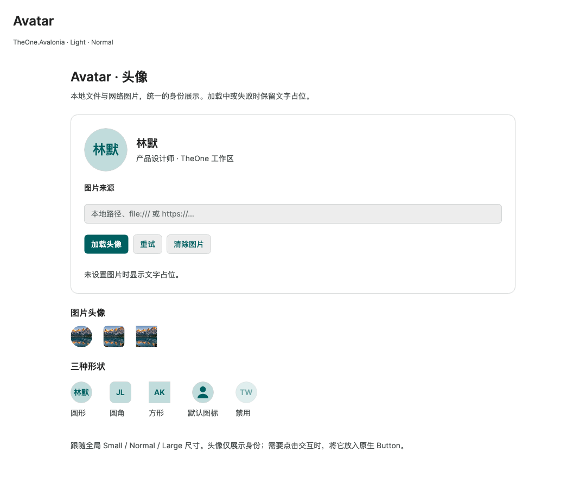

# Avatar 头像

历史命令行验证入口与消费测试项目已移除，文中的专项覆盖和测量结果为历史记录。请正常启动 PreviewHost，从菜单进入对应控件演示页；目标平台行为需在实际应用中验证。

**简体中文** · [English](../en/avatar.md)

`Avatar` 展示本地或网络图片，无图片时显示最多两个 Unicode 文本元素或默认人物图标。使用前加载 `OneTheme`。头像本身用于展示；需要个人资料等点击操作时，将其放入原生 `Button`。

```xml
<one:Avatar Source="avares://YourApp/Assets/avatar.png" Text="LM" AutomationProperties.Name="林默的头像" />
<one:Avatar Source="https://example.com/avatar.png" Text="林默" Shape="Rounded" />
<one:Avatar Source="{Binding AvatarPath}" Text="AK" Shape="Square" />
```

声明 `xmlns:one="using:TheOne.Avalonia.Controls"`，使用编译绑定的视图应声明具体的 `x:DataType`。示例的 YourApp 替换为实际资源程序集名，并把图片声明为 AvaloniaResource；本地文件可通过 AvatarPath 提供，不复制其他设备的绝对路径。

| 属性 | 契约 |
| --- | --- |
| `Source` | 本地绝对／相对路径、`file://` URI、HTTP(S) 地址、`avares://` URI，或调用方持有的 `IImage`；地址支持字符串和 `Uri` 对象 |
| `Text` | 占位文字；去除两端空白后最多显示两个字素，不拆分组合 emoji；空文字显示人物图标 |
| `Shape` | 默认 `Circle` 圆形，也支持 `Rounded` 圆角方形和 `Square` 方形 |
| `CornerRadius` | `Rounded` 的圆角，默认 8；圆形头像请保持 Width / Height 相等 |
| `Stretch` | 原生图片拉伸模式，默认 `UniformToFill`，保持比例并裁剪填充 |
| `CurrentImage`、`HasImage` | 只读的已解码图片与成功加载状态 |
| `IsLoading`、`ErrorMessage` | 只读加载状态与失败原因；清空来源会清除错误 |
| `Reload()` | 控件已挂载时重新加载当前来源 |

继承 Small / Normal / Large 密度，尺寸为 32 / 40 / 56 px，文字字号为 12 / 14 / 18 px。显式 Width / Height 和字号优先，占位内容会按可用空间缩放。明暗主题使用 `One.AccentSoft`、`One.Accent` 和 `One.Line`；可覆盖标准 Background、Foreground、BorderBrush、BorderThickness。

图片在挂载到可视树后加载；切换 Source 或移除控件会取消未完成任务，旧响应不会覆盖新头像。控件创建的位图在替换或移除时释放，外部传入的 `IImage` 仍由调用方持有。重新挂载会再次加载当前来源。本地文件和网络响应在后台解码；网络加载总超时 30 秒，响应最大 16 MiB。不提供持久图片缓存、登录认证界面、SVG 解码或动态图播放。相对文件路径基于进程工作目录，HTTPS 使用平台正常证书校验。

加载中及 HTTP、文件、解码失败时均保留占位。伪类为 `:loading`、`:error`、`:has-image`、`:has-text`。默认模板保留 `PART_Surface`、`PART_Fallback`、`PART_Icon`、`PART_Text`、`PART_Image`。用 `AutomationProperties.Name` 标注人物身份；未指定时，无障碍名称使用 Text，最后回退为“Avatar”。

<!-- visual-guide:start -->
## 外观与场景图示

[配图口径与控件图鉴](visual-index.md)；下图是当前源码的真实渲染，绑定与交互以本页用法说明为准。

### Avatar



头像、占位文字、形状与状态展示；图片加载失败时保留可识别占位。

[查看 Dark 对照](../images/Avatar-dark.png)

<!-- visual-guide:end -->

<!-- generated-contracts:start -->
## 专属属性、Classes 用法与业务 API

本节只列本项目的专属属性、公开 Classes 用法、实际业务动作及关联模型，不重复原生继承 API、构造器、属性 Get/Set 包装或公开标识符。注册默认值与主题生效值不同，显式局部值优先。PreviewHost 用实际标签样例展示 Classes，不展示模板选择器／Setter 明细；Description 中的属性与业务动作附短用法代码。ControlSizing、Motion 等通用配置集中在 Home。仅 Button、Input、Select 合并比较，其余控件保留独立完整示例。

### Avatar

[完整源码契约](../../api/zh-cn/TheOne.Avalonia.Controls.Avatar.md)

| 属性 | 类型 | 读写／绑定／继承 | 注册或模型初值 | 说明与约束 |
| --- | --- | --- | --- | --- |
| [`CurrentImage`](../../../TheOne.Avalonia/Controls/Avatar.cs#L93) | `Avalonia.Media.IImage?` | 只读; OneWay | `computed / state` | 只读的已解码图片与成功加载状态 |
| [`DisplayText`](../../../TheOne.Avalonia/Controls/Avatar.cs#L97) | `string` | 只读; OneWay | `computed / state` | 只读运行状态或派生结果；由对应控件／模型更新，供展示和命令条件读取，不作为双向输入。 |
| [`EffectiveCornerRadius`](../../../TheOne.Avalonia/Controls/Avatar.cs#L98) | `Avalonia.CornerRadius` | 只读; OneWay | `computed / state` | 只读运行状态或派生结果；由对应控件／模型更新，供展示和命令条件读取，不作为双向输入。 |
| [`ErrorMessage`](../../../TheOne.Avalonia/Controls/Avatar.cs#L96) | `string?` | 只读; OneWay | `computed / state` | 只读加载状态与失败原因；清空来源会清除错误 |
| [`HasImage`](../../../TheOne.Avalonia/Controls/Avatar.cs#L95) | `bool` | 只读; OneWay | `computed / state` | 只读的已解码图片与成功加载状态 |
| [`IsLoading`](../../../TheOne.Avalonia/Controls/Avatar.cs#L94) | `bool` | 只读; OneWay | `computed / state` | 只读加载状态与失败原因；清空来源会清除错误 |
| [`Shape`](../../../TheOne.Avalonia/Controls/Avatar.cs#L81) | `TheOne.Avalonia.Controls.AvatarShape` | 可写; OneWay | `0 / default` | 默认 `Circle` 圆形，也支持 `Rounded` 圆角方形和 `Square` 方形 校验：`Enum.IsDefined` 可选值：`Circle`, `Rounded`, `Square` |
| [`Source`](../../../TheOne.Avalonia/Controls/Avatar.cs#L69) | `object?` | 可写; OneWay | `null` | 本地绝对／相对路径、`file://` URI、HTTP(S) 地址、`avares://` URI，或调用方持有的 `IImage`；地址支持字符串和 `Uri` 对象 |
| [`Stretch`](../../../TheOne.Avalonia/Controls/Avatar.cs#L87) | `Avalonia.Media.Stretch` | 可写; OneWay | `Stretch.UniformToFill` | 原生图片拉伸模式，默认 `UniformToFill`，保持比例并裁剪填充 校验：`Enum.IsDefined` 可选值：`None`, `Fill`, `Uniform`, `UniformToFill` |
| [`Text`](../../../TheOne.Avalonia/Controls/Avatar.cs#L75) | `string?` | 可写; OneWay | `null` | 占位文字；去除两端空白后最多显示两个字素，不拆分组合 emoji；空文字显示人物图标 |

尺寸、动效等通用配置见[统一主题说明](../../theme/zh-cn/README.md#shared-configuration)，PreviewHost 在 Home 集中演示。

### Classes 用法

没有额外公开外观类，使用默认主题及专属属性。

以上是分别使用的公开类名；悬停、按下、禁用和选中等状态由控件维护，不手工添加模板类。实际外观见 PreviewHost 的标签样例。

### 业务 API

| 类型 | 动作签名 | 用途 |
| --- | --- | --- |
| [`Avatar`](../../api/zh-cn/TheOne.Avalonia.Controls.Avatar.md) | `void Avatar.Reload()` | Reloads the current source while attached, for example after a failed request. |

### 关联模型

| 模型 | 属性／枚举值 |
| --- | ---: |
| [`TheOne.Avalonia.Controls.AvatarShape`](../../api/zh-cn/TheOne.Avalonia.Controls.AvatarShape.md) | 3 |

[完整源码契约（含构造、属性访问器和标识符，供精确查阅）](../../api/zh-cn/README.md)
<!-- generated-contracts:end -->
