# 按钮、输入、选择与反馈

历史命令行验证入口与消费测试项目已移除，文中的专项覆盖和测量结果为历史记录。请正常启动 PreviewHost，从菜单进入对应控件演示页；目标平台行为需在实际应用中验证。

**简体中文** · [English](../en/basic.md)

[返回控件文档](README.md)。以下绑定属性与命令由业务 ViewModel 提供，根视图需声明 `x:DataType`。

外观扩展包括 `soft` / `gradient` 按钮、`filled` / `underlined` 输入、日期时间的 `filled` 及状态进度条。适用控件、渐变资源及选型见 [主题配色与样式](../../theme/zh-cn/theme-colors.md)；每个控件选择一种主要外观，尺寸类可叠加。

<!-- visual-guide:start -->
## 外观与场景图示

[配图口径与控件图鉴](visual-index.md)；下图是当前源码的真实渲染，绑定与交互以本页用法说明为准。

### Button

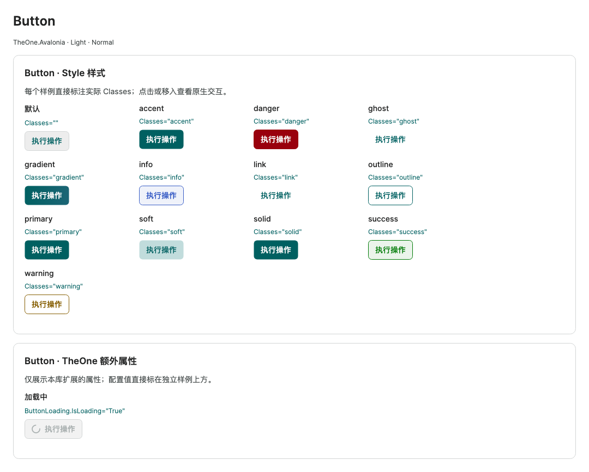

语义色与外观分开组合；图中展示单独 Classes 及加载状态，组合优先级见下文。

[查看 Dark 对照](../images/Button-dark.png)

### RepeatButton

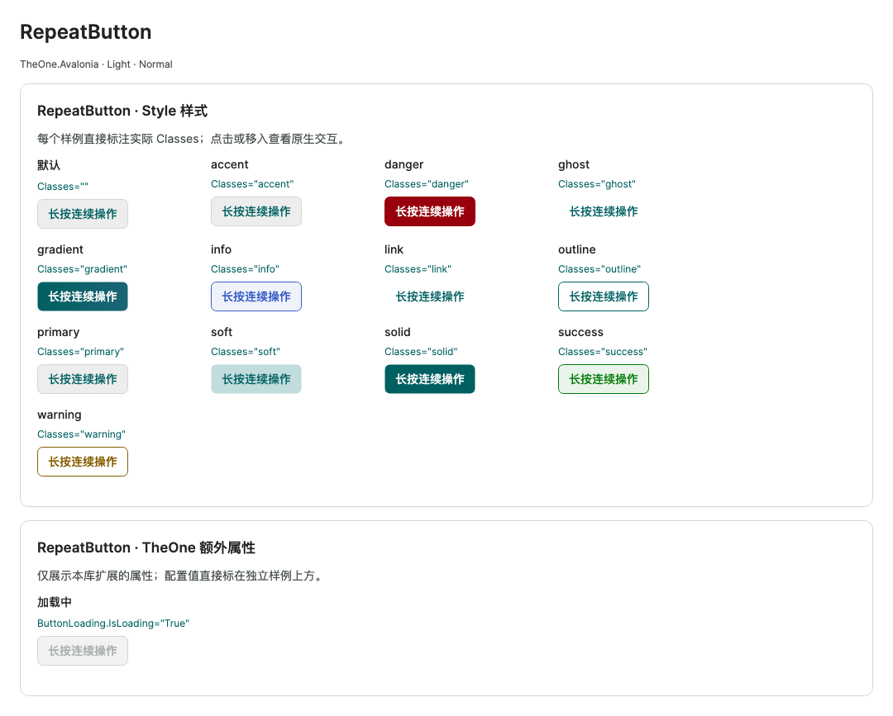

复用按钮配色与外观，按住连续触发；加载态仍保留原按钮尺寸。

[查看 Dark 对照](../images/RepeatButton-dark.png)

### ToggleButton

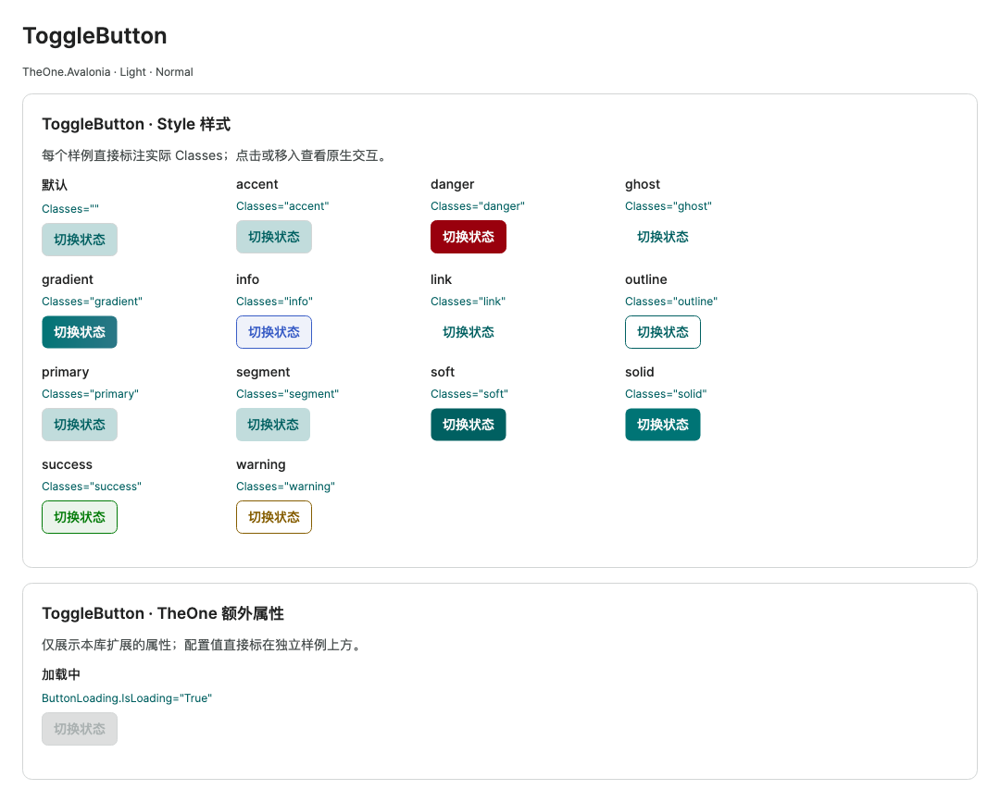

选中态叠加语义色与外观，图中按钮已选中；不是另一套颜色枚举。

[查看 Dark 对照](../images/ToggleButton-dark.png)

### TextBox

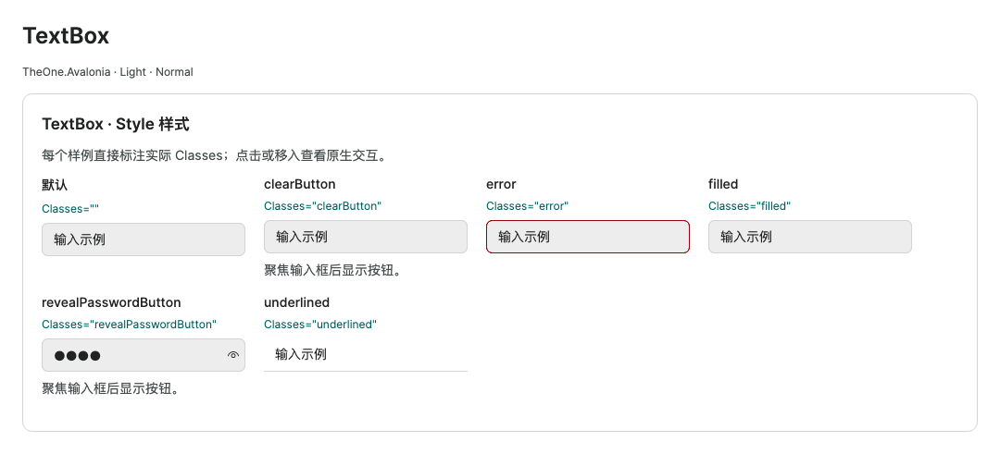

对比边框、填充、下划线及清空/密码按钮相关样式；按钮的实际出现还取决于焦点。

[查看 Dark 对照](../images/TextBox-dark.png)

### CheckBox

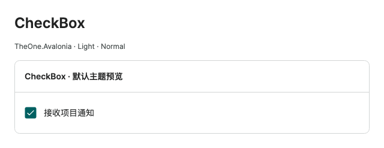

默认主题中的勾选态；绑定和命令仍采用原生控件契约。

[查看 Dark 对照](../images/CheckBox-dark.png)

### RadioButton

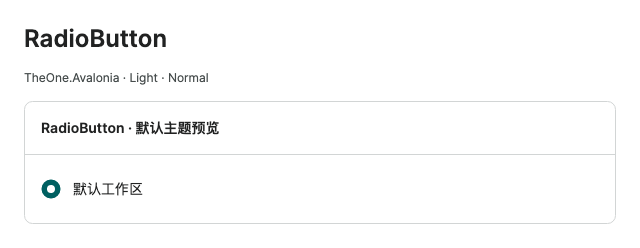

默认主题中的单选态；同组互斥关系由原生分组处理。

[查看 Dark 对照](../images/RadioButton-dark.png)

### ToggleSwitch

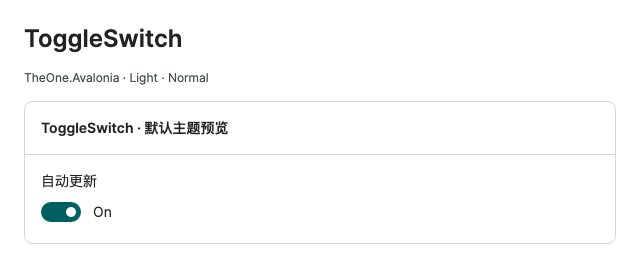

开关开启态的轨道与滑块；颜色跟随主题语义资源。

[查看 Dark 对照](../images/ToggleSwitch-dark.png)

### ComboBox

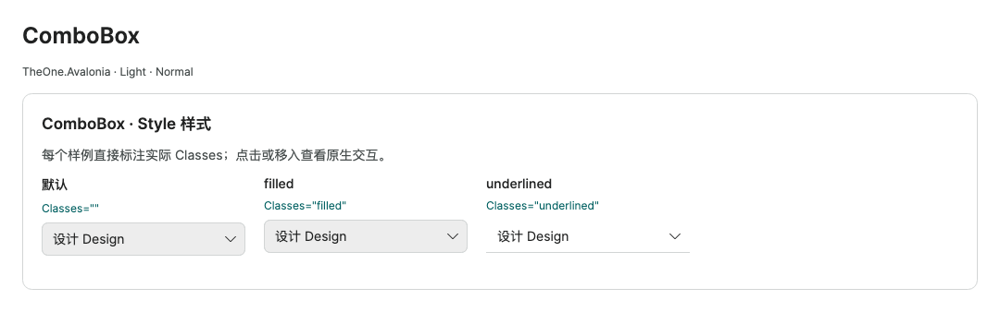

对比默认、filled 和 underlined；下拉项的留白与选择背景见展开图。

[查看 Dark 对照](../images/ComboBox-dark.png)

### ComboBox · 下拉展开

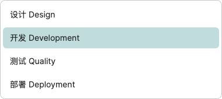

实际下拉列表：当前项高亮，项目间留有间距，弹出内容与输入框分别布局。

[查看 Dark 对照](../images/ComboBoxPopup-dark.png)

### AutoCompleteBox

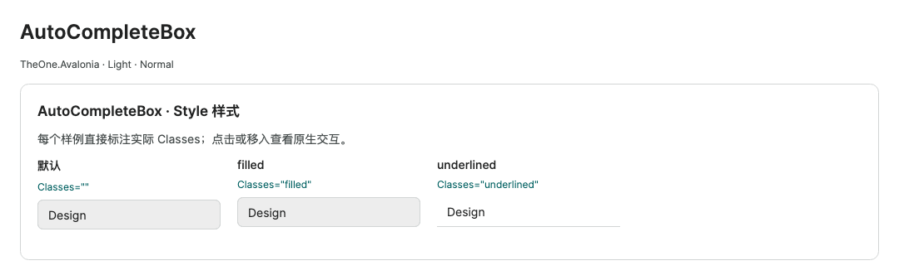

输入建议框沿用一致的三种输入外观；建议列表由输入和数据源共同决定。

[查看 Dark 对照](../images/AutoCompleteBox-dark.png)

### NumericUpDown

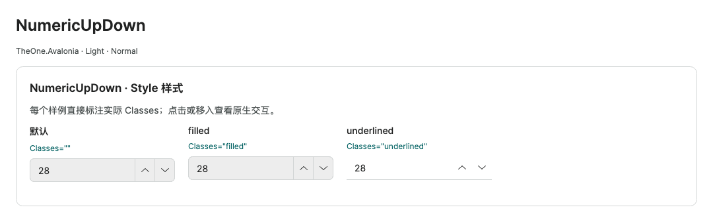

数字输入、增减按钮和分隔线采用同一外观；underlined 不额外叠加整框边线。

[查看 Dark 对照](../images/NumericUpDown-dark.png)

### ButtonSpinner

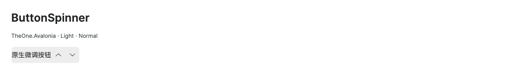

原生微调容器的主题外观，可承载自定义内容。

[查看 Dark 对照](../images/ButtonSpinner-dark.png)

### Slider

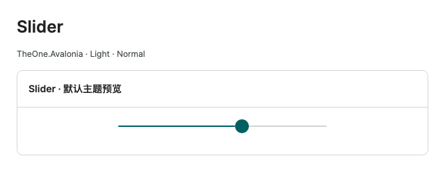

当前值与未完成轨道保持区分；原生拖动和键盘行为不变。

[查看 Dark 对照](../images/Slider-dark.png)

### ProgressBar

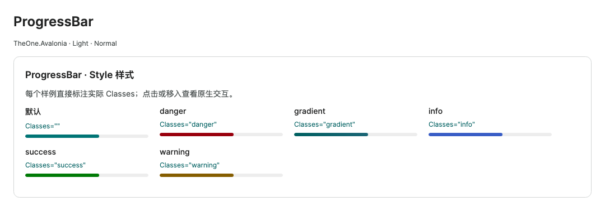

状态配色与默认进度轨道对比；截图为确定进度，不代表循环动画帧。

[查看 Dark 对照](../images/ProgressBar-dark.png)

### ToolTip


实际悬停提示的内容与主题外框；提示依附触发目标显示。

[查看 Dark 对照](../images/ToolTip-dark.png)

<!-- visual-guide:end -->

## Button、RepeatButton、ToggleButton

```xml
<StackPanel Orientation="Horizontal" Spacing="8">
  <Button Content="普通操作" Command="{Binding OpenCommand}" />
  <Button Classes="primary" Content="保存" Command="{Binding SaveCommand}" />
  <Button Classes="ghost" Content="取消" />
  <Button Classes="link" Content="查看详情" />
  <Button Classes="danger" Content="删除" Command="{Binding DeleteCommand}" />
</StackPanel>
```

`primary` 是主操作，`accent` 是兼容类名；`ghost` 为轻操作，`link` 为链接外观，`danger` 为危险操作。禁用使用 `IsEnabled="False"`。外观类不会自动实现确认对话框或业务逻辑。

### Button：语义色与外观组合

Button、RepeatButton、ToggleButton 和 [IconButton](icon-button.md) 均支持“一种语义色 + 一种外观”。语义色是 `primary`（`accent` 为同义类）、`danger`、`success`、`warning`、`info`；外观是 `solid`、`ghost`、`link`、`outline`、`soft`、`gradient`。尺寸仍沿用 Home 页说明的公共规则。

```xml
<Button Classes="danger outline" Content="删除" />
<Button Classes="success soft" Content="已完成" />
<Button Classes="warning solid" Content="需要关注" />
<Button Classes="info link" Content="查看详情" />
<Button Classes="success gradient" Content="确认完成" />
<Button Classes="primary ghost" Content="取消" />
```

| 外观 | 正常及交互表现 |
| --- | --- |
| `solid` | 语义色填充；悬停、按下分别使用反馈色；文字使用与填充匹配的对比色 |
| `outline` | Surface 底色、语义色文字与边框；悬停／按下使用 NeutralHover／NeutralPressed，保留语义色 |
| `soft` | 语义浅色底、语义色文字；正常无边框，悬停／按下显示语义边框。品牌 soft 按下时仍保留原来的 Text 前景色 |
| `ghost` / `link` | 透明底、语义色文字、无边框；悬停／按下显示反馈底色 |
| `gradient` | 品牌色使用既有 Brand 渐变，其他语义色使用对应的渐变，悬停／按下保留该语义色 |

未指定外观时，各控件保留原来的单独 Classes 效果。例如 Button 的 primary/accent 为实心，而 ToggleButton、RepeatButton 的旧默认不同；需要统一实心外观时明确使用 `primary solid`。单独使用 ghost、link、outline、soft、gradient 的正常、悬停、按下及 ToggleButton 选中／空值效果均保留。禁用统一使用 `One.DisabledSurface`、`One.DisabledText`、`One.Line`；ToggleButton 已选中／空值态使用 `One.DisabledSelection` 底色以区分状态。父容器禁用、禁用时切换 Classes、恢复启用均遵守同一规则。

建议每组只选一个类；冲突时按以下优先级确定，Classes 的书写／添加顺序无关：

- 语义色：`info > warning > success > danger > primary/accent`。
- 外观：`gradient > soft > outline > link > ghost > solid`。
- 状态：禁用优先于按下，按下优先于悬停；移除外观类后恢复当前语义色的旧默认。`danger outline` 与 `outline danger` 完全相同。

语义实心与渐变的反馈画刷按调色板缓存，不在每次指针事件中创建；Light / Dark 与 ColorTheme 切换使用当前资源。`One.Button.{Success|Info|Warning|Danger}Foreground` 为实心／渐变文字色，`One.Button.{Success|Info|Warning|Danger}Hover` / `Pressed` 为实心反馈；`One.Button.Gradient.{Success|Info|Warning|Danger}` 及其 `Hover` / `Pressed` 后缀为渐变。Classes 作用于模板内的 ContentPresenter，仅给 Button 本身设置 Background / Foreground 并不保证覆盖其显示颜色。

```xml
<RepeatButton Content="持续增加" Command="{Binding IncrementCommand}"
              Delay="400" Interval="80" />
<ToggleButton Classes="segment" Content="网格视图"
              IsChecked="{Binding IsGridView, Mode=TwoWay}" />
```

RepeatButton 长按重复触发；`segment` 只提供分段外观。互斥选择由业务状态或同组 RadioButton 实现。

三个按钮的内容默认水平、垂直居中，small／normal／large 均使用实际内容尺寸布局。需要靠左或靠上时，显式设置 `HorizontalContentAlignment`／`VerticalContentAlignment`。

设置 `ToggleButton.IsThreeState="True"` 后，点击或 Space 按 false → true → null → false 循环。空值态在按钮底部显示独立短横线，标记跟随实际文字色。

显式语义色与外观组合时，选中／空值态沿用该语义色：solid 使用按下底色，soft 使用语义实心底色，gradient 使用按下渐变；outline 使用语义浅底与描边，ghost/link 使用语义浅底且不显示边框。悬停、按下保留各自反馈；空值态额外显示短横线。只指定外观类时仍保留旧的选中／空值样式；新增的单独 `solid` 按品牌色组合处理。`segment` 与尺寸等辅助类保持原义。

```xml
<ToggleButton Classes="success soft" Content="批准"
              IsChecked="{CompiledBinding Approved, Mode=TwoWay}" />
<RepeatButton Classes="danger outline" Content="持续减少"
              Command="{CompiledBinding DecrementCommand}" Delay="400" Interval="80" />
<one:IconButton Classes="info gradient" Icon="{CompiledBinding RefreshIcon}"
                Content="刷新" Command="{CompiledBinding RefreshCommand}" />
```

这些组合只修改模板配色；ToggleButton 的三态与双向绑定、RepeatButton 的原生长按重复／释放停止，以及 IconButton 的图标位置、加载替换、命令和焦点逻辑保持不变。PreviewHost 三个独立控件页分别提供 30 个组合、禁用态及相关交互演示，按窄视口自动换行。

## TextBox

```xml
<TextBox Classes="clearButton" PlaceholderText="邮箱"
         Text="{Binding Email, Mode=TwoWay}" />
<TextBox Classes="revealPasswordButton" PasswordChar="●"
         Text="{Binding Password, Mode=TwoWay}" />
<TextBox Classes="error" Text="需要修正的值" />
<TextBox IsReadOnly="True" Text="只读说明" />
<TextBox AcceptsReturn="True" TextWrapping="Wrap" MinHeight="96"
         Text="{Binding Notes, Mode=TwoWay}" />
```

`clearButton` 提供清除操作，`revealPasswordButton` 提供密码显示切换，`error` 仅设置显式错误外观。实际绑定验证仍使用 Avalonia 数据验证机制，真实验证错误也会触发主题错误状态；业务应同时给出具体错误文本。

单行输入的文本、占位文字和密码默认垂直居中，AutoCompleteBox 内嵌输入框同样适用。`AcceptsReturn="True"` 的多行输入默认顶部对齐；显式设置 `VerticalContentAlignment` 可覆盖默认值。

## CheckBox、RadioButton、ToggleSwitch

```xml
<CheckBox Content="接收通知" IsChecked="{Binding Notify, Mode=TwoWay}" />
<CheckBox Content="部分选择" IsThreeState="True" IsChecked="{x:Null}" />
<RadioButton GroupName="ExportFormat" Content="CSV" IsChecked="True" />
<RadioButton GroupName="ExportFormat" Content="JSON" />
<ToggleSwitch OnContent="已启用" OffContent="已停用"
              IsChecked="{Binding Enabled, Mode=TwoWay}" />
```

CheckBox 默认不绘制文字行背景，勾选框自身保留填色与状态标记；局部 Background 可自定义。CheckBox 支持 `bool?` 三态；RadioButton 的文字行默认透明，仅圆形标记承担选中／悬停／按下／禁用反馈，局部 Background 可覆盖。RadioButton 用 `GroupName` 指定互斥组；ToggleSwitch 整行默认透明，仅轨道和滑块显示开启／关闭及交互状态；禁用时滑块与轨道保留可辨识的色差。通过 `IsChecked` 表达开关状态，保留鼠标、Space 和滑块拖动操作。

## ComboBox 与 AutoCompleteBox

```xml
<ComboBox ItemsSource="{Binding Categories}"
          SelectedItem="{Binding SelectedCategory, Mode=TwoWay}" />
<AutoCompleteBox ItemsSource="{Binding Suggestions}"
                 Text="{Binding SearchText, Mode=TwoWay}"
                 MinimumPrefixLength="1" />
```

该示例的 `Categories` 和 `Suggestions` 为字符串集合。对象集合可设置 ItemTemplate；AutoCompleteBox 还需要配置对象文本映射，例如 `ValueMemberBinding`，并明确项类型以使用编译绑定。模板只负责候选项显示，搜索与远程数据加载由宿主实现。

下拉与建议列表使用主题的虚拟化模板；使用模型集合，不提前创建 ComboBoxItem。长列表弹层高度受 `One.DataFlyoutMaxHeight` 约束。

## NumericUpDown 与 ButtonSpinner

```xml
<NumericUpDown Minimum="0" Maximum="100" Increment="1"
               FormatString="0" Value="{Binding Quantity, Mode=TwoWay}" />
```

`Value` 为可空数值，业务属性建议匹配 `decimal?`。官方步进按钮和输入验证由控件提供。默认 NumericUpDown 已包含 ButtonSpinner；单独使用 ButtonSpinner 时，宿主处理 Spin 事件来更新自己的值：

```xml
<ButtonSpinner Spin="OnSpin">
  <TextBlock Text="自定义数值" />
</ButtonSpinner>
```

## Slider、ProgressBar、ToolTip

Slider 和 ScrollBar 的 Thumb 由原生模板管理拖动、捕获与位置；主题只修改外观。调整业务值使用父控件的 Value，替换模板时保留原生 Track / Thumb 结构。

```xml
<Slider Minimum="0" Maximum="100" TickFrequency="5"
        IsSnapToTickEnabled="True" Value="{Binding Progress, Mode=TwoWay}"
        ToolTip.Tip="拖动或使用方向键调整进度" />
<ProgressBar Minimum="0" Maximum="100" Value="{Binding Progress}" />
<ProgressBar IsIndeterminate="True" />
```

Slider 保留原生指针与键盘操作。ProgressBar 使用相同业务进度；未知总量时设置 `IsIndeterminate`。通过 `ToolTip.Tip` 添加提示，不需要手动创建弹层。

在 PreviewHost 的“选择控件对比”页可同时查看三种尺寸与明暗主题的固定状态样例，并在实时区域验证点击、键盘、三态、互斥、开关拖动、禁用及重置。

在 PreviewHost 的“按钮控件对比”页可比较三档尺寸、明暗主题、普通／悬停／按下／禁用状态，以及 ToggleButton 的选中状态和 primary 主按钮。实时区可测试单次操作、选中切换、鼠标／Space 长按重复、释放／禁用停止与重置。

<!-- generated-contracts:start -->
## 专属属性、Classes 用法与业务 API

本节只列本项目的专属属性、公开 Classes 用法、实际业务动作及关联模型，不重复原生继承 API、构造器、属性 Get/Set 包装或公开标识符。注册默认值与主题生效值不同，显式局部值优先。PreviewHost 用实际标签样例展示 Classes，不展示模板选择器／Setter 明细；Description 中的属性与业务动作附短用法代码。ControlSizing、Motion 等通用配置集中在 Home。仅 Button、Input、Select 合并比较，其余控件保留独立完整示例。

### ButtonLoading

[完整源码契约](../../api/zh-cn/TheOne.Avalonia.Controls.ButtonLoading.md)

| 属性 | 类型 | 读写／绑定／继承 | 注册或模型初值 | 说明与约束 |
| --- | --- | --- | --- | --- |
| [`IsLoading`](../../../TheOne.Avalonia/Controls/ButtonLoading.cs#L12) | `bool` | 可写; OneWay; 附加属性 | `false` | 显示忙碌指示；按钮保留尺寸并阻止重复操作，容器显示加载层。任务完成后由宿主复位。 |

尺寸、动效等通用配置见[统一主题说明](../../theme/zh-cn/README.md#shared-configuration)，PreviewHost 在 Home 集中演示。

### Classes 用法

- `AutoCompleteBox`: `Classes="filled"` / `Classes="underlined"`
- `Button`: `Classes="accent"` / `Classes="danger"` / `Classes="ghost"` / `Classes="gradient"` / `Classes="info"` / `Classes="link"` / `Classes="outline"` / `Classes="primary"` / `Classes="soft"` / `Classes="solid"` / `Classes="success"` / `Classes="warning"`
- `ComboBox`: `Classes="filled"` / `Classes="underlined"`
- `NumericUpDown`: `Classes="filled"` / `Classes="underlined"`
- `ProgressBar`: `Classes="danger"` / `Classes="gradient"` / `Classes="info"` / `Classes="success"` / `Classes="warning"`
- `RepeatButton`: `Classes="danger"` / `Classes="ghost"` / `Classes="gradient"` / `Classes="info"` / `Classes="link"` / `Classes="outline"` / `Classes="soft"` / `Classes="solid"` / `Classes="success"` / `Classes="warning"`
- `TextBox`: `Classes="clearButton"` / `Classes="error"` / `Classes="filled"` / `Classes="revealPasswordButton"` / `Classes="underlined"`
- `ToggleButton`: `Classes="accent"` / `Classes="danger"` / `Classes="ghost"` / `Classes="gradient"` / `Classes="info"` / `Classes="link"` / `Classes="outline"` / `Classes="primary"` / `Classes="segment"` / `Classes="soft"` / `Classes="solid"` / `Classes="success"` / `Classes="warning"`

以上是分别使用的公开类名；悬停、按下、禁用和选中等状态由控件维护，不手工添加模板类。实际外观见 PreviewHost 的标签样例。

### 业务 API

没有额外业务方法；通过本节专属属性配置。

### 关联模型

| 模型 | 属性／枚举值 |
| --- | ---: |
| [`TheOne.Avalonia.Controls.ButtonLoading`](../../api/zh-cn/TheOne.Avalonia.Controls.ButtonLoading.md) | 1 |

[完整源码契约（含构造、属性访问器和标识符，供精确查阅）](../../api/zh-cn/README.md)
<!-- generated-contracts:end -->
