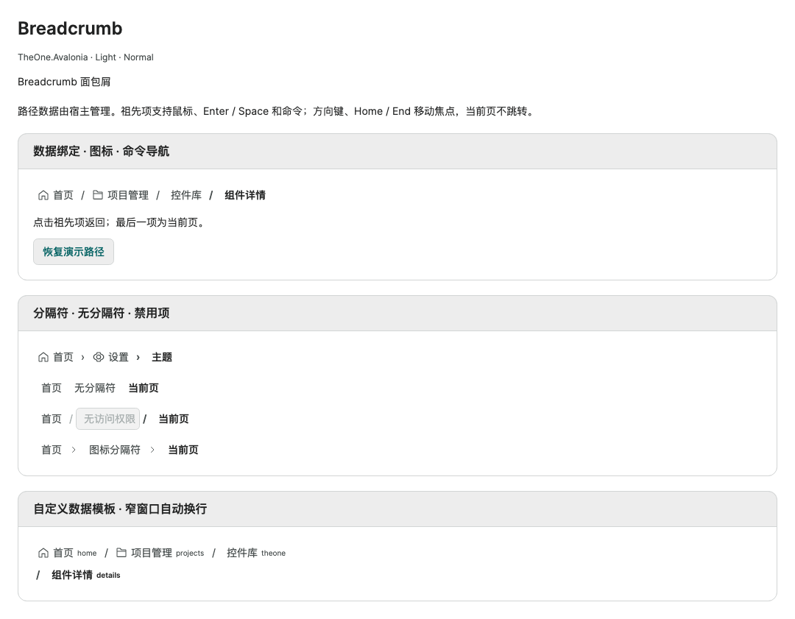

# Breadcrumb 面包屑

[English](../en/breadcrumb.md) · [控件目录](README.md)

`Breadcrumb` 显示由宿主管理的导航路径。最后一项是当前页，不接收焦点或触发导航；祖先项使用原生 Button 的鼠标、Enter / Space、命令和 `CanExecute` 行为。控件不创建页面、不修改路由，也不自动截断集合。

本文对应当前开发源码；使用包含此控件的后续包，或直接引用源码。加载 `OneTheme`，命名空间为 `xmlns:one="using:TheOne.Avalonia.Controls"`。

<!-- visual-guide:start -->
## 外观与场景图示

[配图口径与控件图鉴](visual-index.md)；下图是当前源码的真实渲染，绑定与交互以本页用法说明为准。

### Breadcrumb



路径、分隔符与当前页状态；祖先可导航，当前页不重复执行导航。

[查看 Dark 对照](../images/Breadcrumb-dark.png)

<!-- visual-guide:end -->

## 最小用法

```xml
<one:Breadcrumb ItemInvoked="Navigate">
    <one:BreadcrumbItem Content="首页" Icon="Home" />
    <one:BreadcrumbItem Content="项目管理" Icon="Folder" />
    <one:BreadcrumbItem Content="项目详情" />
</one:Breadcrumb>
```

```csharp
private void Navigate(object? sender, BreadcrumbItemInvokedEventArgs e)
{
    // 声明项时 Item 是 BreadcrumbItem；数据绑定时 Item 是原始数据项。
    OpenPage(e.Item, e.Index); // 宿主自己的导航方法
}
```

`ItemInvoked` 是冒泡路由事件。首项前没有分隔符，末项不触发事件。禁用的项和 `CanExecute=false` 的项不触发命令或事件；空路径不生成占位项。`CurrentItem` 返回末项，无数据时为 null，不是可写的选中项属性。

一次激活会先捕获原始数据项、索引与命令，再触发 `ItemInvoked`，最后执行捕获的命令。即使事件中截断路径、Reset、更换 ItemsSource 或替换 ItemInvokedCommand，本次激活也不会改为执行新项或新命令。`e.Index` 是激活时的索引，`e.Item` 是原始数据项引用，不复制模型字段。执行命令前会再次检查原命令的 `CanExecute(e.Item)`。

事件已完成导航、希望取消后续命令时设置 `e.Handled = true`，同时停止该路由事件继续冒泡：

```csharp
breadcrumb.ItemInvoked += (_, e) =>
{
    NavigateTo(e.Item); // 宿主自己的导航方法，可在这里更新路径
    e.Handled = true;  // 本次激活不再执行 ItemInvokedCommand
};
```

## 编译绑定与默认 Model

消费视图使用自己的 `x:DataType`，普通绑定显式使用 `CompiledBinding`：

```xml
<one:Breadcrumb ItemsSource="{CompiledBinding Path}"
                ItemInvokedCommand="{CompiledBinding NavigateCommand}" />
```

```csharp
public ObservableCollection<BreadcrumbItemModel> Path { get; } =
[
    new() { Header = "首页", Key = "home", Icon = OneIconKind.Home },
    new() { Header = "项目", Key = "projects", Icon = OneIconKind.Folder },
    new() { Header = "详情", Key = "details" }
];
public ICommand NavigateCommand { get; } // 命令参数为集合中的原始 BreadcrumbItemModel
```

命令中可读取 `((BreadcrumbItemModel)item).Key`，按业务导航后更新 Path。`Key` 不进行字符串属性查找、不驱动控件内部匹配；允许业务自定义类型。模型继承 AvaloniaObject，四个属性均可观察并可绑定，更新应在 UI 线程执行。

| Model 属性 | 默认值 | 用途 |
| --- | --- | --- |
| `Header : object?` | null | 默认呈现内容。 |
| `Icon : OneIconKind?` | null | 内置图标，可动态添加、替换、清除；未定义枚举被拒绝。 |
| `Key : object?` | null | 宿主的导航标识，事件与命令传回完整原始项。 |
| `IsEnabled : bool` | true | 是否允许访问该项；与宿主禁用状态和命令 CanExecute 共同生效。 |

使用命令或事件驱动同一次导航即可，避免两边重复执行相同的页面打开操作。一次点击不改变当前项，只有修改路径末项才改变 `CurrentItem`。

## 附加属性与模板

| Breadcrumb 属性 | 默认值 | 说明与示例 |
| --- | --- | --- |
| `Separator : object?` | `"/"` | `Separator="›"` 替换分隔符；`Separator="{x:Null}"` 隐藏。使用可重复的值；视觉内容用模板创建独立实例。 |
| `SeparatorTemplate : IDataTemplate?` | null | 分隔符模板。与路径项分离，不参与导航或焦点。 |
| `ItemInvokedCommand : ICommand?` | null | `ItemInvokedCommand="{CompiledBinding NavigateCommand}"`；参数是原始项，不是 Key 或索引。 |
| `CurrentItem : object?` | null | 只读当前末项；`breadcrumb.CurrentItem`。 |

`Items`、`ItemsSource`、`ItemTemplate` 等来自原生 ItemsControl。自定义数据无需继承默认模型，也无需指定属性名字符串或反射 getter：

```xml
<one:Breadcrumb ItemsSource="{CompiledBinding Routes}">
    <one:Breadcrumb.ItemTemplate>
        <DataTemplate x:DataType="vm:RouteItem">
            <TextBlock Text="{CompiledBinding Title}" MaxWidth="200"
                       TextTrimming="CharacterEllipsis" />
        </DataTemplate>
    </one:Breadcrumb.ItemTemplate>
    <one:Breadcrumb.SeparatorTemplate>
        <DataTemplate>
            <one:OneIcon Kind="ChevronRight" IconSize="12" />
        </DataTemplate>
    </one:Breadcrumb.SeparatorTemplate>
</one:Breadcrumb>
```

`RouteItem.Title` 是使用者自己的属性。模板始终收到原始数据项；默认模型使用自定义模板时，模板也收到完整 `BreadcrumbItemModel`，而不是 Header。默认模型的图标仍由容器呈现；若在自定义模板中绘制图标，请将 Model.Icon 保持 null，避免重复。

直接声明的 `BreadcrumbItem` 可设置 `Icon`，`IconSize` 默认 16 DIP，可显式覆盖。`IsCurrent`、`ShowSeparator`、`CanNavigate` 以及容器的 Separator/SeparatorTemplate/NavigationCommand/NavigationParameter 由 Breadcrumb 管理，只读 CLR 属性用于模板，不是业务导航 API。自定义容器模板保留原生 Button `PART_Navigate`；默认模板另含 `PART_Separator` 和 `PART_Label`。

## 尺寸、主题与键盘

无专有 Classes；公共尺寸、配色与明暗切换参见 [主题](../../theme/zh-cn/README.md)。small / normal / large 对应最小项高 26 / 30 / 34 DIP、图标 14 / 16 / 18 DIP。前景色、悬停、按下、焦点边框与禁用状态复用 `One.*` 资源。当前页使用正文颜色与半粗字重，不使用禁用灰表示当前位置。

默认 WrapPanel 在窄容器中换行，高度随内容增长，不固定裁剪高度、不劫持外部滚轮、不创建额外弹层。单个超长项可在 ItemTemplate 内限制文本宽度，容器 ItemsPanel 可按原生方式替换；本控件面向短路径，不提供虚拟化或自动省略中间项。

Tab 按原生焦点顺序访问可用祖先；Left / Right、Home / End 在路径内移动焦点，跳过禁用项、命令不可用项和当前页；Enter / Space 激活。RTL 时左右键方向跟随布局。焦点移动不执行导航。图标不接收指针或焦点，分隔符不会触发项操作。自定义图标-only 内容应设置可访问名称，避免把可交互控件嵌套到路径按钮内容中。

## 数据更新与预览

容器按原生 ItemsControl 生命周期准备和清理，仅为默认模型建立属性订阅。移除、Replace、Move、Reset 与更换 ItemsSource 后重新计算末项和分隔符，清理旧模型订阅、命令参数与当前页状态。不要同时复用同一个 Control 实例作为多个 Header 或分隔符；需要视觉重复时使用模板。

PreviewHost → 导航与布局 → **Breadcrumb**：命令返回祖先、恢复路径、图标、文字/图标/空分隔符、禁用项和带编译绑定的自定义模板。说明和短代码示例由对应 Description 直接展示。

专项仅覆盖 Breadcrumb、容器、默认模型及直接演示绑定，验证结果与当前宿主实跑范围见本次交付，不代表其他平台已实跑。

2026-10-20：Release 构建通过。macOS ARM64 Skia headless 托管与原生 AOT 各通过 **205 项**专项，包括真实指针、Enter / Space、方向键、RTL、CanExecute、可访问名称、数据源生命周期及实际 AXAML 编译绑定。明暗主题 × 三档尺寸 × 360/900 DIP 共 12 张预览在托管/AOT 间逐字节一致。原生编译使用同一 Xcode 的 clang 与 SDK，无新增裁剪/AOT 警告。未进行全库回归、Windows/Linux 实跑或物理显示器检查。

路径截断后，若原焦点项变成当前页，焦点会移到可用祖先；没有可用祖先时清除焦点，不把键盘焦点留在不可导航的当前页。

## 动态路径与生命周期补充

增删、Move、Replace、Reset 与 ItemsSource 切换以原始项和位置共同验证容器，不仅根据旧索引赋新参数。原生容器尚未完成索引更新时，数据不匹配的旧视觉项暂不允许导航；准备和索引更新完成后恢复对应状态。重复引用同一个模型时，只有末位置为当前页；值类型数据按值匹配，不依赖装箱引用。

移除或替换聚焦项、更换数据源时，待原生布局完成后，优先在原位置或之前寻找可用祖先，再寻找后续祖先；没有可用祖先则清除焦点。有效焦点不移动；若期间用户已把焦点移到输入框、其他路径项或另一个面包屑，不会被延迟恢复抢回。空路径、单项路径和全部祖先禁用时不保留不可导航项的焦点。旧数据源、旧模型和旧命令的变化不应再影响新容器。

按下鼠标期间更换数据源会取消旧激活；插入或重排不会让原先按下的项误执行其他数据项的命令。

2026-10-20 生命周期复查：修复前复现 6 个命令/焦点问题；修复后 macOS ARM64 Skia headless 的 **534 项 Breadcrumb 专项**全部通过，包含事件内更换数据源/命令、Handled 取消、返回祖先、聚焦项移除/替换、按下期间变更数据、重复引用、值类型及 20 轮布局前连续增删重排。正常 PreviewHost Release 构建通过。本轮没有修改模板、主题或编译绑定，未重复绘制矩阵、原生 AOT 或全库回归；上面的 205 项 AOT 记录为首次实现时的验证，不是本轮复跑。

## 连续输入与卸载重载

- 每个独立鼠标点击、完整 Enter / Space 按下松开仍可各执行一次，不做时间防抖。按住导航键产生的自动重复不会连续跳页；方向键、Home / End 只改变焦点。
- 同一次同步导航事件/命令内，再次递归激活本面包屑的其他项会被忽略；异常退出后解除该保护。异步业务需要互斥时，由命令的 CanExecute 表示忙碌状态，控件不猜测 ICommand.Execute 返回后的任务是否完成。
- Space 松开只作用于同一次按下的按钮和路径版本。换焦点、更换/重排路径、替换模板或卸载都会取消这次手势；松开时仍完成原生按钮的按下状态清理，不会跳到新数据项。按键在卸载期间松开后，下次加载的全新按键可正常使用。
- 导航事件中卸载控件会取消尚未执行的命令，即使事件内立即重新加载也不恢复旧激活；仅切换数据源仍遵循上文的命令/参数快照规则。已经开始执行的业务命令不会回滚。
- 卸载取消排队的焦点恢复、移除临时焦点观察，并使旧恢复版本失效。用户先聚焦外部控件、随后又清空焦点时，也不会被旧任务重新聚焦。新加载后的恢复任务独立生效。模板退役的旧按钮不会继续执行旧命令，反复加载不叠加点击处理器。

键盘观察随挂载释放；只有卸载时尚未松开的 Enter / Space 会保留临时弱引用观察，收到松开或窗口失活后清理，不以该观察强持有卸载的控件。

2026-10-20 连续输入复查：修复前复现 9 项问题；修复后 macOS ARM64 Skia headless **570 项 Breadcrumb 专项**通过，包括快速交替点击、递归激活、键盘自动重复、Space 跨数据/焦点/挂载变化、12 轮重载、旧模板按钮及命令异常后的重试。正常 PreviewHost Release 构建通过。此次仅修改交互与生命周期代码，未改模板、主题或编译绑定，未进行全库回归、AOT 复跑或 Windows/Linux 实跑。

<!-- generated-contracts:start -->
## 专属属性、Classes 用法与业务 API

本节只列本项目的专属属性、公开 Classes 用法、实际业务动作及关联模型，不重复原生继承 API、构造器、属性 Get/Set 包装或公开标识符。注册默认值与主题生效值不同，显式局部值优先。PreviewHost 用实际标签样例展示 Classes，不展示模板选择器／Setter 明细；Description 中的属性与业务动作附短用法代码。ControlSizing、Motion 等通用配置集中在 Home。仅 Button、Input、Select 合并比较，其余控件保留独立完整示例。

### Breadcrumb

[完整源码契约](../../api/zh-cn/TheOne.Avalonia.Controls.Breadcrumb.md)

| 属性 | 类型 | 读写／绑定／继承 | 注册或模型初值 | 说明与约束 |
| --- | --- | --- | --- | --- |
| [`CurrentItem`](../../../TheOne.Avalonia/Controls/Breadcrumb.cs#L43) | `object?` | 只读; OneWay | `computed / state` | null ; 只读当前末项；`breadcrumb.CurrentItem`。 |
| [`ItemInvokedCommand`](../../../TheOne.Avalonia/Controls/Breadcrumb.cs#L42) | `System.Windows.Input.ICommand?` | 可写; OneWay | `null` | null ; `ItemInvokedCommand="{CompiledBinding NavigateCommand}"`；参数是原始项，不是 Key 或索引。 |
| [`Separator`](../../../TheOne.Avalonia/Controls/Breadcrumb.cs#L39) | `object?` | 可写; OneWay | `"/"` | `"/"` ; `Separator="›"` 替换分隔符；`Separator="{x:Null}"` 隐藏。使用可重复的值；视觉内容用模板创建独立实例。 |
| [`SeparatorTemplate`](../../../TheOne.Avalonia/Controls/Breadcrumb.cs#L40) | `Avalonia.Controls.Templates.IDataTemplate?` | 可写; OneWay | `null` | null ; 分隔符模板。与路径项分离，不参与导航或焦点。 |

### BreadcrumbItem

[完整源码契约](../../api/zh-cn/TheOne.Avalonia.Controls.BreadcrumbItem.md)

| 属性 | 类型 | 读写／绑定／继承 | 注册或模型初值 | 说明与约束 |
| --- | --- | --- | --- | --- |
| [`CanNavigate`](../../../TheOne.Avalonia/Controls/BreadcrumbItem.cs#L47) | `bool` | 只读; OneWay | `computed / state` | 只读运行状态或派生结果；由对应控件／模型更新，供展示和命令条件读取，不作为双向输入。 |
| [`Icon`](../../../TheOne.Avalonia/Controls/BreadcrumbItem.cs#L39) | `TheOne.Avalonia.Controls.OneIconKind?` | 可写; OneWay | `null` | null ; 内置图标，可动态添加、替换、清除；未定义枚举被拒绝。 校验：`value => value is null &#124;&#124; Enum.IsDefined(value.Value)` 可选值：`Add`, `Remove`, `Edit`, `Delete`, `Search`, `Save`, `Refresh`, `More`, `Home`, `Menu`, `Back`, `Forward`, `Up`, `Down`, `Expand`, `Collapse`, `File`, `Folder`, `Document`, `Image`, `Upload`, `Download`, `Copy`, `Link`, `User`, `Users`, `Role`, `Lock`, `Unlock`, `Shield`, `Login`, `Logout`, `Info`, `Success`, `Warning`, `Error`, `Question`, `Bell`, `Message`, `Loading`, `Table`, `Database`, `LineChart`, `BarChart`, `PieChart`, `Dashboard`, `Filter`, `Sort`, `Calendar`, `Clock`, `DateRange`, `Timer`, `History`, `Schedule`, `PreviousDay`, `NextDay`, `Window`, `Tabs`, `Sidebar`, `Grid`, `List`, `Split`, `Maximize`, `Minimize`, `Settings`, `Monitor`, `Mobile`, `Printer`, `Keyboard`, `Mouse`, `Sun`, `Moon`, `Code`, `Terminal`, `Api`, `Server`, `Cloud`, `Network`, `Bug`, `Package`, `Start`, `End`, `Approval`, `Task`, `Branch`, `Parallel`, `Merge`, `Workflow`, `Pointer`, `Text`, `Rectangle`, `Line`, `AlignLeft`, `AlignCenter`, `Barcode`, `QrCode`, `Close`, `Undo`, `Redo`, `Share`, `ChevronLeft`, `ChevronRight`, `ChevronUp`, `ChevronDown`, `FileAdd`, `FolderOpen`, `Attachment`, `FileSearch`, `UserAdd`, `UserRemove`, `Key`, `Permission`, `BellOff`, `Mail`, `Send`, `Flag`, `SortAscending`, `SortDescending`, `Statistics`, `TrendUp`, `Alarm`, `CalendarCheck`, `CalendarAdd`, `CalendarRemove`, `Fullscreen`, `FullscreenExit`, `Pin`, `Unpin`, `Play`, `Pause`, `Stop`, `Volume`, `Wifi`, `WifiOff`, `Connection`, `Disconnect`, `Approve`, `Reject`, `Transfer`, `Pending`, `ZoomIn`, `ZoomOut`, `AlignRight`, `Crop`, `Cut`, `Paste`, `PrintPreview`, `Export`, `Compass`, `Location`, `Route`, `BreadcrumbPath`, `FileCheck`, `FileLock`, `Archive`, `TrashRestore`, `UserCheck`, `UserSettings`, `Organization`, `Fingerprint`, `NotificationRead`, `ChatReply`, `Heart`, `Star`, `ScatterPlot`, `AreaChart`, `Heatmap`, `DataImport`, `ClockCheck`, `ClockForward`, `CalendarWeek`, `TimeZone`, `DockBottom`, `PanelLeftClose`, `PanelLeftOpen`, `Layers`, `Camera`, `Microphone`, `Headphones`, `Battery`, `GitBranch`, `GitCommit`, `Braces`, `Container`, `Reassign`, `ApprovalChain`, `WorkflowValidate`, `WorkflowPublish`, `AlignTop`, `AlignBottom`, `DistributeHorizontal`, `Palette`, `Wallet`, `CreditCard`, `Bank`, `Cash`, `Coins`, `Receipt`, `Invoice`, `Calculator`, `Payment`, `Refund`, `Exchange`, `CurrencyYuan`, `CurrencyDollar`, `Safe`, `FinancialReport`, `StockTrend`, `Factory`, `Gear`, `Wrench`, `Hammer`, `RobotArm`, `Conveyor`, `Valve`, `Pump`, `Motor`, `Sensor`, `Gauge`, `Crane`, `Forklift`, `HardHat`, `Welding`, `Toolbox`, `MedicalCross`, `Hospital`, `Stethoscope`, `HeartPulse`, `Pill`, `Syringe`, `Thermometer`, `FirstAid`, `Ambulance`, `Wheelchair`, `Microscope`, `TestTube`, `Dna`, `Lungs`, `Tooth`, `Bandage`, `Building`, `Bridge`, `Road`, `Railway`, `Airport`, `PowerTower`, `PowerPlug`, `WaterDrop`, `WaterPipe`, `WindTurbine`, `SolarPanel`, `StreetLight`, `TrafficLight`, `FireHydrant`, `Warehouse`, `Recycle`, `Truck`, `DeliveryVan`, `Car`, `Bus`, `Bicycle`, `Train`, `Ship`, `FlightTakeoff`, `DeliveryBox`, `DeliveryTracking`, `Map`, `NavigationArrow`, `Parking`, `Fuel`, `Anchor`, `TrafficCone`, `ShoppingCart`, `ShoppingBag`, `Store`, `TagLabel`, `Discount`, `Gift`, `Product`, `Scan`, `ShoppingBasket`, `Order`, `OrderCheck`, `OrderCancel`, `Coupon`, `LoyaltyCard`, `CustomerService`, `ShoppingCompare`, `Book`, `BookOpen`, `GraduationCap`, `School`, `Pen`, `Notebook`, `Library`, `Certificate`, `Lightbulb`, `Flask`, `Ruler`, `Globe`, `Language`, `Presentation`, `ReadAloud`, `Backpack`, `CloudSun`, `CloudMoon`, `Rain`, `Snow`, `Thunderstorm`, `Wind`, `Fog`, `Tornado`, `Rainbow`, `Umbrella`, `TemperatureHigh`, `Leaf`, `Tree`, `Flower`, `Mountain`, `Earth` |
| [`IconSize`](../../../TheOne.Avalonia/Controls/BreadcrumbItem.cs#L40) | `double` | 可写; OneWay | `16` | 图标绘制尺寸，单位 DIP；独立于文本字号与按钮点击区域。 校验：`value => double.IsFinite(value) && value > 0` |
| [`IsCurrent`](../../../TheOne.Avalonia/Controls/BreadcrumbItem.cs#L45) | `bool` | 只读; OneWay | `computed / state` | 是否为分页器当前页；由分页状态派生。 |
| [`NavigationCommand`](../../../TheOne.Avalonia/Controls/BreadcrumbItem.cs#L43) | `System.Windows.Input.ICommand?` | 只读; OneWay | `null` | 宿主提供的命令入口；具体操作与权限由业务实现，配对的 CommandParameter 作为命令参数。 |
| [`NavigationParameter`](../../../TheOne.Avalonia/Controls/BreadcrumbItem.cs#L44) | `object?` | 只读; OneWay | `null` | 只读运行状态或派生结果；由对应控件／模型更新，供展示和命令条件读取，不作为双向输入。 |
| [`Separator`](../../../TheOne.Avalonia/Controls/BreadcrumbItem.cs#L41) | `object?` | 只读; OneWay | `"/"` | `"/"` ; `Separator="›"` 替换分隔符；`Separator="{x:Null}"` 隐藏。使用可重复的值；视觉内容用模板创建独立实例。 |
| [`SeparatorTemplate`](../../../TheOne.Avalonia/Controls/BreadcrumbItem.cs#L42) | `Avalonia.Controls.Templates.IDataTemplate?` | 只读; OneWay | `null` | null ; 分隔符模板。与路径项分离，不参与导航或焦点。 |
| [`ShowSeparator`](../../../TheOne.Avalonia/Controls/BreadcrumbItem.cs#L46) | `bool` | 只读; OneWay | `computed / state` | 只读运行状态或派生结果；由对应控件／模型更新，供展示和命令条件读取，不作为双向输入。 |

### BreadcrumbItemInvokedEventArgs

[完整源码契约](../../api/zh-cn/TheOne.Avalonia.Controls.BreadcrumbItemInvokedEventArgs.md)

| 属性 | 类型 | 读写／绑定／继承 | 注册或模型初值 | 说明与约束 |
| --- | --- | --- | --- | --- |
| [`Index`](../../../TheOne.Avalonia/Controls/Breadcrumb.cs#L252) | `int` | 只读; CLR / n/a | `index` | 只读运行状态或派生结果；由对应控件／模型更新，供展示和命令条件读取，不作为双向输入。 |
| [`Item`](../../../TheOne.Avalonia/Controls/Breadcrumb.cs#L251) | `object?` | 只读; CLR / n/a | `item` | 只读运行状态或派生结果；由对应控件／模型更新，供展示和命令条件读取，不作为双向输入。 |

### BreadcrumbItemModel

[完整源码契约](../../api/zh-cn/TheOne.Avalonia.Controls.BreadcrumbItemModel.md)

| 属性 | 类型 | 读写／绑定／继承 | 注册或模型初值 | 说明与约束 |
| --- | --- | --- | --- | --- |
| [`Header`](../../../TheOne.Avalonia/Controls/BreadcrumbItemModel.cs#L14) | `object?` | 可写; OneWay | `null` | null ; 默认呈现内容。 |
| [`Icon`](../../../TheOne.Avalonia/Controls/BreadcrumbItemModel.cs#L15) | `TheOne.Avalonia.Controls.OneIconKind?` | 可写; OneWay | `null` | null ; 内置图标，可动态添加、替换、清除；未定义枚举被拒绝。 校验：`value => value is null &#124;&#124; Enum.IsDefined(value.Value)` 可选值：`Add`, `Remove`, `Edit`, `Delete`, `Search`, `Save`, `Refresh`, `More`, `Home`, `Menu`, `Back`, `Forward`, `Up`, `Down`, `Expand`, `Collapse`, `File`, `Folder`, `Document`, `Image`, `Upload`, `Download`, `Copy`, `Link`, `User`, `Users`, `Role`, `Lock`, `Unlock`, `Shield`, `Login`, `Logout`, `Info`, `Success`, `Warning`, `Error`, `Question`, `Bell`, `Message`, `Loading`, `Table`, `Database`, `LineChart`, `BarChart`, `PieChart`, `Dashboard`, `Filter`, `Sort`, `Calendar`, `Clock`, `DateRange`, `Timer`, `History`, `Schedule`, `PreviousDay`, `NextDay`, `Window`, `Tabs`, `Sidebar`, `Grid`, `List`, `Split`, `Maximize`, `Minimize`, `Settings`, `Monitor`, `Mobile`, `Printer`, `Keyboard`, `Mouse`, `Sun`, `Moon`, `Code`, `Terminal`, `Api`, `Server`, `Cloud`, `Network`, `Bug`, `Package`, `Start`, `End`, `Approval`, `Task`, `Branch`, `Parallel`, `Merge`, `Workflow`, `Pointer`, `Text`, `Rectangle`, `Line`, `AlignLeft`, `AlignCenter`, `Barcode`, `QrCode`, `Close`, `Undo`, `Redo`, `Share`, `ChevronLeft`, `ChevronRight`, `ChevronUp`, `ChevronDown`, `FileAdd`, `FolderOpen`, `Attachment`, `FileSearch`, `UserAdd`, `UserRemove`, `Key`, `Permission`, `BellOff`, `Mail`, `Send`, `Flag`, `SortAscending`, `SortDescending`, `Statistics`, `TrendUp`, `Alarm`, `CalendarCheck`, `CalendarAdd`, `CalendarRemove`, `Fullscreen`, `FullscreenExit`, `Pin`, `Unpin`, `Play`, `Pause`, `Stop`, `Volume`, `Wifi`, `WifiOff`, `Connection`, `Disconnect`, `Approve`, `Reject`, `Transfer`, `Pending`, `ZoomIn`, `ZoomOut`, `AlignRight`, `Crop`, `Cut`, `Paste`, `PrintPreview`, `Export`, `Compass`, `Location`, `Route`, `BreadcrumbPath`, `FileCheck`, `FileLock`, `Archive`, `TrashRestore`, `UserCheck`, `UserSettings`, `Organization`, `Fingerprint`, `NotificationRead`, `ChatReply`, `Heart`, `Star`, `ScatterPlot`, `AreaChart`, `Heatmap`, `DataImport`, `ClockCheck`, `ClockForward`, `CalendarWeek`, `TimeZone`, `DockBottom`, `PanelLeftClose`, `PanelLeftOpen`, `Layers`, `Camera`, `Microphone`, `Headphones`, `Battery`, `GitBranch`, `GitCommit`, `Braces`, `Container`, `Reassign`, `ApprovalChain`, `WorkflowValidate`, `WorkflowPublish`, `AlignTop`, `AlignBottom`, `DistributeHorizontal`, `Palette`, `Wallet`, `CreditCard`, `Bank`, `Cash`, `Coins`, `Receipt`, `Invoice`, `Calculator`, `Payment`, `Refund`, `Exchange`, `CurrencyYuan`, `CurrencyDollar`, `Safe`, `FinancialReport`, `StockTrend`, `Factory`, `Gear`, `Wrench`, `Hammer`, `RobotArm`, `Conveyor`, `Valve`, `Pump`, `Motor`, `Sensor`, `Gauge`, `Crane`, `Forklift`, `HardHat`, `Welding`, `Toolbox`, `MedicalCross`, `Hospital`, `Stethoscope`, `HeartPulse`, `Pill`, `Syringe`, `Thermometer`, `FirstAid`, `Ambulance`, `Wheelchair`, `Microscope`, `TestTube`, `Dna`, `Lungs`, `Tooth`, `Bandage`, `Building`, `Bridge`, `Road`, `Railway`, `Airport`, `PowerTower`, `PowerPlug`, `WaterDrop`, `WaterPipe`, `WindTurbine`, `SolarPanel`, `StreetLight`, `TrafficLight`, `FireHydrant`, `Warehouse`, `Recycle`, `Truck`, `DeliveryVan`, `Car`, `Bus`, `Bicycle`, `Train`, `Ship`, `FlightTakeoff`, `DeliveryBox`, `DeliveryTracking`, `Map`, `NavigationArrow`, `Parking`, `Fuel`, `Anchor`, `TrafficCone`, `ShoppingCart`, `ShoppingBag`, `Store`, `TagLabel`, `Discount`, `Gift`, `Product`, `Scan`, `ShoppingBasket`, `Order`, `OrderCheck`, `OrderCancel`, `Coupon`, `LoyaltyCard`, `CustomerService`, `ShoppingCompare`, `Book`, `BookOpen`, `GraduationCap`, `School`, `Pen`, `Notebook`, `Library`, `Certificate`, `Lightbulb`, `Flask`, `Ruler`, `Globe`, `Language`, `Presentation`, `ReadAloud`, `Backpack`, `CloudSun`, `CloudMoon`, `Rain`, `Snow`, `Thunderstorm`, `Wind`, `Fog`, `Tornado`, `Rainbow`, `Umbrella`, `TemperatureHigh`, `Leaf`, `Tree`, `Flower`, `Mountain`, `Earth` |
| [`IsEnabled`](../../../TheOne.Avalonia/Controls/BreadcrumbItemModel.cs#L17) | `bool` | 可写; OneWay | `true` | true ; 是否允许访问该项；与宿主禁用状态和命令 CanExecute 共同生效。 |
| [`Key`](../../../TheOne.Avalonia/Controls/BreadcrumbItemModel.cs#L16) | `object?` | 可写; OneWay | `null` | null ; 宿主的导航标识，事件与命令传回完整原始项。 |

尺寸、动效等通用配置见[统一主题说明](../../theme/zh-cn/README.md#shared-configuration)，PreviewHost 在 Home 集中演示。

### Classes 用法

没有额外公开外观类，使用默认主题及专属属性。

以上是分别使用的公开类名；悬停、按下、禁用和选中等状态由控件维护，不手工添加模板类。实际外观见 PreviewHost 的标签样例。

### 业务 API

没有额外业务方法；通过本节专属属性配置。

### 事件订阅

按需订阅下列通知，并在宿主释放时解除订阅；这里只列事件入口，不列路由事件标识字段。

| 类型 | 事件 | 用途 |
| --- | --- | --- |
| [`Breadcrumb`](../../api/zh-cn/TheOne.Avalonia.Controls.Breadcrumb.md) | `ItemInvoked` | 状态／操作通知；在宿主生命周期内订阅并在释放时解除，事件参数类型见签名。 |

### 关联模型

| 模型 | 属性／枚举值 |
| --- | ---: |
| [`TheOne.Avalonia.Controls.BreadcrumbItemInvokedEventArgs`](../../api/zh-cn/TheOne.Avalonia.Controls.BreadcrumbItemInvokedEventArgs.md) | 2 |
| [`TheOne.Avalonia.Controls.BreadcrumbItemModel`](../../api/zh-cn/TheOne.Avalonia.Controls.BreadcrumbItemModel.md) | 4 |
| [`TheOne.Avalonia.Controls.OneIconKind`](../../api/zh-cn/TheOne.Avalonia.Controls.OneIconKind.md) | 320 |

[完整源码契约（含构造、属性访问器和标识符，供精确查阅）](../../api/zh-cn/README.md)
<!-- generated-contracts:end -->
