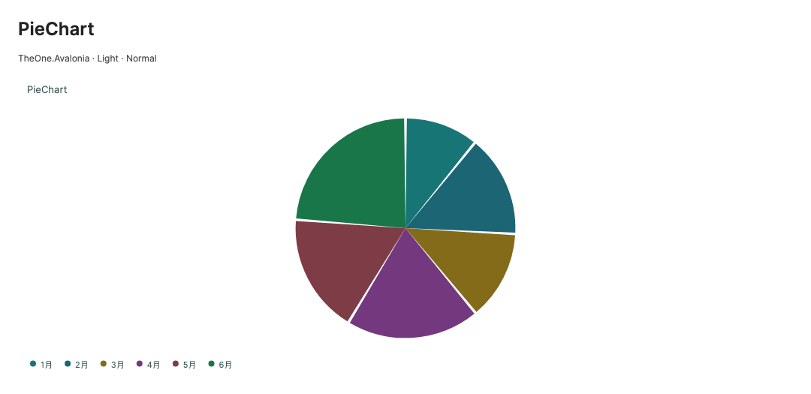
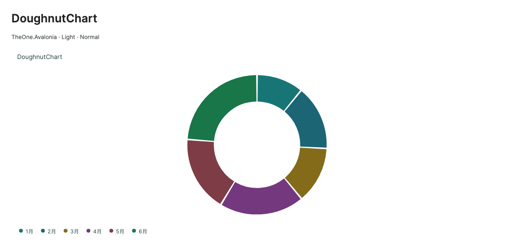

# 饼图、环形图与仪表

**简体中文** · [English](../en/chart-radial.md)

数据模型与接入见[图表入口](charts.md)。

<!-- visual-guide:start -->
## 外观与场景图示

[配图口径与控件图鉴](visual-index.md)；下图是当前源码的真实渲染，绑定与交互以本页用法说明为准。

### PieChart



扇区角度表达占比，图例与分区颜色对应。

[查看 Dark 对照](../images/PieChart-dark.png)

### DoughnutChart



环形分区保留占比语义，内孔比例可配置。

[查看 Dark 对照](../images/DoughnutChart-dark.png)

### GaugeChart


仪表当前值与剩余区间区分；多种仪表样式见独立预览。

[查看 Dark 对照](../images/GaugeChart-dark.png)

<!-- visual-guide:end -->

## 饼图与环形图

```xml
<one:DoughnutChart Title="营收构成"
           SeriesSource="{CompiledBinding Revenue}"
           InnerRadius="0.62" ShowDataLabels="True"
           ValueFormat="0.##" Unit=" 万元" Height="300" />
```

饼图／环形图只使用首个 `IsVisible=True` 且非空的系列；其余系列不合并。只有 X / Y 均有限且 `Y > 0` 的点参与比例、图例与选择，零值、负值及非有限值被忽略。类别名称使用 `Label`。若首个可见非空系列没有有效正值，显示 `EmptyText`，不会自动跳到后续系列。

`InnerRadius` 为 `[0, 1)` 的比例，只影响环形图；`Pie` 保持实心。`ShowDataLabels=True` 显示可容纳文字的扇区百分比，小扇区仍可通过提示查看实际值。大量类别可先在业务层汇总为主要类别与“其他”，图例可分页浏览其余类别。

## 仪表图

```xml
<one:GaugeChart Title="目标完成率"
           Minimum="0" Maximum="100" Value="72"
           ShowGaugeNeedle="True" ShowGaugeTicks="True"
           GaugeMajorTickCount="5" GaugeMinorTickCount="2"
           ValueFormat="0" Unit="%" Height="280" />
```

`Minimum`、`Maximum`、`Value` 必须为有限值。业务层应提供 `Maximum > Minimum` 的范围；无效范围显示“最大值必须大于最小值”。仪表的弧线按范围限制显示，数值文本保留实际 `Value`；可以用编译绑定把 `Value` 连接到带变化通知的 ViewModel 属性。仪表不提供数据点选择与图例。

原有 `GaugeStyle="Semicircle"` 的 `ShowGaugeNeedle` / `ShowGaugeTicks` 默认均为 `False`；开启后显示指针与刻度。指针和弧线使用同一范围及受限数值，超出范围时停在端点，文本仍保留原始值。`GaugeMajorTickCount` 默认 5，范围 `[2, 25]`，包含最小值与最大值；`GaugeMinorTickCount` 默认 2，范围 `[0, 10]`，表示两个主刻度之间的小刻度数量上限，紧凑布局按弧长减少次刻度，避免拥挤。原有半圆的主／次刻度采用色带外侧的圆头短线，以长度及粗细区分，不切穿色带。刻度文字沿用 `ValueFormat`，过长范围文字使用科学计数，空间不足时省略会碰撞的中间标签。数值与单位使用相同字号，同行、基线对齐并整体居中；空间不足时两者一起缩小，数值标题放不下时改用紧凑格式并调整字号，过长单位省略显示；模型数值及单位不改变。

### 用枚举切换仪表

`GaugeStyle` 使用 `GaugeStyle` 枚举选择结构；数值范围、颜色、单位和格式仍由属性控制。默认 `Semicircle` 保持原有半圆绘制。基础仪表的数字动画使用现有 `IsAnimationEnabled` / `AnimationDuration` 与 `Motion.Enabled`，不新增动画专用枚举。

| GaugeStyle | 结构 | 默认起点 / 顺时针角度 | 主题默认指针 / 刻度 / 主刻度数 |
| --- | --- | --- | --- |
| Semicircle | 半圆进度，兼容原有默认 | 180° / 180° | False / False / 5 |
| Basic | 薄轴线、三角指针 | 135° / 270° | True / True / 11 |
| Speed | 半圆速度表、进度弧、指针锚点 | 180° / 180° | True / True / 9 |
| Progress | 270° 进度弧、线形指针 | 135° / 270° | True / True / 11 |
| StageSpeed | 分段色带，指针跟随所属分段颜色 | 135° / 270° | True / True / 11 |
| Grade | 半圆色带、分段标签、短三角标记 | 180° / 180° | True / True / 9 |
| Temperature | 无指针、双层进度弧、中央数值 | 160° / 220° | False / True / 13 |
| Barometer | 外侧主轴、内侧独立刻度、长线指针 | 135° / 270° | True / True / 11 |

主题默认值通过 ControlTheme 样式提供，显式属性值和编译绑定优先；切换枚举不会覆盖本地设置。枚举不会改写 `Minimum`、`Maximum`、`Value`、`Unit` 或业务颜色。未载入 TheOne 主题时，指针、刻度和主刻度数仍使用 ChartBase 的默认值。

```xml
<one:GaugeChart GaugeStyle="Temperature" Title="温度"
                Minimum="0" Maximum="60" Value="35.78" Unit="°C"
                AccentBrush="#FFAB91" SecondaryBrush="#FD7347" />

<one:GaugeChart GaugeStyle="Grade" Value="70" GaugeCaption="Grade Rating">
  <one:GaugeChart.GaugeSegments>
    <one:GaugeSegment Fraction="0.25" Brush="#FF6E76" Label="Grade D" />
    <one:GaugeSegment Fraction="0.5" Brush="#FDDD60" Label="Grade C" />
    <one:GaugeSegment Fraction="0.75" Brush="#58D9F9" Label="Grade B" />
    <one:GaugeSegment Fraction="1" Brush="#7CFFB2" Label="Grade A" />
  </one:GaugeChart.GaugeSegments>
</one:GaugeChart>
```

| 属性 | 默认值与用途 |
| --- | --- |
| GaugeStartAngle / GaugeSweepAngle | NaN 表示随枚举；起点允许 −360°–360°，顺时针角度 `(0, 360]`。坐标系 0° 指向右、90° 指向下。支持整圆 |
| ShowGaugeNeedle / ShowGaugeTicks | 主题按枚举提供默认值；显式 False 隐藏对应元素。气压表的刻度开关同时作用于两套轴 |
| ShowGaugeProgress | null 随枚举；True / False 强制显示／隐藏进度弧 |
| ShowGaugeAnchor | null 随枚举；控制指针中心锚点，仅指针开启时生效 |
| ShowGaugeValue / ShowGaugeTickLabels | 默认 True；分别控制数值和刻度标签，不影响数据 |
| GaugeNeedleShape | Auto 随枚举；Triangle / Line / Marker 单独覆盖指针形状 |
| GaugeNeedleLength / GaugeNeedleWidth | 长度默认半径的 0.72，范围 `(0, 1]`；宽度 NaN 随形状，显式像素值 `(0, 50]` |
| GaugeTickPlacement | Auto 随枚举；Inside / Outside 覆盖主刻度位置，气压表副刻度保持内侧 |
| GaugeBandRatio | 沿用三档主题密度；基础、进度、等级、气压表按结构缩放带宽，可显式调整该比例 |
| GaugeGradeLabelRotation / GaugeGradeLabelGap | 等级标签默认沿切线旋转并保持可读；旋转角 NaN 自动、`[−90, 90]` 显式角度（0 水平）；标签到色带的间距 NaN 随字号、`[0, 100]` 显式像素 |
| GaugeCaption / GaugeCaptionOffset | 说明文字默认 null；说明顶端的垂直偏移为半径比例 `[−1, 1]`，NaN 随枚举，与顶部 Title 分开 |
| GaugeValueFontSize / GaugeValueOffset | NaN 随枚举；字号 `(0, 200]`，垂直偏移为半径比例 `[−1, 1]`，正数向下。字号按实际空间缩小 |
| GaugeTrackBrush | 背景轴线／轨道颜色，默认 GridBrush |
| GaugeNeedleBrush / GaugeTickBrush / GaugeValueBrush | 显式覆盖指针、主刻度和中心数值颜色；未设置时使用主题或所属色带颜色 |
| GaugeSegments | 每个实例默认独立空集合，支持直接 XAML 子项与绑定替换；有序色带列表；每项 Fraction 是相对于 Minimum–Maximum 的累计结束比例 `(0, 1]`，Brush 控制颜色，Label 用于 Grade |
| GaugeSecondaryMinimum / GaugeSecondaryMaximum | 气压表副刻度范围，默认 0–60；不改变主值或指针所代表的范围。无效副范围隐藏副轴 |
| GaugeSecondaryTickCount / GaugeSecondaryBrush | 气压表副刻度数默认 7（范围 `[2, 12]`），颜色默认 Foreground |

默认分段速度表使用三个分段，等级表使用四个分段，颜色来自现有主题系列色。实际等级名称和业务色值通过 `GaugeSegments` 指定。按 Fraction 递增提供色带；非递增项跳过，末尾不足 1 的剩余区间显示轨道。`ObservableCollection<GaugeSegment>` 的增删和每个分段属性的变更会自动重绘；普通列表增删后重新赋值列表。分段事件在离开视觉树时解除。

新增属性也可用于 `Semicircle`；显式使用这些属性时采用通用仪表布局。不配置新增属性时保留原有布局。所有样式均直接绘制、支持数值更新动画和稳定目标值 PNG 导出；导出保留样式、色带及属性覆盖。窄视口优先保留端点，中间刻度标签相撞时省略，极小尺寸回退为数值。

参考：[Apache ECharts 仪表盘示例](https://echarts.apache.org/examples/zh/index.html#chart-type-gauge)。PreviewHost 的 GaugeChart 页同时展示八种样式，展开“交互与数据实验”可通过枚举下拉框在同一实例上切换结构。

等级标签按实际文字的旋转边界参与仪表尺寸计算，放在色带外侧；可见文字不会压到色带或刻度。窄视口按旋转边界检查标签之间的碰撞，省略无法容纳的标签，不把文字向内挤到弧线上。

数值绘制请求字体的等宽数字特性（`tnum`，字体支持时生效），字号根据范围和目标值预留，单位位置跟随目标布局，不跟随每帧插值宽度。默认 `ValueFormat="0.##"` 的整数动画使用整数显示；连续拖动出现小数后在这段动画中保留两位小数，经过整数目标也不反复改变精度，结束后恢复 `ValueFormat` 的最终显示。显式数值格式继续优先。指针和进度弧保留连续数值动画。

### 精度与尺寸

默认 `ValueFormat="0.##"` 时，刻度文字根据主刻度间隔保留必要小数位。例如范围 0–1、5 个主刻度显示 0、0.25、0.5、0.75、1。自定义 `ValueFormat` 仍优先；整数格式会省略小数。高数量级窄范围保留更多有效数字，避免相邻刻度显示为相同文字。

下表描述兼容半圆布局；其他枚举按结构调整带宽与数值字号。

| 配置 | Small | Normal | Large |
| --- | --- | --- | --- |
| 默认期望宽／高 | 320 / 224 | 400 / 280 | 480 / 336 |
| 基础字号 | 10 | 11 | 12 |
| 刻度字号 | 9 | 10 | 11 |
| 中心数值字号 | 20 | 22 | 24 |
| GaugeBandRatio | 0.14 | 0.18 | 0.22 |

中心数值与单位会在空间不足时缩小。端点标签优先，中间标签相撞时省略；尺寸更小时回退为数值提示。不要把三个尺寸的 Width / Height 固定为相同值：显式尺寸和 Grid 拉伸决定外部大小，尺寸主题只改变内部密度。PreviewHost 八种仪表样式的可用宽度为 240 / 300 / 360，随顶部尺寸设置变化。

折线／面积／散点的标签规则见[坐标图与采样](chart-cartesian.md)。

<!-- generated-contracts:start -->
## 专属属性、Classes 用法与业务 API

本节只列本项目的专属属性、公开 Classes 用法、实际业务动作及关联模型，不重复原生继承 API、构造器、属性 Get/Set 包装或公开标识符。注册默认值与主题生效值不同，显式局部值优先。PreviewHost 用实际标签样例展示 Classes，不展示模板选择器／Setter 明细；Description 中的属性与业务动作附短用法代码。ControlSizing、Motion 等通用配置集中在 Home。仅 Button、Input、Select 合并比较，其余控件保留独立完整示例。

### ChartBase

[完整源码契约](../../api/zh-cn/TheOne.Avalonia.Controls.ChartBase.md)

| 属性 | 类型 | 读写／绑定／继承 | 注册或模型初值 | 说明与约束 |
| --- | --- | --- | --- | --- |
| [`AccentBrush`](../../../TheOne.Avalonia/Controls/ChartBase.cs#L297) | `Avalonia.Media.IBrush?` | 可写; OneWay | `null` | 主序列／强调色画刷；动态主题使用 One.* 资源，显式局部值优先。 |
| [`AnimationDuration`](../../../TheOne.Avalonia/Controls/ChartBase.Animation.cs#L52) | `System.TimeSpan` | 可写; OneWay | `TimeSpan.FromMilliseconds(200)` | 数据过渡的持续时间；是否启用动画还受控件开关和 Motion.Enabled 约束。 校验：`value => value >= TimeSpan.Zero && value <= TimeSpan.FromSeconds(10)` |
| [`AnimationProgress`](../../../TheOne.Avalonia/Controls/ChartBase.Animation.cs#L66) | `double` | 只读; OneWay | `computed / state` | 只读运行状态或派生结果；由对应控件／模型更新，供展示和命令条件读取，不作为双向输入。 |
| [`AnimationStyle`](../../../TheOne.Avalonia/Controls/ChartBase.Animation.cs#L59) | `TheOne.Avalonia.Controls.ChartAnimationStyle` | 可写; OneWay | `0 / default` | 首次非空展示 ; 后续数据变化 校验：`value => Enum.IsDefined(value)` 可选值：`Auto`, `None`, `Fade`, `Reveal` |
| [`Background`](../../../TheOne.Avalonia/Controls/ChartBase.cs#L273) | `Avalonia.Media.IBrush?` | 可写; OneWay | `inherited registration` | 背景画刷；主题相关背景使用 DynamicResource，避免固定颜色破坏明暗切换。 |
| [`ChartPadding`](../../../TheOne.Avalonia/Controls/ChartBase.Sizing.cs#L53) | `double` | 可写; OneWay | `12` | 8 ; 12 ; 16 校验：`value => double.IsFinite(value) && value >= 0` |
| [`CrosshairPosition`](../../../TheOne.Avalonia/Controls/ChartBase.Interaction.cs#L54) | `Avalonia.Point?` | 只读; OneWay | `computed / state` | 只读运行状态或派生结果；由对应控件／模型更新，供展示和命令条件读取，不作为双向输入。 |
| [`DefaultChartHeight`](../../../TheOne.Avalonia/Controls/ChartBase.Sizing.cs#L47) | `double` | 可写; OneWay | `280` | 320 / 224 ; 400 / 280 ; 480 / 336 校验：`value => double.IsFinite(value) && value > 0` |
| [`DefaultChartWidth`](../../../TheOne.Avalonia/Controls/ChartBase.Sizing.cs#L40) | `double` | 可写; OneWay | `400` | 320 / 224 ; 400 / 280 ; 480 / 336 校验：`value => double.IsFinite(value) && value > 0` |
| [`EmptyText`](../../../TheOne.Avalonia/Controls/ChartBase.cs#L255) | `string` | 可写; OneWay | `"暂无数据"` | `暂无数据` |
| [`FifthBrush`](../../../TheOne.Avalonia/Controls/ChartBase.cs#L321) | `Avalonia.Media.IBrush?` | 可写; OneWay | `null` | 第五序列画刷；动态主题使用 One.* 资源，显式局部值优先。 |
| [`FontFamily`](../../../TheOne.Avalonia/Controls/ChartBase.cs#L333) | `Avalonia.Media.FontFamily` | 可写; OneWay | `inherited registration` | 文本绘制使用的字体族；字体回退和实际度量由 Avalonia 文本系统处理。 |
| [`FontSize`](../../../TheOne.Avalonia/Controls/ChartBase.cs#L339) | `double` | 可写; OneWay | `inherited registration` | 10 ; 11 ; 12 |
| [`Foreground`](../../../TheOne.Avalonia/Controls/ChartBase.cs#L279) | `Avalonia.Media.IBrush?` | 可写; OneWay | `inherited registration` | 前景画刷；自定义时保持正文、状态与禁用对比度。 |
| [`GaugeBandRatio`](../../../TheOne.Avalonia/Controls/ChartBase.Sizing.cs#L83) | `double` | 可写; OneWay | `0.18` | 沿用三档主题密度；基础、进度、等级、气压表按结构缩放带宽，可显式调整该比例 校验：`value => double.IsFinite(value) && value > 0 && value <= 0.5` |
| [`GaugeMajorTickCount`](../../../TheOne.Avalonia/Controls/ChartBase.Gauge.cs#L34) | `int` | 可写; OneWay | `5` | Number of major ticks, including the minimum and maximum. 校验：`value => value >= 2 && value <= 25` |
| [`GaugeMinorTickCount`](../../../TheOne.Avalonia/Controls/ChartBase.Gauge.cs#L41) | `int` | 可写; OneWay | `2` | Maximum minor marks between consecutive major ticks. Compact gauges reduce them to keep readable spacing. 校验：`value => value >= 0 && value <= 10` |
| [`GridBrush`](../../../TheOne.Avalonia/Controls/ChartBase.cs#L285) | `Avalonia.Media.IBrush?` | 可写; OneWay | `null` | 绘图区网格线画刷；动态主题使用 One.* 资源，显式局部值优先。 |
| [`HoveredPoints`](../../../TheOne.Avalonia/Controls/ChartBase.Interaction.cs#L55) | `System.Collections.Generic.IReadOnlyList<TheOne.Avalonia.Controls.ChartSelection>` | 只读; OneWay | `computed / state` | 只读运行状态或派生结果；由对应控件／模型更新，供展示和命令条件读取，不作为双向输入。 |
| [`InnerRadius`](../../../TheOne.Avalonia/Controls/ChartBase.cs#L207) | `double` | 可写; OneWay | `0.62` | 径向图内半径比例；控制中空区域，保留扇区数值和比例含义。 校验：`value => double.IsFinite(value) && value >= 0 && value < 1` |
| [`IsAnimating`](../../../TheOne.Avalonia/Controls/ChartBase.Animation.cs#L65) | `bool` | 只读; OneWay | `computed / state` | 只读运行状态或派生结果；由对应控件／模型更新，供展示和命令条件读取，不作为双向输入。 |
| [`IsAnimationEnabled`](../../../TheOne.Avalonia/Controls/ChartBase.Animation.cs#L46) | `bool` | 可写; OneWay | `true` | 启用该图表的数据过渡；全局 Motion.Enabled=False 时仍关闭动画。 |
| [`IsLegendInteractive`](../../../TheOne.Avalonia/Controls/ChartBase.Legend.cs#L27) | `bool` | 可写; OneWay | `true` | `True`，允许坐标图图例切换系列及键盘操作 |
| [`IsPanEnabled`](../../../TheOne.Avalonia/Controls/ChartBase.Viewport.cs#L67) | `bool` | 可写; OneWay | `false` | 默认 `False`；启用鼠标左键拖动及键盘平移 |
| [`IsSmooth`](../../../TheOne.Avalonia/Controls/ChartBase.Smoothing.cs#L12) | `bool` | 可写; OneWay | `false` | `False`，折线／普通面积的单调平滑路径 |
| [`IsZoomEnabled`](../../../TheOne.Avalonia/Controls/ChartBase.Viewport.cs#L60) | `bool` | 可写; OneWay | `false` | 默认 `False`；启用滚轮及键盘缩放 |
| [`Kind`](../../../TheOne.Avalonia/Controls/ChartBase.cs#L163) | `TheOne.Avalonia.Controls.ChartKind` | 只读; CLR / n/a | `accessor-defined / state` | 所属字段、属性或元素的种类枚举；具体可选值见该枚举定义。 可选值：`Line`, `Area`, `Bar`, `HorizontalBar`, `Scatter`, `Pie`, `Doughnut`, `Gauge`, `StackedBar`, `StackedHorizontalBar`, `StackedArea`, `PercentStackedBar`, `PercentStackedHorizontalBar`, `PercentStackedArea`, `Heatmap`, `Radar`, `Funnel`, `BoxPlot`, `Candlestick`, `Treemap`, `Sunburst` |
| [`LegendPageCount`](../../../TheOne.Avalonia/Controls/ChartBase.Legend.cs#L42) | `int` | 只读; CLR / n/a | `accessor-defined / state` | 只读分页状态，页索引从 0 开始 |
| [`LegendPageIndex`](../../../TheOne.Avalonia/Controls/ChartBase.Legend.cs#L33) | `int` | 只读; CLR / n/a | `accessor-defined / state` | 只读分页状态，页索引从 0 开始 |
| [`MarkerRadius`](../../../TheOne.Avalonia/Controls/ChartBase.Sizing.cs#L59) | `double` | 可写; OneWay | `3.5` | 3 ; 3.5 ; 4.25 校验：`value => double.IsFinite(value) && value > 0` |
| [`Maximum`](../../../TheOne.Avalonia/Controls/ChartBase.cs#L231) | `double` | 可写; OneWay | `100` | 主数值轴上界；空值使用自动范围，不通过裁剪更改数据本身。 校验：`double.IsFinite` |
| [`Minimum`](../../../TheOne.Avalonia/Controls/ChartBase.cs#L225) | `double` | 可写; OneWay | `0 / default` | 主数值轴下界；空值由数据自动推导，显式范围必须与数据及 Maximum 协调。 校验：`double.IsFinite` |
| [`MutedBrush`](../../../TheOne.Avalonia/Controls/ChartBase.cs#L291) | `Avalonia.Media.IBrush?` | 可写; OneWay | `null` | 次要文字与辅助标记画刷；动态主题使用 One.* 资源，显式局部值优先。 |
| [`NavigationAxes`](../../../TheOne.Avalonia/Controls/ChartBase.Viewport.cs#L73) | `TheOne.Avalonia.Controls.ChartNavigationAxes` | 可写; OneWay | `ChartNavigationAxes.Both` | 默认 `Both`；可设为 `None`、`Horizontal`、`Vertical`，限制导航轴 校验：`value => (value & ~ChartNavigationAxes.Both) == 0` 可选值：`None`, `Horizontal`, `Vertical`, `Both` |
| [`QuaternaryBrush`](../../../TheOne.Avalonia/Controls/ChartBase.cs#L315) | `Avalonia.Media.IBrush?` | 可写; OneWay | `null` | 第四序列画刷；动态主题使用 One.* 资源，显式局部值优先。 |
| [`RenderedPointCount`](../../../TheOne.Avalonia/Controls/ChartBase.Sampling.cs#L113) | `int` | 只读; OneWay | `computed / state` | 只读运行状态或派生结果；由对应控件／模型更新，供展示和命令条件读取，不作为双向输入。 |
| [`SamplingActive`](../../../TheOne.Avalonia/Controls/ChartBase.Sampling.cs#L114) | `bool` | 只读; OneWay | `computed / state` | 只读运行状态或派生结果；由对应控件／模型更新，供展示和命令条件读取，不作为双向输入。 |
| [`SamplingMode`](../../../TheOne.Avalonia/Controls/ChartBase.Sampling.cs#L94) | `TheOne.Avalonia.Controls.ChartSamplingMode` | 可写; OneWay | `ChartSamplingMode.MinMax` | 密集序列的采样算法；可选策略见枚举，采样影响绘制点数，不替换原始数据。 校验：`value => value is ChartSamplingMode.None or ChartSamplingMode.MinMax` 可选值：`None`, `MinMax` |
| [`SamplingPointBudget`](../../../TheOne.Avalonia/Controls/ChartBase.Sampling.cs#L107) | `int` | 可写; OneWay | `2000` | A per-series sampling target; gap boundaries and selected originals can exceed it. 校验：`value => value >= 8` |
| [`SamplingThreshold`](../../../TheOne.Avalonia/Controls/ChartBase.Sampling.cs#L100) | `int` | 可写; OneWay | `2000` | 启用采样的点数阈值；结合视口与 SamplingMode 调整大数据绘制成本。 校验：`value => value >= 2` |
| [`SecondaryBrush`](../../../TheOne.Avalonia/Controls/ChartBase.cs#L303) | `Avalonia.Media.IBrush?` | 可写; OneWay | `null` | 第二序列画刷；动态主题使用 One.* 资源，显式局部值优先。 |
| [`SecondaryUnit`](../../../TheOne.Avalonia/Controls/ChartBase.Advanced.cs#L60) | `string?` | 可写; OneWay | `null` | 第二数值轴的单位后缀，与主轴单位独立。 |
| [`SecondaryValueFormat`](../../../TheOne.Avalonia/Controls/ChartBase.Advanced.cs#L54) | `string` | 可写; OneWay | `"0.##"` | 第二数值轴的数值格式字符串；使用符合 .NET 数值格式的值。 |
| [`SecondaryYAxisTitle`](../../../TheOne.Avalonia/Controls/ChartBase.Advanced.cs#L48) | `string?` | 可写; OneWay | `null` | 第二数值轴标题；不改变序列使用哪一条数值轴。 |
| [`SecondaryYMaximum`](../../../TheOne.Avalonia/Controls/ChartBase.Advanced.cs#L36) | `double` | 可写; OneWay | `double.NaN` | 第二数值轴上界；空值自动计算，与 SecondaryYMinimum 配合使用。 校验：`value => !double.IsInfinity(value)` |
| [`SecondaryYMinimum`](../../../TheOne.Avalonia/Controls/ChartBase.Advanced.cs#L30) | `double` | 可写; OneWay | `double.NaN` | 第二数值轴下界；空值自动计算，与 SecondaryYMaximum 配合使用。 校验：`value => !double.IsInfinity(value)` |
| [`SelectedIndex`](../../../TheOne.Avalonia/Controls/ChartBase.cs#L267) | `int` | 可写; TwoWay | `-1` | 零基系列 / 点索引，支持双向绑定；点索引 `-1` 清除选择 |
| [`SelectedSeriesIndex`](../../../TheOne.Avalonia/Controls/ChartBase.cs#L261) | `int` | 可写; TwoWay | `0 / default` | 零基系列 / 点索引，支持双向绑定；点索引 `-1` 清除选择 |
| [`Selection`](../../../TheOne.Avalonia/Controls/ChartBase.cs#L345) | `TheOne.Avalonia.Controls.ChartSelection?` | 只读; OneWay | `computed / state` | 只读 `ChartSelection?`，包含索引以及原始 `Series` / `Point` 引用 |
| [`SelectionThickness`](../../../TheOne.Avalonia/Controls/ChartBase.Sizing.cs#L65) | `double` | 可写; OneWay | `2` | 1.5 ; 2 ; 2.5 校验：`value => double.IsFinite(value) && value > 0` |
| [`SeriesSource`](../../../TheOne.Avalonia/Controls/ChartBase.cs#L165) | `System.Collections.Generic.IList<TheOne.Avalonia.Controls.ChartSeries>?` | 可写; OneWay | `null` | 模型或结果集合；集合及元素类型见签名。动态业务数据需提供通知；只读集合由控件维护，不直接替换。 |
| [`ShowCrosshair`](../../../TheOne.Avalonia/Controls/ChartBase.Interaction.cs#L42) | `bool` | 可写; OneWay | `false` | `False`，开启坐标图指针十字准线 |
| [`ShowDataLabels`](../../../TheOne.Avalonia/Controls/ChartBase.cs#L195) | `bool` | 可写; OneWay | `false` | `False`，坐标图显示数据值，饼图／环形图显示可容纳的百分比 |
| [`ShowGaugeNeedle`](../../../TheOne.Avalonia/Controls/ChartBase.Gauge.cs#L21) | `bool` | 可写; OneWay | `false` | 主题按枚举提供默认值；显式 False 隐藏对应元素。气压表的刻度开关同时作用于两套轴 |
| [`ShowGaugeTicks`](../../../TheOne.Avalonia/Controls/ChartBase.Gauge.cs#L27) | `bool` | 可写; OneWay | `false` | 主题按枚举提供默认值；显式 False 隐藏对应元素。气压表的刻度开关同时作用于两套轴 |
| [`ShowGrid`](../../../TheOne.Avalonia/Controls/ChartBase.cs#L183) | `bool` | 可写; OneWay | `true` | `True`，坐标图网格 |
| [`ShowLegend`](../../../TheOne.Avalonia/Controls/ChartBase.cs#L177) | `bool` | 可写; OneWay | `true` | `True`，坐标图为系列图例，饼图／环形图为类别图例 |
| [`ShowMarkers`](../../../TheOne.Avalonia/Controls/ChartBase.cs#L189) | `bool` | 可写; OneWay | `true` | `True`，折线／面积图的数据标记 |
| [`ShowSecondaryAxis`](../../../TheOne.Avalonia/Controls/ChartBase.Advanced.cs#L66) | `bool` | 可写; OneWay | `true` | 显示第二数值轴；序列轴归属仍由序列模型配置。 |
| [`SixthBrush`](../../../TheOne.Avalonia/Controls/ChartBase.cs#L327) | `Avalonia.Media.IBrush?` | 可写; OneWay | `null` | 第六序列画刷；动态主题使用 One.* 资源，显式局部值优先。 |
| [`SliceHoverOffset`](../../../TheOne.Avalonia/Controls/ChartBase.Sizing.cs#L71) | `double` | 可写; OneWay | `6` | 4 ; 6 ; 8 校验：`value => double.IsFinite(value) && value >= 0` |
| [`SliceHoverScale`](../../../TheOne.Avalonia/Controls/ChartBase.Sizing.cs#L77) | `double` | 可写; OneWay | `1.025` | 1.02 ; 1.025 ; 1.03 校验：`value => double.IsFinite(value) && value >= 1 && value <= 1.2` |
| [`StrokeThickness`](../../../TheOne.Avalonia/Controls/ChartBase.cs#L201) | `double` | 可写; OneWay | `2.5` | `2.5`，必须大于零且有限 校验：`value => double.IsFinite(value) && value > 0` |
| [`TertiaryBrush`](../../../TheOne.Avalonia/Controls/ChartBase.cs#L309) | `Avalonia.Media.IBrush?` | 可写; OneWay | `null` | 第三序列画刷；动态主题使用 One.* 资源，显式局部值优先。 |
| [`Title`](../../../TheOne.Avalonia/Controls/ChartBase.cs#L171) | `string?` | 可写; OneWay | `null` | 可选标题 |
| [`TooltipMode`](../../../TheOne.Avalonia/Controls/ChartBase.Interaction.cs#L48) | `TheOne.Avalonia.Controls.ChartTooltipMode` | 可写; OneWay | `0 / default` | `ChartTooltipMode.Single`，可设为 `Shared` 查看同位置的多个系列 校验：`value => value is ChartTooltipMode.Single or ChartTooltipMode.Shared` 可选值：`Single`, `Shared` |
| [`Unit`](../../../TheOne.Avalonia/Controls/ChartBase.cs#L249) | `string?` | 可写; OneWay | `null` | `0.##` / 空，使用当前区域设置格式化数值 |
| [`Value`](../../../TheOne.Avalonia/Controls/ChartBase.cs#L237) | `double` | 可写; OneWay | `0 / default` | 当前值；单位、范围及空值含义以所属模型和校验条件为准。 校验：`double.IsFinite` |
| [`ValueFormat`](../../../TheOne.Avalonia/Controls/ChartBase.cs#L243) | `string` | 可写; OneWay | `"0.##"` | `0.##` / 空，使用当前区域设置格式化数值 |
| [`Viewport`](../../../TheOne.Avalonia/Controls/ChartBase.Viewport.cs#L53) | `Avalonia.Rect` | 可写; TwoWay | `new Rect(0, 0, 1, 1)` | A normalized window into full data extents, bounded to [0,1] and at most 1,000× zoom. 校验：`value => double.IsFinite(value.X) && double.IsFinite(value.Y) && double.IsFinite(value.Width) && double.IsFinite(value.Height) && value.Width > 0 && value.Height > 0` |
| [`YAxisTitle`](../../../TheOne.Avalonia/Controls/ChartBase.Advanced.cs#L42) | `string?` | 可写; OneWay | `null` | 主数值轴标题，参与实际文本度量与轴区域布局。 |
| [`YMaximum`](../../../TheOne.Avalonia/Controls/ChartBase.cs#L219) | `double` | 可写; OneWay | `double.NaN` | `NaN` 表示自动范围，可设置有限 Y 轴范围 校验：`value => !double.IsInfinity(value)` |
| [`YMinimum`](../../../TheOne.Avalonia/Controls/ChartBase.cs#L213) | `double` | 可写; OneWay | `double.NaN` | `NaN` 表示自动范围，可设置有限 Y 轴范围 校验：`value => !double.IsInfinity(value)` |

### DoughnutChart

[完整源码契约](../../api/zh-cn/TheOne.Avalonia.Controls.DoughnutChart.md)

| 属性 | 类型 | 读写／绑定／继承 | 注册或模型初值 | 说明与约束 |
| --- | --- | --- | --- | --- |
| [`Kind`](../../../TheOne.Avalonia/Controls/DoughnutChart.cs#L6) | `TheOne.Avalonia.Controls.ChartKind` | 只读; CLR / n/a | `accessor-defined / state` | 所属字段、属性或元素的种类枚举；具体可选值见该枚举定义。 可选值：`Line`, `Area`, `Bar`, `HorizontalBar`, `Scatter`, `Pie`, `Doughnut`, `Gauge`, `StackedBar`, `StackedHorizontalBar`, `StackedArea`, `PercentStackedBar`, `PercentStackedHorizontalBar`, `PercentStackedArea`, `Heatmap`, `Radar`, `Funnel`, `BoxPlot`, `Candlestick`, `Treemap`, `Sunburst` |

### GaugeChart

[完整源码契约](../../api/zh-cn/TheOne.Avalonia.Controls.GaugeChart.md)

| 属性 | 类型 | 读写／绑定／继承 | 注册或模型初值 | 说明与约束 |
| --- | --- | --- | --- | --- |
| [`GaugeCaption`](../../../TheOne.Avalonia/Controls/GaugeChart.Properties.cs#L298) | `string?` | 可写; OneWay | `null` | 说明文字默认 null；说明顶端的垂直偏移为半径比例 `[−1, 1]`，NaN 随枚举，与顶部 Title 分开 |
| [`GaugeCaptionOffset`](../../../TheOne.Avalonia/Controls/GaugeChart.Properties.cs#L278) | `double` | 可写; OneWay | `double.NaN` | 说明文字默认 null；说明顶端的垂直偏移为半径比例 `[−1, 1]`，NaN 随枚举，与顶部 Title 分开 校验：`value => double.IsNaN(value) &#124;&#124; (double.IsFinite(value) && value >= -1 && value <= 1)` |
| [`GaugeGradeLabelGap`](../../../TheOne.Avalonia/Controls/GaugeChart.Properties.cs#L292) | `double` | 可写; OneWay | `double.NaN` | 等级标签默认沿切线旋转并保持可读；旋转角 NaN 自动、`[−90, 90]` 显式角度（0 水平）；标签到色带的间距 NaN 随字号、`[0, 100]` 显式像素 校验：`value => double.IsNaN(value) &#124;&#124; (double.IsFinite(value) && value >= 0 && value <= 100)` |
| [`GaugeGradeLabelRotation`](../../../TheOne.Avalonia/Controls/GaugeChart.Properties.cs#L285) | `double` | 可写; OneWay | `double.NaN` | 等级标签默认沿切线旋转并保持可读；旋转角 NaN 自动、`[−90, 90]` 显式角度（0 水平）；标签到色带的间距 NaN 随字号、`[0, 100]` 显式像素 校验：`value => double.IsNaN(value) &#124;&#124; (double.IsFinite(value) && value >= -90 && value <= 90)` |
| [`GaugeNeedleBrush`](../../../TheOne.Avalonia/Controls/GaugeChart.Properties.cs#L310) | `Avalonia.Media.IBrush?` | 可写; OneWay | `null` | 显式覆盖指针、主刻度和中心数值颜色；未设置时使用主题或所属色带颜色 |
| [`GaugeNeedleLength`](../../../TheOne.Avalonia/Controls/GaugeChart.Properties.cs#L253) | `double` | 可写; OneWay | `0.72` | 长度默认半径的 0.72，范围 `(0, 1]`；宽度 NaN 随形状，显式像素值 `(0, 50]` 校验：`value => double.IsFinite(value) && value > 0 && value <= 1` |
| [`GaugeNeedleShape`](../../../TheOne.Avalonia/Controls/GaugeChart.Properties.cs#L241) | `TheOne.Avalonia.Controls.GaugeNeedleShape` | 可写; OneWay | `0 / default` | Auto 随枚举；Triangle / Line / Marker 单独覆盖指针形状 校验：`Enum.IsDefined` 可选值：`Auto`, `Triangle`, `Line`, `Marker` |
| [`GaugeNeedleWidth`](../../../TheOne.Avalonia/Controls/GaugeChart.Properties.cs#L259) | `double` | 可写; OneWay | `double.NaN` | 长度默认半径的 0.72，范围 `(0, 1]`；宽度 NaN 随形状，显式像素值 `(0, 50]` 校验：`value => double.IsNaN(value) &#124;&#124; (double.IsFinite(value) && value > 0 && value <= 50)` |
| [`GaugeSecondaryBrush`](../../../TheOne.Avalonia/Controls/GaugeChart.Properties.cs#L352) | `Avalonia.Media.IBrush?` | 可写; OneWay | `null` | 气压表副刻度数默认 7（范围 `[2, 12]`），颜色默认 Foreground |
| [`GaugeSecondaryMaximum`](../../../TheOne.Avalonia/Controls/GaugeChart.Properties.cs#L340) | `double` | 可写; OneWay | `60` | 气压表副刻度范围，默认 0–60；不改变主值或指针所代表的范围。无效副范围隐藏副轴 校验：`double.IsFinite` |
| [`GaugeSecondaryMinimum`](../../../TheOne.Avalonia/Controls/GaugeChart.Properties.cs#L334) | `double` | 可写; OneWay | `0 / default` | 气压表副刻度范围，默认 0–60；不改变主值或指针所代表的范围。无效副范围隐藏副轴 校验：`double.IsFinite` |
| [`GaugeSecondaryTickCount`](../../../TheOne.Avalonia/Controls/GaugeChart.Properties.cs#L346) | `int` | 可写; OneWay | `7` | 气压表副刻度数默认 7（范围 `[2, 12]`），颜色默认 Foreground 校验：`value => value >= 2 && value <= 12` |
| [`GaugeSegments`](../../../TheOne.Avalonia/Controls/GaugeChart.Properties.cs#L328) | `System.Collections.Generic.IList<TheOne.Avalonia.Controls.GaugeSegment>?` | 可写; OneWay | `null` | 每个实例默认独立空集合，支持直接 XAML 子项与绑定替换；有序色带列表；每项 Fraction 是相对于 Minimum–Maximum 的累计结束比例 `(0, 1]`，Brush 控制颜色，Label 用于 Grade |
| [`GaugeStartAngle`](../../../TheOne.Avalonia/Controls/GaugeChart.Properties.cs#L205) | `double` | 可写; OneWay | `double.NaN` | NaN 表示随枚举；起点允许 −360°–360°，顺时针角度 `(0, 360]`。坐标系 0° 指向右、90° 指向下。支持整圆 校验：`value => double.IsNaN(value) &#124;&#124; (double.IsFinite(value) && value >= -360 && value <= 360)` |
| [`GaugeStyle`](../../../TheOne.Avalonia/Controls/GaugeChart.Properties.cs#L199) | `TheOne.Avalonia.Controls.GaugeStyle` | 可写; OneWay | `0 / default` | 结构 ; 默认起点 / 顺时针角度 ; 主题默认指针 / 刻度 / 主刻度数 校验：`Enum.IsDefined` 可选值：`Semicircle`, `Basic`, `Speed`, `Progress`, `StageSpeed`, `Grade`, `Temperature`, `Barometer` |
| [`GaugeSweepAngle`](../../../TheOne.Avalonia/Controls/GaugeChart.Properties.cs#L211) | `double` | 可写; OneWay | `double.NaN` | NaN 表示随枚举；起点允许 −360°–360°，顺时针角度 `(0, 360]`。坐标系 0° 指向右、90° 指向下。支持整圆 校验：`value => double.IsNaN(value) &#124;&#124; (double.IsFinite(value) && value > 0 && value <= 360)` |
| [`GaugeTickBrush`](../../../TheOne.Avalonia/Controls/GaugeChart.Properties.cs#L316) | `Avalonia.Media.IBrush?` | 可写; OneWay | `null` | 显式覆盖指针、主刻度和中心数值颜色；未设置时使用主题或所属色带颜色 |
| [`GaugeTickPlacement`](../../../TheOne.Avalonia/Controls/GaugeChart.Properties.cs#L247) | `TheOne.Avalonia.Controls.GaugeTickPlacement` | 可写; OneWay | `0 / default` | Auto 随枚举；Inside / Outside 覆盖主刻度位置，气压表副刻度保持内侧 校验：`Enum.IsDefined` 可选值：`Auto`, `Inside`, `Outside` |
| [`GaugeTrackBrush`](../../../TheOne.Avalonia/Controls/GaugeChart.Properties.cs#L304) | `Avalonia.Media.IBrush?` | 可写; OneWay | `null` | 背景轴线／轨道颜色，默认 GridBrush |
| [`GaugeValueBrush`](../../../TheOne.Avalonia/Controls/GaugeChart.Properties.cs#L322) | `Avalonia.Media.IBrush?` | 可写; OneWay | `null` | 显式覆盖指针、主刻度和中心数值颜色；未设置时使用主题或所属色带颜色 |
| [`GaugeValueFontSize`](../../../TheOne.Avalonia/Controls/GaugeChart.Properties.cs#L265) | `double` | 可写; OneWay | `double.NaN` | NaN 随枚举；字号 `(0, 200]`，垂直偏移为半径比例 `[−1, 1]`，正数向下。字号按实际空间缩小 校验：`value => double.IsNaN(value) &#124;&#124; (double.IsFinite(value) && value > 0 && value <= 200)` |
| [`GaugeValueOffset`](../../../TheOne.Avalonia/Controls/GaugeChart.Properties.cs#L271) | `double` | 可写; OneWay | `double.NaN` | NaN 随枚举；字号 `(0, 200]`，垂直偏移为半径比例 `[−1, 1]`，正数向下。字号按实际空间缩小 校验：`value => double.IsNaN(value) &#124;&#124; (double.IsFinite(value) && value >= -1 && value <= 1)` |
| [`Kind`](../../../TheOne.Avalonia/Controls/GaugeChart.cs#L9) | `TheOne.Avalonia.Controls.ChartKind` | 只读; CLR / n/a | `accessor-defined / state` | 所属字段、属性或元素的种类枚举；具体可选值见该枚举定义。 可选值：`Line`, `Area`, `Bar`, `HorizontalBar`, `Scatter`, `Pie`, `Doughnut`, `Gauge`, `StackedBar`, `StackedHorizontalBar`, `StackedArea`, `PercentStackedBar`, `PercentStackedHorizontalBar`, `PercentStackedArea`, `Heatmap`, `Radar`, `Funnel`, `BoxPlot`, `Candlestick`, `Treemap`, `Sunburst` |
| [`ShowGaugeAnchor`](../../../TheOne.Avalonia/Controls/GaugeChart.Properties.cs#L223) | `bool?` | 可写; OneWay | `null` | null 随枚举；控制指针中心锚点，仅指针开启时生效 |
| [`ShowGaugeProgress`](../../../TheOne.Avalonia/Controls/GaugeChart.Properties.cs#L217) | `bool?` | 可写; OneWay | `null` | null 随枚举；True / False 强制显示／隐藏进度弧 |
| [`ShowGaugeTickLabels`](../../../TheOne.Avalonia/Controls/GaugeChart.Properties.cs#L235) | `bool` | 可写; OneWay | `true` | 默认 True；分别控制数值和刻度标签，不影响数据 |
| [`ShowGaugeValue`](../../../TheOne.Avalonia/Controls/GaugeChart.Properties.cs#L229) | `bool` | 可写; OneWay | `true` | 默认 True；分别控制数值和刻度标签，不影响数据 |

### PieChart

[完整源码契约](../../api/zh-cn/TheOne.Avalonia.Controls.PieChart.md)

| 属性 | 类型 | 读写／绑定／继承 | 注册或模型初值 | 说明与约束 |
| --- | --- | --- | --- | --- |
| [`Kind`](../../../TheOne.Avalonia/Controls/PieChart.cs#L6) | `TheOne.Avalonia.Controls.ChartKind` | 只读; CLR / n/a | `accessor-defined / state` | 所属字段、属性或元素的种类枚举；具体可选值见该枚举定义。 可选值：`Line`, `Area`, `Bar`, `HorizontalBar`, `Scatter`, `Pie`, `Doughnut`, `Gauge`, `StackedBar`, `StackedHorizontalBar`, `StackedArea`, `PercentStackedBar`, `PercentStackedHorizontalBar`, `PercentStackedArea`, `Heatmap`, `Radar`, `Funnel`, `BoxPlot`, `Candlestick`, `Treemap`, `Sunburst` |

### RadialChartBase

[完整源码契约](../../api/zh-cn/TheOne.Avalonia.Controls.RadialChartBase.md)

没有在该类型上另外声明 CLR／附加属性；继承成员见其基类。

尺寸、动效等通用配置见[统一主题说明](../../theme/zh-cn/README.md#shared-configuration)，PreviewHost 在 Home 集中演示。

### Classes 用法

- `ChartBase`: `Classes="animation-fade"` / `Classes="animation-none"` / `Classes="animation-reveal"`

以上是分别使用的公开类名；悬停、按下、禁用和选中等状态由控件维护，不手工添加模板类。实际外观见 PreviewHost 的标签样例。

### 业务 API

| 类型 | 动作签名 | 用途 |
| --- | --- | --- |
| [`ChartBase`](../../api/zh-cn/TheOne.Avalonia.Controls.ChartBase.md) | `double? ChartBase.GetStackPercentage(int seriesIndex, int pointIndex)` | A signed share of the matching axis/category/sign total in a percentage stack, or null otherwise. |
| [`ChartBase`](../../api/zh-cn/TheOne.Avalonia.Controls.ChartBase.md) | `void ChartBase.ExportPng(Stream stream, Size? size = null, double dpi = 96, bool transparentBackground = false)` | Render a stable target-state PNG on the UI thread without altering this chart. Size is logical pixels; DPI scales the output. |
| [`ChartBase`](../../api/zh-cn/TheOne.Avalonia.Controls.ChartBase.md) | `void ChartBase.ExportPng(string path, Size? size = null, double dpi = 96, bool transparentBackground = false)` | 将当前图表绘制为 PNG；目标尺寸、缩放与输出流参数见签名，调用方负责流生命周期。 |
| [`ChartBase`](../../api/zh-cn/TheOne.Avalonia.Controls.ChartBase.md) | `IReadOnlyList<ChartSelection> ChartBase.GetSharedDataPoints(Point point)` | Nearest visible numeric X (exact matches per series), or the pointed categorical index. No interpolation. |
| [`ChartBase`](../../api/zh-cn/TheOne.Avalonia.Controls.ChartBase.md) | `Rect? ChartBase.GetDataLabelBounds(int seriesIndex, int pointIndex)` | Returns the target bounds of a visible numeric data label, or null when it is omitted or labels are disabled. |
| [`ChartBase`](../../api/zh-cn/TheOne.Avalonia.Controls.ChartBase.md) | `Rect? ChartBase.GetLegendItemBounds(int seriesIndex)` | 当前页系列图例的局部 `Rect?` |
| [`ChartBase`](../../api/zh-cn/TheOne.Avalonia.Controls.ChartBase.md) | `int? ChartBase.HitTestLegend(Point point)` | 指针下的系列索引；没有命中时为 `null` |
| [`ChartBase`](../../api/zh-cn/TheOne.Avalonia.Controls.ChartBase.md) | `Rect? ChartBase.GetLegendPageNavigationBounds(bool next)` | 获取下一页（True）或上一页（False）区域的局部 `Rect?` |
| [`ChartBase`](../../api/zh-cn/TheOne.Avalonia.Controls.ChartBase.md) | `bool ChartBase.PageLegend(int delta)` | 按页移动，返回是否改变当前页 |
| [`ChartBase`](../../api/zh-cn/TheOne.Avalonia.Controls.ChartBase.md) | `bool ChartBase.ToggleSeriesVisibility(int seriesIndex)` | Toggle model visibility, retaining the series' binding. Independent of input/legend flags. |
| [`ChartBase`](../../api/zh-cn/TheOne.Avalonia.Controls.ChartBase.md) | `void ChartBase.Zoom(double factor, Point? anchor = null)` | Zoom by a positive factor around fractional coordinates in the current view. Factors above one zoom in. |
| [`ChartBase`](../../api/zh-cn/TheOne.Avalonia.Controls.ChartBase.md) | `void ChartBase.Pan(double horizontal, double vertical)` | Pan by fractions of the visible spans. Positive deltas move towards larger axis values/category indices. |
| [`ChartBase`](../../api/zh-cn/TheOne.Avalonia.Controls.ChartBase.md) | `void ChartBase.ResetViewport()` | 恢复完整数据视图 |
| [`ChartBase`](../../api/zh-cn/TheOne.Avalonia.Controls.ChartBase.md) | `bool ChartBase.BringDataPointIntoView(int seriesIndex, int pointIndex)` | Reveal a valid data mark without changing the current zoom. This explicit operation can move both axes. |
| [`ChartBase`](../../api/zh-cn/TheOne.Avalonia.Controls.ChartBase.md) | `void ChartBase.RefreshData()` | Refresh a plain IList after modifying its contents. Use observable collections for automatic updates. |
| [`ChartBase`](../../api/zh-cn/TheOne.Avalonia.Controls.ChartBase.md) | `Point? ChartBase.GetDataPointPosition(int seriesIndex, int pointIndex)` | The center of a visible mark in local coordinates; null for a missing or clipped point. |
| [`ChartBase`](../../api/zh-cn/TheOne.Avalonia.Controls.ChartBase.md) | `ChartSelection? ChartBase.HitTestDataPoint(Point point)` | Find the data mark under a local-coordinate pointer. |

### 事件订阅

按需订阅下列通知，并在宿主释放时解除订阅；这里只列事件入口，不列路由事件标识字段。

| 类型 | 事件 | 用途 |
| --- | --- | --- |
| [`ChartBase`](../../api/zh-cn/TheOne.Avalonia.Controls.ChartBase.md) | `ViewportChanged` | 状态／操作通知；在宿主生命周期内订阅并在释放时解除，事件参数类型见签名。 |
| [`ChartBase`](../../api/zh-cn/TheOne.Avalonia.Controls.ChartBase.md) | `SelectionChanged` | 状态／操作通知；在宿主生命周期内订阅并在释放时解除，事件参数类型见签名。 |

### 关联模型

| 模型 | 属性／枚举值 |
| --- | ---: |
| [`TheOne.Avalonia.Controls.ChartAnimationStyle`](../../api/zh-cn/TheOne.Avalonia.Controls.ChartAnimationStyle.md) | 4 |
| [`TheOne.Avalonia.Controls.ChartHierarchyNode`](../../api/zh-cn/TheOne.Avalonia.Controls.ChartHierarchyNode.md) | 3 |
| [`TheOne.Avalonia.Controls.ChartKind`](../../api/zh-cn/TheOne.Avalonia.Controls.ChartKind.md) | 21 |
| [`TheOne.Avalonia.Controls.ChartNavigationAxes`](../../api/zh-cn/TheOne.Avalonia.Controls.ChartNavigationAxes.md) | 4 |
| [`TheOne.Avalonia.Controls.ChartPoint`](../../api/zh-cn/TheOne.Avalonia.Controls.ChartPoint.md) | 3 |
| [`TheOne.Avalonia.Controls.ChartSamplingMode`](../../api/zh-cn/TheOne.Avalonia.Controls.ChartSamplingMode.md) | 2 |
| [`TheOne.Avalonia.Controls.ChartSelection`](../../api/zh-cn/TheOne.Avalonia.Controls.ChartSelection.md) | 4 |
| [`TheOne.Avalonia.Controls.ChartSelectionChangedEventArgs`](../../api/zh-cn/TheOne.Avalonia.Controls.ChartSelectionChangedEventArgs.md) | 1 |
| [`TheOne.Avalonia.Controls.ChartSeries`](../../api/zh-cn/TheOne.Avalonia.Controls.ChartSeries.md) | 7 |
| [`TheOne.Avalonia.Controls.ChartTooltipMode`](../../api/zh-cn/TheOne.Avalonia.Controls.ChartTooltipMode.md) | 2 |
| [`TheOne.Avalonia.Controls.ChartViewportChangedEventArgs`](../../api/zh-cn/TheOne.Avalonia.Controls.ChartViewportChangedEventArgs.md) | 2 |
| [`TheOne.Avalonia.Controls.ChartYAxis`](../../api/zh-cn/TheOne.Avalonia.Controls.ChartYAxis.md) | 2 |
| [`TheOne.Avalonia.Controls.GaugeNeedleShape`](../../api/zh-cn/TheOne.Avalonia.Controls.GaugeNeedleShape.md) | 4 |
| [`TheOne.Avalonia.Controls.GaugeSegment`](../../api/zh-cn/TheOne.Avalonia.Controls.GaugeSegment.md) | 3 |
| [`TheOne.Avalonia.Controls.GaugeStyle`](../../api/zh-cn/TheOne.Avalonia.Controls.GaugeStyle.md) | 8 |
| [`TheOne.Avalonia.Controls.GaugeTickPlacement`](../../api/zh-cn/TheOne.Avalonia.Controls.GaugeTickPlacement.md) | 3 |

[完整源码契约（含构造、属性访问器和标识符，供精确查阅）](../../api/zh-cn/README.md)
<!-- generated-contracts:end -->
