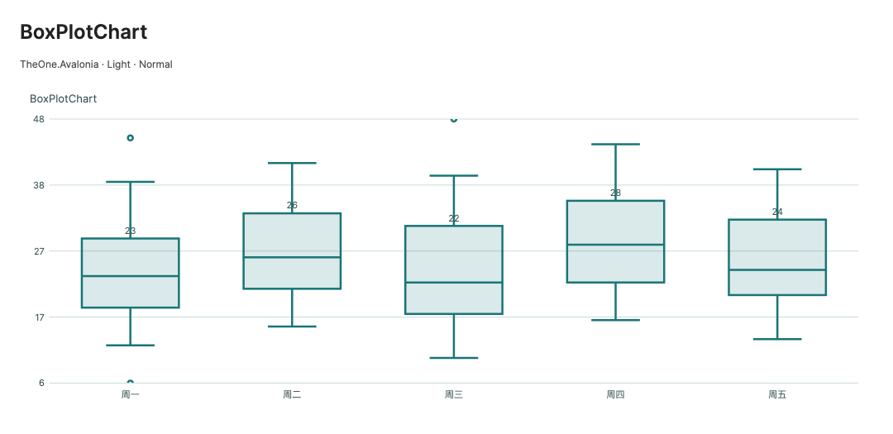
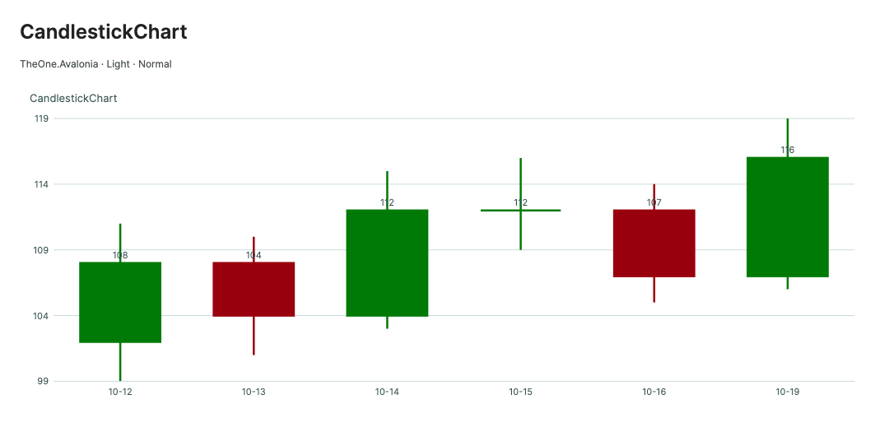

# BoxPlot 与 Candlestick

**简体中文** · [English](../en/chart-statistical.md) · [图表入口](charts.md)

`BoxPlotChart` 和 `CandlestickChart` 继承 `StatisticalChartBase`，直接绘制缓存后的图形、坐标和文本，不为每条数据创建控件。语义参考 [ECharts 箱线图](https://echarts.apache.org/en/llms-documents/option-parts/option.series-boxplot.md)和 [K 线图](https://echarts.apache.org/en/llms-documents/option-parts/option.series-candlestick.md)，使用本库强类型模型，不依赖 ECharts 运行时。

<!-- visual-guide:start -->
## 外观与场景图示

[配图口径与控件图鉴](visual-index.md)；下图是当前源码的真实渲染，绑定与交互以本页用法说明为准。

### BoxPlotChart



箱体、须与离群点展示五数摘要；不是从任意样本自动计算分位数。

[查看 Dark 对照](../images/BoxPlotChart-dark.png)

### CandlestickChart



烛体和影线表达 Open/Close/Low/High；涨跌配色可独立设置。

[查看 Dark 对照](../images/CandlestickChart-dark.png)

<!-- visual-guide:end -->

## 共用配置

加载 `OneTheme` 后支持 Light / Dark、三档尺寸、`SeriesSource`、图例、单点提示、选择和 PNG 导出。通用配置见 [Chart](charts.md)，动画见[渲染说明](chart-rendering.md)。以下仅列本组图表的差异。

| 属性 | 默认值 | 说明 |
| --- | --- | --- |
| `PointWidthRatio` | `0.6` | 箱体／蜡烛体占最小相邻 X 间隔的比例，有限且 `0 < value <= 1`；同一 X 的多个可见系列并排分配宽度 |
| `YMinimum` / `YMaximum` | `NaN` | 单一数值轴的显式范围；NaN 自动计算。上限不大于下限时不生成图形 |
| `Viewport` | `(0,0,1,1)` | 归一化数值视口，可双向绑定；使用共享 `Zoom`、`Pan`、`ResetViewport`、`BringDataPointIntoView`，交互由 `IsZoomEnabled` / `IsPanEnabled` 开启 |

X 是真实数值坐标，输入顺序不改变坐标位置；`Label` 用于 X 刻度和提示。时间序列可用时间戳作为 X，日期文字作为 Label。没有交易日历或类别轴自动压缩：缺失交易日是否保留距离由调用方的 X 决定。重复 X 不会合并数据，同系列重叠时最后绘制项优先命中。

两种图表使用单一主 Y 轴；不使用 `ChartSeries.YAxis` 的次轴配置、堆积、共享 X 提示或抽样。无效观察不绘制、不命中、不参与自动范围，但源索引不重排。缩放保持原始值，越界部分仅视觉裁剪。命中检索按 X 建索引，并检查实际箱体、须线、蜡烛及离群点。

## BoxPlotChart

| 额外属性 | 类型／默认值 | 说明 |
| --- | --- | --- |
| `ShowOutliers` | `bool`，true | 绘制有限离群值，并将其计入自动 Y 范围；false 时忽略离群值的绘制和范围贡献 |
| `OutlierRadius` | `double`，3 | 离群点半径，DIP，有限且 `0 < value <= 32` |

`ChartSeries.ItemsSource` 接收 `BoxPlotPoint`。该模型继承 `ChartPoint`：`X` 为位置，`Label` 为名称；`Minimum`、`LowerQuartile`、`Median`、`UpperQuartile`、`Maximum` 为预计算五数摘要。`Median` 与继承的 `Y` 是同一个值，修改任一个会通知两个属性，图表只处理一次数据失效。

必须满足 `Minimum <= LowerQuartile <= Median <= UpperQuartile <= Maximum`，坐标和五个数均须有限。负值和相等值有效；反序或 NaN 不会被静默排序／纠正。须端点由输入决定，不内置 1.5×IQR 规则，也不从原始样本计算分位数，调用方须统一统计方法。

`Outliers` 为 `IList<double>?`，每实例默认可观察空集合。有限值均按输入绘制，不再判断其是否在须外；NaN / Infinity 跳过。显示箱体、中位线和须端帽，提示显示完整五数摘要。

远离箱体的离群值不会把键盘提示或 `GetDataPointPosition()` 的锚点拉到空白处：优先使用可见箱体／中位线，缩放后回退到可见须线或离群点。动画安全预算包含已绘制的离群点，大量离群点不能绕过共享预算。

```csharp
public ObservableCollection<ChartSeries> Distribution { get; } =
[
    new()
    {
        Name = "耗时", Unit = " ms", ValueFormat = "0.0",
        ItemsSource = new ObservableCollection<ChartPoint>
        {
            new BoxPlotPoint(1, 12, 18, 24, 32, 43, "服务 A")
            { Outliers = new ObservableCollection<double> { 5, 56 } },
            new BoxPlotPoint(2, 9, 15, 21, 29, 38, "服务 B")
        }
    }
];
```

视图根元素声明实际 ViewModel 的 `x:DataType`，启用编译绑定：

```xml
<one:BoxPlotChart SeriesSource="{CompiledBinding Distribution}"
                  PointWidthRatio="0.6" ShowOutliers="True" OutlierRadius="3"
                  IsZoomEnabled="True" IsPanEnabled="True"
                  AnimationStyle="Reveal" MinHeight="280" />
```

## CandlestickChart

| 额外属性 | 类型／默认值 | 说明 |
| --- | --- | --- |
| `UpBrush` | `IBrush?`，主题 `One.Success` | `Close >= Open` 的颜色；显式 null 回退到主题系列色 0 |
| `DownBrush` | `IBrush?`，主题 `One.Danger` | `Close < Open` 的颜色；显式 null 回退到主题系列色 1 |
| `IsHollowUp` | `bool`，false | 上涨蜡烛为空心；透明导出不会在空心体内留下影线 |

`CandlestickPoint` 继承 `ChartPoint`，公开 `Open`、`Close`、`Low`、`High`。`Close` 与 `Y` 是同一个可观察值。构造参数顺序为 **x, open, close, low, high, label**。

输入需有限，且 `Low <= min(Open, Close)`、`High >= max(Open, Close)`；负价格、平盘和零高度区间均可表达。非法 OHLC 整项跳过，不能将高低值颠倒后自动修正。涨跌以 Close 与 Open 比较，平盘使用 UpBrush 并绘制水平实体线；不同市场的红涨绿跌惯例请显式设置两种 Brush。

```csharp
public ObservableCollection<ChartSeries> Prices { get; } =
[
    new()
    {
        Name = "价格", ValueFormat = "0.00",
        ItemsSource = new ObservableCollection<ChartPoint>
        {
            new CandlestickPoint(1, 102, 108, 99, 110, "10-19"),
            new CandlestickPoint(2, 108, 104, 101, 111, "10-20")
        }
    }
];
```

```xml
<one:CandlestickChart SeriesSource="{CompiledBinding Prices}"
                      IsHollowUp="True" PointWidthRatio="0.7"
                      UpBrush="{DynamicResource One.Danger}"
                      DownBrush="{DynamicResource One.Success}"
                      IsZoomEnabled="True" IsPanEnabled="True" />
```

## 更新、缓存与导出

可观察的系列、点集合、点属性及 Outliers 自动更新；替换 Outliers 或 ItemsSource 时释放旧订阅，共享离群集合按引用计数订阅一次。卸载释放订阅，重新挂载读取最新模型。普通 IList 原地变化后调用 `RefreshData()`，包括 Outliers 的普通列表。应在 UI 线程修改 Avalonia 模型。

数值变化保留共享数据订阅，只使当前图表的几何失效。数据布局阶段计算范围、X 索引、须线／影线、文本和画笔；未变化的重绘复用缓存，不再枚举数据。单点更新仍会重新计算该图表的范围和布局，未宣称 O(1) 增量几何。

`AnimationStyle="Auto"` 首次使用 Reveal，后续数据更新使用 Fade；复用共享动画安全预算，大数据直接呈现目标帧。`None`、关闭 Motion 或零时长即时完成。`ExportPng` 使用相同具体类型、专用模型和当前配置的独立快照，始终导出完整目标帧，不推进屏幕动画或共享可变绘制缓存。

PreviewHost 提供两个独立页面，包含配置对比、动态更新、属性／模型说明和短代码。测量方法、实际性能和专项范围见[第二批图表性能记录](chart-next-batch-performance-20261020.md)。
