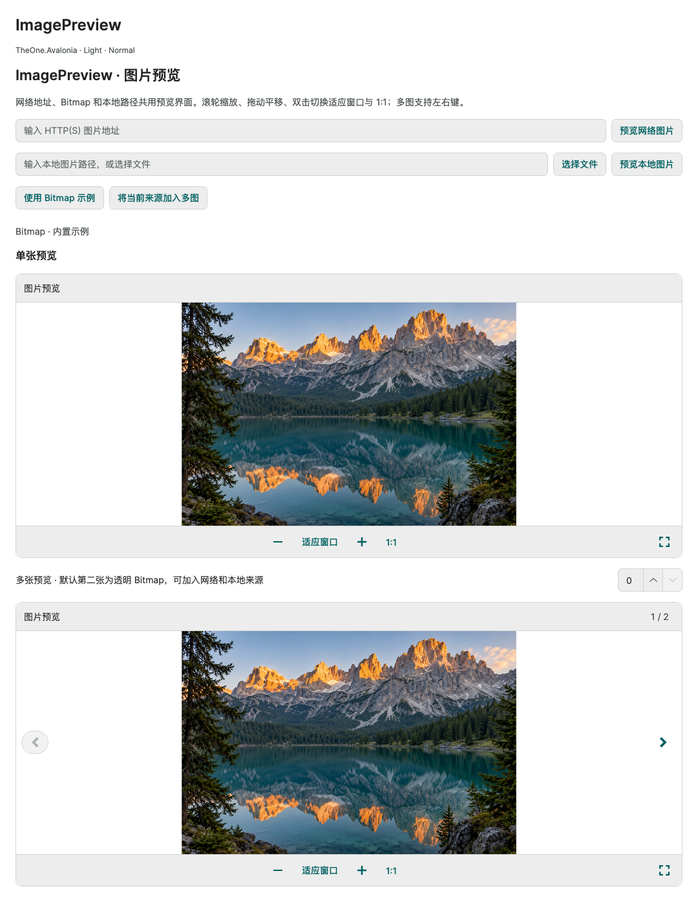

# ImagePreview 图片预览

历史命令行验证入口与消费测试项目已移除，文中的专项覆盖和测量结果为历史记录。请正常启动 PreviewHost，从菜单进入对应控件演示页；目标平台行为需在实际应用中验证。

**简体中文** · [English](../en/image-preview.md)

轻量单图／多图预览器，支持 HTTP(S) 地址、本地路径／file URI 和 Bitmap（也接受 IImage）。使用已加载 OneTheme 的视图，并声明正确的 x:DataType 以启用编译绑定。

<!-- visual-guide:start -->
## 外观与场景图示

[配图口径与控件图鉴](visual-index.md)；下图是当前源码的真实渲染，绑定与交互以本页用法说明为准。

### ImagePreview



内置示例图片的单图与多图预览，包含透明背景及导航入口。

[查看 Dark 对照](../images/ImagePreview-dark.png)

<!-- visual-guide:end -->

## 单图与多图

```xml
<one:ImagePreview Source="{Binding Picture}" Height="440" />
<one:ImagePreview ItemsSource="{Binding Pictures}"
                  SelectedIndex="{Binding PictureIndex}" Height="440" />
```

- Picture 可以是 Bitmap、图片路径字符串或 HTTP(S) 字符串／Uri；相对本地路径按进程工作目录解析。Bitmap 无需转换成路径。
- Pictures 是 IEnumerable，成员可混合上述类型。非空 ItemsSource 进入集合模式（空集合也有效），此时忽略 Source；清空 ItemsSource 后恢复 Source。建议一次只绑定一种输入。
- SelectedIndex 从 0 开始，默认 TwoWay；空列表为 -1，有数据时越界值收敛到有效范围并回写。ObservableCollection 变化会更新导航；插入或移动时尽量保留同一来源对象。
- 单图隐藏页码和导航；多图显示页码与上一张／下一张，首尾禁用，不循环。当前图片加载失败仍可切换。
- 为控件提供有限高度或 Grid 的星号行，避免在垂直 StackPanel 中使用不受限高度。

## 输入和状态

路径解码与 HTTP(S) 加载在后台执行。切图和离开视觉树会取消旧请求，过期结果不会覆盖新图；再次附加后自动重载。HTTP 超时为 30 秒，失败可点击重试或调用 Reload()。IsLoading、HasImage、HasError 和 ErrorMessage 为只读状态；ErrorMessage 保留诊断信息，默认界面仅显示简洁提示。

空来源显示“暂无图片”；请求中显示加载状态；文件缺失、HTTP 错误、格式不支持和解码错误显示失败及重试。透明图片绘制棋盘格背景。不会将网络加载失败伪装为空图片。

调用方传入的 Bitmap / IImage 始终由调用方管理，预览器不会释放它们；请在所有预览（包括全屏）结束后再 Dispose。由路径加载的 Bitmap 归控件所有，替换或移出视觉树时释放。默认不提供跨图片缓存、动画帧播放或 EXIF 解析。

## 操作与窗口

滚轮以鼠标位置缩放，拖动平移，双击在适应窗口与 1:1 间切换。平移限制在图片边界内；小于视口的方向保持居中。1:1 让一个 Bitmap 像素对应一个屏幕像素，包含宿主 RenderScaling。ZoomFactor 的 1 表示 100%，范围为 0.001～64；设置 ZoomFactor 退出适应窗口模式，IsFitToWindow 可绑定。

工具栏支持 ZoomIn()、ZoomOut()、FitToWindow() 和 ActualSize()。窄于 380 DIP 时隐藏独立的 1:1 按钮，仍可通过双击切换。焦点在控件内时支持左右键切图和加减键缩放；内部按钮保留原生键盘与焦点行为。

ShowHeader 默认 true；Title 可覆盖路径推导的名称，Bitmap 默认显示“图片预览”。ShowCloseButton 默认 false，开启后触发冒泡 CloseRequested 事件，由宿主关闭弹层。

桌面 Window 内可调用 ToggleFullScreen() 或点击全屏按钮：创建独立的拥有者窗口，保持嵌入预览位置和原始 SelectedIndex 绑定；全屏中的选图同步回原视图。Esc／关闭按钮退出全屏，嵌入宿主不会被关闭。非 Window 宿主不创建全屏窗口。IsFullScreen 为只读。

## 主题和模板

颜色复用 One.Canvas、One.Subtle、One.Surface、One.Text、One.Muted、One.Line；明暗主题与 ControlSizing.Size 三档密度均可继承。ChromeHeight 为 36 / 44 / 52，默认圆角为 8。Background、Foreground、BorderBrush、BorderThickness 和 CornerRadius 可以覆盖。

核心模板部件：PART_Viewport（ImagePreviewSurface）、PART_Previous、PART_Next、PART_Fit、PART_Actual、PART_ZoomOut、PART_ZoomIn、PART_Retry、PART_FullScreen、PART_Close。按钮部件使用原生 Button；ImagePreviewSurface 直接绘制单个图片及棋盘格，不建立像素级控件。伪类为 :multiple、:loading、:error、:has-image、:compact、:fullscreen。

## 演示与验证

PreviewHost 的“数据展示 → ImagePreview”包含 Bitmap 和透明图片、网络地址输入、本地文件选择、混合来源集合和 SelectedIndex 编译绑定。网络示例需要自行输入地址，不自动请求外部服务。内置山湖示例图由 ImageGen 生成。

专项使用本地 HTTP 服务验证真实网络加载、失败重试及取消竞争，无外部网络依赖；同时检查本地路径、Bitmap 所有权、集合变化、编译绑定、全屏、明暗三档尺寸、窄视口与实际像素。

<!-- generated-contracts:start -->
## 专属属性、Classes 用法与业务 API

本节只列本项目的专属属性、公开 Classes 用法、实际业务动作及关联模型，不重复原生继承 API、构造器、属性 Get/Set 包装或公开标识符。注册默认值与主题生效值不同，显式局部值优先。PreviewHost 用实际标签样例展示 Classes，不展示模板选择器／Setter 明细；Description 中的属性与业务动作附短用法代码。ControlSizing、Motion 等通用配置集中在 Home。仅 Button、Input、Select 合并比较，其余控件保留独立完整示例。

### ImagePreview

[完整源码契约](../../api/zh-cn/TheOne.Avalonia.Controls.ImagePreview.md)

| 属性 | 类型 | 读写／绑定／继承 | 注册或模型初值 | 说明与约束 |
| --- | --- | --- | --- | --- |
| [`CanNext`](../../../TheOne.Avalonia/Controls/ImagePreview.cs#L188) | `bool` | 只读; OneWay | `computed / state` | 只读运行状态或派生结果；由对应控件／模型更新，供展示和命令条件读取，不作为双向输入。 |
| [`CanPrevious`](../../../TheOne.Avalonia/Controls/ImagePreview.cs#L182) | `bool` | 只读; OneWay | `computed / state` | 只读运行状态或派生结果；由对应控件／模型更新，供展示和命令条件读取，不作为双向输入。 |
| [`ChromeHeight`](../../../TheOne.Avalonia/Controls/ImagePreview.cs#L146) | `double` | 可写; OneWay | `44` | 图片预览工具栏／装饰区高度，单位 DIP。 校验：`value => double.IsFinite(value) && value > 0` |
| [`CurrentImage`](../../../TheOne.Avalonia/Controls/ImagePreview.cs#L225) | `Avalonia.Media.IImage?` | 只读; CLR / n/a | `accessor-defined / state` | The currently decoded image. Images created from paths are owned by the viewer. |
| [`DisplayTitle`](../../../TheOne.Avalonia/Controls/ImagePreview.cs#L206) | `string` | 只读; OneWay | `computed / state` | 只读运行状态或派生结果；由对应控件／模型更新，供展示和命令条件读取，不作为双向输入。 |
| [`ErrorMessage`](../../../TheOne.Avalonia/Controls/ImagePreview.cs#L200) | `string?` | 只读; OneWay | `computed / state` | 当前失败／校验说明；展示错误状态，不能据此假定操作已经成功完成。 |
| [`HasError`](../../../TheOne.Avalonia/Controls/ImagePreview.cs#L170) | `bool` | 只读; OneWay | `computed / state` | 只读运行状态或派生结果；由对应控件／模型更新，供展示和命令条件读取，不作为双向输入。 |
| [`HasImage`](../../../TheOne.Avalonia/Controls/ImagePreview.cs#L164) | `bool` | 只读; OneWay | `computed / state` | 只读运行状态或派生结果；由对应控件／模型更新，供展示和命令条件读取，不作为双向输入。 |
| [`ImageCount`](../../../TheOne.Avalonia/Controls/ImagePreview.cs#L152) | `int` | 只读; OneWay | `computed / state` | 只读运行状态或派生结果；由对应控件／模型更新，供展示和命令条件读取，不作为双向输入。 |
| [`IsFitToWindow`](../../../TheOne.Avalonia/Controls/ImagePreview.cs#L134) | `bool` | 可写; TwoWay | `true` | 启用适合视口的图片缩放；手动缩放与此状态的关系见图片预览交互约定。 |
| [`IsFullScreen`](../../../TheOne.Avalonia/Controls/ImagePreview.cs#L194) | `bool` | 只读; OneWay | `computed / state` | 只读运行状态或派生结果；由对应控件／模型更新，供展示和命令条件读取，不作为双向输入。 |
| [`IsLoading`](../../../TheOne.Avalonia/Controls/ImagePreview.cs#L158) | `bool` | 只读; OneWay | `computed / state` | 显示忙碌指示；按钮保留尺寸并阻止重复操作，容器显示加载层。任务完成后由宿主复位。 |
| [`IsMultiple`](../../../TheOne.Avalonia/Controls/ImagePreview.cs#L176) | `bool` | 只读; OneWay | `computed / state` | 只读运行状态或派生结果；由对应控件／模型更新，供展示和命令条件读取，不作为双向输入。 |
| [`ItemsSource`](../../../TheOne.Avalonia/Controls/ImagePreview.cs#L104) | `System.Collections.IEnumerable?` | 可写; OneWay | `null` | 绑定原始模型集合，不预建大量 Control；动态增删使用带通知的集合，并提供有限视口。 |
| [`PageText`](../../../TheOne.Avalonia/Controls/ImagePreview.cs#L212) | `string` | 只读; OneWay | `computed / state` | 只读运行状态或派生结果；由对应控件／模型更新，供展示和命令条件读取，不作为双向输入。 |
| [`SelectedIndex`](../../../TheOne.Avalonia/Controls/ImagePreview.cs#L110) | `int` | 可写; TwoWay | `0 / default` | 当前显示项的零基索引；越界处理遵循所属控件的选择契约。 |
| [`ShowCloseButton`](../../../TheOne.Avalonia/Controls/ImagePreview.cs#L128) | `bool` | 可写; OneWay | `false` | 显示关闭按钮；关闭行为和权限仍由宿主及相关命令决定。 |
| [`ShowHeader`](../../../TheOne.Avalonia/Controls/ImagePreview.cs#L122) | `bool` | 可写; OneWay | `true` | 显示标题区域；不删除模型中的标题内容。 |
| [`Source`](../../../TheOne.Avalonia/Controls/ImagePreview.cs#L98) | `object?` | 可写; OneWay | `null` | 源对象／地址；按控件支持的类型提供，外部资源的所有权与加载限制见用法章节。 |
| [`Title`](../../../TheOne.Avalonia/Controls/ImagePreview.cs#L116) | `string?` | 可写; OneWay | `null` | 显示标题；不等于业务主键或本地化资源键。 |
| [`ZoomFactor`](../../../TheOne.Avalonia/Controls/ImagePreview.cs#L140) | `double` | 可写; TwoWay | `1` | 图片显示缩放倍率；改变视图，不改写源图片像素。 校验：`value => double.IsFinite(value) && value is >= .001 and <= 64` |
| [`ZoomText`](../../../TheOne.Avalonia/Controls/ImagePreview.cs#L218) | `string` | 只读; OneWay | `computed / state` | 只读运行状态或派生结果；由对应控件／模型更新，供展示和命令条件读取，不作为双向输入。 |

### ImagePreviewSurface

[完整源码契约](../../api/zh-cn/TheOne.Avalonia.Controls.ImagePreviewSurface.md)

| 属性 | 类型 | 读写／绑定／继承 | 注册或模型初值 | 说明与约束 |
| --- | --- | --- | --- | --- |
| [`AlternateCheckerBrush`](../../../TheOne.Avalonia/Controls/ImagePreviewSurface.cs#L48) | `Avalonia.Media.IBrush?` | 可写; OneWay | `null` | 透明棋盘第二格画刷；动态主题使用 One.* 资源，显式局部值优先。 |
| [`CheckerBrush`](../../../TheOne.Avalonia/Controls/ImagePreviewSurface.cs#L42) | `Avalonia.Media.IBrush?` | 可写; OneWay | `null` | 透明棋盘第一格画刷；动态主题使用 One.* 资源，显式局部值优先。 |

尺寸、动效等通用配置见[统一主题说明](../../theme/zh-cn/README.md#shared-configuration)，PreviewHost 在 Home 集中演示。

### Classes 用法

没有额外公开外观类，使用默认主题及专属属性。

以上是分别使用的公开类名；悬停、按下、禁用和选中等状态由控件维护，不手工添加模板类。实际外观见 PreviewHost 的标签样例。

### 业务 API

| 类型 | 动作签名 | 用途 |
| --- | --- | --- |
| [`ImagePreview`](../../api/zh-cn/TheOne.Avalonia.Controls.ImagePreview.md) | `void ImagePreview.Previous()` | 切换到上一张可用预览图片。 |
| [`ImagePreview`](../../api/zh-cn/TheOne.Avalonia.Controls.ImagePreview.md) | `void ImagePreview.Next()` | 切换到下一张可用预览图片。 |
| [`ImagePreview`](../../api/zh-cn/TheOne.Avalonia.Controls.ImagePreview.md) | `void ImagePreview.Reload()` | 重新加载当前图片；原始来源与错误状态遵循图片加载契约。 |
| [`ImagePreview`](../../api/zh-cn/TheOne.Avalonia.Controls.ImagePreview.md) | `void ImagePreview.FitToWindow()` | 将图片缩放到适合当前视口，不修改源像素。 |
| [`ImagePreview`](../../api/zh-cn/TheOne.Avalonia.Controls.ImagePreview.md) | `void ImagePreview.ActualSize()` | 按实际像素比例显示图片；视口可能出现滚动范围。 |
| [`ImagePreview`](../../api/zh-cn/TheOne.Avalonia.Controls.ImagePreview.md) | `void ImagePreview.ZoomIn()` | 放大当前预览视图；遵守控件的缩放范围。 |
| [`ImagePreview`](../../api/zh-cn/TheOne.Avalonia.Controls.ImagePreview.md) | `void ImagePreview.ZoomOut()` | 缩小当前预览视图；遵守控件的缩放范围。 |
| [`ImagePreview`](../../api/zh-cn/TheOne.Avalonia.Controls.ImagePreview.md) | `void ImagePreview.ToggleFullScreen()` | 切换图片预览的全屏展示状态。 |

### 事件订阅

按需订阅下列通知，并在宿主释放时解除订阅；这里只列事件入口，不列路由事件标识字段。

| 类型 | 事件 | 用途 |
| --- | --- | --- |
| [`ImagePreview`](../../api/zh-cn/TheOne.Avalonia.Controls.ImagePreview.md) | `CloseRequested` | 状态／操作通知；在宿主生命周期内订阅并在释放时解除，事件参数类型见签名。 |

### 关联模型

没有额外关联数据模型。

[完整源码契约（含构造、属性访问器和标识符，供精确查阅）](../../api/zh-cn/README.md)
<!-- generated-contracts:end -->
