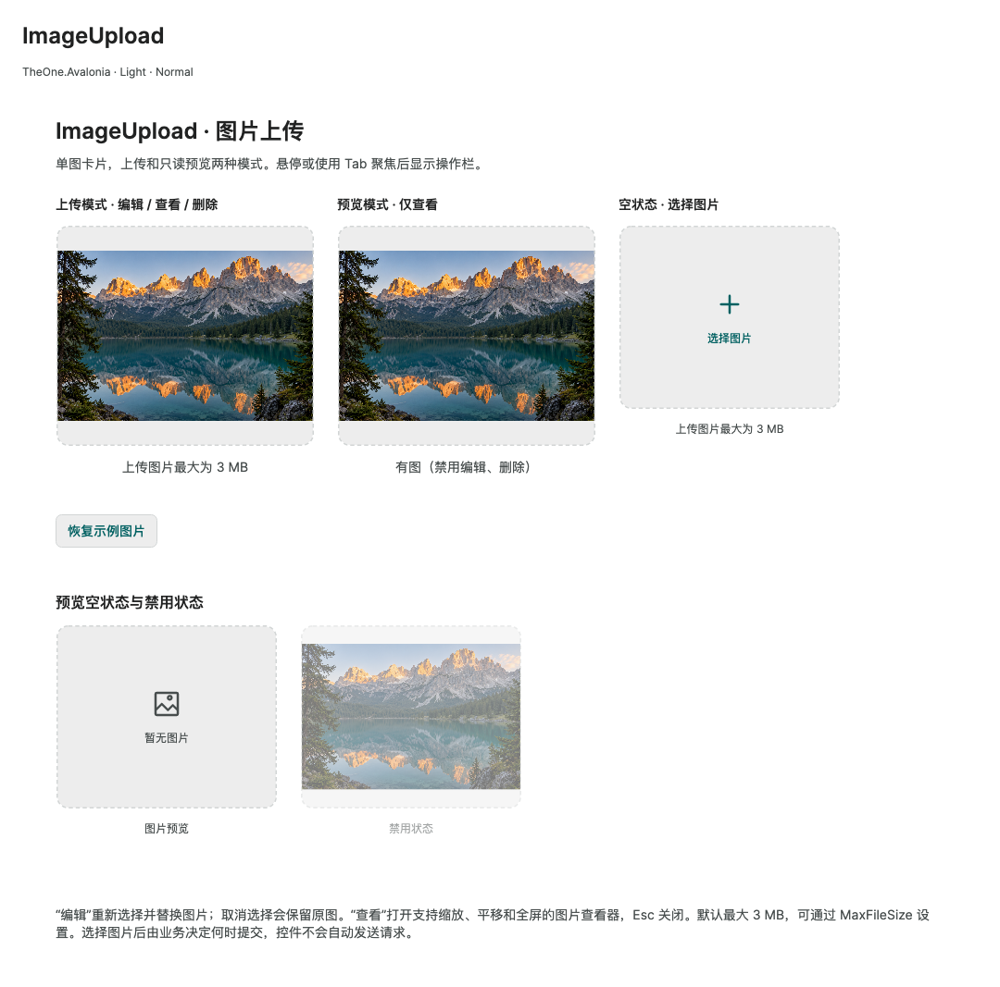

# ImageUpload 图片上传

`TheOne.Avalonia.Controls.ImageUpload` 是单图卡片控件，包含虚线边框、图片区域和大小提示。继承 [Upload](upload.md)，复用文件选择、校验和 `SelectedFile` 双向绑定契约。

```xml
<one:ImageUpload SelectedFile="{Binding CoverFile, Mode=TwoWay}"
                 Mode="Upload" MaxFileSize="3145728" />
<one:ImageUpload SelectedFile="{Binding CoverFile}" Mode="Preview"
                 HintText="有图（禁用编辑、删除）" />
```

| 成员 | 行为 |
| --- | --- |
| `Mode` | 默认 `ImageUploadMode.Upload`，支持选择、编辑替换、查看、删除。`Preview` 仅允许查看，直接调用命令也无法修改。切换模式会取消正在选择的文件和内置上传；宿主仍可更新绑定图片。 |
| `SelectedFile` | 继承的 `UploadFile` 双向绑定。流工厂每次打开新的可读流，不依赖本地路径。 |
| `MaxFileSize` | 默认 3 MiB（3145728 字节）。即使文件没有大小元数据，也会检查实际读取量。0 取消配置限制，仍保留继承的 64 MiB 读取上限。 |
| `AllowedExtensions` | 默认 PNG、JPEG、WebP、BMP、GIF。拒绝非图片，解码失败显示错误。 |
| `ImageHeight` | 图片区域高度，Small / Normal / Large 分别为 200 / 240 / 280 DIP，也可单独设置。 |
| `ImageStretch` | 默认 `Uniform`，保持比例完整显示图片，保留留白。 |
| `HintText` / `DisplayHint` | 可覆盖提示文字，默认根据当前大小限制或预览模式生成。空字符串可隐藏提示文字。 |
| `SelectText`、`ReplaceText`、`ViewText`、`RemoveText` | 可本地化的操作文字。“编辑”指重新选择并替换图片，不包含裁剪、涂画；取消选择保留原图。 |
| `ViewCommand` / `View()` | 使用原始分辨率的解码图片打开 [ImagePreview](image-preview.md)，支持缩放、平移和实际大小。关闭按钮或 Esc 可关闭弹层；弹层内隐藏桌面全屏操作。 |

悬停或键盘聚焦后显示操作栏。预览模式隐藏编辑、删除，并禁止选择、删除、提交命令。`IsEnabled="False"` 禁止包括查看在内的全部操作。支持 Light / Dark 和继承的 `ControlSizing.Size`。预览模式无图时显示不可编辑的占位内容。

选择图片不会自动发送网络请求。业务可在表单提交时读取绑定文件，也可配置继承的 `UploadCommand` 或 `UploadApi` 后显式调用 `RequestUploadCommand` / `UploadAsync`；紧凑卡片没有单独的提交按钮。继承的 `EmptyTemplate`、`FileTemplate`、`ActionsTemplate` 属于 Upload 默认模板，本卡片不使用它们；自定义结构时替换 `Template`。

控件负责释放自己解码的图片。接受的 `UploadFile` 由消费方持有，替换、删除及页面或模型释放时需释放文件，详见 [Upload](upload.md#宿主命令接入)。多个控件共享文件时，不要在其他控件仍使用它时提前释放。

PreviewHost：扩展控件分组下的 **ImageUpload**。

<!-- visual-guide:start -->
## 外观与场景图示

[配图口径与控件图鉴](visual-index.md)；下图是当前源码的真实渲染，绑定与交互以本页用法说明为准。

### ImageUpload



单图卡片的空态、有图及预览模式；选择和替换仍通过绑定文件交给宿主管理。

[查看 Dark 对照](../images/ImageUpload-dark.png)

<!-- visual-guide:end -->
