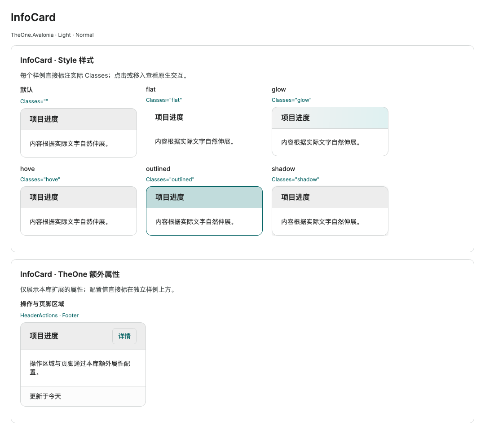

# InfoCard 信息卡片

历史命令行验证入口与消费测试项目已移除，文中的专项覆盖和测量结果为历史记录。请正常启动 PreviewHost，从菜单进入对应控件演示页；目标平台行为需在实际应用中验证。

**简体中文** · [English](../en/info-card.md)

`InfoCard` 继承官方 `HeaderedContentControl`，用于展示标题与内容，并提供标题图标、标题操作区、页脚区域。加载 `OneTheme` 后自动使用 TheOne 表面、细边框和圆角，并继承明暗主题及三种尺寸。卡片固定展示存在的区域；放入其中的按钮、输入框和列表保留原生交互。

```xml
<one:InfoCard Header="工作区概览"
              Content="使用统一的标题、正文和间距展示信息。" />
```

`one` 命名空间为 `using:TheOne.Avalonia.Controls`。标题、图标与操作区均为空时移除整个标题行；`Header` 为 null、空字符串或空白字符串时只移除标题文字，图标或操作区仍可独立显示。各空内容区域自动隐藏，不保留额外间隔。

<!-- visual-guide:start -->
## 外观与场景图示

[配图口径与控件图鉴](visual-index.md)；下图是当前源码的真实渲染，绑定与交互以本页用法说明为准。

### InfoCard



对比公开 Classes、头部、正文、页脚和区域分隔；额外属性可独立配置。

[查看 Dark 对照](../images/InfoCard-dark.png)

<!-- visual-guide:end -->

## 自定义标题与内容

标题和内容支持字符串、控件或数据模型。控件实例直接成为对应 presenter 的子元素，输入、焦点、命令及验证仍由原生控件负责。

```xml
<one:InfoCard>
  <one:InfoCard.Header>
    <Grid ColumnDefinitions="*,Auto" ColumnSpacing="12">
      <TextBlock Text="工作区设置" FontWeight="SemiBold" />
      <Button Grid.Column="1" Content="保存" Command="{Binding SaveCommand}" />
    </Grid>
  </one:InfoCard.Header>
  <TextBox Text="{Binding WorkspaceName, Mode=TwoWay}" />
</one:InfoCard>
```

## 标题图标、操作区与页脚

`HeaderIcon` 位于标题前，`HeaderActions` 位于标题右侧，`Footer` 位于内容下方。这些属性均接受控件、文本或模型，分别通过 `HeaderIconTemplate`、`HeaderActionsTemplate` 和 `FooterTemplate` 展示数据模型。

```xml
<one:InfoCard Header="工作区设置">
  <one:InfoCard.HeaderIcon>
    <PathIcon Data="M 2,2 L 18,2 L 18,18 L 2,18 Z" />
  </one:InfoCard.HeaderIcon>
  <one:InfoCard.HeaderActions>
    <Button Content="详情" Command="{Binding DetailsCommand}" />
  </one:InfoCard.HeaderActions>
  <one:InfoCard.Footer>
    <Grid ColumnDefinitions="*,Auto" ColumnSpacing="12">
      <TextBlock Text="{Binding Status}" TextWrapping="Wrap" />
      <Button Grid.Column="1" Content="同步" Command="{Binding SyncCommand}" />
    </Grid>
  </one:InfoCard.Footer>
  <TextBox Text="{Binding WorkspaceName, Mode=TwoWay}" />
</one:InfoCard>
```

显式数据模板可以接收 null 数据，因此只有内容为 null 时，已设置的模板仍可展示该区域。需要彻底隐藏图标、操作区或页脚时，应同时将该区域的内容和对应模板设为 null；PreviewHost 的显示开关同时切换两者，收回区域与其间距。自定义图标可通过 `HeaderIconSize` 统一调整尺寸，标题各部分之间的间距由 `HeaderContentSpacing` 控制，页脚与前方区域的间距由 `FooterSpacing` 控制。

页脚也支持明确类型的编译绑定模板：

```xml
<one:InfoCard Header="工作区概览" Content="{Binding Description}" Footer="{Binding CurrentWorkspace}">
  <one:InfoCard.FooterTemplate>
    <DataTemplate x:DataType="vm:WorkspaceViewModel">
      <Grid ColumnDefinitions="*,Auto" ColumnSpacing="12">
        <TextBlock Text="{Binding Status}" TextWrapping="Wrap" />
        <Button Grid.Column="1" Content="同步" Command="{Binding SyncCommand}" />
      </Grid>
    </DataTemplate>
  </one:InfoCard.FooterTemplate>
</one:InfoCard>
```

在使用绑定的视图根节点声明准确的 `x:DataType`。`HeaderTemplate` 和 `ContentTemplate` 使用官方 `IDataTemplate` 合约；各数据模板也应声明自己的类型，保持编译绑定与 NativeAOT 兼容。

```xml
<one:InfoCard Header="{Binding CurrentWorkspace}" Content="{Binding CurrentWorkspace}">
  <one:InfoCard.HeaderTemplate>
    <DataTemplate x:DataType="vm:WorkspaceViewModel">
      <TextBlock Text="{Binding Name}" FontWeight="SemiBold" />
    </DataTemplate>
  </one:InfoCard.HeaderTemplate>
  <one:InfoCard.ContentTemplate>
    <DataTemplate x:DataType="vm:WorkspaceViewModel">
      <TextBlock Text="{Binding Description}" TextWrapping="Wrap" />
    </DataTemplate>
  </one:InfoCard.ContentTemplate>
</one:InfoCard>
```

## 区域分割线

`ShowHeaderSeparator`、`ShowFooterSeparator` 默认均为 `true`，可独立设置、绑定或通过 Style setter 控制。

```xml
<one:InfoCard Header="工作区" Footer="已保存"
              ShowHeaderSeparator="True"
              ShowFooterSeparator="False"
              Content="正文内容" />
```

标题分割线在标题与正文均存在时显示；页脚分割线在页脚存在且前方有正文或标题时显示。无对应区域时不留空线。线条采用 `One.Line` 语义色、厚度为 1 DIP，从左边框内缘连接至右边框内缘，位于相邻区域背景的交界处。隐藏分割线仅移除该 1 DIP 行，不改变区域内边距。

## 区域背景与内边距

Header 保留较明显的背景区别，Content 与 Footer 只有细微色差。三者默认分别采用 `One.Subtle`、`One.Surface`、`One.InfoCard.Footer`，随 Light / Dark 主题切换，铺满各自区域并裁切到卡片圆角。Footer 浅色为 `#FCFCFC`（正文 `#FFFFFF`），深色为 `#131313`（正文 `#0F0F0F`），每个 RGB 通道的差值不超过 4。

| 属性 | 用途 |
| --- | --- |
| `HeaderBackground` | 标题区域背景，默认 `One.Subtle` |
| `Background` | 正文区域及卡片底色，默认 `One.Surface` |
| `FooterBackground` | 页脚区域背景，默认 `One.InfoCard.Footer` |
| `Padding` | 正文四周内边距，以及标题／页脚的左右内边距 |
| `HeaderSpacing` | 标题区域的上下内边距 |
| `FooterSpacing` | 页脚区域的上下内边距 |

`HeaderPadding`／`FooterPadding` 是由上述设置计算的只读布局属性，供模板使用。缺少区域时不保留该区域的背景或内边距。禁用时三个区域统一采用 `One.DisabledSurface`；实例属性与 Style setter 可覆盖背景。

```xml
<one:InfoCard Header="标题" Content="正文" Footer="页脚"
              HeaderBackground="{DynamicResource One.Subtle}"
              Background="{DynamicResource One.Surface}"
              FooterBackground="{DynamicResource One.InfoCard.Footer}" />
```

## 尺寸与样式

`Classes="shadow"` 显示常驻外阴影；`Classes="hove"` 在鼠标移入时强调边框、调整正文底色并显示悬浮阴影，移出后恢复。类名使用 `hove`。两者可组合，`Classes="hove shadow"` 在常驻阴影上提供更明显的悬浮效果；禁用时这些类的阴影与悬浮效果停止。

```xml
<one:InfoCard Classes="hove shadow" Header="可交互卡片" Margin="16"
              Content="鼠标移入查看强调边框和阴影。" />
```

效果不移动内容、不增加布局尺寸，也不拦截卡片中的原生输入。外阴影由独立的 `PART_Shadow` 绘制，内容仍由 `PART_Surface` 裁切圆角；父容器裁切时应留出足够 Margin / Padding。`BoxShadow` 可通过实例属性或样式设置，例如 `BoxShadow="0 2 10 0 #30000000"`；显式本地值优先于类样式。默认阴影使用随明暗切换的 `One.InfoCard.Shadow` 与 `One.InfoCard.HoverShadow` 资源。

`Classes="outlined"` 使用主色边框与柔和标题背景；`Classes="glow"` 使用柔光渐变标题背景；`Classes="flat"` 去除外框与分割线，标题和页脚透明，适合嵌入布局。这些样式保留内容槽与模板接口，无展开折叠行为。

通过 `ControlSizing.Size` 继承父级尺寸，或使用 `Classes="small"` / `normal` / `large` 在单张卡片上指定尺寸。以下属性也可通过 Style setter 或实例属性覆盖。

| 属性 | small | normal | large |
| --- | ---: | ---: | ---: |
| `Padding` | 16 | 20 | 24 |
| `FontSize` | 12 | 14 | 16 |
| `HeaderFontSize` | 14 | 16 | 18 |
| `HeaderSpacing` | 8 | 12 | 16 |
| `HeaderIconSize` | 16 | 18 | 20 |
| `HeaderContentSpacing` | 8 | 10 | 12 |
| `FooterSpacing` | 8 | 12 | 16 |

卡片沿用 `Background`、`Foreground`、`BorderBrush`、`BorderThickness` 和 `CornerRadius`。`HeaderSpacing`／`FooterSpacing` 控制各自区域的上下内边距；未设置固定高度时，卡片按内容高度布局。禁用卡片时，标题、正文及页脚内的原生控件也被禁用。

## 列表内容

InfoCard 不替换内容的布局，也不额外包裹无限高度的滚动容器。可增长的集合应放入有界且支持虚拟化的原生控件，用 `ItemsSource` 提供模型，不预创建大量控件。

```xml
<one:InfoCard Header="成员">
  <ListBox Height="200" ItemsSource="{Binding Members}" />
</one:InfoCard>
```

也可为卡片设置有限的 `Height` 或 `MaxHeight`，在正文中使用 `Grid` 的 `*` 行承载列表，使列表继承剩余的有限视口。折叠与恢复仍遵循该布局约束；不要把列表放入无限高度的 `StackPanel` 而又不设置列表高度。

PreviewHost 的 InfoCard 预览包含标题、图标、操作区、页脚及两处分割线的独立开关，原生输入与按钮，明确类型的标题、正文、图标、操作区和页脚编译绑定模板，以及固定高度的 1,000 条成员列表和末尾跳转。固定高度与 MaxHeight 专项检查千条列表回收和页脚可见性。标题操作和页脚按钮可更新状态，禁用卡片会同时禁用各区域的交互。仅导出当前控件的测试图：

专项可保存悬浮和阴影的实际像素截图：

<!-- generated-contracts:start -->
## 专属属性、Classes 用法与业务 API

本节只列本项目的专属属性、公开 Classes 用法、实际业务动作及关联模型，不重复原生继承 API、构造器、属性 Get/Set 包装或公开标识符。注册默认值与主题生效值不同，显式局部值优先。PreviewHost 用实际标签样例展示 Classes，不展示模板选择器／Setter 明细；Description 中的属性与业务动作附短用法代码。ControlSizing、Motion 等通用配置集中在 Home。仅 Button、Input、Select 合并比较，其余控件保留独立完整示例。

### InfoCard

[完整源码契约](../../api/zh-cn/TheOne.Avalonia.Controls.InfoCard.md)

| 属性 | 类型 | 读写／绑定／继承 | 注册或模型初值 | 说明与约束 |
| --- | --- | --- | --- | --- |
| [`BoxShadow`](../../../TheOne.Avalonia/Controls/InfoCard.cs#L93) | `Avalonia.Media.BoxShadows` | 可写; OneWay | `inherited registration` | Outer shadow, supplied by the shadow and hove theme classes. |
| [`Footer`](../../../TheOne.Avalonia/Controls/InfoCard.cs#L123) | `object?` | 可写; OneWay | `null` | 底部区域内容；与主体和标题分别定制。 |
| [`FooterBackground`](../../../TheOne.Avalonia/Controls/InfoCard.cs#L143) | `Avalonia.Media.IBrush?` | 可写; OneWay | `null` | 页脚区域背景，默认 `One.InfoCard.Footer` |
| [`FooterPadding`](../../../TheOne.Avalonia/Controls/InfoCard.cs#L153) | `Avalonia.Thickness` | 只读; OneWay | `computed / state` | Computed footer insets: horizontal Padding and vertical FooterSpacing. |
| [`FooterSpacing`](../../../TheOne.Avalonia/Controls/InfoCard.cs#L193) | `double` | 可写; OneWay | `12` | 页脚区域的上下内边距 校验：`value => double.IsFinite(value) && value >= 0` |
| [`FooterTemplate`](../../../TheOne.Avalonia/Controls/InfoCard.cs#L129) | `Avalonia.Controls.Templates.IDataTemplate?` | 可写; OneWay | `null` | 原生数据模板扩展点；保持正确 x:DataType，模板数据作用域见本控件接入章节。 |
| [`HeaderActions`](../../../TheOne.Avalonia/Controls/InfoCard.cs#L111) | `object?` | 可写; OneWay | `null` | 标题区右侧的操作内容；可放置业务按钮，保持命令和焦点行为。 |
| [`HeaderActionsTemplate`](../../../TheOne.Avalonia/Controls/InfoCard.cs#L117) | `Avalonia.Controls.Templates.IDataTemplate?` | 可写; OneWay | `null` | 原生数据模板扩展点；保持正确 x:DataType，模板数据作用域见本控件接入章节。 |
| [`HeaderBackground`](../../../TheOne.Avalonia/Controls/InfoCard.cs#L136) | `Avalonia.Media.IBrush?` | 可写; OneWay | `null` | 标题区域背景，默认 `One.Subtle` |
| [`HeaderContentSpacing`](../../../TheOne.Avalonia/Controls/InfoCard.cs#L173) | `double` | 可写; OneWay | `10` | 8 ; 10 ; 12 校验：`value => double.IsFinite(value) && value >= 0` |
| [`HeaderFontSize`](../../../TheOne.Avalonia/Controls/InfoCard.cs#L161) | `double` | 可写; OneWay | `16` | 14 ; 16 ; 18 校验：`value => double.IsFinite(value) && value > 0` |
| [`HeaderIcon`](../../../TheOne.Avalonia/Controls/InfoCard.cs#L99) | `object?` | 可写; OneWay | `null` | 标题区图标内容，与标题文本分开定制。 |
| [`HeaderIconSize`](../../../TheOne.Avalonia/Controls/InfoCard.cs#L167) | `double` | 可写; OneWay | `18` | 16 ; 18 ; 20 校验：`value => double.IsFinite(value) && value > 0` |
| [`HeaderIconTemplate`](../../../TheOne.Avalonia/Controls/InfoCard.cs#L105) | `Avalonia.Controls.Templates.IDataTemplate?` | 可写; OneWay | `null` | 原生数据模板扩展点；保持正确 x:DataType，模板数据作用域见本控件接入章节。 |
| [`HeaderPadding`](../../../TheOne.Avalonia/Controls/InfoCard.cs#L150) | `Avalonia.Thickness` | 只读; OneWay | `computed / state` | Computed header insets: horizontal Padding and vertical HeaderSpacing. |
| [`HeaderSpacing`](../../../TheOne.Avalonia/Controls/InfoCard.cs#L155) | `double` | 可写; OneWay | `12` | 标题区域的上下内边距 校验：`value => double.IsFinite(value) && value >= 0` |
| [`ShowFooterSeparator`](../../../TheOne.Avalonia/Controls/InfoCard.cs#L187) | `bool` | 可写; OneWay | `true` | Shows a divider before an existing footer when another region precedes it. |
| [`ShowHeaderSeparator`](../../../TheOne.Avalonia/Controls/InfoCard.cs#L180) | `bool` | 可写; OneWay | `true` | Shows an edge-to-edge divider between the header and body. |

尺寸、动效等通用配置见[统一主题说明](../../theme/zh-cn/README.md#shared-configuration)，PreviewHost 在 Home 集中演示。

### Classes 用法

- `InfoCard`: `Classes="flat"` / `Classes="glow"` / `Classes="hove"` / `Classes="outlined"` / `Classes="shadow"`

以上是分别使用的公开类名；悬停、按下、禁用和选中等状态由控件维护，不手工添加模板类。实际外观见 PreviewHost 的标签样例。

### 业务 API

没有额外业务方法；通过本节专属属性配置。

### 关联模型

没有额外关联数据模型。

[完整源码契约（含构造、属性访问器和标识符，供精确查阅）](../../api/zh-cn/README.md)
<!-- generated-contracts:end -->
