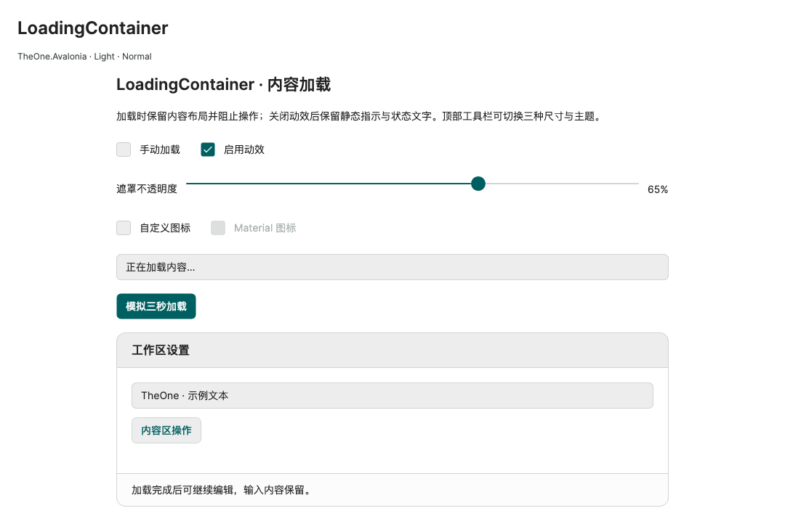

# 加载状态与 LoadingContainer

历史命令行验证入口与消费测试项目已移除，文中的专项覆盖和测量结果为历史记录。请正常启动 PreviewHost，从菜单进入对应控件演示页；目标平台行为需在实际应用中验证。

**简体中文** · [English](../en/loading.md)

普通 Button 保留官方类型，使用 `ButtonLoading.IsLoading` 附加属性；IconButton 直接提供 `IsLoading`。两者加载期间显示指示图标并禁用原生输入、Command、Click 与 Flyout 触发。普通 Button 的 IsEnabled 值／绑定保持不变（包括 TwoWay），内部利用原生命令可执行状态临时阻止输入，加载结束后恢复原命令，并继续遵守原来的禁用状态。Command 按原生默认 OneWay 绑定；执行门禁不包装或代理业务命令。调用方直接执行 ICommand 不属于控件输入，业务命令仍应管理自己的并发。

```xml
<Button Content="保存" Command="{Binding SaveCommand}"
        one:ButtonLoading.IsLoading="{Binding IsLoading}" />
<one:IconButton Icon="{Binding SaveIcon}" Content="保存"
                IconPlacement="Right" IsLoading="{Binding IsLoading}"
                Command="{Binding SaveCommand}" />
```

加载不会自动判断任务状态；VM 在执行前设置 IsLoading，在 finally 中清除。PreviewHost 使用 ReactiveCommand 异步示例与 ReactiveObject 属性通知。视图声明 x:DataType 即可使用编译绑定，无须反射或动态创建控件。

LoadingContainer 继承 ContentControl，支持 Content／ContentTemplate、Padding、CornerRadius 与内容对齐。`IsLoading` 默认 false，`LoadingText` 默认“正在加载…”，可以绑定或设为 null。`OverlayOpacity` 默认 0.65，范围为 0～1（0 完全透明、1 完全不透明），只作用于遮罩背景，不降低加载图标和文字透明度；`OverlayBrush` 默认使用 One.Surface，可覆盖颜色。即使透明度为 0，覆盖层仍阻止内容区鼠标和键盘操作；内容实例、数据上下文与输入值保留。覆盖层不改变容器测量或虚拟化约束；大型列表仍需有界视口与虚拟化面板。

```xml
<one:LoadingContainer IsLoading="{Binding IsLoading}" LoadingText="{Binding ProgressText}"
                      OverlayOpacity="0.65" LoadingIcon="{Binding ProgressIcon}" Height="320">
  <Grid><!-- 正常内容，包括编译绑定与命令 --></Grid>
</one:LoadingContainer>
```

`LoadingIcon` 可以传 Geometry、PathIcon／其他 Control，或由 `LoadingIconTemplate` 渲染的数据。默认 Geometry 模板使用 PathIcon；消费项目可提供带 x:DataType 的 Material 图标模板。LoadingIcon 和 LoadingIconTemplate 都为空时恢复内置旋转指示器；自定义图标不自动旋转，其模板可自行提供动效。`LoadingIconSize` 控制图标大小，默认跟随三档密度。`LoadingText` 为空／空白时隐藏文字和间隔。控件实例不能共享视觉父级，共用图标请使用 Geometry 或模板。

`ControlSizing.Size` 支持 Small／Normal／Large，按钮指示图标为 14／16／20px，容器为 22／28／34px。使用 One.* 语义色，跟随 Light／Dark。`Motion.Enabled=False` 停止旋转、保留静态图标和文字；在加载中重新设置 true 恢复旋转，隐藏／卸载时取消动画。LoadingIndicator 也可独立使用，IsActive 控制运行状态，Foreground 控制颜色。

`LoadingIcon` 支持直接绑定 OneIconKind 或 Geometry，例如 `LoadingIcon="{x:Static one:OneIconKind.Loading}"`；按 LoadingIconSize 等比适配，显式宽高的自定义图标不会溢出。默认前景在禁用时统一为 One.DisabledText，重新启用后恢复当前主题强调色；消费方局部 Foreground 仍优先。自定义 `LoadingIconTemplate` 优先；内置 Loading 枚举图形不会自动旋转，需动画时继续使用默认指示器或自定义动效。见 [OneIcon 图标宿主](one-icon.md#图标宿主与-icontemplate)。

<!-- visual-guide:start -->
## 外观与场景图示

[配图口径与控件图鉴](visual-index.md)；下图是当前源码的真实渲染，绑定与交互以本页用法说明为准。

### LoadingContainer



覆盖式加载区域与忙碌按钮；忙碌显示不替代宿主任务取消。

[查看 Dark 对照](../images/LoadingContainer-dark.png)

<!-- visual-guide:end -->

<!-- generated-contracts:start -->
## 专属属性、Classes 用法与业务 API

本节只列本项目的专属属性、公开 Classes 用法、实际业务动作及关联模型，不重复原生继承 API、构造器、属性 Get/Set 包装或公开标识符。注册默认值与主题生效值不同，显式局部值优先。PreviewHost 用实际标签样例展示 Classes，不展示模板选择器／Setter 明细；Description 中的属性与业务动作附短用法代码。ControlSizing、Motion 等通用配置集中在 Home。仅 Button、Input、Select 合并比较，其余控件保留独立完整示例。

### ButtonLoading

[完整源码契约](../../api/zh-cn/TheOne.Avalonia.Controls.ButtonLoading.md)

| 属性 | 类型 | 读写／绑定／继承 | 注册或模型初值 | 说明与约束 |
| --- | --- | --- | --- | --- |
| [`IsLoading`](../../../TheOne.Avalonia/Controls/ButtonLoading.cs#L12) | `bool` | 可写; OneWay; 附加属性 | `false` | 显示忙碌指示；按钮保留尺寸并阻止重复操作，容器显示加载层。任务完成后由宿主复位。 |

### LoadingContainer

[完整源码契约](../../api/zh-cn/TheOne.Avalonia.Controls.LoadingContainer.md)

| 属性 | 类型 | 读写／绑定／继承 | 注册或模型初值 | 说明与约束 |
| --- | --- | --- | --- | --- |
| [`HasCustomLoadingIcon`](../../../TheOne.Avalonia/Controls/LoadingContainer.cs#L95) | `bool` | 只读; OneWay | `computed / state` | 只读运行状态或派生结果；由对应控件／模型更新，供展示和命令条件读取，不作为双向输入。 |
| [`HasLoadingText`](../../../TheOne.Avalonia/Controls/LoadingContainer.cs#L107) | `bool` | 只读; OneWay | `computed / state` | 只读运行状态或派生结果；由对应控件／模型更新，供展示和命令条件读取，不作为双向输入。 |
| [`IsLoading`](../../../TheOne.Avalonia/Controls/LoadingContainer.cs#L53) | `bool` | 可写; OneWay | `false` | 显示忙碌指示；按钮保留尺寸并阻止重复操作，容器显示加载层。任务完成后由宿主复位。 |
| [`LoadingIcon`](../../../TheOne.Avalonia/Controls/LoadingContainer.cs#L77) | `object?` | 可写; OneWay | `null` | 加载状态图标；为空时沿用默认指示器。 |
| [`LoadingIconSize`](../../../TheOne.Avalonia/Controls/LoadingContainer.cs#L89) | `double` | 可写; OneWay | `28` | 加载图标的 DIP 尺寸；不控制覆盖层的面积。 校验：`value => double.IsFinite(value) && value > 0` |
| [`LoadingIconTemplate`](../../../TheOne.Avalonia/Controls/LoadingContainer.cs#L83) | `Avalonia.Controls.Templates.IDataTemplate?` | 可写; OneWay | `null` | 原生数据模板扩展点；保持正确 x:DataType，模板数据作用域见本控件接入章节。 |
| [`LoadingText`](../../../TheOne.Avalonia/Controls/LoadingContainer.cs#L59) | `string?` | 可写; OneWay | `"正在加载…"` | 加载中的说明文本，可本地化；不代表任务完成结果。 |
| [`OverlayBrush`](../../../TheOne.Avalonia/Controls/LoadingContainer.cs#L71) | `Avalonia.Media.IBrush?` | 可写; OneWay | `null` | 加载覆盖层画刷；动态主题使用 One.* 资源，显式局部值优先。 |
| [`OverlayOpacity`](../../../TheOne.Avalonia/Controls/LoadingContainer.cs#L65) | `double` | 可写; OneWay | `.65` | 覆盖层不透明度；范围及有限数约束见校验列。 校验：`value => double.IsFinite(value) && value is >= 0 and <= 1` |
| [`ShowDefaultLoadingIndicator`](../../../TheOne.Avalonia/Controls/LoadingContainer.cs#L101) | `bool` | 只读; OneWay | `computed / state` | 只读运行状态或派生结果；由对应控件／模型更新，供展示和命令条件读取，不作为双向输入。 |

### LoadingIndicator

[完整源码契约](../../api/zh-cn/TheOne.Avalonia.Controls.LoadingIndicator.md)

| 属性 | 类型 | 读写／绑定／继承 | 注册或模型初值 | 说明与约束 |
| --- | --- | --- | --- | --- |
| [`Foreground`](../../../TheOne.Avalonia/Controls/LoadingIndicator.cs#L43) | `Avalonia.Media.IBrush?` | 可写; OneWay | `inherited registration` | 前景画刷；自定义时保持正文、状态与禁用对比度。 |
| [`IsActive`](../../../TheOne.Avalonia/Controls/LoadingIndicator.cs#L49) | `bool` | 可写; OneWay | `true` | 指示器是否运行动画；关闭时保留控件布局，全局动效开关仍生效。 |
| [`IsSpinning`](../../../TheOne.Avalonia/Controls/LoadingIndicator.cs#L55) | `bool` | 只读; OneWay | `computed / state` | 只读运行状态或派生结果；由对应控件／模型更新，供展示和命令条件读取，不作为双向输入。 |

尺寸、动效等通用配置见[统一主题说明](../../theme/zh-cn/README.md#shared-configuration)，PreviewHost 在 Home 集中演示。

### Classes 用法

没有额外公开外观类，使用默认主题及专属属性。

以上是分别使用的公开类名；悬停、按下、禁用和选中等状态由控件维护，不手工添加模板类。实际外观见 PreviewHost 的标签样例。

### 业务 API

没有额外业务方法；通过本节专属属性配置。

### 关联模型

| 模型 | 属性／枚举值 |
| --- | ---: |
| [`TheOne.Avalonia.Controls.ButtonLoading`](../../api/zh-cn/TheOne.Avalonia.Controls.ButtonLoading.md) | 1 |

[完整源码契约（含构造、属性访问器和标识符，供精确查阅）](../../api/zh-cn/README.md)
<!-- generated-contracts:end -->
