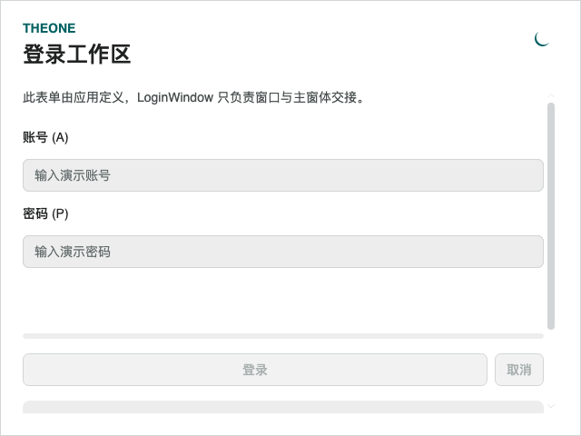

# LoginWindow 与主窗体交接

历史命令行验证入口与消费测试项目已移除，文中的专项覆盖和测量结果为历史记录。请正常启动 PreviewHost，从菜单进入对应控件演示页；目标平台行为需在实际应用中验证。

**简体中文** · [English](../en/login-window.md)

主题与公共窗口服务见[窗口文档](windows.md)。

登录窗的显式 owner、错误提示辅助方法、Toast / Notification / Dialog 生命周期和交接后的消息归属详见[窗口 owner 与消息服务](window-owners.md)。

<!-- visual-guide:start -->
## 外观与场景图示

[配图口径与控件图鉴](visual-index.md)；下图是当前源码的真实渲染，绑定与交互以本页用法说明为准。

### LoginWindow



登录表单承载在 LoginWindow 内，消息和主窗口交接有独立 owner 规则。

[查看 Dark 对照](../images/LoginWindow-dark.png)

<!-- visual-guide:end -->

## LoginWindow 与主窗体交接

LoginWindow 直接继承官方 Window，使用 OneTheme 的语义色、字号和 small / normal / large 密度。默认保留平台完整窗口装饰及标题栏，大小 440 × 540、内容内边距 24、居中显示，关闭按钮保留原生行为；默认禁止缩放和最大化，可按应用需要覆盖。类库不提供账号、密码或认证规则，Content / ContentTemplate 均由开发者定义，支持控件和有明确 x:DataType 的模型模板。

```xml
<one:LoginWindow xmlns="https://github.com/avaloniaui"
                 xmlns:x="http://schemas.microsoft.com/winfx/2006/xaml"
                 xmlns:one="using:TheOne.Avalonia.Controls"
                 xmlns:views="using:YourApp.Views"
                 x:Class="YourApp.SignInWindow" Title="登录工作区">
  <views:LoginFormView />
</one:LoginWindow>
```

对应 code-behind 继承 LoginWindow，LoginFormView 内部启用编译绑定并声明自己的 ViewModel 类型。应用启动时把登录窗口指定为桌面 MainWindow，推荐使用 OnMainWindowClose：

```csharp
public override void OnFrameworkInitializationCompleted()
{
    if (ApplicationLifetime is IClassicDesktopStyleApplicationLifetime desktop)
    {
        desktop.ShutdownMode = ShutdownMode.OnMainWindowClose;
        desktop.MainWindow = new SignInWindow();
    }
    base.OnFrameworkInitializationCompleted();
}
```

在应用自己的认证成功回调中传入全新、尚未显示且没有原生 Window.Owner 的 OneWindow。窗口须在 UI 线程构造：

```csharp
// UI 线程认证成功回调；MainWindow 继承 OneWindow。
var mainWindow = new MainWindow();
bool opened = await login.CompleteLoginAsync(mainWindow);
// UI 线程上的同步入口：login.CompleteLogin(mainWindow);
```

CompleteLoginAsync 将交接切回 UI 线程；同步入口要求 UI 线程。交接时先执行登录窗口的原生 Closing 处理，接受关闭后将 desktop.MainWindow 设为传入实例，校正 OneToast.Owner、OneNotification.Owner、OneDialog.Owner，然后独立 Show 主窗体；再次检查三个 owner 后关闭登录窗口。最终校正也覆盖登录 Closed 回调更改 owner 的情况。主窗体不会成为登录窗口的 owned window，关闭登录窗口不会连带销毁主窗体或其消息宿主。应用无需另行 Show、Close 或设置 MainWindow。

Closing 取消时返回 false，传入窗口保持未打开状态，由调用方保留或释放；交接正在进行时的重复调用同样返回 false。成功后的重复调用返回 true，不再次打开窗口，即使传入另一实例也不会创建第二个主窗体，未使用的实例仍由调用方负责。调用时登录窗口必须是已显示、无原生 Owner 的 desktop.MainWindow；已经关闭、作为子窗口显示或未注册为主窗体的登录窗口不能交接。原有 Func<OneWindow> 工厂重载保留兼容：工厂只在 Closing 接受关闭后于 UI 线程执行，适合在后台认证完成后延迟构造窗口。

交接期间短暂使用 OnExplicitShutdown，最终恢复调用前的 ShutdownMode，避免关闭回调或主窗体显示失败导致应用意外退出。Show 失败会抛出异常，恢复登录 MainWindow 和交接前的三个消息 owner，并释放已接受但打开失败的主窗体及其 owned 子窗口，可在登录表单内显示错误并重试。业务认证失败不调用完成入口；登录窗口 Closed 时应取消仍在运行的认证请求，并在回调前检查取消状态，关闭后的迟到完成调用会被拒绝。

LoginWindow 打开或激活时自动注册三个消息服务的默认 Owner，内部包含独立 Toast、Notification 和 Dialog 层。服务的 owner 参数现在接受 Window（仅支持 LoginWindow / OneWindow）；显式 owner 优先，未指定时使用仍可用的默认 owner，隐藏或关闭后回退到其他可用的主题窗口。Owner 属性通过弱引用存储，须在 UI 线程读写。OneWindow.Current 继续只返回可见的 OneWindow。三个错误提示方法明确绑定当前登录窗口，即使其他窗口激活也不会把登录错误显示到其他窗口：

```csharp
login.ShowErrorToast("账号或密码错误");
login.ShowErrorNotification("认证服务暂不可用", title: "登录失败");
OneDialogResult result = await login.ShowErrorDialog("请检查账号和密码", title: "登录失败");
```

ShowErrorToast / ShowErrorNotification 使用 NotificationType.Error，在 UI 线程调用，可传 expiration（TimeSpan.Zero 表示保留）；ShowErrorDialog 返回可等待的 Ok / Closed 结果，并支持 CancellationToken。登录窗口关闭时，当前及排队中的对话框以 Closed 完成，不迁移到主窗体；交接后的新请求使用 OneWindow 的宿主。业务 Content、DataContext、ContentTemplate 与宿主实例也不复制到主窗体。

LoginWindow 不管理依赖注入容器或 .NET Generic Host。Generic Host 及应用共享服务应与应用生命周期关联，在桌面 lifetime 的 Exit / Shutdown 路径停止、释放；不要把 Host.StopAsync / Dispose 注册到登录窗口 Closed。登录验证的局部取消与清理仍由登录表单负责。

生命周期实现依据 [Avalonia 桌面生命周期](https://docs.avaloniaui.net/docs/fundamentals/application-lifetimes) 与 [12.1.4 Window 源码](https://github.com/AvaloniaUI/Avalonia/blob/12.1.4/src/Avalonia.Controls/Window.cs)。

<!-- generated-contracts:start -->
## 专属属性、Classes 用法与业务 API

本节只列本项目的专属属性、公开 Classes 用法、实际业务动作及关联模型，不重复原生继承 API、构造器、属性 Get/Set 包装或公开标识符。注册默认值与主题生效值不同，显式局部值优先。PreviewHost 用实际标签样例展示 Classes，不展示模板选择器／Setter 明细；Description 中的属性与业务动作附短用法代码。ControlSizing、Motion 等通用配置集中在 Home。仅 Button、Input、Select 合并比较，其余控件保留独立完整示例。

### LoginWindow

[完整源码契约](../../api/zh-cn/TheOne.Avalonia.Controls.LoginWindow.md)

| 属性 | 类型 | 读写／绑定／继承 | 注册或模型初值 | 说明与约束 |
| --- | --- | --- | --- | --- |
| [`IsDialogOpen`](../../../TheOne.Avalonia/Controls/LoginWindow.cs#L35) | `bool` | 只读; OneWay | `computed / state` | 只读运行状态或派生结果；由对应控件／模型更新，供展示和命令条件读取，不作为双向输入。 |

### OneWindow

[完整源码契约](../../api/zh-cn/TheOne.Avalonia.Controls.OneWindow.md)

| 属性 | 类型 | 读写／绑定／继承 | 注册或模型初值 | 说明与约束 |
| --- | --- | --- | --- | --- |
| [`Current`](../../../TheOne.Avalonia/Controls/OneWindow.cs#L123) | `TheOne.Avalonia.Controls.OneWindow?` | 只读; CLR / n/a | `accessor-defined / state` | UI 线程。 |
| [`IsDialogOpen`](../../../TheOne.Avalonia/Controls/OneWindow.cs#L122) | `bool` | 只读; OneWay | `computed / state` | 只读运行状态或派生结果；由对应控件／模型更新，供展示和命令条件读取，不作为双向输入。 |
| [`LeftContent`](../../../TheOne.Avalonia/Controls/OneWindow.cs#L67) | `object?` | 可写; OneWay | `null` | 窗口标题栏左侧扩展内容，位于库提供的标题栏结构内。 |
| [`LeftContentTemplate`](../../../TheOne.Avalonia/Controls/OneWindow.cs#L79) | `Avalonia.Controls.Templates.IDataTemplate?` | 可写; OneWay | `null` | 原生数据模板扩展点；保持正确 x:DataType，模板数据作用域见本控件接入章节。 |
| [`RightContent`](../../../TheOne.Avalonia/Controls/OneWindow.cs#L73) | `object?` | 可写; OneWay | `null` | 窗口标题栏右侧扩展内容；避免覆盖原生窗口操作区域。 |
| [`RightContentTemplate`](../../../TheOne.Avalonia/Controls/OneWindow.cs#L85) | `Avalonia.Controls.Templates.IDataTemplate?` | 可写; OneWay | `null` | 原生数据模板扩展点；保持正确 x:DataType，模板数据作用域见本控件接入章节。 |
| [`ShowThemeButton`](../../../TheOne.Avalonia/Controls/OneWindow.cs#L91) | `bool` | 可写; OneWay | `true` | 显示窗口内置明暗切换按钮；配色资源仍由 ThemeColorPicker 或 OneTheme 控制。 |
| [`ShowTitleBar`](../../../TheOne.Avalonia/Controls/OneWindow.cs#L110) | `bool` | 可写; OneWay | `true` | 显示库提供的标题栏区域；窗口生命周期与 owner 不因此变化。 |
| [`ThemeButtonIsThreeState`](../../../TheOne.Avalonia/Controls/OneWindow.cs#L104) | `bool` | 可写; OneWay | `false` | Includes Default in the built-in theme button's Light/Dark cycle. |
| [`ThemeButtonScope`](../../../TheOne.Avalonia/Controls/OneWindow.cs#L97) | `TheOne.Avalonia.Controls.ThemeButtonScope` | 可写; OneWay | `0 / default` | 窗口内置主题按钮的切换作用域；使用枚举区分应用与窗口。 可选值：`Window`, `Application` |
| [`TitleBarHeight`](../../../TheOne.Avalonia/Controls/OneWindow.cs#L116) | `double` | 可写; OneWay | `48` | 标题栏区域的 DIP 高度；改变时保留标题与窗口按钮点击空间。 校验：`value => double.IsFinite(value) && value >= 0` |

尺寸、动效等通用配置见[统一主题说明](../../theme/zh-cn/README.md#shared-configuration)，PreviewHost 在 Home 集中演示。

### Classes 用法

没有额外公开外观类，使用默认主题及专属属性。

以上是分别使用的公开类名；悬停、按下、禁用和选中等状态由控件维护，不手工添加模板类。实际外观见 PreviewHost 的标签样例。

### 业务 API

| 类型 | 动作签名 | 用途 |
| --- | --- | --- |
| [`LoginWindow`](../../api/zh-cn/TheOne.Avalonia.Controls.LoginWindow.md) | `void LoginWindow.ShowErrorToast(string message, TimeSpan? expiration = null)` | Shows an error toast in this login window on the UI thread. |
| [`LoginWindow`](../../api/zh-cn/TheOne.Avalonia.Controls.LoginWindow.md) | `void LoginWindow.ShowErrorNotification(string message, string title = "登录失败", TimeSpan? expiration = null)` | Shows an error notification in this login window on the UI thread. |
| [`LoginWindow`](../../api/zh-cn/TheOne.Avalonia.Controls.LoginWindow.md) | `Task<OneDialogResult> LoginWindow.ShowErrorDialog(string message, string title = "登录失败", CancellationToken cancellationToken = default(CancellationToken))` | Shows an error dialog in this login window; dispatches to the UI thread. |
| [`LoginWindow`](../../api/zh-cn/TheOne.Avalonia.Controls.LoginWindow.md) | `bool LoginWindow.CompleteLogin(OneWindow mainWindow)` | Installs the supplied fresh, unopened OneWindow as the desktop MainWindow and all message owners, then closes login. |
| [`LoginWindow`](../../api/zh-cn/TheOne.Avalonia.Controls.LoginWindow.md) | `Task<bool> LoginWindow.CompleteLoginAsync(OneWindow mainWindow)` | Dispatches the handoff of the supplied OneWindow to the UI thread. Construct the window on the UI thread. |
| [`LoginWindow`](../../api/zh-cn/TheOne.Avalonia.Controls.LoginWindow.md) | `bool LoginWindow.CompleteLogin(Func<OneWindow> mainWindowFactory)` | After successful authentication, replaces this desktop MainWindow with a fresh OneWindow. Returns false if Closing cancels the transition or a completion is already in progress. Repeated calls after success return true without invoking the factory again. |
| [`LoginWindow`](../../api/zh-cn/TheOne.Avalonia.Controls.LoginWindow.md) | `Task<bool> LoginWindow.CompleteLoginAsync(Func<OneWindow> mainWindowFactory)` | Dispatches completion, including window construction, to the UI thread. |

### 关联模型

| 模型 | 属性／枚举值 |
| --- | ---: |
| [`TheOne.Avalonia.Controls.OneDialogResult`](../../api/zh-cn/TheOne.Avalonia.Controls.OneDialogResult.md) | 5 |
| [`TheOne.Avalonia.Controls.ThemeButtonScope`](../../api/zh-cn/TheOne.Avalonia.Controls.ThemeButtonScope.md) | 2 |

[完整源码契约（含构造、属性访问器和标识符，供精确查阅）](../../api/zh-cn/README.md)
<!-- generated-contracts:end -->
