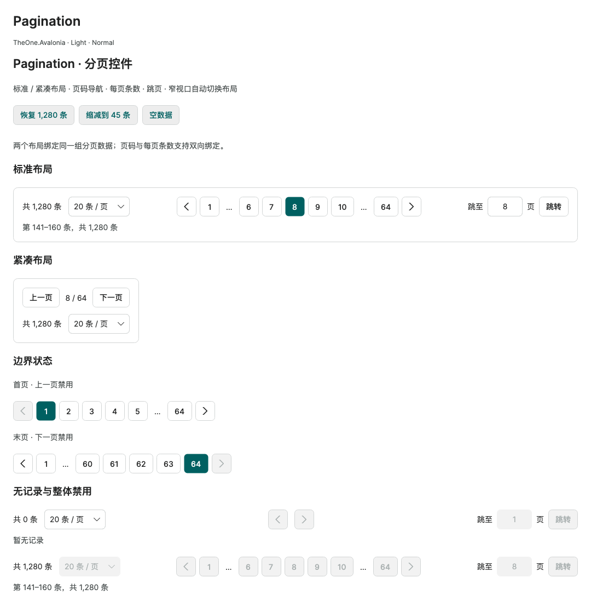

# Pagination 分页控件

历史命令行验证入口与消费测试项目已移除，文中的专项覆盖和测量结果为历史记录。请正常启动 PreviewHost，从菜单进入对应控件演示页；目标平台行为需在实际应用中验证。

**简体中文** · [English](../en/pagination.md)

`Pagination` 使用原生 Button、ComboBox、TextBox 展示分页导航。加载 `OneTheme` 后支持 Standard／Compact、Light／Dark 和 Small／Normal／Large。控件负责页码与范围，不加载或筛选业务数据；通过双向绑定、PageChanged 事件或 PageChangedCommand 请求数据。

```xml
<!-- 根视图声明 x:DataType="vm:YourViewModel"，one 为 using:TheOne.Avalonia.Controls。 -->
<one:Pagination TotalCount="{Binding TotalCount}"
                PageSize="{Binding PageSize, Mode=TwoWay}"
                CurrentPage="{Binding CurrentPage, Mode=TwoWay}"
                PageChangedCommand="{Binding LoadPageCommand}" />
```

<!-- visual-guide:start -->
## 外观与场景图示

[配图口径与控件图鉴](visual-index.md)；下图是当前源码的真实渲染，绑定与交互以本页用法说明为准。

### Pagination



页码、省略号、每页条数和跳页示例；页码从 1 开始，加载由宿主执行。

[查看 Dark 对照](../images/Pagination-dark.png)

<!-- visual-guide:end -->

## 页码与边界

| 属性 | 契约 |
| --- | --- |
| TotalCount | 非负 long，总记录数，默认 0 |
| PageSize | 正整数，每页条数，默认 20，默认双向绑定 |
| CurrentPage | 从 1 开始的 long 页码，默认 1，默认双向绑定 |
| PageCount | 只读，总页数；空数据为 0 |
| FirstItem / LastItem | 只读，当前页记录范围，从 1 开始；空数据均为 0 |
| CanGoPrevious / CanGoNext | 只读，前后导航是否有目标页 |
| HasPages | 只读，是否存在记录页 |

设置 PageSize 时回到第 1 页；TotalCount 减少时修正越界 CurrentPage。总数恢复增长后不会恢复旧的越界页码。初始化建议先提供 TotalCount、PageSize，再设置 CurrentPage。空数据的 CurrentPage 保持 1 作为业务请求起点，UI 显示 `0 / 0`，没有数字页码，前后导航与跳页禁用；默认范围文本为“暂无记录”。

`GoToPage(long)`、`GoPrevious()`、`GoNext()`、`GoFirst()`、`GoLast()` 返回是否实际改变页码。无效、重复、空数据或整体禁用时返回 false。直接设置 CurrentPage 必须是正数；越界值会修正到末页。UI 属性、集合变化与导航方法在 UI 线程执行。

## 布局与页码省略

Standard 包含总条数、每页条数选择、数字导航、跳页和记录范围。Compact 仅保留上一页、`当前页 / 总页数`、下一页，以及下方的总条数／每页条数。窄宽度默认自动采用 Compact；设置 `Layout="Compact"` 可固定使用紧凑布局。

| 属性 | 默认值与用途 |
| --- | --- |
| Layout | Standard / Compact，默认 Standard |
| CompactBreakpoint | 640；内容区在此宽度以下，或实际数字导航无法完整放下时自动紧凑；0 关闭自动切换 |
| SiblingCount | 2，当前页两侧邻居数量，允许 0–5 |
| ShowTotal / ShowRange / ShowPageSizeSelector / ShowJump | 默认均为 true；Compact 始终隐藏范围与跳页 |
| ItemHeight | Small / Normal / Large 为 30 / 36 / 44，导航与输入的最小高度 |

数字导航保留首页、末页和当前页邻居，省略部分用不可点击的 `…` 表示；只有一个缺失页时直接展示该页。以第 8 页、64 页为例：`1 … 6 7 8 9 10 … 64`。条目数量取决于 SiblingCount，与总页数无关；支持 Int64 总数而不按总页数创建控件。横向可用空间不足时标准信息组换行，紧凑信息组上下排列。Padding 保留控件内边距。

## 每页条数与跳页

PageSizeOptions 接受 `IEnumerable<int>`，默认 10、20、50、100。每项必须为正数；重复项去重。如果当前 PageSize 不在候选值中，选择器会补入当前值。ObservableCollection 的增删会更新候选项；脱离视觉树后解除集合订阅，重新附加时刷新。

跳页输入通过 Enter 或“跳转”提交，不在输入中途改变页码。无效文本或超过 PageCount 时保留原页码并显示错误；重新编辑清除错误，Escape 恢复当前页码。按钮、下拉框和输入框保留原生焦点、键盘、禁用与主题反馈；省略号不是焦点目标。

## 通知与加载数据

PageChanged 在页码或 PageSize 实际变化并完成归一化后触发一次，包含 OldPage、CurrentPage、OldPageSize、PageSize。修改每页条数产生一份同时包含新页码与新条数的通知；总数变化未改变页码时不触发通知。初始化、直接赋值和边界修正也可能触发通知。

PageChangedCommand 接收同一个 `PaginationPageChangedEventArgs`，执行前检查 CanExecute。它是变化通知，不阻止导航；加载期间需要禁用操作时，绑定 Pagination.IsEnabled。业务负责请求取消、错误处理和异步结果顺序。

```csharp
if (parameter is PaginationPageChangedEventArgs request)
{
    // 使用 request.CurrentPage 和 request.PageSize 请求业务数据。
}
```

## 文本、主题与模板

可以设置 TotalTextFormat、RangeTextFormat、PageSizeTextFormat，以及 PreviousText、NextText、JumpText、JumpPrefixText、PageUnitText、EmptyText。格式使用当前文化，格式串分别接收总条数、起止记录与总条数、每页条数。页码和紧凑计数遵循当前文化；显式替换文本可用于本地化。

默认主题复用 One.Surface、One.Text、One.Muted、One.Line、One.Accent、One.OnAccent 和原生输入状态资源。保留 PART_PreviousButton、PART_NextButton、PART_Pages、PART_PageSizes、PART_JumpInput、PART_JumpButton 以保留对应交互。辅助主题键为 One.PaginationButton、One.PaginationPages。显式控件主题可以重排外观；缺少某个部件仅使对应 UI 操作不可用。

## 示例与验证

PreviewHost 的“扩展控件 → Pagination”展示标准／紧凑共享绑定、首页／末页、空数据与整体禁用，并支持恢复和缩减记录数。

<!-- generated-contracts:start -->
## 专属属性、Classes 用法与业务 API

本节只列本项目的专属属性、公开 Classes 用法、实际业务动作及关联模型，不重复原生继承 API、构造器、属性 Get/Set 包装或公开标识符。注册默认值与主题生效值不同，显式局部值优先。PreviewHost 用实际标签样例展示 Classes，不展示模板选择器／Setter 明细；Description 中的属性与业务动作附短用法代码。ControlSizing、Motion 等通用配置集中在 Home。仅 Button、Input、Select 合并比较，其余控件保留独立完整示例。

### Pagination

[完整源码契约](../../api/zh-cn/TheOne.Avalonia.Controls.Pagination.md)

| 属性 | 类型 | 读写／绑定／继承 | 注册或模型初值 | 说明与约束 |
| --- | --- | --- | --- | --- |
| [`CanGoNext`](../../../TheOne.Avalonia/Controls/Pagination.cs#L322) | `bool` | 只读; OneWay | `computed / state` | 只读，前后导航是否有目标页 |
| [`CanGoPrevious`](../../../TheOne.Avalonia/Controls/Pagination.cs#L316) | `bool` | 只读; OneWay | `computed / state` | 只读，前后导航是否有目标页 |
| [`CompactBreakpoint`](../../../TheOne.Avalonia/Controls/Pagination.cs#L196) | `double` | 可写; OneWay | `640` | 640；内容区在此宽度以下，或实际数字导航无法完整放下时自动紧凑；0 关闭自动切换 校验：`value => double.IsFinite(value) && value >= 0` |
| [`CurrentPage`](../../../TheOne.Avalonia/Controls/Pagination.cs#L172) | `long` | 可写; TwoWay | `1` | 从 1 开始的 long 页码，默认 1，默认双向绑定 校验：`value => value >= 1` |
| [`CurrentPageText`](../../../TheOne.Avalonia/Controls/Pagination.cs#L370) | `string` | 只读; OneWay | `computed / state` | 只读运行状态或派生结果；由对应控件／模型更新，供展示和命令条件读取，不作为双向输入。 |
| [`EmptyText`](../../../TheOne.Avalonia/Controls/Pagination.cs#L286) | `string` | 可写; OneWay | `"暂无记录"` | 没有可显示数据时的提示文本；由应用覆盖以进行本地化。 |
| [`FirstItem`](../../../TheOne.Avalonia/Controls/Pagination.cs#L304) | `long` | 只读; OneWay | `computed / state` | 只读，当前页记录范围，从 1 开始；空数据均为 0 |
| [`HasJumpError`](../../../TheOne.Avalonia/Controls/Pagination.cs#L346) | `bool` | 只读; OneWay | `computed / state` | 只读运行状态或派生结果；由对应控件／模型更新，供展示和命令条件读取，不作为双向输入。 |
| [`HasPages`](../../../TheOne.Avalonia/Controls/Pagination.cs#L328) | `bool` | 只读; OneWay | `computed / state` | 只读，是否存在记录页 |
| [`HasSummary`](../../../TheOne.Avalonia/Controls/Pagination.cs#L340) | `bool` | 只读; OneWay | `computed / state` | 只读运行状态或派生结果；由对应控件／模型更新，供展示和命令条件读取，不作为双向输入。 |
| [`IsCompact`](../../../TheOne.Avalonia/Controls/Pagination.cs#L334) | `bool` | 只读; OneWay | `computed / state` | 启用紧凑布局；具体显示字段由所属模板决定，不改变业务数据。 |
| [`ItemHeight`](../../../TheOne.Avalonia/Controls/Pagination.cs#L208) | `double` | 可写; OneWay | `36` | Small / Normal / Large 为 30 / 36 / 44，导航与输入的最小高度 校验：`value => double.IsFinite(value) && value > 0` |
| [`JumpError`](../../../TheOne.Avalonia/Controls/Pagination.cs#L352) | `string` | 只读; OneWay | `computed / state` | 只读运行状态或派生结果；由对应控件／模型更新，供展示和命令条件读取，不作为双向输入。 |
| [`JumpPrefixText`](../../../TheOne.Avalonia/Controls/Pagination.cs#L274) | `string` | 可写; OneWay | `"跳至"` | 页码跳转框前的本地化提示。 |
| [`JumpText`](../../../TheOne.Avalonia/Controls/Pagination.cs#L268) | `string` | 可写; OneWay | `"跳转"` | 执行页码跳转的按钮文本。 |
| [`LastItem`](../../../TheOne.Avalonia/Controls/Pagination.cs#L310) | `long` | 只读; OneWay | `computed / state` | 只读，当前页记录范围，从 1 开始；空数据均为 0 |
| [`Layout`](../../../TheOne.Avalonia/Controls/Pagination.cs#L190) | `TheOne.Avalonia.Controls.PaginationLayout` | 可写; OneWay | `0 / default` | Standard / Compact，默认 Standard 校验：`Enum.IsDefined` 可选值：`Standard`, `Compact` |
| [`NextText`](../../../TheOne.Avalonia/Controls/Pagination.cs#L262) | `string` | 可写; OneWay | `"下一页"` | 下一页按钮的可访问／显示文本。 |
| [`PageChangedCommand`](../../../TheOne.Avalonia/Controls/Pagination.cs#L292) | `System.Windows.Input.ICommand?` | 可写; OneWay | `null` | 宿主提供的命令入口；具体操作与权限由业务实现，配对的 CommandParameter 作为命令参数。 |
| [`PageCount`](../../../TheOne.Avalonia/Controls/Pagination.cs#L298) | `long` | 只读; OneWay | `computed / state` | 只读，总页数；空数据为 0 |
| [`PageItems`](../../../TheOne.Avalonia/Controls/Pagination.cs#L376) | `System.Collections.Generic.IReadOnlyList<TheOne.Avalonia.Controls.PaginationPageItem>` | 只读; OneWay | `computed / state` | 只读运行状态或派生结果；由对应控件／模型更新，供展示和命令条件读取，不作为双向输入。 |
| [`PageSize`](../../../TheOne.Avalonia/Controls/Pagination.cs#L178) | `int` | 可写; TwoWay | `20` | 正整数，每页条数，默认 20，默认双向绑定 校验：`value => value > 0` |
| [`PageSizeOptions`](../../../TheOne.Avalonia/Controls/Pagination.cs#L184) | `System.Collections.Generic.IEnumerable<int>?` | 可写; OneWay | `DefaultSizes` | 模型或结果集合；集合及元素类型见签名。动态业务数据需提供通知；只读集合由控件维护，不直接替换。 |
| [`PageSizeTextFormat`](../../../TheOne.Avalonia/Controls/Pagination.cs#L250) | `string` | 可写; OneWay | `"{0} 条 / 页"` | 每页条数选择的格式文本；占位参数与分页文档一致。 |
| [`PageSizes`](../../../TheOne.Avalonia/Controls/Pagination.cs#L382) | `System.Collections.Generic.IReadOnlyList<TheOne.Avalonia.Controls.PaginationPageSize>` | 只读; OneWay | `computed / state` | 只读运行状态或派生结果；由对应控件／模型更新，供展示和命令条件读取，不作为双向输入。 |
| [`PageUnitText`](../../../TheOne.Avalonia/Controls/Pagination.cs#L280) | `string` | 可写; OneWay | `"页"` | 页码后面的本地化单位文本。 |
| [`PreviousText`](../../../TheOne.Avalonia/Controls/Pagination.cs#L256) | `string` | 可写; OneWay | `"上一页"` | 上一页按钮的可访问／显示文本。 |
| [`RangeText`](../../../TheOne.Avalonia/Controls/Pagination.cs#L364) | `string` | 只读; OneWay | `computed / state` | 只读运行状态或派生结果；由对应控件／模型更新，供展示和命令条件读取，不作为双向输入。 |
| [`RangeTextFormat`](../../../TheOne.Avalonia/Controls/Pagination.cs#L244) | `string` | 可写; OneWay | `"第 {0:N0}–{1:N0} 条，共 {2:N0} 条"` | 当前数据范围的格式文本；不更改分页计算。 |
| [`ShowJump`](../../../TheOne.Avalonia/Controls/Pagination.cs#L232) | `bool` | 可写; OneWay | `true` | 默认均为 true；Compact 始终隐藏范围与跳页 |
| [`ShowPageSizeSelector`](../../../TheOne.Avalonia/Controls/Pagination.cs#L226) | `bool` | 可写; OneWay | `true` | 默认均为 true；Compact 始终隐藏范围与跳页 |
| [`ShowRange`](../../../TheOne.Avalonia/Controls/Pagination.cs#L220) | `bool` | 可写; OneWay | `true` | 默认均为 true；Compact 始终隐藏范围与跳页 |
| [`ShowTotal`](../../../TheOne.Avalonia/Controls/Pagination.cs#L214) | `bool` | 可写; OneWay | `true` | 默认均为 true；Compact 始终隐藏范围与跳页 |
| [`SiblingCount`](../../../TheOne.Avalonia/Controls/Pagination.cs#L202) | `int` | 可写; OneWay | `2` | 2，当前页两侧邻居数量，允许 0–5 校验：`value => value is >= 0 and <= 5` |
| [`TotalCount`](../../../TheOne.Avalonia/Controls/Pagination.cs#L166) | `long` | 可写; OneWay | `0 / default` | 非负 long，总记录数，默认 0 校验：`value => value >= 0` |
| [`TotalText`](../../../TheOne.Avalonia/Controls/Pagination.cs#L358) | `string` | 只读; OneWay | `computed / state` | 只读运行状态或派生结果；由对应控件／模型更新，供展示和命令条件读取，不作为双向输入。 |
| [`TotalTextFormat`](../../../TheOne.Avalonia/Controls/Pagination.cs#L238) | `string` | 可写; OneWay | `"共 {0:N0} 条"` | 总条数的格式文本；仅负责展示。 |

尺寸、动效等通用配置见[统一主题说明](../../theme/zh-cn/README.md#shared-configuration)，PreviewHost 在 Home 集中演示。

### Classes 用法

没有额外公开外观类，使用默认主题及专属属性。

以上是分别使用的公开类名；悬停、按下、禁用和选中等状态由控件维护，不手工添加模板类。实际外观见 PreviewHost 的标签样例。

### 业务 API

| 类型 | 动作签名 | 用途 |
| --- | --- | --- |
| [`Pagination`](../../api/zh-cn/TheOne.Avalonia.Controls.Pagination.md) | `bool Pagination.GoToPage(long page)` | 切换到指定页码；分页器与报表的页码／越界处理分别见其契约。 |
| [`Pagination`](../../api/zh-cn/TheOne.Avalonia.Controls.Pagination.md) | `bool Pagination.GoPrevious()` | 切换到上一页，边界时不产生无效页号。 |
| [`Pagination`](../../api/zh-cn/TheOne.Avalonia.Controls.Pagination.md) | `bool Pagination.GoNext()` | 切换到下一页，边界时不产生无效页号。 |
| [`Pagination`](../../api/zh-cn/TheOne.Avalonia.Controls.Pagination.md) | `bool Pagination.GoFirst()` | 切换到第一页。 |
| [`Pagination`](../../api/zh-cn/TheOne.Avalonia.Controls.Pagination.md) | `bool Pagination.GoLast()` | 切换到最后一页。 |

### 事件订阅

按需订阅下列通知，并在宿主释放时解除订阅；这里只列事件入口，不列路由事件标识字段。

| 类型 | 事件 | 用途 |
| --- | --- | --- |
| [`Pagination`](../../api/zh-cn/TheOne.Avalonia.Controls.Pagination.md) | `PageChanged` | 状态／操作通知；在宿主生命周期内订阅并在释放时解除，事件参数类型见签名。 |

### 关联模型

| 模型 | 属性／枚举值 |
| --- | ---: |
| [`TheOne.Avalonia.Controls.PaginationLayout`](../../api/zh-cn/TheOne.Avalonia.Controls.PaginationLayout.md) | 2 |
| [`TheOne.Avalonia.Controls.PaginationPageChangedEventArgs`](../../api/zh-cn/TheOne.Avalonia.Controls.PaginationPageChangedEventArgs.md) | 4 |
| [`TheOne.Avalonia.Controls.PaginationPageItem`](../../api/zh-cn/TheOne.Avalonia.Controls.PaginationPageItem.md) | 6 |
| [`TheOne.Avalonia.Controls.PaginationPageSize`](../../api/zh-cn/TheOne.Avalonia.Controls.PaginationPageSize.md) | 2 |

[完整源码契约（含构造、属性访问器和标识符，供精确查阅）](../../api/zh-cn/README.md)
<!-- generated-contracts:end -->
