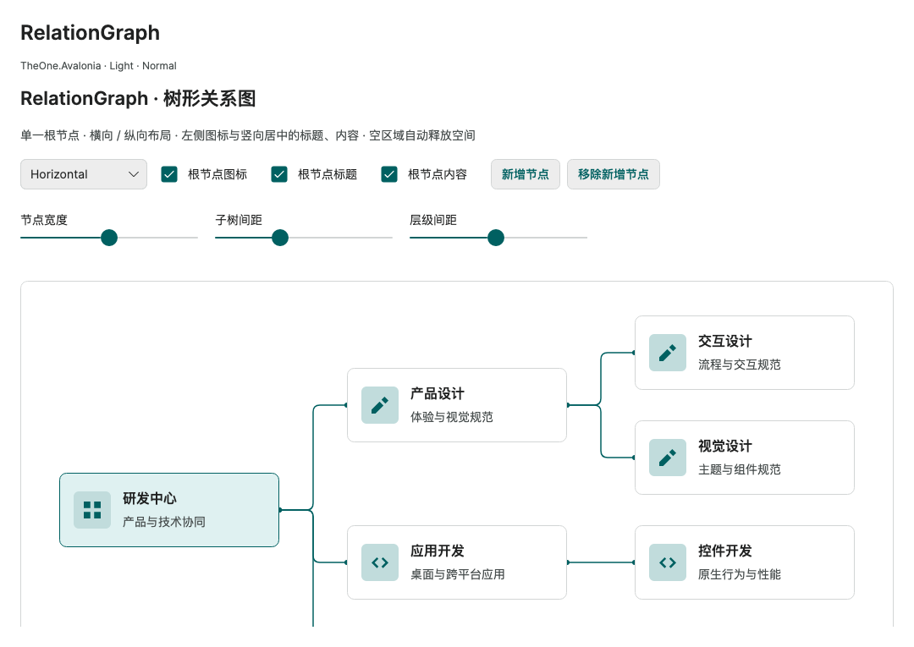

# RelationGraph 树形关系图

历史命令行验证入口与消费测试项目已移除，文中的专项覆盖和测量结果为历史记录。请正常启动 PreviewHost，从菜单进入对应控件演示页；目标平台行为需在实际应用中验证。

**简体中文** · [English](../en/relation-graph.md)

`RelationGraph` 接收一个根节点，按树形层级绘制关系。`Orientation="Horizontal"` 从左向右展开，`Vertical` 从上向下展开；节点内部始终保持左侧图标、右侧标题和内容。先加载 `OneTheme`。

`IconSource` 指定的节点字段和独立节点呈现器的 `Icon` 支持 `OneIconKind`，无需 IconTemplate；如节点 `Glyph` 为枚举时设置 `IconSource="{CompiledBinding Glyph}"`。显式 IconTemplate 仍接收图标字段值，支持 OneIcon Filled 和原有第三方模板。见 [OneIcon 图标宿主](one-icon.md#图标宿主与-icontemplate)。

<!-- visual-guide:start -->
## 外观与场景图示

[配图口径与控件图鉴](visual-index.md)；下图是当前源码的真实渲染，绑定与交互以本页用法说明为准。

### RelationGraph



节点及连线的层级布局；内容模板和选中模型由业务绑定驱动。

[查看 Dark 对照](../images/RelationGraph-dark.png)

<!-- visual-guide:end -->

## 默认模型

```csharp
var root = new RelationGraphNode
{
    Title = "研发中心",
    Content = "产品与技术协同"
};
root.Children!.Add(new RelationGraphNode
{
    Title = "应用开发", Content = "桌面与跨平台应用"
});
```

```xml
<ScrollViewer Height="540" HorizontalScrollBarVisibility="Auto"
              VerticalScrollBarVisibility="Auto">
  <one:RelationGraph RootNode="{CompiledBinding Root}" Orientation="Horizontal" />
</ScrollViewer>
```

`RelationGraphNode` 内置 `Icon`、`Title`、`Content`（均为 `object?`），以及 `IList<RelationGraphNode>? Children`。每个实例默认拥有独立的 `ObservableCollection<RelationGraphNode>`。属性通过 `INotifyPropertyChanged` 通知；`Children` 可以替换，`null` 表示叶子。

`RootNode` 是单个对象，不能用多个根节点集合代替。根节点为 `null` 时图为空。树中不允许循环、重复引用同一个节点或 `null` 子节点；错误时停止显示，并通过只读 `ValidationError` 给出原因。可观察数据修正后自动恢复。

## 自定义模型与 ChildrenSource

无需继承默认模型或复制树。`ChildrenSource` 保存绑定表达式，并在**每个节点的 DataContext** 中求值；支持不同名称的子节点集合和嵌套属性路径。`IconSource`、`TitleSource`、`ContentSource` 按相同方式选择显示字段。

假设 `OrganizationUnit` 定义 `Branches`、`Symbol`、`Name`、`Description`，视图模型定义一个 `OrganizationUnit Root`：

```xml
<!-- 根视图声明 x:Name="View"；ViewModel 是视图上有变更通知的强类型属性。 -->
<one:RelationGraph x:DataType="vm:OrganizationUnit"
    RootNode="{CompiledBinding #View.ViewModel.Root}"
    SelectItem="{CompiledBinding #View.ViewModel.SelectedNode}"
    Orientation="Vertical"
    ChildrenSource="{CompiledBinding Branches}"
    IconSource="{CompiledBinding Symbol}"
    TitleSource="{CompiledBinding Name}"
    ContentSource="{CompiledBinding Description}" />
```

在 RelationGraph 上只声明一次**节点类型**，四个捕获的取值绑定即可直接识别属性，无需逐条指定 `DataType` 或类型转换；根视图仍声明页面 ViewModel 的 `x:DataType`。这个类型声明不改变运行时 DataContext。根节点和选择绑定通过命名视图的强类型 `ViewModel` 属性访问页面数据，避免 IDE 将跨作用域的 `DataContext` 识别成 object 或 CompiledBinding。不要通过替换业务 DataContext 消除提示。

视图的 `ViewModel` 应随 DataContext 变化并发出属性通知，不能固定指向最初创建的模型。例如在视图代码中：

```csharp
public static readonly DirectProperty<OrganizationView, OrganizationViewModel?> ViewModelProperty =
    AvaloniaProperty.RegisterDirect<OrganizationView, OrganizationViewModel?>(
        nameof(ViewModel), view => view.ViewModel);
private OrganizationViewModel? _viewModel;
public OrganizationViewModel? ViewModel => _viewModel;

private void UpdateViewModel() => SetAndRaise(ViewModelProperty, ref _viewModel,
    DataContext as OrganizationViewModel);
// 构造函数中，在加载 XAML 前调用 UpdateViewModel()，再订阅：
// DataContextChanged += (_, _) => UpdateViewModel();
```

完整示例见 [RelationGraphDemoView](../../../design/PreviewHost/Views/DataDisplay/RelationGraphDemoView.axaml) 及其 [代码](../../../design/PreviewHost/Views/DataDisplay/RelationGraphDemoView.axaml.cs)。默认模型省略 Source 属性即可；自定义模型必须提供 `ChildrenSource`，其结果必须为 `IEnumerable` 或 `null`（字符串无效）。省略自定义模型的显示 Source 会使对应区域为 `null`。

变化属性实现 `INotifyPropertyChanged`；变化集合实现 `INotifyCollectionChanged`，如 `ObservableCollection<T>`。属性替换和集合增删自动更新；普通 `List<T>` 原地修改后调用 `RefreshData()`。数据与集合变化应发生在 UI 线程。控件脱离可视树后解除订阅，重新挂载时读取最新数据。

C# 可用 `Avalonia.Data.CompiledBinding.Create<TNode, TValue>(node => node.Branches)` 设置 `ChildrenSource`。不要把属性名称字符串当作绑定；NativeAOT 项目使用上述编译绑定，控件不会反射扫描用户模型。

## 节点内容与空值

| 区域 | 数据 / 模板 | 为 null 时 |
| --- | --- | --- |
| 左侧图标 | `Icon` / `IconTemplate` | 图标及间距不占空间，文本占据整个宽度 |
| 右上标题 | `Title` / `TitleTemplate` | 内容在整个文本区竖向居中 |
| 右下内容 | `Content` / `ContentTemplate` | 标题在整个文本区竖向居中 |

标题和内容同时存在时，整个文字组合竖向居中。只有图标时，在整个节点中居中。所有区域为 `null` 时保留空节点外框及连接关系。模板本身不会为 `null` 数据预留区域；空字符串仍为非 null 数据。

文本自动换行，内容可让节点高于 `NodeMinHeight`。`Icon` 可直接提供 OneIconKind、Geometry 或 `PathIcon` 等原生控件。业务对象、特殊画刷或外观可设置模板，例如：

```xml
<one:RelationGraph.IconTemplate>
  <DataTemplate x:DataType="media:Geometry">
    <PathIcon Data="{CompiledBinding}" />
  </DataTemplate>
</one:RelationGraph.IconTemplate>
```

在视图中声明 `xmlns:media="using:Avalonia.Media"`。模板的数据上下文是相应字段值；显示字段可承载原生控件，保留焦点、按钮命令和键盘行为。同一个控件实例只能由一个节点区域拥有，需要重复图标时共享 Geometry 并由模板分别创建控件。

## 节点选择

`SelectItem` 保存当前选中的**节点模型对象**，默认值为 null，默认绑定方向是 TwoWay。点击任意有效节点会同步选中状态；节点获得键盘焦点后可按 Enter / Space 选中，Tab 导航仍由 Avalonia 处理。点击节点内的按钮或输入框也会选中节点，同时保留这些原生控件的命令和焦点。

```xml
<one:RelationGraph RootNode="{CompiledBinding Root}"
                   SelectItem="{CompiledBinding SelectedNode, Mode=TwoWay}" />
```

`SelectedNode` 的类型应与节点模型一致，如 `RelationGraphNode?` 或自定义 `OrganizationUnit?`；自定义模型仍需配置 ChildrenSource 等编译绑定。选中值按对象引用匹配当前树，不能传入另建的相同内容对象或 Presenter。模型属性初始化可早于 RootNode，首轮布局后会校验选择。选中节点被移除、根节点清空或数据变为无效树时，SelectItem 自动清空并写回绑定；运行时设置树外对象也会清空。设置 null 可主动取消选择。

节点 Presenter 提供只读 `IsSelected` 与 `:selected` 伪类，默认用强调色底色、轮廓和图标区显示选择。NodeTheme 可定制该状态；选择不改变节点几何尺寸。禁用节点不会响应指针和键盘选择。

## 布局与外观

| 属性 | 默认 Normal 值 | 用途 |
| --- | --- | --- |
| `Orientation` | Horizontal | 树的展开方向 |
| `NodeWidth` / `NodeMinHeight` | 260 / 88 | 固定卡片宽度 / 自然内容高度下限 |
| `NodeSpacing` | 36 | 相邻子树在横截方向的间距 |
| `LevelSpacing` | 80 | 层级间距；每层按最大节点高度或宽度计算 |
| `Padding` | 16 | 整张图边缘留白 |
| `ConnectorBrush` / `ConnectorThickness` | One.Accent / 1.5 | 连接线颜色与宽度，宽度为 0 时隐藏 |
| `ConnectorCornerRadius` / `PortRadius` | 8 / 3 | 正交拐角与连接端点半径 |
| `NodeTheme` | 默认主题 | 替换 `RelationGraphNodePresenter` 的 ControlTheme |
| `NodeCount` / `ValidationError` | 只读 | 当前有效树的节点数量 / 数据校验错误 |

尺寸、间距、连接线和模板均可通过属性调整。`NodeTheme` 可基于默认节点主题定义填充、轮廓、字体、图标尺寸、区域间距和模板。`RelationGraphNodePresenter.Header` 对应模型 `Title`，并提供 `IsRoot`、`IconBackground`、`IconForeground`、`ContentForeground`、`HeaderFontSize`、`IconSize`、`IconTileSize`、`IconSpacing`、`TextSpacing`。默认模板部件为 `PART_Surface`、`PART_Layout`、`PART_IconHost`、`PART_IconPresenter`、`PART_TextHost`、`PART_HeaderPresenter`、`PART_ContentPresenter`。

默认样式使用 `One.Surface`、`One.Text`、`One.Muted`、`One.Line`、`One.Accent`、`One.AccentSoft`、`One.RowSelected`。根节点通过 `:root` 显示强调轮廓和底色。`ControlSizing.Size` 支持 Small / Normal / Large：节点宽度为 220 / 260 / 300，高度下限为 72 / 88 / 104，字体与图标同步变化；显式属性覆盖尺寸默认值。

控件按整棵树自然尺寸布局，使用外层原生 `ScrollViewer` 处理窄视口；不会压缩节点文字。当前完整实现所有节点，无虚拟化，适合有限规模的关系树。没有内置折叠、拖动或缩放。布局遍历使用迭代方式，连接线直接绘制，节点内容使用原生 Presenter。

## 预览与验证

PreviewHost 的“数据展示 → RelationGraph”展示方向切换、宽度与间距、根节点空值、集合增删、自定义模型绑定和八种区域组合。

专项检查明暗主题、三档尺寸、横纵布局、真实连接线像素、窄视口、自动换行、空值、集合及属性替换、无效树恢复、订阅重挂载、原生控件交互以及 XAML 编译绑定。独立 NativeAOT 消费端复用同一专项：

<!-- generated-contracts:start -->
## 专属属性、Classes 用法与业务 API

本节只列本项目的专属属性、公开 Classes 用法、实际业务动作及关联模型，不重复原生继承 API、构造器、属性 Get/Set 包装或公开标识符。注册默认值与主题生效值不同，显式局部值优先。PreviewHost 用实际标签样例展示 Classes，不展示模板选择器／Setter 明细；Description 中的属性与业务动作附短用法代码。ControlSizing、Motion 等通用配置集中在 Home。仅 Button、Input、Select 合并比较，其余控件保留独立完整示例。

### RelationGraph

[完整源码契约](../../api/zh-cn/TheOne.Avalonia.Controls.RelationGraph.md)

| 属性 | 类型 | 读写／绑定／继承 | 注册或模型初值 | 说明与约束 |
| --- | --- | --- | --- | --- |
| [`Background`](../../../TheOne.Avalonia/Controls/RelationGraph.cs#L107) | `Avalonia.Media.IBrush?` | 可写; OneWay | `inherited registration` | 背景画刷；主题相关背景使用 DynamicResource，避免固定颜色破坏明暗切换。 |
| [`ChildrenSource`](../../../TheOne.Avalonia/Controls/RelationGraph.cs#L134) | `Avalonia.Data.BindingBase?` | 可写; OneWay | `null` | A binding evaluated against each node, not against the graph's data context. |
| [`ConnectorBrush`](../../../TheOne.Avalonia/Controls/RelationGraph.cs#L215) | `Avalonia.Media.IBrush?` | 可写; OneWay | `null` | One.Accent / 1.5 ; 连接线颜色与宽度，宽度为 0 时隐藏 |
| [`ConnectorCornerRadius`](../../../TheOne.Avalonia/Controls/RelationGraph.cs#L227) | `double` | 可写; OneWay | `8` | 8 / 3 ; 正交拐角与连接端点半径 校验：`NonNegative` |
| [`ConnectorThickness`](../../../TheOne.Avalonia/Controls/RelationGraph.cs#L221) | `double` | 可写; OneWay | `1.5` | One.Accent / 1.5 ; 连接线颜色与宽度，宽度为 0 时隐藏 校验：`NonNegative` |
| [`ContentSource`](../../../TheOne.Avalonia/Controls/RelationGraph.cs#L155) | `Avalonia.Data.BindingBase?` | 可写; OneWay | `null` | 读取关系节点正文的类型化字段访问器；不使用字符串反射路径。 |
| [`ContentTemplate`](../../../TheOne.Avalonia/Controls/RelationGraph.cs#L173) | `Avalonia.Controls.Templates.IDataTemplate?` | 可写; OneWay | `null` | 原生数据模板扩展点；保持正确 x:DataType，模板数据作用域见本控件接入章节。 |
| [`IconSource`](../../../TheOne.Avalonia/Controls/RelationGraph.cs#L141) | `Avalonia.Data.BindingBase?` | 可写; OneWay | `null` | 读取关系节点图标的类型化字段访问器。 |
| [`IconTemplate`](../../../TheOne.Avalonia/Controls/RelationGraph.cs#L161) | `Avalonia.Controls.Templates.IDataTemplate?` | 可写; OneWay | `null` | 原生数据模板扩展点；保持正确 x:DataType，模板数据作用域见本控件接入章节。 |
| [`LevelSpacing`](../../../TheOne.Avalonia/Controls/RelationGraph.cs#L203) | `double` | 可写; OneWay | `80` | 80 ; 层级间距；每层按最大节点高度或宽度计算 校验：`NonNegative` |
| [`NodeCount`](../../../TheOne.Avalonia/Controls/RelationGraph.cs#L242) | `int` | 只读; OneWay | `computed / state` | 只读 ; 当前有效树的节点数量 / 数据校验错误 |
| [`NodeMinHeight`](../../../TheOne.Avalonia/Controls/RelationGraph.cs#L191) | `double` | 可写; OneWay | `88` | 260 / 88 ; 固定卡片宽度 / 自然内容高度下限 校验：`Positive` |
| [`NodeSpacing`](../../../TheOne.Avalonia/Controls/RelationGraph.cs#L197) | `double` | 可写; OneWay | `36` | 36 ; 相邻子树在横截方向的间距 校验：`NonNegative` |
| [`NodeTheme`](../../../TheOne.Avalonia/Controls/RelationGraph.cs#L179) | `Avalonia.Styling.ControlTheme?` | 可写; OneWay | `null` | 默认主题 ; 替换 `RelationGraphNodePresenter` 的 ControlTheme |
| [`NodeWidth`](../../../TheOne.Avalonia/Controls/RelationGraph.cs#L185) | `double` | 可写; OneWay | `260` | 260 / 88 ; 固定卡片宽度 / 自然内容高度下限 校验：`Positive` |
| [`Orientation`](../../../TheOne.Avalonia/Controls/RelationGraph.cs#L126) | `Avalonia.Layout.Orientation` | 可写; OneWay | `0 / default` | Horizontal ; 树的展开方向 校验：`Enum.IsDefined` 可选值：`Horizontal`, `Vertical` |
| [`Padding`](../../../TheOne.Avalonia/Controls/RelationGraph.cs#L209) | `Avalonia.Thickness` | 可写; OneWay | `inherited registration` | 16 ; 整张图边缘留白 |
| [`PortRadius`](../../../TheOne.Avalonia/Controls/RelationGraph.cs#L233) | `double` | 可写; OneWay | `3` | 8 / 3 ; 正交拐角与连接端点半径 校验：`NonNegative` |
| [`RootNode`](../../../TheOne.Avalonia/Controls/RelationGraph.cs#L113) | `object?` | 可写; OneWay | `null` | 关系图的根模型；子节点通过模型树或访问器获取。 |
| [`SelectItem`](../../../TheOne.Avalonia/Controls/RelationGraph.cs#L120) | `object?` | 可写; TwoWay | `null` | The selected node model, matched by reference. Null clears selection. |
| [`TitleSource`](../../../TheOne.Avalonia/Controls/RelationGraph.cs#L148) | `Avalonia.Data.BindingBase?` | 可写; OneWay | `null` | 读取关系节点标题的类型化字段访问器。 |
| [`TitleTemplate`](../../../TheOne.Avalonia/Controls/RelationGraph.cs#L167) | `Avalonia.Controls.Templates.IDataTemplate?` | 可写; OneWay | `null` | 原生数据模板扩展点；保持正确 x:DataType，模板数据作用域见本控件接入章节。 |
| [`ValidationError`](../../../TheOne.Avalonia/Controls/RelationGraph.cs#L240) | `string?` | 只读; OneWay | `computed / state` | 只读 ; 当前有效树的节点数量 / 数据校验错误 |

### RelationGraphNode

[完整源码契约](../../api/zh-cn/TheOne.Avalonia.Controls.RelationGraphNode.md)

| 属性 | 类型 | 读写／绑定／继承 | 注册或模型初值 | 说明与约束 |
| --- | --- | --- | --- | --- |
| [`Children`](../../../TheOne.Avalonia/Controls/RelationGraphNode.cs#L33) | `System.Collections.Generic.IList<TheOne.Avalonia.Controls.RelationGraphNode>?` | 可写; CLR / n/a | `new ObservableCollection<RelationGraphNode>()` | 子级模型集合；保持父子与对象身份，避免循环和跨父级共享可变节点。 |
| [`Content`](../../../TheOne.Avalonia/Controls/RelationGraphNode.cs#L27) | `object?` | 可写; CLR / n/a | `null` | 宿主内容或业务展示对象；具体模板作用域见内容模板契约，不把视图对象当作持久化数据。 |
| [`Icon`](../../../TheOne.Avalonia/Controls/RelationGraphNode.cs#L15) | `object?` | 可写; CLR / n/a | `null` | 图标内容或矢量几何，具体类型见签名；外部位图所有权仍由宿主负责。 |
| [`Title`](../../../TheOne.Avalonia/Controls/RelationGraphNode.cs#L21) | `object?` | 可写; CLR / n/a | `null` | 显示标题；不等于业务主键或本地化资源键。 |

### RelationGraphNodePresenter

[完整源码契约](../../api/zh-cn/TheOne.Avalonia.Controls.RelationGraphNodePresenter.md)

| 属性 | 类型 | 读写／绑定／继承 | 注册或模型初值 | 说明与约束 |
| --- | --- | --- | --- | --- |
| [`ContentForeground`](../../../TheOne.Avalonia/Controls/RelationGraphNodePresenter.cs#L105) | `Avalonia.Media.IBrush?` | 可写; OneWay | `null` | 节点正文文字画刷；动态主题使用 One.* 资源，显式局部值优先。 |
| [`HeaderFontSize`](../../../TheOne.Avalonia/Controls/RelationGraphNodePresenter.cs#L99) | `double` | 可写; OneWay | `16` | 节点标题字号，单位 DIP，按实际文本度量参与布局。 校验：`Positive` |
| [`Icon`](../../../TheOne.Avalonia/Controls/RelationGraphNodePresenter.cs#L63) | `object?` | 可写; OneWay | `null` | 图标内容或矢量几何，具体类型见签名；外部位图所有权仍由宿主负责。 |
| [`IconBackground`](../../../TheOne.Avalonia/Controls/RelationGraphNodePresenter.cs#L111) | `Avalonia.Media.IBrush?` | 可写; OneWay | `null` | 图标底板画刷；动态主题使用 One.* 资源，显式局部值优先。 |
| [`IconForeground`](../../../TheOne.Avalonia/Controls/RelationGraphNodePresenter.cs#L117) | `Avalonia.Media.IBrush?` | 可写; OneWay | `null` | 图标前景画刷；动态主题使用 One.* 资源，显式局部值优先。 |
| [`IconSize`](../../../TheOne.Avalonia/Controls/RelationGraphNodePresenter.cs#L75) | `double` | 可写; OneWay | `24` | 图标绘制尺寸，单位 DIP；独立于文本字号与按钮点击区域。 校验：`Positive` |
| [`IconSpacing`](../../../TheOne.Avalonia/Controls/RelationGraphNodePresenter.cs#L87) | `double` | 可写; OneWay | `14` | 图标与相邻文本／内容的 DIP 间距。 校验：`NonNegative` |
| [`IconTemplate`](../../../TheOne.Avalonia/Controls/RelationGraphNodePresenter.cs#L69) | `Avalonia.Controls.Templates.IDataTemplate?` | 可写; OneWay | `null` | 原生数据模板扩展点；保持正确 x:DataType，模板数据作用域见本控件接入章节。 |
| [`IconTileSize`](../../../TheOne.Avalonia/Controls/RelationGraphNodePresenter.cs#L81) | `double` | 可写; OneWay | `44` | 图标承载底板的 DIP 尺寸，独立于图标自身尺寸。 校验：`Positive` |
| [`IsRoot`](../../../TheOne.Avalonia/Controls/RelationGraphNodePresenter.cs#L123) | `bool` | 可写; OneWay | `false` | 此节点是否为根节点；由关系图生成器维护。 |
| [`IsSelected`](../../../TheOne.Avalonia/Controls/RelationGraphNodePresenter.cs#L130) | `bool` | 只读; OneWay | `computed / state` | Selection state maintained by the owning RelationGraph. |
| [`TextSpacing`](../../../TheOne.Avalonia/Controls/RelationGraphNodePresenter.cs#L93) | `double` | 可写; OneWay | `6` | 标题与正文之间的 DIP 间距。 校验：`NonNegative` |

尺寸、动效等通用配置见[统一主题说明](../../theme/zh-cn/README.md#shared-configuration)，PreviewHost 在 Home 集中演示。

### Classes 用法

没有额外公开外观类，使用默认主题及专属属性。

以上是分别使用的公开类名；悬停、按下、禁用和选中等状态由控件维护，不手工添加模板类。实际外观见 PreviewHost 的标签样例。

### 业务 API

| 类型 | 动作签名 | 用途 |
| --- | --- | --- |
| [`RelationGraph`](../../api/zh-cn/TheOne.Avalonia.Controls.RelationGraph.md) | `RelationGraphNodePresenter? RelationGraph.GetNodePresenter(object node)` | Finds a realized native card; returns null before layout or for invalid trees. |
| [`RelationGraph`](../../api/zh-cn/TheOne.Avalonia.Controls.RelationGraph.md) | `void RelationGraph.RefreshData()` | Refresh after changing a collection that does not notify. |

### 事件订阅

按需订阅下列通知，并在宿主释放时解除订阅；这里只列事件入口，不列路由事件标识字段。

| 类型 | 事件 | 用途 |
| --- | --- | --- |
| [`RelationGraphNode`](../../api/zh-cn/TheOne.Avalonia.Controls.RelationGraphNode.md) | `PropertyChanged` | 状态／操作通知；在宿主生命周期内订阅并在释放时解除，事件参数类型见签名。 |

### 关联模型

| 模型 | 属性／枚举值 |
| --- | ---: |
| [`TheOne.Avalonia.Controls.RelationGraphNode`](../../api/zh-cn/TheOne.Avalonia.Controls.RelationGraphNode.md) | 4 |

[完整源码契约（含构造、属性访问器和标识符，供精确查阅）](../../api/zh-cn/README.md)
<!-- generated-contracts:end -->
