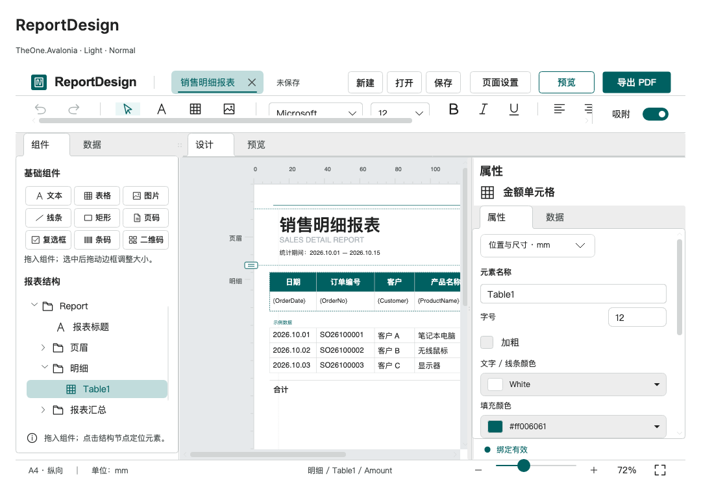

# ReportDesign 报表设计器

历史命令行验证入口与消费测试项目已移除，文中的专项覆盖和测量结果为历史记录。请正常启动 PreviewHost，从菜单进入对应控件演示页；目标平台行为需在实际应用中验证。

[English](../en/report-design.md) · [控件文档](README.md) · [ReportPreview 预览控件](report-preview.md)

`ReportDesign` 是以自由排版为核心的桌面报表设计器，数据源可选，不连接接口也能设计静态报表。加载 `OneTheme` 后可直接使用；编辑器复用 `One.*` 资源与三档尺寸，打印纸张始终为白底，并保持真实比例。

```xml
<one:ReportDesign Document="{Binding Report}"
                  DataSource="{Binding SalesSource}"
                  SaveCommand="{Binding SaveReportCommand}" />
```

视图声明正确的 `x:DataType`；`one` 为 `using:TheOne.Avalonia.Controls`，模型位于 `TheOne.Avalonia.Reporting`。

<!-- visual-guide:start -->
## 外观与场景图示

[配图口径与控件图鉴](visual-index.md)；下图是当前源码的真实渲染，绑定与交互以本页用法说明为准。

### ReportDesign



左侧组件/结构、中央纸张和右侧属性组成设计工作区，图中含表格和二维码。

[查看 Dark 对照](../images/ReportDesign-dark.png)

<!-- visual-guide:end -->

## 工作台与拖放编辑

顶部报表名称使用原生 `TabStrip`，包含文档标题和内置关闭操作，旁边为保存状态及文档操作，下面为格式工具栏。沿用原生标签项内容布局，移除标签栏外层重复边框与留白。关闭当前唯一文档会清空 `Document`、`DataSource`，禁用保存与 PDF 导出；新建／打开仍可恢复文档。左侧组件／数据栏贯穿工作区高度，设计／预览页签只位于纸张区域顶部。右侧采用“属性／数据”两个页签，几何、内容、字体和颜色在属性页分块排列。组件／数据（`SourceTabs`）、属性／数据（`PropertyTabs`）及设计／预览（`ViewTabs`）统一使用内置 `TabControl` 的 `Classes="card"` 样式，不自定义页签模板，保留原生键盘交互。这些固定功能页显式关闭 `TabFeatures.CanClose` 与 `TabFeatures.CanReorder`，不可关闭或重排。报表名称栏使用 [TabFeatures 关闭能力](collections.md#tabstrip-独立标签导航)。

从左侧拖入文本、表格、图片、线条、矩形、页码、复选框、条码或二维码。组件栏采用三列紧凑布局，按钮最小高度 30 DIP、内边距 6 × 3 DIP、图标 14 DIP、文字 12 DIP，三档编辑器密度下保持该工具区尺寸。新增项自然增加行，结构树占据剩余高度。拖动元素可移动，右下角手柄可缩放；表格还可通过外侧右边缘手柄调整整体宽度，保持各列比例。内部列边界用于调整相邻列宽，表头与明细之间的边界改变表头高度，底边改变明细模板行高。列宽保存为相对权重 `WidthWeight`；`TableHeaderHeightMm` 保存表头高度，实际高度还会按文字测量增高。

几何使用 mm，支持 1 mm 吸附、方向键微移（Shift 为 5 mm）、Delete 删除及撤销／重做，一次画布拖动记为一次编辑。工具栏编辑字体、字号、粗体、斜体、下划线、对齐和列表；属性栏与边框／填充下拉框使用内置 `ColorPicker`。字号编辑器及 `FontSizeValue` 使用印刷点 pt；模型 `ReportElement.FontSize` 仍为 DIP，换算为 `pt = DIP × 0.75`，新增元素默认 12 pt（16 DIP）。

字体下拉框通过 Avalonia 的 `FontManager` 读取本机系统字体，不使用固定预设列表。当前文档字体即使未在本机安装也会保留为可选项，绘制时按可用字体回退；保存字体名称不会将字体文件嵌入模板。

点击纸张元素或结构树可选中元素，点击表格模板单元格可编辑该列。结构树按标题、页眉、明细、汇总和页脚组织元素；点击结构项会切回设计模式，并将对应元素、单元格或区域滚动到可见位置。点击子项时保持父节点展开；元素选择只同步树中选中项，不重建层级。重命名或结构编辑需要重建时，保留原有展开状态。当前一个文档支持一个重复明细表格，其他元素可有多个。

设计页中右键点击表格列，可选择“左侧插入列”“右侧插入列”“删除列”。操作目标是右键命中的列，不沿用之前选中的其他列；键盘请求快捷菜单时使用当前选中列。新列为空白列，插入后选中新列；删除后选中相邻列。每次操作作为一次编辑参与撤销／重做，已有列的字段绑定和格式保留。表格至少保留一列，最多 100 列；插入后必须为每列保留至少 32 DIP，否则禁用插入。预览模式及非表格位置不提供列菜单；切换文档或进入预览会关闭旧菜单。

新增列继承目标列的 `WidthWeight`，已有列权重不变；删除列也不改写其他列权重。实际列宽按 `表格总宽 × 当前列权重 / 全部列权重之和` 重新分配，表格总宽保持不变。因此插入后已有列会按比例缩小，删除后按比例增大，并非保留原来的绝对宽度。右侧“添加列”在末尾追加，继承选中列权重并沿用待绑定字段；它与右键菜单使用相同的列数和最小宽度限制。“删除此列”同样保留最后一列；删除时优先选中右邻列，末列则选中左邻列。

撤销恢复操作前的选中列，重做恢复操作后的选中列；字段、静态文字、格式、小数位、合计及条件样式随列一起恢复，而不是沿用变化后的序号。历史恢复保留 `Document` 实例，列和元素实例会替换，外部应通过 `SelectedColumn` / `SelectedElement` 重新获取当前实例。模板保存列顺序和权重，不保存选中状态或运行时数据；重载后使用新的选择状态，并按数据源类型恢复 API 或重新传入显式 `DataSource`。设计、预览和 PDF 使用相同的列顺序、比例宽度及字段解析规则。

## 二维码组件

从组件栏拖入“二维码”，或调用 `AddElement(ReportElementKind.QRCode, x, y)`，坐标单位为 mm。新增元素默认 32 × 32 mm，内容为示例链接。属性栏可设置 `Text`、`QRCodeErrorCorrection`（默认 `Medium`）及 `QRCodeQuietZone`（4–32 模块，默认 4）。前景色控制深色模块，二维码区域保持白底以保护静区，不受页面填充影响；非正方形元素内居中放置正方形，不拉伸编码。请保留深色模块与足够对比度。

```csharp
var qr = designer.AddElement(ReportElementKind.QRCode, 150, 16);
qr.Text = "https://example.com/report"; // 静态内容，支持中文
qr.Width = qr.Height = 32;
qr.QRCodeErrorCorrection = QRCodeErrorCorrection.High;
qr.QRCodeQuietZone = 4;

// 已传入注册了 OrderNo 字段的数据源：
designer.SelectedElement = qr;
designer.BindField("OrderNo"); // 也可将字段拖到二维码上
// qr.FieldKey = "" 可恢复使用静态 Text。
```

`FieldKey` 优先于 `Text`，使用数据源第一条记录，或显式注册的 JSON 根属性；不会为每条明细行自动重复生成。替换数据源或刷新行值后更新内容。缺失字段、空字段值、无效 Unicode、容量超限，以及模块不足 1 DIP 均会提示错误。未连接运行时数据的绑定模板仍可保存，设计模式显示待绑定提示；预览和 PDF 则要求有实际非空字段值，绝不把字段占位文字编码进去。

保存重载保留 `FieldKey`、静态 `Text`、纠错等级及静区，但不保存运行时数据行。加载会清理旧数据源：带接口配置的模板自动重新取数，无接口模板需要重新赋值运行时 `DataSource`。替换源不会改写字段绑定或静态文本。修改现有行对象的值后，调用 `RefreshReport()` 重新生成二维码内容；源创建时固定行成员，新增、删除或替换行后应重新赋值 `DataSource`。清空 `FieldKey` 即可恢复保留的静态文本。

```csharp
var template = designer.SaveTemplate();
designer.LoadTemplate(template); // 无接口配置时，需要重新提供运行时数据
designer.DataSource = ReportDataSource.Create("Orders", rows,
    new ReportField<Order>("OrderNo", "订单号", row => row.OrderNo));
rows[0].OrderNo = "SO-2026-002";
designer.RefreshReport(); // 在 UI 线程重新读取当前行值
```

数据栏的“刷新数据源”会重新请求接口，按保存的集合路径和根字段键替换已绑定的记录快照，保留二维码字段绑定及静态文本。请求期间替换文档、请求配置或运行时源，迟到响应不会覆盖替换后的数据。请求成功但二维码字段为空或缺失时，清理旧码并阻止预览／PDF；HTTP 请求失败时保留原数据源，显示错误并允许重试。

多页报表在每页的定义位置重复展示各二维码。字段二维码始终使用第一条记录或已注册的根单值，不随当前页的首条明细行改变；切页复用当前布局及已编码符号。PDF 导出包含全部页面，不受当前预览页影响，也不改变选中页。每次导出在等待网络图片前固定文档定义、已解析的二维码内容及分页；等待期间修改共享行对象或启动另一份导出，不会改变本次二维码。批量导出时先为每份任务设置数据源和静态文本，等待该次导出完成后再复用目标流；并行任务使用各自独立的流。

设计、预览和矢量 PDF 复用相同的 UTF-8 / ECI 编码、指定纠错等级、正方形布局及静区。布局快照保存编码几何，选中和重复绘制不重新编码。模板 JSON 和撤销／重做保留内容、字段绑定、mm 位置尺寸、纠错等级及静区，不序列化二维码矩阵或源数据行。`ReportElementKind` 末尾新增 `QRCode = 8`，不改变旧枚举数值；旧版本控件库不能读取包含该类型的新模板。

PreviewHost 的 ReportDesign 销售示例在页眉并列展示静态链接和首条订单字段二维码；独立 QRCode 页通过 `Description` 展示属性代码。内容限制、尺寸和扫码注意事项见 [QRCode](qr-code.md)。

通过字段选择器、`BindField`、普通字段拖放或 JSON 标量拖放绑定二维码时，都保留原有静态 `Text`；切换字段也不会覆盖它。绑定期间修改 `Text` 只更新备用静态内容，画面仍编码字段值。点击二维码属性栏的“恢复静态内容”，或清空 `FieldKey`，即可编码最新静态文字。撤销／重做同时恢复绑定和静态内容，包括绑定期间的修改。当前有效来源为空或非法时会清除旧码并阻止 PDF 导出，不会悄悄回退为上一次成功编码的内容。

## 页面设置与固定区域

“页面设置”打开所属窗口的模态对话框，分组编辑纸张／方向、四边距及固定区域，并提供实时比例纸张预览与就地校验。支持 A4、A3、Letter 和自定义尺寸，继承宿主实际主题与尺寸密度；表单可滚动，主次操作按钮固定在底部。应用前先校验草稿，取消或关闭窗口不修改文档。

`PageWidthMm` / `PageHeightMm` 为物理纸张尺寸；可空的 `MarginLeftMm`、`MarginTopMm`、`MarginRightMm`、`MarginBottomMm` 分别覆盖旧版统一边距 `MarginMm`。

页眉从 `TopMargin` 开始，高度为 `HeaderHeightMm`；页脚从 `PageHeightMm - BottomMargin - FooterHeightMm` 开始。画布绘制这些已知区域边界，标尺旁标签按区域放置，不随表格漂移。设计模式可上下拖动左侧页眉／页脚边界手柄改变区域高度，页脚元素跟随页脚边界移动。分页为页脚区域保留空间，固定元素与表头在每页重复；区域之间必须留有明细空间。A4 保持真实比例，通过滚动查看，不为填满视口拉伸。

## 网络图片与 MVVM JSON 保存

服务器图片使用 `ReportElement.ImageUrl`：在图片属性中输入 HTTP / HTTPS 网络路径并点击“加载网络图片”。下载内容只缓存在运行时，不写入 JSON；模板保存 `ImageUrl`，预览端重新获取。仍可通过 `SetImage` 导入本地 PNG、JPEG、WebP 或 BMP，写入内嵌 `ImageData`。支持等比适应、等比填充裁剪和拉伸；单张上限 8 MiB、1600 万像素，一份报表的网络图片合计上限 32 MiB、3200 万像素。本地图片替换校验失败保留原图；改用新的网络地址后加载失败，设计模式显示加载／失败占位，不继续绘制旧地址缓存。图片提示只在设计模式显示。

`SaveCommand` 类型为 `ICommand`。保存按钮将当前 `ReportDocument` 作为参数并遵循 `CanExecute`；消费者在命令中调用 `document.Save()` 获取 JSON，自行保存至服务器。执行命令本身不代表保存成功，持久化成功后调用 `designer.MarkSaved()` 更新状态。未设置命令时使用系统本地保存对话框；“打开”读取本地模板，“新建”创建空白报表。

```csharp
// 消费者的保存命令处理方法中：
string json = document.Save();
// 此处等待应用自己的仓储或 HTTP 保存操作完成。
designer.MarkSaved(); // 仅在持久化成功后调用

// 后续取回 JSON：
ReportDocument restored = ReportDocument.Load(json);
designer.Document = restored;
```

`ReportDocument.Save()` / 静态 `Load(json)` 封装版本化的 `ReportTemplate` JSON，保存纸张、边距、区域高度、元素、字体、列、绑定、格式、合计、条件、内嵌图片，以及公共 `DataSourceUrl`、`DataBodyPointer`、`DataSourceAuthentication`、`ImageUrl`。不保存数据记录、接口响应、运行时图片缓存、HTTP 客户端及已获取的 token。登录入参属于模板定义，会随 JSON 保存；需要将凭证保留在模板之外的应用，可向独立预览提供消费者持有的已鉴权客户端。

无效模板不会替换当前文档。模板上限 32 MiB、1000 个元素、100 列和一个表格；源生成序列化元数据支持 NativeAOT。`SaveTemplate()` / `LoadTemplate(json)` 继续可用。加载会清理上一份报表的运行时源，然后按保存的接口、方式、入参、鉴权和集合路径自动恢复数据及响应树，无须再次拖字段。需要等待数据及绑定网络图片加载完成（例如导出前），可用 `await LoadTemplateAsync(json, cancellationToken)`。网络／字段错误保留已加载定义和绑定、显示错误，并向显式异步调用方抛出异常；无接口模板仍可静态设计。

```csharp
var picture = designer.AddElement(ReportElementKind.Image, 150, 30);
picture.ImageUrl = "https://reports.example.com/logo.png";
picture.ImageFit = ReportImageFit.Contain;
var json = designer.Document!.Save();
await designer.LoadTemplateAsync(json);
await using var pdf = new FileStream("report.pdf", FileMode.OpenOrCreate,
    FileAccess.ReadWrite, FileShare.None);
await designer.ExportPdfAsync(pdf); // UI 线程调用，包含全部页面
```

PDF 复用分页与 Avalonia / Skia 绘制，文字和图形保留为矢量，图片嵌入 PDF；物理 mm 按 72 点／英寸换算，去除标尺、选框和编辑器。无源模板也能导出占位符，非法布局阻止导出。系统字体与字形回退可能影响换行排版。

## 可选 API 数据与绑定

“数据”页签独占整个左侧栏，响应树填满接口操作与搜索框下方的剩余高度。“报表结构”只在“组件”页签内显示，位于紧凑组件栏下方；切换页签保留结构选中状态。切换组件／数据还会保留数据树的展开、选中、滚动位置及搜索条件，不会重复请求接口。源和查询未变时复用筛选后的根节点，避免刷新重建节点而丢失选择。

给已挂载设计器赋值保存的 `Document` 也会自动取数；应用已显式提供数据源时保留应用数据。自动加载过程中赋值 `DataSource` 会接管并取消当前取数。关闭／替换文档取消旧请求，迟到响应不能覆盖新报表。未完成的自动加载在卸载时中断、重新挂载后恢复；已加载数据在缓存导航返回时保留，不再重复请求。自动加载整体限时 30 秒，运行时数据不写入模板 JSON，也不会作为一次定义修改加入撤销栈。

在“数据”页签点击“添加数据源”，对话框支持 HTTP / HTTPS URL、GET / POST / PUT / PATCH / DELETE 和请求参数。参数输入为 JSON 对象（上限 64 KiB），GET 编码到查询字符串并保留 URL 已有参数；其他方式支持 JSON 请求体或 Form 表单，嵌套 Form 值按 JSON 字符串传递。请求超时 20 秒，响应上限 4 MiB。

对话框使用 `VerificationStep` 分步校验。未勾选“需要权限校验”时只有“数据接口 → 选择数据”两步；勾选后为“权限接口 → 权限头与 Token → 数据接口 → 选择数据”四步，自动重排编号。下一步会校验并按需调用当前接口；也可先点击当前页的调用按钮查看响应。更改上游设置会使依赖的结果失效，必须重新验证；取消／关闭会中止进行中的请求，不修改已有数据源。确认只导入已验证结果，不重复发送请求。

未修改配置时，返回上一步再继续会复用已验证响应，保留本次勾选和搜索。修改接口／入参／权限头／Token 路径后，清空依赖的数据响应、勾选与搜索；新结果默认勾选全部可用项，不套用上一配置的筛选。模板保存的选择只在向导首次加载同一配置时恢复。切换权限校验会清除登录响应、Token 候选、高亮和请求头预览，重新启用需要重新调用登录接口。手工修改 Token 路径会同步候选高亮，无效路径取消高亮。关闭窗口也释放运行时登录响应。

离开正在调用接口的步骤或取消校验会中止该次操作并立即恢复输入；失败后重试会启动新请求。输入失效判断同步监听 Text 属性，避免延后的 TextChanged 误取消新请求。每个请求独立持有取消对象并检查版本；即使服务端迟到返回或忽略取消，旧操作也不能回填响应、Token、勾选或取消新的重试。

最后一步填写数据源名称，按“单值字段／数据集”勾选需要展示的项；对象仅组织路径，一个属性是一项，整个数组是一项，搜索不丢失隐藏项的勾选。至少勾选一项且名称非空才可确认。确认保存 `ReportDocument.DataSourceName`、`SelectedDataPointers`（JSON Pointer 数组），参与保存与撤销；旧模板的 null 选择表示展示全部项。左侧以命名数据源 → 单值字段／数据集分组展示，集合展开为字段结构，不逐条生成记录节点。JSON 文本预览最多显示 20 万字符，完整响应与现有报表绑定保留，未勾选项仅从设计器目录隐藏，不会删除底层数据。

编辑器仍管理一个接口源；再次确认会替换当前接口目录和配置，不清空既有字段绑定。刷新按钮重新获取当前配置，保留名称和选择项；模板重新加载仍重新获取完整响应。

单值节点可拖入文本或指定表格单元格，填入当前值并保留绑定；拖到空白纸张创建绑定文本。包含 HTTP / HTTPS 图片路径的单值可拖入图片组件，加载并绑定图片。对象只用于组织层级，不作为值拖入。

集合只能拖到已有表格，打开逐列字段映射模态框，显示各列、字段选择与首条数据样例，长列表使用原生滚动。确认后切换明细集合并一次应用全部映射，可作为一次编辑撤销。未选字段的列保留静态 `ReportColumn.Text`、清除旧绑定；未绑定或非数字列关闭求和与数字条件。取消或关闭对话框不改变列和数据源；集合不能拖到文本或空白纸张。

所选接口与集合 JSON Pointer 保存为 `DataSourceUrl`、`DataBodyPointer`。`$root/company`、`$root/orders/0/logo` 等绝对单值键可与集合的相对字段并存。JSON 保存这些绑定键，独立预览重新获取响应后，可同时恢复根单值、明细记录及绑定图片地址。转义 JSON Pointer 保留带点／斜杠属性名和实际数组索引，不与嵌套路径混淆。请求失败保留原设计和数据源。

绑定节点时同时保存 `DataSourceMethod`、`DataSourceParameters`、`DataSourceParameterMode`，独立预览复用相同请求。`FetchApiDataAsync(url, cancellationToken)` 保留 GET 兼容入口；`FetchApiDataAsync(new ReportApiRequest(url, "POST", "{\"page\":1}"), cancellationToken)` 支持配置请求。`ReportResources.FetchJsonAsync(request, client, cancellationToken)` 可使用消费者提供的 `HttpClient`。

“权限接口”步骤只调用登录 URL，不依赖数据 URL，也不要求预先选择 token；支持请求方式和 JSON／Form 入参。“权限头与 Token”步骤从登录响应的字符串／数字叶节点中选择字段，也可手工输入路径，再设置可编辑的请求头名称与前缀。路径无效或字段为空时阻止进入数据接口步骤。登录响应中的字符串与最终请求头预览脱敏显示。数据接口步骤复用本次已验证的登录响应，不重复登录；修改登录配置后必须返回第一步重新调用。正文独立滚动，取消、上一步和确认按钮保持在正文外。

请求头名称支持下拉选择 Authorization、X-API-Key、X-Auth-Token、Token、Access-Token、Auth-Token，也可自由输入；使用原生 `AutoCompleteBox` 和显式下拉按钮实现可编辑选择。token 字段支持 JSON Pointer（如 `/data/token`，包括 `~0`／`~1` 转义）或点分路径（如 `data.token`），值必须为非空字符串或数字。请求头值自动组合“可选前缀 + 字段值”；`Bearer ` 的尾部空格会保留，直接使用 token 时将前缀留空。

```csharp
var request = new ReportApiRequest("https://reports.example.com/rows")
{
    Authentication = new ReportApiAuthentication
    {
        Url = "https://reports.example.com/login", Method = "POST",
        Parameters = "{\"username\":\"example\",\"password\":\"example\"}",
        ParameterMode = ReportApiParameterMode.Json,
        TokenField = "/data/token", HeaderName = "Authorization", HeaderPrefix = "Bearer "
    }
};
await designer.FetchApiDataAsync(request);
```

确认数据源或绑定已获取节点时，配置写入 `ReportDocument.DataSourceAuthentication`，参与撤销／重做；`null` 表示直接请求。公开取数 API、模板重载与独立预览仍按“登录 → 取 token → 请求数据”执行，登录失败、token 无效或取消时不继续请求数据。权限头只添加到这一次数据请求，不修改共享客户端默认请求头，也不自动传给独立图片请求。实际 token 不进入模板，重新加载会重新登录。登录和数据响应分别受相同的 4 MiB／20 秒限制。当前编辑器支持一个 token 请求头，不包含交互式 OAuth、刷新 token 流程或多个鉴权头。

代码取数可通过附加配置控制同样的目录展示：

```csharp
await designer.FetchApiDataAsync(new ReportApiRequest("https://example.com/report")
{
    SourceName = "销售报表",
    SelectedDataPointers = ["/reportTitle", "/sales"]
});
```

## 复选框与条码

组件栏支持拖入 `ReportElementKind.CheckBox` 和 `Barcode`，继承现有移动、缩放、结构定位与撤销行为。复选框 `Text` 为标签，`IsChecked` 为默认状态；绑定字段优先，支持布尔值、1/0、yes/no、是/否，空值视为未勾选，其他值阻止预览／导出，拖入布尔字段不覆盖标签。

条码采用 Code 128B，`Text` 为静态码值或由 `FieldKey` 绑定，`BarcodeShowText` 控制是否显示码值。支持 1–128 个可打印 ASCII 字符，包含校验码、结束码和两侧 10 模块静区；不支持中文、GS1/FNC 或其他条码类型。模块宽度最少 0.75 DIP（约 0.20 mm），尺寸不足会报告错误。条码和复选框直接绘制矢量，进入模板 JSON、独立预览与 PDF；实际打印机分辨率和扫描设备仍需使用者验证。

设计器目录支持 16 层对象路径、4096 个可选项和每个集合 4096 个不同字段，超过上限明确报错，原数据源保留。集合字段取所有记录的字段并集，只创建字段节点；每个字段使用其首次出现的真实 JSON Pointer。公开 `ReportJsonData.CreateTree(json)` 仍保留原有逐索引树契约（每数组前 200 个索引、约 4000 节点的显示预算），不受设计器目录改版影响。集合绑定读取完整源行，模板已保存的根绑定继续按需恢复。

数据搜索框与 TreeView 固定使用原生 Small 尺寸，不跟随宿主密度放大。节点展示图标、名称、类型及值／行数和字段数摘要；长内容省略，悬停可查看名称、JSON Pointer 和预览。目录使用原生 StackPanel 项面板与单一物理滚动视口，避免嵌套虚拟面板在展开后滚动丢失内容；横向内容限制在侧栏宽度内。树上方隐藏获取／绑定成功提示，获取或绑定失败的信息仍会显示。

`FetchApiDataAsync(url, cancellationToken)` 获取并展示响应树。公开 `ReportDataNode` 提供 `Kind`（`Scalar`／`Object`／`Collection`）、`Pointer`、`FieldKey`、`Preview`、`Children` 和 `IsExpanded`；`DropDataNodeAsync(node, x, y)` 按 mm 坐标执行同样的拖入流程。`ReportJsonData.CreateTree(json)` 创建节点；`CreateSource(json, bodyPointer, rootFieldKeys: ...)` 创建集合源并补充指定的根单值键：

```csharp
var nodes = ReportJsonData.CreateTree(responseJson);
var source = ReportJsonData.CreateSource(responseJson, "/orders", ["$root/company"]);
var collectionNode = nodes[0].Children.Single(item => item.Pointer == "/orders");
await designer.DropDataNodeAsync(collectionNode, 30, 70); // 此位置已有表格
```

`FindBodies(json)` 仍可作为 JSON 数据体工具使用，设计器通过树节点直接拖入。

也可直接提供强类型数据，不经过 HTTP：

```csharp
var report = new ReportDocument { Title = "销售明细报表" };
report.Columns.Add(new ReportColumn { Header = "产品", FieldKey = "Product" });
report.Columns.Add(new ReportColumn
{
    Header = "金额", FieldKey = "Amount", Format = ReportValueFormat.Currency,
    DecimalPlaces = 2, ShowSum = true
});
var source = ReportDataSource.Create("Sales", sales,
    new ReportField<Sale>("Product", "产品", row => row.Product),
    new ReportField<Sale>("Amount", "金额", row => row.Price * row.Quantity, ReportValueKind.Number));
designer.Document = report;
designer.DataSource = source;
```

getter 显式注册，嵌套访问写进 lambda，不扫描反射属性或动态编译表达式。格式支持自动、文本、数字、货币和日期，当前使用 `zh-CN`、货币前缀 `¥`；只有数字字段可求和，空值显示为空。数字条件支持大于、小于或等于阈值时改变文字颜色，不修改值及合计；条件保存在 JSON，设计、预览和 PDF 使用同一结果。

## 预览与更新契约

`ShowPreview()` / `ShowDesign()` 切换模式；`GoToPage(int)` 使用从 1 开始的页码并限制在有效范围；`Zoom` 为 0.35–1.5。`SelectedElement`、`SelectedColumn` 支持双向绑定。独立只读 JSON 查看使用 [ReportPreview](report-preview.md)，可获取接口数据／图片、导出 PDF 及打印。

- 几何使用 mm，按 `96 / 25.4` 转为 DIP；模型字号和最小行高使用 DIP，列权重按表格宽度归一化。
- 表格高度包含表头和一行明细模板。纵向调整改变展开行最小高度，换行还会继续增高。
- 先格式化再测量文字，明细行完整保留在一页。预留页脚区域，末页合计放不下时增加汇总页。
- 空源生成一页，已配置合计为零。缺失字段、错误格式／几何、数字溢出、过窄列及过高单行会清空 `Layout` 并报告错误；修正后恢复。
- 源创建时固定行成员；getter 读取行对象当前值。修改行值后调用 `RefreshReport()`；替换源刷新成员并回到首页。文档／列通知自动刷新，要求在 UI 线程操作。
- `ReportPaginator.Paginate(document, source)` 返回只读文字／几何快照，测量需要初始化 Avalonia。分页同步计算，不为每行／单元格创建 Control。
- 撤销／重做保留文档实例，但替换元素和列实例；直接模型编辑也进入历史，替换文档重置历史。

当前不包含多明细表／多源、分组、交叉表或子报表。合计使用 `ShowSum`，不执行任意表达式；JSON 日期字符串暂按文本处理。编辑器标签使用中文。

### 导出取消、失败重试与目标占用

`ExportPdfAsync(destination, token)` 先完整生成 PDF，再修改目标。校验、图片加载、绘制失败或提交前取消，均保留已有目标内容；备份可读目标期间也可取消。一旦开始提交目标，就完成整份写入，不再传入取消令牌：此时到达的取消会得到完整 PDF 和成功结果，避免返回取消却留下半份文件。成功后，可寻址流的位置位于新 PDF 末尾。

对可读、可写、可寻址的流，先备份旧内容；写入、末尾截断或缓冲刷新失败时恢复原字节、长度和位置，再抛出写入异常。备份读取失败不修改目标。空的可寻址只写流可在失败后恢复为空；非空的可寻址只写流会在修改前抛出 `NotSupportedException`，因为无法读取原内容进行恢复。恢复本身也失败时，抛出同时包含两次错误的 `AggregateException`，目标应视为损坏。备份会额外占用与旧内容大小相当的内存。不可寻址流仍可输出，但 I/O 失败后无法撤回目标已经接收的字节。

同一个 `Stream` 对象同一时间只允许一份导出；冲突任务在取数或写入前抛出 `InvalidOperationException`。成功、失败或取消后均释放占用，重试可复用原流。使用独立目标流的任务可并发，各自保留二维码和分页快照。要求在 UI 线程调用、等待每个任务结束，并保持目标流打开；导出器不释放调用方的流。同一文件的不同流包装、以及导出器之外的直接写入，仍由调用方协调。

API 调用方要保留原 PDF 时，应像上方示例一样使用 `FileMode.OpenOrCreate` 和 `FileAccess.ReadWrite`；`File.Create` / `FileMode.Create` 会在导出开始前截断文件，导出器无法找回已提前删除的内容。设计器内置保存操作先写入同目录临时文件，整份 PDF 写完并刷新后才替换本地目标；失败或取消清理临时文件并保留原 PDF。无法获取本地路径的存储提供程序使用暂存后的流写入；若提供程序在打开时就截断内容，或不支持回退，无法提供相同替换保证。操作系统崩溃及恢复写入本身失败，不在流回滚保证范围内。

内置保存选择器显式请求覆盖确认。关闭选择器或选择器任务被取消时，显示取消状态并释放导出占用，不打开或修改目标文件；保存失败也会释放占用，解除文件锁或恢复权限后可直接重试。替换本地旧 PDF 前，先以不截断内容的读写方式打开目标，并保持句柄到替换完成，允许本次重命名所需的删除共享；独占共享锁和目标无写权限会在替换前报错。已有 PDF 的 Unix 权限位保持不变。对于系统允许替换的已打开文件，沿用原生规则：Unix 文件共享是协作锁，不等同于 Windows 的强制共享限制，见 [.NET Unix 文件锁实现](https://github.com/dotnet/runtime/blob/v10.0.0/src/libraries/System.Private.CoreLib/src/Microsoft/Win32/SafeHandles/SafeFileHandle.Unix.cs#L311)。

若创建临时文件后目录权限被撤销，删除临时文件也可能失败。此时错误同时包含原始保存错误、清理错误及临时文件完整路径，旧 PDF 保持不变。恢复权限后，在同一目录重试本地保存，会先清理当前进程追踪到的自有临时文件，不扫描或删除其他应用的临时文件；权限仍未恢复时，重试不会再创建新的暂存文件。追踪仅在本次进程内有效；重启后应按之前报错中的路径处理残留文件。系统拒绝删除期间无法保证立即清理。

## PreviewHost 与专项验证

“扩展控件 → ReportDesign”打开销售示例；“扩展控件 → ReportPreview”以已保存 JSON 和显式 96 行数据源演示独立预览，不依赖外网。两者填满宿主内容区，可按控件名搜索；离开后返回保留设计器状态。

<!-- generated-contracts:start -->
## 专属属性、Classes 用法与业务 API

本节只列本项目的专属属性、公开 Classes 用法、实际业务动作及关联模型，不重复原生继承 API、构造器、属性 Get/Set 包装或公开标识符。注册默认值与主题生效值不同，显式局部值优先。PreviewHost 用实际标签样例展示 Classes，不展示模板选择器／Setter 明细；Description 中的属性与业务动作附短用法代码。ControlSizing、Motion 等通用配置集中在 Home。仅 Button、Input、Select 合并比较，其余控件保留独立完整示例。

### ReportDesign

[完整源码契约](../../api/zh-cn/TheOne.Avalonia.Controls.ReportDesign.md)

| 属性 | 类型 | 读写／绑定／继承 | 注册或模型初值 | 说明与约束 |
| --- | --- | --- | --- | --- |
| [`ConditionIndex`](../../../TheOne.Avalonia/Controls/ReportDesign.Files.cs#L40) | `int` | 可写; OneWay | `computed / state` | 条件格式编辑器的当前选项索引；与选中列模型同步。 |
| [`CurrentPageNumber`](../../../TheOne.Avalonia/Controls/ReportDesign.axaml.cs#L109) | `int` | 只读; CLR / n/a | `accessor-defined / state` | 只读运行状态或派生结果；由对应控件／模型更新，供展示和命令条件读取，不作为双向输入。 |
| [`DataSource`](../../../TheOne.Avalonia/Controls/ReportDesign.axaml.cs#L70) | `TheOne.Avalonia.Reporting.ReportDataSource?` | 可写; OneWay | `null` | 显式数据来源；由宿主提供符合目标模型契约的数据，不能用显示模板代替数据适配。 |
| [`Document`](../../../TheOne.Avalonia/Controls/ReportDesign.axaml.cs#L64) | `TheOne.Avalonia.Reporting.ReportDocument?` | 可写; OneWay | `null` | 当前业务文档模型；替换时重接订阅、选择和历史的具体行为见编辑器文档。 |
| [`FontFamilyName`](../../../TheOne.Avalonia/Controls/ReportDesign.Files.cs#L60) | `string` | 可写; OneWay | `computed / state` | 报表文本字体族名称；使用目标平台可用字体并检查回退。 |
| [`FontSizeValue`](../../../TheOne.Avalonia/Controls/ReportDesign.Files.cs#L50) | `double` | 可写; OneWay | `computed / state` | 报表属性编辑器当前字号值；与选中元素／文档同步。 |
| [`FormatIndex`](../../../TheOne.Avalonia/Controls/ReportDesign.axaml.cs#L96) | `int` | 可写; OneWay | `computed / state` | 报表数值格式编辑器的当前选项索引。 |
| [`ImageFitIndex`](../../../TheOne.Avalonia/Controls/ReportDesign.Files.cs#L76) | `int` | 可写; OneWay | `computed / state` | 报表图片适应模式编辑器的当前选项索引。 |
| [`IsPreview`](../../../TheOne.Avalonia/Controls/ReportDesign.axaml.cs#L108) | `bool` | 只读; CLR / n/a | `accessor-defined / state` | 只读运行状态或派生结果；由对应控件／模型更新，供展示和命令条件读取，不作为双向输入。 |
| [`Layout`](../../../TheOne.Avalonia/Controls/ReportDesign.axaml.cs#L106) | `TheOne.Avalonia.Reporting.ReportLayout?` | 只读; CLR / n/a | `accessor-defined / state` | 只读运行状态或派生结果；由对应控件／模型更新，供展示和命令条件读取，不作为双向输入。 |
| [`SaveCommand`](../../../TheOne.Avalonia/Controls/ReportDesign.Commands.cs#L17) | `System.Windows.Input.ICommand?` | 可写; OneWay | `null` | Consumer save command. Its parameter is the current ReportDocument; call document.Save() to obtain JSON. |
| [`SelectedColumn`](../../../TheOne.Avalonia/Controls/ReportDesign.axaml.cs#L76) | `TheOne.Avalonia.Reporting.ReportColumn?` | 可写; TwoWay | `null` | 当前选中的报表列模型；空值表示未选择。 |
| [`SelectedElement`](../../../TheOne.Avalonia/Controls/ReportDesign.Editing.cs#L30) | `TheOne.Avalonia.Reporting.ReportElement?` | 可写; TwoWay | `null` | 当前选中的报表元素模型；空值表示未选择。 |
| [`SelectedField`](../../../TheOne.Avalonia/Controls/ReportDesign.axaml.cs#L84) | `TheOne.Avalonia.Reporting.ReportFieldInfo?` | 可写; OneWay | `computed / state` | 当前选中的可用报表字段；用于插入或编辑绑定。 |
| [`SourceFields`](../../../TheOne.Avalonia/Controls/ReportDesign.axaml.cs#L82) | `System.Collections.Generic.IReadOnlyList<TheOne.Avalonia.Reporting.ReportFieldInfo>` | 只读; OneWay | `computed / state` | 只读运行状态或派生结果；由对应控件／模型更新，供展示和命令条件读取，不作为双向输入。 |
| [`SumIndex`](../../../TheOne.Avalonia/Controls/ReportDesign.Files.cs#L86) | `int` | 可写; OneWay | `computed / state` | 报表汇总操作编辑器的当前选项索引。 |
| [`ValidationError`](../../../TheOne.Avalonia/Controls/ReportDesign.axaml.cs#L107) | `string?` | 只读; CLR / n/a | `accessor-defined / state` | 只读运行状态或派生结果；由对应控件／模型更新，供展示和命令条件读取，不作为双向输入。 |
| [`Zoom`](../../../TheOne.Avalonia/Controls/ReportDesign.axaml.cs#L111) | `double` | 可写; CLR / n/a | `accessor-defined / state` | 视图缩放倍率，1 表示 100%；只缩放视图，不修改报表毫米尺寸或流程坐标。 |

尺寸、动效等通用配置见[统一主题说明](../../theme/zh-cn/README.md#shared-configuration)，PreviewHost 在 Home 集中演示。

### Classes 用法

没有额外公开外观类，使用默认主题及专属属性。

以上是分别使用的公开类名；悬停、按下、禁用和选中等状态由控件维护，不手工添加模板类。实际外观见 PreviewHost 的标签样例。

### 业务 API

| 类型 | 动作签名 | 用途 |
| --- | --- | --- |
| [`ReportDesign`](../../api/zh-cn/TheOne.Avalonia.Controls.ReportDesign.md) | `void ReportDesign.MarkSaved()` | Call after the consumer's server save succeeds; executing SaveCommand alone does not imply success. |
| [`ReportDesign`](../../api/zh-cn/TheOne.Avalonia.Controls.ReportDesign.md) | `Task ReportDesign.DropDataNodeAsync(ReportDataNode node, double x, double y)` | Drops an actual JSON node or typed source field at a paper position in millimetres. |
| [`ReportDesign`](../../api/zh-cn/TheOne.Avalonia.Controls.ReportDesign.md) | `ReportElement ReportDesign.AddElement(ReportElementKind kind, double x, double y)` | Adds an unbound component at a page position in millimetres. A report supports one repeating table. |
| [`ReportDesign`](../../api/zh-cn/TheOne.Avalonia.Controls.ReportDesign.md) | `void ReportDesign.DropField(string fieldKey, double x, double y)` | Binds a dropped field to the hit table detail cell or text element; empty paper creates a bound text element. |
| [`ReportDesign`](../../api/zh-cn/TheOne.Avalonia.Controls.ReportDesign.md) | `Task ReportDesign.FetchApiDataAsync(string url, CancellationToken cancellationToken = default(CancellationToken))` | GET a JSON endpoint and expose its actual object, scalar and collection nodes for binding. |
| [`ReportDesign`](../../api/zh-cn/TheOne.Avalonia.Controls.ReportDesign.md) | `Task ReportDesign.FetchApiDataAsync(ReportApiRequest request, CancellationToken cancellationToken = default(CancellationToken))` | Fetches a configured API request and imports its response tree without changing existing bindings. |
| [`ReportDesign`](../../api/zh-cn/TheOne.Avalonia.Controls.ReportDesign.md) | `void ReportDesign.SetImage(ReportElement element, ReadOnlySpan<byte> bytes, string name = "图片")` | Assigns a validated, embedded raster image as one undoable edit. |
| [`ReportDesign`](../../api/zh-cn/TheOne.Avalonia.Controls.ReportDesign.md) | `string ReportDesign.SaveTemplate()` | Serializes only the report definition, bindings and embedded images. |
| [`ReportDesign`](../../api/zh-cn/TheOne.Avalonia.Controls.ReportDesign.md) | `void ReportDesign.LoadTemplate(string json)` | Validates a template, replaces the document and automatically restores its optional API data. |
| [`ReportDesign`](../../api/zh-cn/TheOne.Avalonia.Controls.ReportDesign.md) | `Task ReportDesign.ExportPdfAsync(Stream destination, CancellationToken cancellationToken = default(CancellationToken))` | Exports every preview page as a vector PDF. Must be called on the UI thread. |
| [`ReportDesign`](../../api/zh-cn/TheOne.Avalonia.Controls.ReportDesign.md) | `Task ReportDesign.LoadTemplateAsync(string json, CancellationToken cancellationToken = default(CancellationToken))` | Loads a saved definition and awaits its optional API data and bound images. |
| [`ReportDesign`](../../api/zh-cn/TheOne.Avalonia.Controls.ReportDesign.md) | `void ReportDesign.RefreshReport()` | Re-evaluates registered getters and repaginates. Source row membership is a creation-time snapshot. |
| [`ReportDesign`](../../api/zh-cn/TheOne.Avalonia.Controls.ReportDesign.md) | `void ReportDesign.ShowPreview()` | 将报表设计器切换到预览模式，保留同一文档。 |
| [`ReportDesign`](../../api/zh-cn/TheOne.Avalonia.Controls.ReportDesign.md) | `void ReportDesign.ShowDesign()` | 将报表设计器切换回设计模式。 |
| [`ReportDesign`](../../api/zh-cn/TheOne.Avalonia.Controls.ReportDesign.md) | `void ReportDesign.GoToPage(int pageNumber)` | 切换到指定页码；分页器与报表的页码／越界处理分别见其契约。 |
| [`ReportDesign`](../../api/zh-cn/TheOne.Avalonia.Controls.ReportDesign.md) | `void ReportDesign.BindField(string fieldKey)` | 将选中报表元素／列绑定到显式注册的数据字段。 |
| [`PrintTool`](../../api/zh-cn/TheOne.Avalonia.Reporting.PrintTool.md) | `static ProcessStartInfo PrintTool.CreateStartInfo(string pdfPath, ReportPrintPlatform platform, ReportPrintOptions? options = null)` | Builds shell-free CUPS arguments, or the Windows registered PDF print verb. |
| [`PrintTool`](../../api/zh-cn/TheOne.Avalonia.Reporting.PrintTool.md) | `static Task<ReportPrintResult> PrintTool.PrintPdfAsync(string pdfPath, ReportPrintOptions? options = null, CancellationToken cancellationToken = default(CancellationToken))` | 将现有 PDF 交给桌面打印适配器并返回结果；平台支持与保留文件规则见打印文档。 |
| [`PrintTool`](../../api/zh-cn/TheOne.Avalonia.Reporting.PrintTool.md) | `static void PrintTool.CleanupTemporaryDocuments()` | Removes print PDFs older than 24 hours, including files left by a previous process. Call at application startup if printing is infrequent. Only this library's temporary folders are inspected. |
| [`ReportDataSource`](../../api/zh-cn/TheOne.Avalonia.Reporting.ReportDataSource.md) | `object? ReportDataSource.GetValue(int rowIndex, string fieldKey)` | 通过显式字段键／类型化 getter 从原始行读取值；不使用反射路径。 |
| [`ReportDocument`](../../api/zh-cn/TheOne.Avalonia.Reporting.ReportDocument.md) | `string ReportDocument.Save()` | Returns a portable JSON definition including public API/image URLs, but no fetched records. |
| [`ReportDocument`](../../api/zh-cn/TheOne.Avalonia.Reporting.ReportDocument.md) | `static ReportDocument ReportDocument.Load(string json)` | 从 JSON 载入类型化业务文档；版本、字段及结构校验见对应序列化契约。 |
| [`ReportJsonData`](../../api/zh-cn/TheOne.Avalonia.Reporting.ReportJsonData.md) | `static bool ReportJsonData.IsRootField(string key)` | 判断字段键是否使用报表根级字段前缀。 |
| [`ReportJsonData`](../../api/zh-cn/TheOne.Avalonia.Reporting.ReportJsonData.md) | `static object? ReportJsonData.ReadRootValue(string json, string pointer)` | 从 JSON 根按指定路径读取标量字段。 |
| [`ReportJsonData`](../../api/zh-cn/TheOne.Avalonia.Reporting.ReportJsonData.md) | `static IReadOnlyList<ReportDataNode> ReportJsonData.CreateTree(string json)` | Builds a bounded response tree. Truncating display nodes never truncates the source rows. |
| [`ReportJsonData`](../../api/zh-cn/TheOne.Avalonia.Reporting.ReportJsonData.md) | `static IReadOnlyList<ReportJsonBody> ReportJsonData.FindBodies(string json)` | 枚举 JSON 中可作为报表明细记录源的数组及其路径。 |
| [`ReportJsonData`](../../api/zh-cn/TheOne.Avalonia.Reporting.ReportJsonData.md) | `static ReportDataSource ReportJsonData.CreateSource(string json, string bodyPointer)` | 从 JSON 记录数组路径和显式字段配置创建报表数据源。 |
| [`ReportJsonData`](../../api/zh-cn/TheOne.Avalonia.Reporting.ReportJsonData.md) | `static ReportDataSource ReportJsonData.CreateSource(string json, string bodyPointer, IEnumerable<string>? rootFieldKeys)` | 从 JSON 记录数组路径和显式字段配置创建报表数据源。 |
| [`ReportPaginator`](../../api/zh-cn/TheOne.Avalonia.Reporting.ReportPaginator.md) | `static ReportLayout ReportPaginator.Paginate(ReportDocument document, ReportDataSource? source = null)` | 校验文档并计算不可变分页布局，供设计预览与打印共享。 |
| [`ReportPdfExporter`](../../api/zh-cn/TheOne.Avalonia.Reporting.ReportPdfExporter.md) | `static Task ReportPdfExporter.ExportAsync(ReportDocument definition, ReportDataSource? source, Stream destination, HttpClient? client = null, CancellationToken cancellationToken = default(CancellationToken))` | Stages a complete PDF; concurrent jobs require separate destination streams. |
| [`ReportResources`](../../api/zh-cn/TheOne.Avalonia.Reporting.ReportResources.md) | `static Task<string> ReportResources.FetchJsonAsync(ReportApiRequest request, HttpClient? client = null, CancellationToken cancellationToken = default(CancellationToken))` | Fetches one bounded JSON response using the same request path as the independent preview. |
| [`ReportResources`](../../api/zh-cn/TheOne.Avalonia.Reporting.ReportResources.md) | `static Task<ReportDataSource?> ReportResources.LoadDataAsync(ReportDocument document, HttpClient? client = null, CancellationToken cancellationToken = default(CancellationToken))` | 按报表 API 配置异步加载记录，不在序列化文档内保存返回记录。 |
| [`ReportResources`](../../api/zh-cn/TheOne.Avalonia.Reporting.ReportResources.md) | `static Task ReportResources.LoadImagesAsync(ReportDocument document, HttpClient? client = null, CancellationToken cancellationToken = default(CancellationToken))` | 异步解析报表外部图片，按加载批次维护缓存和失败状态。 |
| [`ReportResources`](../../api/zh-cn/TheOne.Avalonia.Reporting.ReportResources.md) | `static Task ReportResources.LoadImagesAsync(ReportDocument document, HttpClient? client, CancellationToken cancellationToken, ReportDataSource? source)` | 异步解析报表外部图片，按加载批次维护缓存和失败状态。 |
| [`ReportTemplate`](../../api/zh-cn/TheOne.Avalonia.Reporting.ReportTemplate.md) | `static ReportDocument ReportTemplate.CreateSalesDetail()` | A source-independent starting template matching the sales report design. |
| [`ReportTemplate`](../../api/zh-cn/TheOne.Avalonia.Reporting.ReportTemplate.md) | `static string ReportTemplate.Save(ReportDocument document)` | 将业务文档保存为可移植 JSON；不包含运行期凭据、视觉对象或非持久化状态。 |
| [`ReportTemplate`](../../api/zh-cn/TheOne.Avalonia.Reporting.ReportTemplate.md) | `static ReportDocument ReportTemplate.Load(string json)` | 从 JSON 载入类型化业务文档；版本、字段及结构校验见对应序列化契约。 |

### 事件订阅

按需订阅下列通知，并在宿主释放时解除订阅；这里只列事件入口，不列路由事件标识字段。

| 类型 | 事件 | 用途 |
| --- | --- | --- |
| [`ReportObservable`](../../api/zh-cn/TheOne.Avalonia.Reporting.ReportObservable.md) | `PropertyChanged` | 状态／操作通知；在宿主生命周期内订阅并在释放时解除，事件参数类型见签名。 |

### 关联模型

| 模型 | 属性／枚举值 |
| --- | ---: |
| [`TheOne.Avalonia.Controls.QRCodeErrorCorrection`](../../api/zh-cn/TheOne.Avalonia.Controls.QRCodeErrorCorrection.md) | 4 |
| [`TheOne.Avalonia.Reporting.ReportApiAuthentication`](../../api/zh-cn/TheOne.Avalonia.Reporting.ReportApiAuthentication.md) | 7 |
| [`TheOne.Avalonia.Reporting.ReportApiParameterMode`](../../api/zh-cn/TheOne.Avalonia.Reporting.ReportApiParameterMode.md) | 2 |
| [`TheOne.Avalonia.Reporting.ReportApiRequest`](../../api/zh-cn/TheOne.Avalonia.Reporting.ReportApiRequest.md) | 7 |
| [`TheOne.Avalonia.Reporting.ReportColumn`](../../api/zh-cn/TheOne.Avalonia.Reporting.ReportColumn.md) | 12 |
| [`TheOne.Avalonia.Reporting.ReportCondition`](../../api/zh-cn/TheOne.Avalonia.Reporting.ReportCondition.md) | 3 |
| [`TheOne.Avalonia.Reporting.ReportDataNode`](../../api/zh-cn/TheOne.Avalonia.Reporting.ReportDataNode.md) | 10 |
| [`TheOne.Avalonia.Reporting.ReportDataNodeKind`](../../api/zh-cn/TheOne.Avalonia.Reporting.ReportDataNodeKind.md) | 3 |
| [`TheOne.Avalonia.Reporting.ReportDataSource`](../../api/zh-cn/TheOne.Avalonia.Reporting.ReportDataSource.md) | 3 |
| [`TheOne.Avalonia.Reporting.ReportDocument`](../../api/zh-cn/TheOne.Avalonia.Reporting.ReportDocument.md) | 31 |
| [`TheOne.Avalonia.Reporting.ReportElement`](../../api/zh-cn/TheOne.Avalonia.Reporting.ReportElement.md) | 27 |
| [`TheOne.Avalonia.Reporting.ReportElementKind`](../../api/zh-cn/TheOne.Avalonia.Reporting.ReportElementKind.md) | 9 |
| [`TheOne.Avalonia.Reporting.ReportField<T>`](../../api/zh-cn/TheOne.Avalonia.Reporting.ReportField_T_.md) | 4 |
| [`TheOne.Avalonia.Reporting.ReportFieldInfo`](../../api/zh-cn/TheOne.Avalonia.Reporting.ReportFieldInfo.md) | 4 |
| [`TheOne.Avalonia.Reporting.ReportImageFit`](../../api/zh-cn/TheOne.Avalonia.Reporting.ReportImageFit.md) | 3 |
| [`TheOne.Avalonia.Reporting.ReportJsonBody`](../../api/zh-cn/TheOne.Avalonia.Reporting.ReportJsonBody.md) | 2 |
| [`TheOne.Avalonia.Reporting.ReportLayout`](../../api/zh-cn/TheOne.Avalonia.Reporting.ReportLayout.md) | 19 |
| [`TheOne.Avalonia.Reporting.ReportLayoutColumn`](../../api/zh-cn/TheOne.Avalonia.Reporting.ReportLayoutColumn.md) | 4 |
| [`TheOne.Avalonia.Reporting.ReportLayoutElement`](../../api/zh-cn/TheOne.Avalonia.Reporting.ReportLayoutElement.md) | 12 |
| [`TheOne.Avalonia.Reporting.ReportLayoutRow`](../../api/zh-cn/TheOne.Avalonia.Reporting.ReportLayoutRow.md) | 4 |
| [`TheOne.Avalonia.Reporting.ReportPage`](../../api/zh-cn/TheOne.Avalonia.Reporting.ReportPage.md) | 3 |
| [`TheOne.Avalonia.Reporting.ReportPrintOptions`](../../api/zh-cn/TheOne.Avalonia.Reporting.ReportPrintOptions.md) | 2 |
| [`TheOne.Avalonia.Reporting.ReportPrintPlatform`](../../api/zh-cn/TheOne.Avalonia.Reporting.ReportPrintPlatform.md) | 3 |
| [`TheOne.Avalonia.Reporting.ReportPrintResult`](../../api/zh-cn/TheOne.Avalonia.Reporting.ReportPrintResult.md) | 3 |
| [`TheOne.Avalonia.Reporting.ReportTextAlignment`](../../api/zh-cn/TheOne.Avalonia.Reporting.ReportTextAlignment.md) | 4 |
| [`TheOne.Avalonia.Reporting.ReportTextListStyle`](../../api/zh-cn/TheOne.Avalonia.Reporting.ReportTextListStyle.md) | 3 |
| [`TheOne.Avalonia.Reporting.ReportValueFormat`](../../api/zh-cn/TheOne.Avalonia.Reporting.ReportValueFormat.md) | 5 |
| [`TheOne.Avalonia.Reporting.ReportValueKind`](../../api/zh-cn/TheOne.Avalonia.Reporting.ReportValueKind.md) | 3 |

[完整源码契约（含构造、属性访问器和标识符，供精确查阅）](../../api/zh-cn/README.md)
<!-- generated-contracts:end -->
