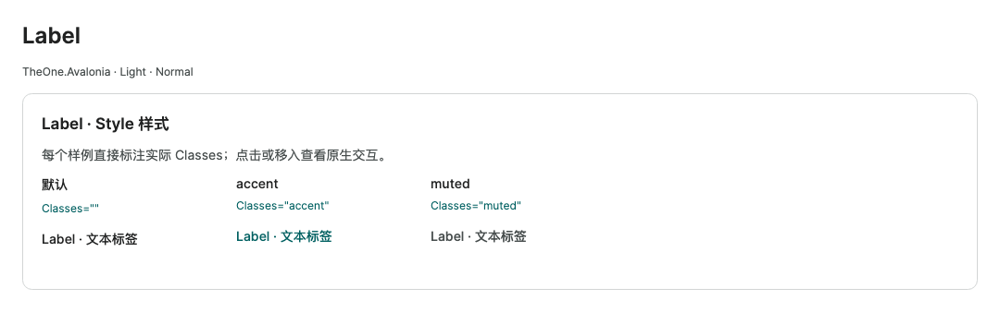
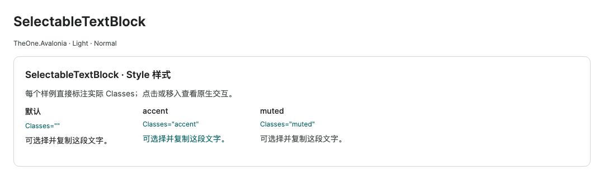

# 文本展示与字段标签

历史命令行验证入口与消费测试项目已移除，文中的专项覆盖和测量结果为历史记录。请正常启动 PreviewHost，从菜单进入对应控件演示页；目标平台行为需在实际应用中验证。

**简体中文** · [English](../en/text-display.md)

TextBlock 用于普通只读文字；SelectableTextBlock 用于需要选择和复制的只读内容；Label 用于关联输入控件的字段标题。三者加载 OneTheme 后使用统一文字色、字体和继承的尺寸。

```xml
<StackPanel Spacing="8">
  <Label Content="工作区名称" Target="{Binding #WorkspaceName}" />
  <TextBox Name="WorkspaceName" Text="{Binding Name, Mode=TwoWay}" />
  <TextBlock Text="修改后立即生效" Foreground="{DynamicResource One.Muted}" />
  <SelectableTextBlock Text="{Binding Description}" TextWrapping="Wrap" />
</StackPanel>
```

视图声明 VM 的 x:DataType。Label 的 Content / ContentTemplate 支持文字或有类型模板，Target 关联实际输入控件；访问键及焦点交给原生机制处理。不要用普通 TextBlock 替代需要输入关联的 Label。

TextBlock 和 SelectableTextBlock 支持 Text、Inlines、TextWrapping、TextTrimming、FontSize、FontWeight、LineHeight、TextAlignment。长文本启用换行并提供有限宽度；标题或业务强调可显式覆盖字体和语义色，不需要另建包装控件。

SelectableTextBlock 保留原生 SelectionStart / SelectionEnd、SelectedText、鼠标选择及平台复制快捷键。文本变化后选择范围由原生控件校正；需要编辑时使用 TextBox。SelectionBrush 映射 One.TextSelection；SelectionForegroundBrush 默认为空，保留各 Inline 的文字格式，也可局部覆盖。明暗切换保留选择范围。

small / normal / large 正文字号为 12 / 14 / 16 px，Label 与输入行共享最小高度。显式 FontSize、LineHeight 等局部值优先。不要为只读段落固定单行 Height，以免换行或字体缩放被裁切。

<!-- visual-guide:start -->
## 外观与场景图示

[配图口径与控件图鉴](visual-index.md)；下图是当前源码的真实渲染，绑定与交互以本页用法说明为准。

### Label



标签的默认与语义样式，展示正文色和强调色的区别。

[查看 Dark 对照](../images/Label-dark.png)

### SelectableTextBlock



可选择文本的主题表现，保留原生选择与复制。

[查看 Dark 对照](../images/SelectableTextBlock-dark.png)

<!-- visual-guide:end -->

<!-- generated-contracts:start -->
## 专属属性、Classes 用法与业务 API

本节只列本项目的专属属性、公开 Classes 用法、实际业务动作及关联模型，不重复原生继承 API、构造器、属性 Get/Set 包装或公开标识符。注册默认值与主题生效值不同，显式局部值优先。PreviewHost 用实际标签样例展示 Classes，不展示模板选择器／Setter 明细；Description 中的属性与业务动作附短用法代码。ControlSizing、Motion 等通用配置集中在 Home。仅 Button、Input、Select 合并比较，其余控件保留独立完整示例。

本页的原生控件没有同名 TheOne 包装类；本项目增加的能力来自下列样式。

尺寸、动效等通用配置见[统一主题说明](../../theme/zh-cn/README.md#shared-configuration)，PreviewHost 在 Home 集中演示。

### Classes 用法

- `Label`: `Classes="accent"` / `Classes="muted"`
- `SelectableTextBlock`: `Classes="accent"` / `Classes="muted"`

以上是分别使用的公开类名；悬停、按下、禁用和选中等状态由控件维护，不手工添加模板类。实际外观见 PreviewHost 的标签样例。

### 业务 API

没有额外业务方法；通过本节专属属性配置。

### 关联模型

没有额外关联数据模型。

[完整源码契约（含构造、属性访问器和标识符，供精确查阅）](../../api/zh-cn/README.md)
<!-- generated-contracts:end -->
