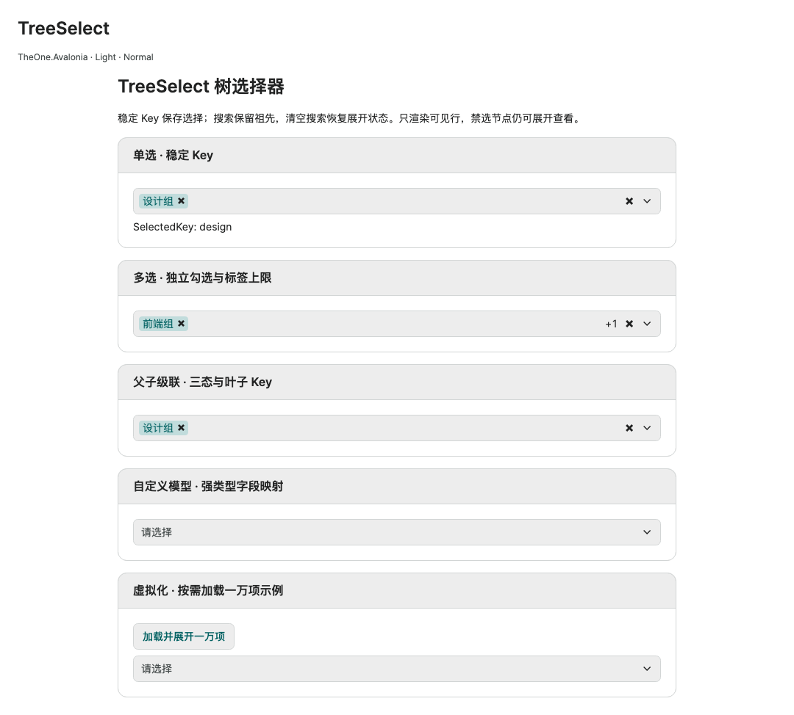

# TreeSelect 树选择器

[English](../en/tree-select.md) · [控件目录](README.md) · [扩展路线图](../../plans/control-and-chart-roadmap.md)

加载 OneTheme 后使用 `TheOne.Avalonia.Controls.TreeSelect`。单选默认允许选择任意可用节点；多选可独立勾选或父子级联。选择保存稳定 Key，更换为同 Key 的新实例后，选中项指向新实例。使用有界原生虚拟 ListBox，不为所有节点创建 Control。

<!-- visual-guide:start -->
## 外观与场景图示

[配图口径与控件图鉴](visual-index.md)；下图是当前源码的真实渲染，绑定与交互以本页用法说明为准。

### TreeSelect



单选、独立多选、父子级联和自定义模型示例，持久化时保存稳定 Key。

[查看 Dark 对照](../images/TreeSelect-dark.png)

### TreeSelect · 树形弹层


展开后的树形选项保留祖先与缩进；显示文字与持久化 Key 分离。

[查看 Dark 对照](../images/TreeSelectPopup-dark.png)

<!-- visual-guide:end -->

## 默认模型与绑定

```csharp
public ObservableCollection<TreeSelectNode> Departments { get; } =
[
    new() { Key = "engineering", Text = "研发中心", Children =
    [ new() { Key = "frontend", Text = "前端组" }, new() { Key = "backend", Text = "后端组" } ] }
];
```

```xml
<!-- 根视图声明实际 ViewModel 的 x:DataType；one 为 using:TheOne.Avalonia.Controls。 -->
<one:TreeSelect ItemsSource="{CompiledBinding Departments}"
                SelectedKey="{CompiledBinding DepartmentKey, Mode=TwoWay}" />
<one:TreeSelect IsMultiSelect="True" CheckMode="Cascade" MaxVisibleTags="1"
                ItemsSource="{CompiledBinding Departments}"
                SelectedKeys="{CompiledBinding DepartmentKeys, Mode=TwoWay}" />
```

TreeSelectNode 实现属性通知，包含 Key（object）、Text（string）、IsEnabled（bool，默认 true）、可替换的 Children（ObservableCollection&lt;TreeSelectNode&gt;?，默认空集合）。null Children 表示叶子。Key 非 null、按 Equals 全树唯一且稳定；默认生成的 Key 只在实例生命周期稳定，持久化和重载必须显式使用业务 Key，不要修改已挂载模型的 Key。

单选绑定 SelectedKey 或 SelectedItem，多选绑定 SelectedKeys，不要同时绑定到互相冲突的业务属性。SelectedItems 只读返回原始模型。多选时 SelectedKey/SelectedItem 表示第一项，写入任一属性会替换整个选择。切回单选保留第一项。SelectedKeys 支持 IList 整体 TwoWay 替换和可观察集合原地变更；尽量修改原可写集合，固定长度/只读集合需要时替换。重复和有效源中不存在的 Key 会被清理。

配置可在挂载前赋值；ItemsSource 尚为 null 时允许等待 Key，第一次非 null 源会清理缺失 Key。清空已加载的源会清空选择。

## 自定义模型与编译模板

```csharp
public TreeSelectItemAdapter DepartmentAdapter { get; } =
    TreeSelectItemAdapter.Create<Department>(
        item => item.Id, item => item.Name, item => item.Teams, item => item.IsEnabled);
```

```xml
<one:TreeSelect ItemsSource="{CompiledBinding Departments}"
                ItemAdapter="{CompiledBinding DepartmentAdapter}"
                SelectedKey="{CompiledBinding DepartmentKey, Mode=TwoWay}">
  <one:TreeSelect.ItemTemplate>
    <DataTemplate x:DataType="vm:Department">
      <TextBlock Text="{CompiledBinding Name}" />
    </DataTemplate>
  </one:TreeSelect.ItemTemplate>
</one:TreeSelect>
```

适配器依次指定稳定 Key、展示/搜索文字、IEnumerable? 子项和可选可用状态。使用强类型 getter，不按字符串反射属性，兼容裁剪。ItemTemplate / SelectedItemTemplate 接收原始模型，默认显示适配器文字；自定义模板声明自己的 x:DataType。无适配器时只接受 TreeSelectNode。

## 额外属性与勾选规则

| 属性 | 默认与说明 |
| --- | --- |
| ItemsSource / ItemAdapter | IEnumerable? 根集合 / 可选强类型模型映射 |
| IsMultiSelect / CheckMode | false / Independent；单选忽略勾选模式 |
| SelectedKey / SelectedItem | object?，TwoWay；单项 Key / 原始对象 |
| SelectedKeys | IList?，TwoWay；默认独立可观察集合 |
| ItemTemplate / SelectedItemTemplate | null；列表 / 标签模板 |
| SearchText | 空字符串，TwoWay；忽略大小写搜索，保留匹配节点的祖先 |
| PlaceholderText / SearchPlaceholderText | “请选择” / “搜索节点” |
| EmptyText / ClearText / OpenText | “无匹配节点” / “清空可编辑选择” / “展开或收起树”；空状态及可访问操作文字 |
| IsReadOnly / IsDropDownOpen | false / false；浏览不改变选择 / TwoWay 展开状态 |
| MaxVisibleTags | 3，0–100；单选显示一项，多选超出显示 +N，0 仅计数 |
| MaxDropDownHeight | 320 DIP，有限且 ≥80；列表视口高度上限 |

```xml
<one:TreeSelect ItemsSource="{CompiledBinding Departments}" IsMultiSelect="True"
                SearchText="{CompiledBinding Filter, Mode=TwoWay}" MaxVisibleTags="1"
                MaxDropDownHeight="280" IsReadOnly="{CompiledBinding IsLocked}" />
```

Independent 父子分别保存 Key。Cascade 切换父项的全部可用叶子，Key 仅保存叶子；程序传父 Key 时展开为可用叶子 Key。父项从可用叶子派生 true / false / null 三态。禁用节点的子树不能编辑但仍可展开查看；预选禁用叶子不能移除或清空，不参与父项全选判断。搜索不缩小级联范围，清空搜索恢复原展开状态。

无额外公开外观 Classes；明暗、配色和三档尺寸遵循 Home。只读状态：VisibleItems、DisplayTags、SelectedItems、SelectedCount、HiddenSelectedCount、HasSelection、HasHiddenSelection、HasNoResults、CanClear、ValidationError、ItemHeight。TreeSelectItem 是展示行，含 Item、Key、Text、Depth/Indent、HasChildren、IsExpanded、IsEnabled、IsChecked、ShowCheckBox、CanRemove、展开/移除文字和模板展示信息；持久化保存模型 Key，不保存展示行。

## 业务 API 与输入

```csharp
tree.SetExpanded("engineering", true); // bool；搜索时不改写展开状态
bool opened = tree.OpenDropDown();
tree.CloseDropDown();
bool changed = tree.ToggleItem(department); // 原始模型，遵守只读和禁选
bool cleared = tree.ClearSelection(); // 保留已选禁用项
tree.RefreshItems(); // 无通知模型变化后显式重新读取
tree.SelectionChanged += (_, e) => SaveKeys(tree.SelectedKeys);
```

SelectionChanged 为冒泡事件，AddedItems/RemovedItems 为原始模型。API、模型与集合变更在 UI 线程执行。

Enter/Space/↓、Alt+↓ 或 F4 打开；搜索中 ↓ 进入列表，列表 ↑↓ 移动、→ 展开、← 折叠或回父项、Enter/Space 选择；Esc 关闭返回焦点；Tab/Shift+Tab 继续焦点导航。字段聚焦且搜索为空时 Backspace 移除最后一个可编辑标签。展开按钮不改变选择。滚轮、触摸滚动和惯性阶段在弹层边界截断，防止影响外层页面。

## 集合生命周期与范围

可观察集合 Add/Remove/Move/Replace/Reset、根源/子项替换及 INotifyPropertyChanged 会重新核对索引；保留有效选择和展开 Key，旧集合/模型解除订阅。搜索只筛选缓存，不重新读取适配器或重建订阅。脱离视觉树解除订阅，重新挂载读取最新数据。

重复 Key、null 节点、循环或重复模型引用通过 ValidationError 报告且不显示旧行；修复可观察源后恢复。刷新会扫描整棵模型树，虚拟化的是行视图，不是懒加载数据。首版没有内置异步子项加载器、拖动排序和服务请求；宿主更新可观察 Children 并负责取消过期请求。极深层级缩进有上限，长路径可用自定义模板/提示补充。

独立 PreviewHost 页包含单选、独立多选、级联、自定义模型、标签上限及按需加载一万节点示例。

精确声明：[TreeSelect](../../api/zh-cn/TheOne.Avalonia.Controls.TreeSelect.md)、[默认模型](../../api/zh-cn/TheOne.Avalonia.Controls.TreeSelectNode.md)、[适配器](../../api/zh-cn/TheOne.Avalonia.Controls.TreeSelectItemAdapter.md)、[展示行](../../api/zh-cn/TheOne.Avalonia.Controls.TreeSelectItem.md)、[勾选枚举](../../api/zh-cn/TheOne.Avalonia.Controls.TreeSelectCheckMode.md)。

<!-- generated-contracts:start -->
## 专属属性、Classes 用法与业务 API

本节只列本项目的专属属性、公开 Classes 用法、实际业务动作及关联模型，不重复原生继承 API、构造器、属性 Get/Set 包装或公开标识符。注册默认值与主题生效值不同，显式局部值优先。PreviewHost 用实际标签样例展示 Classes，不展示模板选择器／Setter 明细；Description 中的属性与业务动作附短用法代码。ControlSizing、Motion 等通用配置集中在 Home。仅 Button、Input、Select 合并比较，其余控件保留独立完整示例。

### TreeSelect

[完整源码契约](../../api/zh-cn/TheOne.Avalonia.Controls.TreeSelect.md)

| 属性 | 类型 | 读写／绑定／继承 | 注册或模型初值 | 说明与约束 |
| --- | --- | --- | --- | --- |
| [`CanClear`](../../../TheOne.Avalonia/Controls/TreeSelect.Properties.cs#L132) | `bool` | 只读; OneWay | `computed / state` | 只读运行状态或派生结果；由对应控件／模型更新，供展示和命令条件读取，不作为双向输入。 |
| [`CheckMode`](../../../TheOne.Avalonia/Controls/TreeSelect.Properties.cs#L35) | `TheOne.Avalonia.Controls.TreeSelectCheckMode` | 可写; OneWay | `TreeSelectCheckMode.Independent` | false / Independent；单选忽略勾选模式 校验：`value => Enum.IsDefined(value)` 可选值：`Independent`, `Cascade` |
| [`ClearText`](../../../TheOne.Avalonia/Controls/TreeSelect.Properties.cs#L67) | `string` | 可写; OneWay | `"清空可编辑选择"` | “无匹配节点” / “清空可编辑选择” / “展开或收起树”；空状态及可访问操作文字 |
| [`DisplayTags`](../../../TheOne.Avalonia/Controls/TreeSelect.Properties.cs#L97) | `System.Collections.Generic.IReadOnlyList<TheOne.Avalonia.Controls.TreeSelectItem>` | 只读; OneWay | `computed / state` | 只读运行状态或派生结果；由对应控件／模型更新，供展示和命令条件读取，不作为双向输入。 |
| [`EmptyText`](../../../TheOne.Avalonia/Controls/TreeSelect.Properties.cs#L63) | `string` | 可写; OneWay | `"无匹配节点"` | “无匹配节点” / “清空可编辑选择” / “展开或收起树”；空状态及可访问操作文字 |
| [`HasHiddenSelection`](../../../TheOne.Avalonia/Controls/TreeSelect.Properties.cs#L122) | `bool` | 只读; OneWay | `computed / state` | 只读运行状态或派生结果；由对应控件／模型更新，供展示和命令条件读取，不作为双向输入。 |
| [`HasNoResults`](../../../TheOne.Avalonia/Controls/TreeSelect.Properties.cs#L127) | `bool` | 只读; OneWay | `computed / state` | 只读运行状态或派生结果；由对应控件／模型更新，供展示和命令条件读取，不作为双向输入。 |
| [`HasSelection`](../../../TheOne.Avalonia/Controls/TreeSelect.Properties.cs#L117) | `bool` | 只读; OneWay | `computed / state` | 只读运行状态或派生结果；由对应控件／模型更新，供展示和命令条件读取，不作为双向输入。 |
| [`HiddenSelectedCount`](../../../TheOne.Avalonia/Controls/TreeSelect.Properties.cs#L112) | `int` | 只读; OneWay | `computed / state` | 只读运行状态或派生结果；由对应控件／模型更新，供展示和命令条件读取，不作为双向输入。 |
| [`IsDropDownOpen`](../../../TheOne.Avalonia/Controls/TreeSelect.Properties.cs#L79) | `bool` | 可写; TwoWay | `false` | false / false；浏览不改变选择 / TwoWay 展开状态 |
| [`IsMultiSelect`](../../../TheOne.Avalonia/Controls/TreeSelect.Properties.cs#L31) | `bool` | 可写; OneWay | `false` | false / Independent；单选忽略勾选模式 |
| [`IsReadOnly`](../../../TheOne.Avalonia/Controls/TreeSelect.Properties.cs#L75) | `bool` | 可写; OneWay | `false` | false / false；浏览不改变选择 / TwoWay 展开状态 |
| [`ItemAdapter`](../../../TheOne.Avalonia/Controls/TreeSelect.Properties.cs#L39) | `TheOne.Avalonia.Controls.TreeSelectItemAdapter?` | 可写; OneWay | `null` | IEnumerable? 根集合 / 可选强类型模型映射 |
| [`ItemHeight`](../../../TheOne.Avalonia/Controls/TreeSelect.Properties.cs#L142) | `double` | 只读; OneWay | `computed / state` | 单项／滚轮单元的 DIP 高度；主题密度和显式局部值可能覆盖注册初值。 |
| [`ItemTemplate`](../../../TheOne.Avalonia/Controls/TreeSelect.Properties.cs#L43) | `Avalonia.Controls.Templates.IDataTemplate?` | 可写; OneWay | `null` | null；列表 / 标签模板 |
| [`ItemsSource`](../../../TheOne.Avalonia/Controls/TreeSelect.Properties.cs#L15) | `System.Collections.IEnumerable?` | 可写; OneWay | `null` | IEnumerable? 根集合 / 可选强类型模型映射 |
| [`MaxDropDownHeight`](../../../TheOne.Avalonia/Controls/TreeSelect.Properties.cs#L87) | `double` | 可写; OneWay | `320` | 320 DIP，有限且 ≥80；列表视口高度上限 校验：`value => double.IsFinite(value) && value >= 80` |
| [`MaxVisibleTags`](../../../TheOne.Avalonia/Controls/TreeSelect.Properties.cs#L83) | `int` | 可写; OneWay | `3` | 3，0–100；单选显示一项，多选超出显示 +N，0 仅计数 校验：`value => value is >= 0 and <= 100` |
| [`OpenText`](../../../TheOne.Avalonia/Controls/TreeSelect.Properties.cs#L71) | `string` | 可写; OneWay | `"展开或收起树"` | “无匹配节点” / “清空可编辑选择” / “展开或收起树”；空状态及可访问操作文字 |
| [`PlaceholderText`](../../../TheOne.Avalonia/Controls/TreeSelect.Properties.cs#L55) | `string` | 可写; OneWay | `"请选择"` | “请选择” / “搜索节点” |
| [`SearchPlaceholderText`](../../../TheOne.Avalonia/Controls/TreeSelect.Properties.cs#L59) | `string` | 可写; OneWay | `"搜索节点"` | “请选择” / “搜索节点” |
| [`SearchText`](../../../TheOne.Avalonia/Controls/TreeSelect.Properties.cs#L51) | `string` | 可写; TwoWay | `""` | 空字符串，TwoWay；忽略大小写搜索，保留匹配节点的祖先 |
| [`SelectedCount`](../../../TheOne.Avalonia/Controls/TreeSelect.Properties.cs#L107) | `int` | 只读; OneWay | `computed / state` | 只读运行状态或派生结果；由对应控件／模型更新，供展示和命令条件读取，不作为双向输入。 |
| [`SelectedItem`](../../../TheOne.Avalonia/Controls/TreeSelect.Properties.cs#L27) | `object?` | 可写; TwoWay | `null` | object?，TwoWay；单项 Key / 原始对象 |
| [`SelectedItemTemplate`](../../../TheOne.Avalonia/Controls/TreeSelect.Properties.cs#L47) | `Avalonia.Controls.Templates.IDataTemplate?` | 可写; OneWay | `null` | null；列表 / 标签模板 |
| [`SelectedItems`](../../../TheOne.Avalonia/Controls/TreeSelect.Properties.cs#L102) | `System.Collections.Generic.IReadOnlyList<object>` | 只读; OneWay | `computed / state` | 多选模型集合；元素必须来自源集合，变更与清空行为遵循控件的禁选／只读契约。 |
| [`SelectedKey`](../../../TheOne.Avalonia/Controls/TreeSelect.Properties.cs#L23) | `object?` | 可写; TwoWay | `null` | object?，TwoWay；单项 Key / 原始对象 |
| [`SelectedKeys`](../../../TheOne.Avalonia/Controls/TreeSelect.Properties.cs#L19) | `System.Collections.IList?` | 可写; TwoWay | `null` | IList?，TwoWay；默认独立可观察集合 |
| [`ValidationError`](../../../TheOne.Avalonia/Controls/TreeSelect.Properties.cs#L137) | `string?` | 只读; OneWay | `computed / state` | 只读运行状态或派生结果；由对应控件／模型更新，供展示和命令条件读取，不作为双向输入。 |
| [`VisibleItems`](../../../TheOne.Avalonia/Controls/TreeSelect.Properties.cs#L92) | `System.Collections.Generic.IReadOnlyList<TheOne.Avalonia.Controls.TreeSelectItem>` | 只读; OneWay | `computed / state` | 只读运行状态或派生结果；由对应控件／模型更新，供展示和命令条件读取，不作为双向输入。 |

### TreeSelectCheckMode

[完整源码契约](../../api/zh-cn/TheOne.Avalonia.Controls.TreeSelectCheckMode.md)

没有在该类型上另外声明 CLR／附加属性；继承成员见其基类。

### TreeSelectItem

[完整源码契约](../../api/zh-cn/TheOne.Avalonia.Controls.TreeSelectItem.md)

| 属性 | 类型 | 读写／绑定／继承 | 注册或模型初值 | 说明与约束 |
| --- | --- | --- | --- | --- |
| [`CanRemove`](../../../TheOne.Avalonia/Controls/TreeSelectItem.cs#L28) | `bool` | 只读; CLR / n/a | `accessor-defined / state` | 只读运行状态或派生结果；由对应控件／模型更新，供展示和命令条件读取，不作为双向输入。 |
| [`ContentTemplate`](../../../TheOne.Avalonia/Controls/TreeSelectItem.cs#L33) | `Avalonia.Controls.Templates.IDataTemplate?` | 只读; CLR / n/a | `accessor-defined / state` | 原生数据模板扩展点；保持正确 x:DataType，模板数据作用域见本控件接入章节。 |
| [`Depth`](../../../TheOne.Avalonia/Controls/TreeSelectItem.cs#L21) | `int` | 只读; CLR / n/a | `accessor-defined / state` | 节点深度，根级从 0 开始；用于计算缩进。 |
| [`DisplayContent`](../../../TheOne.Avalonia/Controls/TreeSelectItem.cs#L32) | `object` | 只读; CLR / n/a | `accessor-defined / state` | 只读运行状态或派生结果；由对应控件／模型更新，供展示和命令条件读取，不作为双向输入。 |
| [`ExpandText`](../../../TheOne.Avalonia/Controls/TreeSelectItem.cs#L30) | `string` | 只读; CLR / n/a | `accessor-defined / state` | 只读运行状态或派生结果；由对应控件／模型更新，供展示和命令条件读取，不作为双向输入。 |
| [`ExpansionGlyph`](../../../TheOne.Avalonia/Controls/TreeSelectItem.cs#L29) | `string` | 只读; CLR / n/a | `accessor-defined / state` | 只读运行状态或派生结果；由对应控件／模型更新，供展示和命令条件读取，不作为双向输入。 |
| [`HasChildren`](../../../TheOne.Avalonia/Controls/TreeSelectItem.cs#L23) | `bool` | 只读; CLR / n/a | `accessor-defined / state` | 节点是否存在子项；用于显示展开入口，不代表当前已展开。 |
| [`Indent`](../../../TheOne.Avalonia/Controls/TreeSelectItem.cs#L22) | `Avalonia.Thickness` | 只读; CLR / n/a | `accessor-defined / state` | 每一级层次增加的 DIP 缩进；不改变父子关系。 |
| [`IsChecked`](../../../TheOne.Avalonia/Controls/TreeSelectItem.cs#L26) | `bool?` | 只读; CLR / n/a | `accessor-defined / state` | 报表复选框元素的勾选状态。 |
| [`IsEnabled`](../../../TheOne.Avalonia/Controls/TreeSelectItem.cs#L24) | `bool` | 只读; CLR / n/a | `accessor-defined / state` | 业务可用性；不可用项的选择、移除和命令行为遵循控件禁用规则。 |
| [`IsExpanded`](../../../TheOne.Avalonia/Controls/TreeSelectItem.cs#L25) | `bool` | 只读; CLR / n/a | `accessor-defined / state` | 当前节点展开状态；需要在回收或数据重新加载后保留时，将其绑定到稳定模型。 |
| [`Item`](../../../TheOne.Avalonia/Controls/TreeSelectItem.cs#L18) | `object` | 只读; CLR / n/a | `accessor-defined / state` | 只读运行状态或派生结果；由对应控件／模型更新，供展示和命令条件读取，不作为双向输入。 |
| [`Key`](../../../TheOne.Avalonia/Controls/TreeSelectItem.cs#L19) | `object` | 只读; CLR / n/a | `accessor-defined / state` | 字段／参数键，用于关联业务值；与显示名称分开维护。 |
| [`RemoveText`](../../../TheOne.Avalonia/Controls/TreeSelectItem.cs#L31) | `string` | 只读; CLR / n/a | `accessor-defined / state` | 只读运行状态或派生结果；由对应控件／模型更新，供展示和命令条件读取，不作为双向输入。 |
| [`ShowCheckBox`](../../../TheOne.Avalonia/Controls/TreeSelectItem.cs#L27) | `bool` | 只读; CLR / n/a | `accessor-defined / state` | 只读运行状态或派生结果；由对应控件／模型更新，供展示和命令条件读取，不作为双向输入。 |
| [`TagContent`](../../../TheOne.Avalonia/Controls/TreeSelectItem.cs#L34) | `object` | 只读; CLR / n/a | `accessor-defined / state` | 只读运行状态或派生结果；由对应控件／模型更新，供展示和命令条件读取，不作为双向输入。 |
| [`TagTemplate`](../../../TheOne.Avalonia/Controls/TreeSelectItem.cs#L35) | `Avalonia.Controls.Templates.IDataTemplate?` | 只读; CLR / n/a | `accessor-defined / state` | 原生数据模板扩展点；保持正确 x:DataType，模板数据作用域见本控件接入章节。 |
| [`Text`](../../../TheOne.Avalonia/Controls/TreeSelectItem.cs#L20) | `string` | 只读; CLR / n/a | `accessor-defined / state` | 文本输入／显示值；变更通知和校验按所在模型或原生输入契约处理。 |

### TreeSelectItemAdapter

[完整源码契约](../../api/zh-cn/TheOne.Avalonia.Controls.TreeSelectItemAdapter.md)

没有在该类型上另外声明 CLR／附加属性；继承成员见其基类。

### TreeSelectNode

[完整源码契约](../../api/zh-cn/TheOne.Avalonia.Controls.TreeSelectNode.md)

| 属性 | 类型 | 读写／绑定／继承 | 注册或模型初值 | 说明与约束 |
| --- | --- | --- | --- | --- |
| [`Children`](../../../TheOne.Avalonia/Controls/TreeSelectNode.cs#L17) | `System.Collections.ObjectModel.ObservableCollection<TheOne.Avalonia.Controls.TreeSelectNode>?` | 可写; CLR / n/a | `[]` | 子级模型集合；保持父子与对象身份，避免循环和跨父级共享可变节点。 |
| [`IsEnabled`](../../../TheOne.Avalonia/Controls/TreeSelectNode.cs#L16) | `bool` | 可写; CLR / n/a | `true` | 业务可用性；不可用项的选择、移除和命令行为遵循控件禁用规则。 |
| [`Key`](../../../TheOne.Avalonia/Controls/TreeSelectNode.cs#L14) | `object` | 可写; CLR / n/a | `Guid.NewGuid().ToString("N")` | 字段／参数键，用于关联业务值；与显示名称分开维护。 |
| [`Text`](../../../TheOne.Avalonia/Controls/TreeSelectNode.cs#L15) | `string` | 可写; CLR / n/a | `""` | 文本输入／显示值；变更通知和校验按所在模型或原生输入契约处理。 |

尺寸、动效等通用配置见[统一主题说明](../../theme/zh-cn/README.md#shared-configuration)，PreviewHost 在 Home 集中演示。

### Classes 用法

没有额外公开外观类，使用默认主题及专属属性。

以上是分别使用的公开类名；悬停、按下、禁用和选中等状态由控件维护，不手工添加模板类。实际外观见 PreviewHost 的标签样例。

### 业务 API

| 类型 | 动作签名 | 用途 |
| --- | --- | --- |
| [`TreeSelect`](../../api/zh-cn/TheOne.Avalonia.Controls.TreeSelect.md) | `bool TreeSelect.OpenDropDown()` | 打开多选弹层并聚焦搜索；控件必须已挂载且可用，返回是否打开。 |
| [`TreeSelect`](../../api/zh-cn/TheOne.Avalonia.Controls.TreeSelect.md) | `void TreeSelect.CloseDropDown()` | 关闭多选弹层，按交互上下文将焦点返回输入区。 |
| [`TreeSelect`](../../api/zh-cn/TheOne.Avalonia.Controls.TreeSelect.md) | `void TreeSelect.RefreshItems()` | Re-read model structure and mapping; search alone never rebuilds subscriptions. |
| [`TreeSelect`](../../api/zh-cn/TheOne.Avalonia.Controls.TreeSelect.md) | `bool TreeSelect.ToggleItem(object item)` | Toggle a model's selection. Cascade affects enabled leaves only; disabled selections remain locked. |
| [`TreeSelect`](../../api/zh-cn/TheOne.Avalonia.Controls.TreeSelect.md) | `bool TreeSelect.ClearSelection()` | Clear editable selections; selected disabled nodes remain. |
| [`TreeSelect`](../../api/zh-cn/TheOne.Avalonia.Controls.TreeSelect.md) | `bool TreeSelect.SetExpanded(object key, bool expanded)` |  |
| [`TreeSelectItemAdapter`](../../api/zh-cn/TheOne.Avalonia.Controls.TreeSelectItemAdapter.md) | `abstract object TreeSelectItemAdapter.GetKey(object item)` |  |
| [`TreeSelectItemAdapter`](../../api/zh-cn/TheOne.Avalonia.Controls.TreeSelectItemAdapter.md) | `abstract string TreeSelectItemAdapter.GetText(object item)` | 使用已配置的类型化适配器读取原始模型显示／搜索文本。 |
| [`TreeSelectItemAdapter`](../../api/zh-cn/TheOne.Avalonia.Controls.TreeSelectItemAdapter.md) | `abstract IEnumerable? TreeSelectItemAdapter.GetChildren(object item)` |  |
| [`TreeSelectItemAdapter`](../../api/zh-cn/TheOne.Avalonia.Controls.TreeSelectItemAdapter.md) | `virtual bool TreeSelectItemAdapter.IsEnabled(object item)` | 使用适配器判断原始模型能否参与用户选择。 |

### 事件订阅

按需订阅下列通知，并在宿主释放时解除订阅；这里只列事件入口，不列路由事件标识字段。

| 类型 | 事件 | 用途 |
| --- | --- | --- |
| [`TreeSelect`](../../api/zh-cn/TheOne.Avalonia.Controls.TreeSelect.md) | `SelectionChanged` | 状态／操作通知；在宿主生命周期内订阅并在释放时解除，事件参数类型见签名。 |
| [`TreeSelectItem`](../../api/zh-cn/TheOne.Avalonia.Controls.TreeSelectItem.md) | `PropertyChanged` | 状态／操作通知；在宿主生命周期内订阅并在释放时解除，事件参数类型见签名。 |
| [`TreeSelectNode`](../../api/zh-cn/TheOne.Avalonia.Controls.TreeSelectNode.md) | `PropertyChanged` | 状态／操作通知；在宿主生命周期内订阅并在释放时解除，事件参数类型见签名。 |

### 关联模型

| 模型 | 属性／枚举值 |
| --- | ---: |
| [`TheOne.Avalonia.Controls.TreeSelectCheckMode`](../../api/zh-cn/TheOne.Avalonia.Controls.TreeSelectCheckMode.md) | 2 |
| [`TheOne.Avalonia.Controls.TreeSelectItem`](../../api/zh-cn/TheOne.Avalonia.Controls.TreeSelectItem.md) | 18 |
| [`TheOne.Avalonia.Controls.TreeSelectNode`](../../api/zh-cn/TheOne.Avalonia.Controls.TreeSelectNode.md) | 4 |

[完整源码契约（含构造、属性访问器和标识符，供精确查阅）](../../api/zh-cn/README.md)
<!-- generated-contracts:end -->
