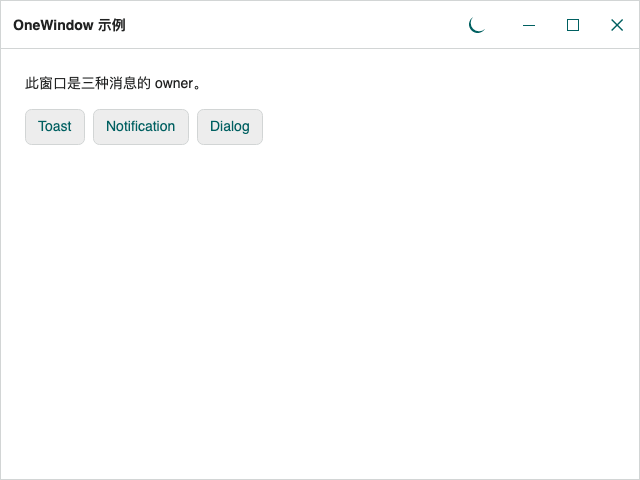
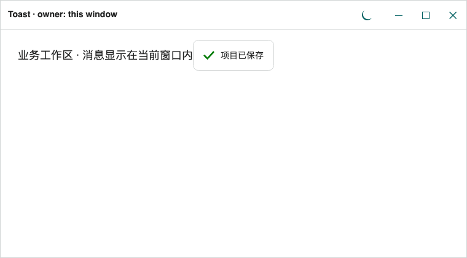
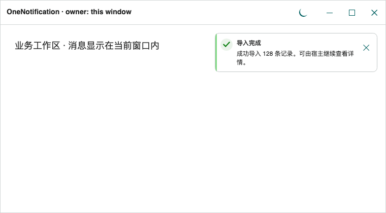
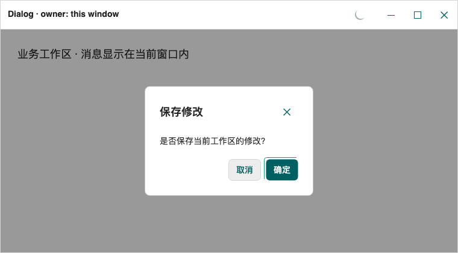

# 窗口 owner 与 Toast、Notification、Dialog

**简体中文** · [English](../en/window-owners.md)

`OneWindow` 和 `LoginWindow` 都自带独立的 Toast、Notification 和 Dialog 宿主。消息显示在所属窗口内部；这里的 Notification 是应用内通知。先加载 `OneTheme`，再显示窗口，最后调用服务。窗口模板、主题和基础用法见 [OneWindow](windows.md)，登录交接见 [LoginWindow](login-window.md)。

<!-- visual-guide:start -->
## 外观与场景图示

[配图口径与控件图鉴](visual-index.md)；下图是当前源码的真实渲染，绑定与交互以本页用法说明为准。

### OneWindow



实际主题窗口客户区和自绘标题栏；操作系统外部窗口装饰不在图片范围内。

[查看 Dark 对照](../images/OneWindow-dark.png)

### Toast



成功提示显示在所属窗口顶部中央；仅正文和状态图标，不要求用户确认。

[查看 Dark 对照](../images/Toast-dark.png)

### OneNotification



标题、正文与关闭入口显示在所属窗口右上角；不是系统通知。

[查看 Dark 对照](../images/OneNotification-dark.png)

### Dialog



实际窗口内模态层覆盖工作区，包含标题、正文及确认/取消操作。

[查看 Dark 对照](../images/Dialog-dark.png)

<!-- visual-guide:end -->

## 四种归属概念

| 概念 | 作用 |
| --- | --- |
| 原生 `Window.Owner` | `child.Show(parent)` / `child.ShowDialog<T>(parent)` 建立的原生窗口所属关系，影响平台窗口生命周期。 |
| `desktop.MainWindow` | 桌面应用的主窗口，参与 `ShutdownMode` 的退出策略。 |
| `OneToast.Owner`、`OneNotification.Owner`、`OneDialog.Owner` | 三个服务各自的默认消息目标。 |
| 调用参数 `owner:` | 仅指定本次显示或清理的目标，不改变默认 Owner，也不建立原生所属关系。 |

例如，详情窗口由主窗口拥有，仍可分别向两个窗口显示消息：

```csharp
using TheOne.Avalonia.Controls;

var detail = new OneWindow { Title = "详情" };
detail.Show(mainWindow); // 原生 Owner 是 mainWindow。
OneToast.Show("详情已加载", owner: detail);
await OneDialog.ShowAsync("确认", "是否保存主窗口的修改？", owner: mainWindow);
```

单独修改 `desktop.MainWindow`、DataContext 或原生 Owner 不会为普通 `Window` 添加消息宿主。普通 `Window` 即使应用了 OneTheme，也不能作为这些服务的目标。

## owner 如何解析

每次调用按以下顺序选择目标：

1. 显式传入非空 `owner`：必须是已登记、已打开且可见的 `OneWindow` 或 `LoginWindow`；否则抛出 `InvalidOperationException`，不会转到其他窗口。
2. 未传 owner 或传入 null：使用该服务可用的默认 `Owner`。
3. 默认 Owner 已隐藏、关闭、尚未打开或弱引用失效：回退到最近打开／激活的可见主题窗口。
4. 没有可用窗口：抛出 `InvalidOperationException`。

可用性依据登记信息、`IsVisible` 和平台窗口实例；没有单独排除最小化状态。因此不要把最小化等同于 `Hide()`，也不要把默认 Owner 当成始终处于前台的保证。

三个默认 Owner 都是弱引用，可在 UI 线程分别设置。给属性赋普通 `Window` 会抛出 `ArgumentException`。给尚未打开的主题窗口赋值本身允许，但显示消息时仍会检查可用性。

```csharp
OneToast.Owner = mainWindow;
OneNotification.Owner = mainWindow;
OneDialog.Owner = mainWindow;
```

任意 `OneWindow` / `LoginWindow` 打开或激活时，会自动把三个默认 Owner 都更新为该窗口。手动赋值不会永久锁定路由；多窗口业务优先传显式 owner。窗口关闭时，仅把仍指向它的默认值替换成可见窗口回退值，没有回退窗口则置空。

读取 `Owner` 得到的是保存的弱引用目标，不会执行回退解析。设为 null 仅清除该默认值，不会禁用服务，后续调用仍可回退。`OneWindow.Current` 返回最近可见的 `OneWindow`，不包含 `LoginWindow`；它也不是某次后台操作的来源窗口。

## 多窗口与后台操作

在用户发起操作时保存目标窗口，并在完成后显式传入，避免等待期间激活其他窗口导致消息换目标：

```csharp
// 在来源窗口的事件处理器中。
var messageOwner = this; // this 是 OneWindow 或 LoginWindow。
await SaveAsync(cancellationToken);
await OneToast.ShowAsync("已保存", owner: messageOwner);
await OneNotification.ShowAsync("保存完成", "数据已更新。", owner: messageOwner);
var result = await OneDialog.ShowAsync(
    "继续操作", "是否查看结果？", OneDialogButtons.YesNo, owner: messageOwner,
    cancellationToken: cancellationToken);
```

窗口关闭时，应用应取消关联的后台工作。若完成后显式 owner 已关闭，显示调用会失败；不要依赖默认路由把登录错误或业务结果送到其他窗口。异步方法在 UI 线程实际执行时解析 owner。

## Toast 与 Notification

| 服务 | 默认位置／同时显示上限 | 内容与默认停留时间 | `ShowAsync` 完成含义 |
| --- | --- | --- | --- |
| `OneToast` | 顶部居中／3 条 | 正文，无标题和关闭按钮；2.5 秒 | 已执行显示调用，不等待消息消失。 |
| `OneNotification` | 右上角／4 条 | 标题、正文、关闭按钮；4 秒 | 已执行显示调用，不等待用户确认。 |
| `OneDialog` | 窗口内模态层／每窗一个活动请求 | 确认或自定义内容，无自动过期 | 等待该请求结束，返回结果或取消任务。 |

位置和上限来自默认窗口模板，自定义模板可调整。每个窗口的宿主相互独立。`INotification` 重载可提供类型、过期时间及点击／关闭回调；Toast 不展示其 Title。需要用户决策时使用 Dialog，不以等待 Toast / Notification 的任务代替确认。

```csharp
using Avalonia.Controls.Notifications;

OneToast.Show("正在处理", NotificationType.Information,
    expiration: TimeSpan.Zero, owner: mainWindow);
OneNotification.Show("需要关注", "请检查导入结果。", NotificationType.Warning,
    expiration: TimeSpan.Zero, owner: mainWindow);

OneToast.CloseAll(owner: mainWindow);
OneNotification.CloseAll(owner: mainWindow);
```

`TimeSpan.Zero` 禁用自动过期。Toast 可点击正文关闭，Notification 可通过关闭按钮关闭，也可分别调用 `CloseAll`。`CloseAll` 只清理解析到的一个窗口内的对应消息类型，不清理 Dialog，不修改默认 Owner，也不遍历所有窗口。关闭窗口不会把已有消息迁到回退窗口。

## UI 线程规则

| 操作 | 线程要求 |
| --- | --- |
| 读取／设置三个服务的 `Owner`、读取 `OneWindow.Current` | UI 线程。 |
| Toast / Notification 的同步 `Show`、`CloseAll` | UI 线程。 |
| Toast / Notification 的字符串 `ShowAsync` | 内部调度至 UI 线程。 |
| Dialog 的 `ShowAsync`、泛型重载、`ShowContentAsync` | 内部调度至 UI 线程。 |

没有 `CloseAllAsync`；后台调用可使用 `await Dispatcher.UIThread.InvokeAsync(() => OneToast.CloseAll(owner: messageOwner));`，并引入 `Avalonia.Threading`。后台工作开始前在 UI 线程捕获来源窗口，不在后台读取静态 Owner / Current。UI 线程不要使用 `.Wait()` 或 `.Result` 等待对话框。

## Dialog 队列、返回值与关闭

Dialog 是所属窗口内的模态弹层，不会创建新的原生 Window；需要原生子窗口时使用原生 `ShowDialog<T>(owner)`。每个窗口有自己的队列，同一窗口一次显示一个请求，其他请求排队，不同窗口可以各自显示。owner 在入队前确定，后续激活窗口或修改默认 Owner 不会迁移请求。`IsDialogOpen` 表示该窗口当前是否有活动对话框。

| 结束方式 | 结果 |
| --- | --- |
| 确定／取消／是／否按钮 | `Ok` / `Cancel` / `Yes` / `No`。 |
| Escape，默认允许 | `Cancel`。 |
| 标题栏关闭按钮，默认显示 | `Closed`。 |
| 点击蒙层，默认不允许 | 启用 `CloseOnOverlayClick` 后返回 `Closed`。 |
| owner 实际关闭 | 活动与排队请求均返回 `Closed`。 |
| CancellationToken 取消 | Task 进入取消状态，await 抛出 `OperationCanceledException`，不是普通 `Cancel` 结果。 |

窗口 `Hide()` 不等同于关闭，不会自动结束其对话框；原生 Closing 被取消也保留请求。调用方可用 CancellationToken 结束等待：

```csharp
try
{
    var result = await OneDialog.ShowAsync("删除", "确定删除？",
        OneDialogButtons.OkCancel, owner: mainWindow,
        cancellationToken: cancellationToken);
    if (result == OneDialogResult.Ok)
        await DeleteAsync();
}
catch (OperationCanceledException) when (cancellationToken.IsCancellationRequested)
{
    // 业务取消；与用户点击取消按钮区分处理。
}
```

`DialogOptions` 可控制标题、关闭按钮、确认按钮、Escape、蒙层、尺寸及动效；默认 `CloseOnEscape=true`、`CloseOnOverlayClick=false`，泛型对话框默认 `ShowButtons=false`。自定义表单和 DialogContext 关闭命令见[泛型 VM 对话框](windows.md#泛型-vm-对话框)。传入的 Control 不能已有父级；请求结束后会从呈现器移除，支持顺序复用。模态层禁用背景交互、循环键盘焦点，关闭后尽可能恢复原焦点。

## LoginWindow 的错误提示与主窗口交接

LoginWindow 直接继承原生 Window，有独立消息宿主；它不属于 `OneWindow.Current` 的返回范围。错误辅助方法固定使用当前登录窗作为显式 owner，即使其他窗口已经激活，也不会把错误发到那里：

```csharp
login.ShowErrorToast("账号或密码错误");
login.ShowErrorNotification("认证服务暂时不可用", title: "登录失败");
await login.ShowErrorDialog("请重新登录", title: "会话失效",
    cancellationToken: cancellationToken);
```

前两个同步辅助方法要求 UI 线程；`ShowErrorDialog` 内部调度。隐藏或关闭登录窗后调用同样会因 owner 不可用而失败。登录窗关闭时取消认证工作，避免迟到的结果继续操作旧窗口。

| 交接阶段 | 窗口与消息服务行为 |
| --- | --- |
| 登录窗打开／激活 | 三个默认 Owner 自动指向登录窗。 |
| `CompleteLogin` / `CompleteLoginAsync` 正常成功 | 替换 `desktop.MainWindow`，独立显示新 OneWindow，关闭登录窗，默认消息目标转到仍可见的新主窗口。 |
| 原生 Closing 否决关闭 | 返回 false；登录宿主保留，主窗口不显示。 |
| 新主窗口显示失败 | 抛出异常，回滚主窗口及原先的默认 Owner。 |
| 登录窗实际关闭 | 它的活动／排队 Dialog 返回 Closed，已有消息和业务 Content / DataContext 不会迁移。 |

```csharp
var mainWindow = new MainWindow(); // 继承 OneWindow，尚未显示且无原生 Owner。
if (await login.CompleteLoginAsync(mainWindow))
    await OneToast.ShowAsync("欢迎回来", owner: mainWindow);
```

上例假设关闭回调没有同时关闭新主窗口；若业务回调会立即关闭它，应先结束相应业务流程，不再向它显示消息。交接期间会临时采用显式退出策略，再恢复原 ShutdownMode；不要只设置服务 Owner 后关闭登录窗来代替交接。也不要先 `mainWindow.Show(login)` 或 `ShowDialog(login)`，新主窗口必须独立于将关闭的登录窗。交接前提、工厂重载和失败处理见 [LoginWindow](login-window.md)。

## 常见问题

| 现象 | 检查方向 |
| --- | --- |
| 多窗口消息跑到另一窗口 | 默认 Owner 随激活更新；保存来源窗口并传显式 owner。 |
| 设置 Owner 后仍报生命周期错误 | 检查是否已 Show、是否隐藏／关闭、是否为主题窗口。 |
| Owner 为 null 仍能显示 | null 允许回退，不是禁用开关。 |
| 登录窗存在但 Current 为 null | Current 只包含 OneWindow；使用登录窗实例或服务默认路由。 |
| 等待 Toast 后立即执行下一步 | ShowAsync 只等待显示调用；需要选择结果时改用 Dialog。 |
| 自定义模板缺少消息或弹窗 | 保留 `PART_VisualLayerManager`、`PART_ContentPresenter`、`PART_Notifications`、`PART_Toasts`、`PART_DialogShield`、`PART_DialogLayer`，标题栏遵守相应 PART_*。 |

实现参考：[服务与 owner 解析](../../../TheOne.Avalonia/Controls/OneMessages.cs)、[Dialog 生命周期](../../../TheOne.Avalonia/Controls/DialogCoordinator.cs)、[登录交接](../../../TheOne.Avalonia/Controls/LoginWindow.cs)。

<!-- generated-contracts:start -->
## 专属属性、Classes 用法与业务 API

本节只列本项目的专属属性、公开 Classes 用法、实际业务动作及关联模型，不重复原生继承 API、构造器、属性 Get/Set 包装或公开标识符。注册默认值与主题生效值不同，显式局部值优先。PreviewHost 用实际标签样例展示 Classes，不展示模板选择器／Setter 明细；Description 中的属性与业务动作附短用法代码。ControlSizing、Motion 等通用配置集中在 Home。仅 Button、Input、Select 合并比较，其余控件保留独立完整示例。

### DialogContext

[完整源码契约](../../api/zh-cn/TheOne.Avalonia.Controls.DialogContext.md)

没有在该类型上另外声明 CLR／附加属性；继承成员见其基类。

### LoginWindow

[完整源码契约](../../api/zh-cn/TheOne.Avalonia.Controls.LoginWindow.md)

| 属性 | 类型 | 读写／绑定／继承 | 注册或模型初值 | 说明与约束 |
| --- | --- | --- | --- | --- |
| [`IsDialogOpen`](../../../TheOne.Avalonia/Controls/LoginWindow.cs#L35) | `bool` | 只读; OneWay | `computed / state` | 只读运行状态或派生结果；由对应控件／模型更新，供展示和命令条件读取，不作为双向输入。 |

### OneDialog

[完整源码契约](../../api/zh-cn/TheOne.Avalonia.Controls.OneDialog.md)

| 属性 | 类型 | 读写／绑定／继承 | 注册或模型初值 | 说明与约束 |
| --- | --- | --- | --- | --- |
| [`Owner`](../../../TheOne.Avalonia/Controls/OneMessages.cs#L217) | `Avalonia.Controls.Window?` | 可写; CLR / n/a | `accessor-defined / state` | `child.Show(parent)` / `child.ShowDialog<T>(parent)` 建立的原生窗口所属关系，影响平台窗口生命周期。 |

### OneNotification

[完整源码契约](../../api/zh-cn/TheOne.Avalonia.Controls.OneNotification.md)

| 属性 | 类型 | 读写／绑定／继承 | 注册或模型初值 | 说明与约束 |
| --- | --- | --- | --- | --- |
| [`Owner`](../../../TheOne.Avalonia/Controls/OneMessages.cs#L120) | `Avalonia.Controls.Window?` | 可写; CLR / n/a | `accessor-defined / state` | `child.Show(parent)` / `child.ShowDialog<T>(parent)` 建立的原生窗口所属关系，影响平台窗口生命周期。 |

### OneToast

[完整源码契约](../../api/zh-cn/TheOne.Avalonia.Controls.OneToast.md)

| 属性 | 类型 | 读写／绑定／继承 | 注册或模型初值 | 说明与约束 |
| --- | --- | --- | --- | --- |
| [`Owner`](../../../TheOne.Avalonia/Controls/OneMessages.cs#L159) | `Avalonia.Controls.Window?` | 可写; CLR / n/a | `accessor-defined / state` | `child.Show(parent)` / `child.ShowDialog<T>(parent)` 建立的原生窗口所属关系，影响平台窗口生命周期。 |

### OneWindow

[完整源码契约](../../api/zh-cn/TheOne.Avalonia.Controls.OneWindow.md)

| 属性 | 类型 | 读写／绑定／继承 | 注册或模型初值 | 说明与约束 |
| --- | --- | --- | --- | --- |
| [`Current`](../../../TheOne.Avalonia/Controls/OneWindow.cs#L123) | `TheOne.Avalonia.Controls.OneWindow?` | 只读; CLR / n/a | `accessor-defined / state` | UI 线程。 |
| [`IsDialogOpen`](../../../TheOne.Avalonia/Controls/OneWindow.cs#L122) | `bool` | 只读; OneWay | `computed / state` | 只读运行状态或派生结果；由对应控件／模型更新，供展示和命令条件读取，不作为双向输入。 |
| [`LeftContent`](../../../TheOne.Avalonia/Controls/OneWindow.cs#L67) | `object?` | 可写; OneWay | `null` | 窗口标题栏左侧扩展内容，位于库提供的标题栏结构内。 |
| [`LeftContentTemplate`](../../../TheOne.Avalonia/Controls/OneWindow.cs#L79) | `Avalonia.Controls.Templates.IDataTemplate?` | 可写; OneWay | `null` | 原生数据模板扩展点；保持正确 x:DataType，模板数据作用域见本控件接入章节。 |
| [`RightContent`](../../../TheOne.Avalonia/Controls/OneWindow.cs#L73) | `object?` | 可写; OneWay | `null` | 窗口标题栏右侧扩展内容；避免覆盖原生窗口操作区域。 |
| [`RightContentTemplate`](../../../TheOne.Avalonia/Controls/OneWindow.cs#L85) | `Avalonia.Controls.Templates.IDataTemplate?` | 可写; OneWay | `null` | 原生数据模板扩展点；保持正确 x:DataType，模板数据作用域见本控件接入章节。 |
| [`ShowThemeButton`](../../../TheOne.Avalonia/Controls/OneWindow.cs#L91) | `bool` | 可写; OneWay | `true` | 显示窗口内置明暗切换按钮；配色资源仍由 ThemeColorPicker 或 OneTheme 控制。 |
| [`ShowTitleBar`](../../../TheOne.Avalonia/Controls/OneWindow.cs#L110) | `bool` | 可写; OneWay | `true` | 显示库提供的标题栏区域；窗口生命周期与 owner 不因此变化。 |
| [`ThemeButtonIsThreeState`](../../../TheOne.Avalonia/Controls/OneWindow.cs#L104) | `bool` | 可写; OneWay | `false` | Includes Default in the built-in theme button's Light/Dark cycle. |
| [`ThemeButtonScope`](../../../TheOne.Avalonia/Controls/OneWindow.cs#L97) | `TheOne.Avalonia.Controls.ThemeButtonScope` | 可写; OneWay | `0 / default` | 窗口内置主题按钮的切换作用域；使用枚举区分应用与窗口。 可选值：`Window`, `Application` |
| [`TitleBarHeight`](../../../TheOne.Avalonia/Controls/OneWindow.cs#L116) | `double` | 可写; OneWay | `48` | 标题栏区域的 DIP 高度；改变时保留标题与窗口按钮点击空间。 校验：`value => double.IsFinite(value) && value >= 0` |

尺寸、动效等通用配置见[统一主题说明](../../theme/zh-cn/README.md#shared-configuration)，PreviewHost 在 Home 集中演示。

### Classes 用法

没有额外公开外观类，使用默认主题及专属属性。

以上是分别使用的公开类名；悬停、按下、禁用和选中等状态由控件维护，不手工添加模板类。实际外观见 PreviewHost 的标签样例。

### 业务 API

| 类型 | 动作签名 | 用途 |
| --- | --- | --- |
| [`DialogContext`](../../api/zh-cn/TheOne.Avalonia.Controls.DialogContext.md) | `void DialogContext.RequestClose(OneDialogResult result = OneDialogResult.Ok)` | Requests completion of this dialog, including when it is still queued. |
| [`LoginWindow`](../../api/zh-cn/TheOne.Avalonia.Controls.LoginWindow.md) | `void LoginWindow.ShowErrorToast(string message, TimeSpan? expiration = null)` | Shows an error toast in this login window on the UI thread. |
| [`LoginWindow`](../../api/zh-cn/TheOne.Avalonia.Controls.LoginWindow.md) | `void LoginWindow.ShowErrorNotification(string message, string title = "登录失败", TimeSpan? expiration = null)` | Shows an error notification in this login window on the UI thread. |
| [`LoginWindow`](../../api/zh-cn/TheOne.Avalonia.Controls.LoginWindow.md) | `Task<OneDialogResult> LoginWindow.ShowErrorDialog(string message, string title = "登录失败", CancellationToken cancellationToken = default(CancellationToken))` | Shows an error dialog in this login window; dispatches to the UI thread. |
| [`LoginWindow`](../../api/zh-cn/TheOne.Avalonia.Controls.LoginWindow.md) | `bool LoginWindow.CompleteLogin(OneWindow mainWindow)` | Installs the supplied fresh, unopened OneWindow as the desktop MainWindow and all message owners, then closes login. |
| [`LoginWindow`](../../api/zh-cn/TheOne.Avalonia.Controls.LoginWindow.md) | `Task<bool> LoginWindow.CompleteLoginAsync(OneWindow mainWindow)` | Dispatches the handoff of the supplied OneWindow to the UI thread. Construct the window on the UI thread. |
| [`LoginWindow`](../../api/zh-cn/TheOne.Avalonia.Controls.LoginWindow.md) | `bool LoginWindow.CompleteLogin(Func<OneWindow> mainWindowFactory)` | After successful authentication, replaces this desktop MainWindow with a fresh OneWindow. Returns false if Closing cancels the transition or a completion is already in progress. Repeated calls after success return true without invoking the factory again. |
| [`LoginWindow`](../../api/zh-cn/TheOne.Avalonia.Controls.LoginWindow.md) | `Task<bool> LoginWindow.CompleteLoginAsync(Func<OneWindow> mainWindowFactory)` | Dispatches completion, including window construction, to the UI thread. |
| [`OneDialog`](../../api/zh-cn/TheOne.Avalonia.Controls.OneDialog.md) | `static Task<OneDialogResult> OneDialog.ShowAsync<TView, TViewModel>(TViewModel viewModel, DialogOptions? options = null, Window? owner = null, CancellationToken cancellationToken = default(CancellationToken)) where TView : UserControl, new() where TViewModel : class` | Creates a typed view lazily on the UI thread; compiled bindings and NativeAOT are supported. |
| [`OneDialog`](../../api/zh-cn/TheOne.Avalonia.Controls.OneDialog.md) | `static Task<OneDialogResult> OneDialog.ShowAsync(string title, string message, OneDialogButtons buttons = OneDialogButtons.Ok, Window? owner = null, CancellationToken cancellationToken = default(CancellationToken))` | 内部调度至 UI 线程。 |
| [`OneDialog`](../../api/zh-cn/TheOne.Avalonia.Controls.OneDialog.md) | `static Task<OneDialogResult> OneDialog.ShowContentAsync(object? content, string? title = null, OneDialogButtons buttons = OneDialogButtons.OkCancel, IDataTemplate? contentTemplate = null, Window? owner = null, CancellationToken cancellationToken = default(CancellationToken))` | 内部调度至 UI 线程。 |
| [`OneNotification`](../../api/zh-cn/TheOne.Avalonia.Controls.OneNotification.md) | `static void OneNotification.Show(string title, string message, NotificationType type = NotificationType.Information, TimeSpan? expiration = null, Window? owner = null)` | Shows on the UI thread. The owner is optional; the registered default owner or most recently activated visible themed window is used. |
| [`OneNotification`](../../api/zh-cn/TheOne.Avalonia.Controls.OneNotification.md) | `static void OneNotification.Show(INotification notification, Window? owner = null)` | UI 线程。 |
| [`OneNotification`](../../api/zh-cn/TheOne.Avalonia.Controls.OneNotification.md) | `static Task OneNotification.ShowAsync(string title, string message, NotificationType type = NotificationType.Information, TimeSpan? expiration = null, Window? owner = null)` | 内部调度至 UI 线程。 |
| [`OneNotification`](../../api/zh-cn/TheOne.Avalonia.Controls.OneNotification.md) | `static void OneNotification.CloseAll(Window? owner = null)` | UI 线程。 |
| [`OneToast`](../../api/zh-cn/TheOne.Avalonia.Controls.OneToast.md) | `static void OneToast.Show(string message, NotificationType type = NotificationType.Information, TimeSpan? expiration = null, Window? owner = null)` | UI 线程。 |
| [`OneToast`](../../api/zh-cn/TheOne.Avalonia.Controls.OneToast.md) | `static void OneToast.Show(INotification notification, Window? owner = null)` | Shows the notification's message and status icon, ignoring Title, while retaining expiration and click/close callbacks. |
| [`OneToast`](../../api/zh-cn/TheOne.Avalonia.Controls.OneToast.md) | `static Task OneToast.ShowAsync(string message, NotificationType type = NotificationType.Information, TimeSpan? expiration = null, Window? owner = null)` | 内部调度至 UI 线程。 |
| [`OneToast`](../../api/zh-cn/TheOne.Avalonia.Controls.OneToast.md) | `static void OneToast.CloseAll(Window? owner = null)` | UI 线程。 |

### 事件订阅

按需订阅下列通知，并在宿主释放时解除订阅；这里只列事件入口，不列路由事件标识字段。

| 类型 | 事件 | 用途 |
| --- | --- | --- |
| [`DialogContext`](../../api/zh-cn/TheOne.Avalonia.Controls.DialogContext.md) | `PropertyChanged` | 状态／操作通知；在宿主生命周期内订阅并在释放时解除，事件参数类型见签名。 |
| [`DialogContext`](../../api/zh-cn/TheOne.Avalonia.Controls.DialogContext.md) | `CloseRequested` | 状态／操作通知；在宿主生命周期内订阅并在释放时解除，事件参数类型见签名。 |

### 关联模型

| 模型 | 属性／枚举值 |
| --- | ---: |
| [`TheOne.Avalonia.Controls.DialogCloseRequestedEventArgs`](../../api/zh-cn/TheOne.Avalonia.Controls.DialogCloseRequestedEventArgs.md) | 1 |
| [`TheOne.Avalonia.Controls.DialogOptions`](../../api/zh-cn/TheOne.Avalonia.Controls.DialogOptions.md) | 9 |
| [`TheOne.Avalonia.Controls.OneDialogButtons`](../../api/zh-cn/TheOne.Avalonia.Controls.OneDialogButtons.md) | 4 |
| [`TheOne.Avalonia.Controls.OneDialogResult`](../../api/zh-cn/TheOne.Avalonia.Controls.OneDialogResult.md) | 5 |
| [`TheOne.Avalonia.Controls.ThemeButtonScope`](../../api/zh-cn/TheOne.Avalonia.Controls.ThemeButtonScope.md) | 2 |
| [`TheOne.Avalonia.Styling.ControlSize`](../../api/zh-cn/TheOne.Avalonia.Styling.ControlSize.md) | 3 |

[完整源码契约（含构造、属性访问器和标识符，供精确查阅）](../../api/zh-cn/README.md)
<!-- generated-contracts:end -->
