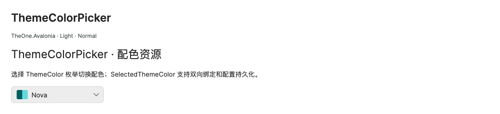
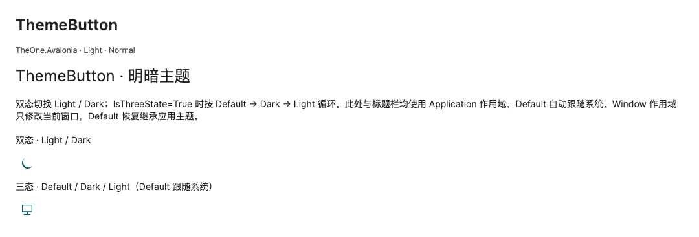

# Theme colors and implementation

Historical command-line checks and consumer test projects have been removed. Check coverage and measurements in this guide are historical records. Start PreviewHost normally and open the relevant control page; validate target-platform behavior in the consuming application.

[简体中文](../zh-cn/README.md) · **English**

OneTheme is the library's default theme. It uses shared `One.*` resources and includes DataGrid. [Setup](../../../README.en.md#quick-start) · [Colors and variants](theme-colors.md) · [Control APIs](../../controls/en/README.md).

<!-- visual-guide:start -->
## Appearance and example states

[Capture scope and visual index](../../controls/en/visual-index.md). These are actual source-rendered examples; use this page’s usage notes for interaction and binding contracts.

### ThemeColorPicker



Enum palette entry, independent of Light/Dark switching.

[View Dark comparison](../../controls/images/ThemeColorPicker-dark.png)

### ThemeButton



Icon-only theme toggle; properties determine two/three-state behavior and scope.

[View Dark comparison](../../controls/images/ThemeButton-dark.png)

<!-- visual-guide:end -->

## Native control templates

Each [control guide](../../controls/en/README.md) lists only control-specific properties, public Classes usage, actual business actions and related models. PreviewHost shows Classes through labeled examples and adds short usage snippets to property and business-action descriptions, without selector/setter inventories. See the separate [complete source contract](../../api/en/README.md) for exact constructors, attached-property accessors and public identifiers. Template-only `one-*` classes remain automatic.

See [ThemeColorPicker / ThemeButton](theme-color-picker.md) for runtime palettes, independent Light / Dark switching, PreviewHost code highlighting, and scoped verification.

| Group | Controls |
| --- | --- |
| Actions | Button, ToggleButton, RepeatButton, SplitButton, ToggleSplitButton |
| Text and numeric input | TextBox, NumericUpDown, ButtonSpinner, AutoCompleteBox |
| Selection | ComboBox, ComboBoxItem, CheckBox, RadioButton, ToggleSwitch |
| Colors | Official ColorPicker, ColorView, ColorSpectrum, ColorSlider and ColorPreviewer; [guide](../../controls/en/color-picker.md) |
| Values and feedback | Slider, ProgressBar, ToolTip, NotificationCard |
| Dates and times | CalendarDatePicker, Calendar, CalendarItem, date cells, DatePicker, TimePicker, date/time popup presenters |
| Navigation and lists | TabControl, TabItem, TabStrip, TabStripItem, Carousel, ItemsControl, ListBox, ListBoxItem, TreeView, TreeViewItem, DataGrid and its cells, headers, rows, row headers, group headers |
| Menus | Menu, MenuItem, ContextMenu, MenuFlyoutPresenter, menu scrolling helper templates |
| Labels and text | Label, SelectableTextBlock |
| Content popups | FlyoutPresenter, the native content container for Flyout |
| Layout and scrolling | Expander, SplitView, GridSplitter, TransitioningContentControl, RefreshContainer, RefreshVisualizer, ScrollViewer, ScrollBar, Separator |

The base templates adapt Avalonia **12.1.4** Fluent sources; the Calendar family and Card templates are implemented by this library. Templates keep `PART_*`, input presenters, validation containers, Popup, Track, Spinner, scrolling gestures, and native keyboard behavior. Colors, radii, default dimensions, helper theme keys, and visual states use TheOne's design. Sources and MIT notices are in the root `THIRD-PARTY-NOTICES.md`, which is also included in the packages.

## Style APIs

See [item surface spacing](item-spacing.md) for the shared spacing rules, audited control families, and independent verification commands.

| Control | Classes / properties | Purpose |
| --- | --- | --- |
| Avatar | `Shape`, `CornerRadius`, `Stretch`, `:loading`, `:error`, `:has-image`, `:has-text` | [Avatar](../../controls/en/avatar.md): 32 / 40 / 56 px, shared semantic colors and clipped image fallback |
| Button | `primary`, with `accent` compatibility | Primary action in the accent color |
| Button / IconButton | `outline`, `ghost`, `link`, `success`, `info`, `warning`, `danger` | Lightweight actions and semantic states |
| Native controls / containers | `small`, `normal`, `large` | Three shared densities, inherited with per-control overrides |
| TabControl | `card` | Borderless headers, bordered content, closing, reordering |
| TabStrip | `TabFeatures.CanClose`, `CloseCommand`, per-item `IsClosable` | Optional native header closing and Ctrl / ⌘ + W; [API](../../controls/en/collections.md#standalone-tabstrip). Reordering remains TabControl-only |
| ToggleButton | `segment` | Segmented selection appearance |
| TextBox | `clearButton` | Clear input |
| TextBox | `revealPasswordButton` | Show / hide password |
| TextBox | `error` | Explicit error appearance; binding errors also trigger `:error` |
| TextBox | `IsReadOnly` | Secondary background for read-only input |
| Interactive controls | `IsEnabled`, native pseudoclasses | Hover, press, focus, disabled, selection states |
| TransitioningContentControl | `PageTransition`, `IsTransitionReversed`, `Motion.Enabled` | Native content transitions, reverse direction, inherited motion switch |
| NotificationCard | `NotificationType`, `Motion.Enabled` | Information / success / warning / error, enter and dismiss animations |

```xml
<Button Classes="primary" Content="保存" Command="{Binding SaveCommand}" />
<TextBox Classes="clearButton" Text="{Binding Email, Mode=TwoWay}" />
<TextBox Classes="revealPasswordButton" PasswordChar="●" />
```

## Resources and sizing

| File / type | Contents |
| --- | --- |
| `Themes/Colors.axaml` | Light / Dark One.* semantic colors and brushes |
| `Themes/Metrics.axaml`, `Sizing.axaml` | Font sizes, heights, radii, spacing, density |
| `Themes/Controls/*.axaml` | Control templates and helper themes |
| `Themes/Styles.axaml`, `Motion.axaml` | Style classes, focus, errors, brush transitions |
| `Themes/OneTheme.axaml` | Theme entry point and merged resources |
| `Controls/RevealHost.cs` | Clipped expansion, space reservation, and reverse motion for trees / Expander |
| `Controls/TabFeatures.cs`, `TabFeatures.Close.cs`, `CardTabChrome.cs`, `CardTabStrip.cs` | TabControl / TabStrip closing, TabControl reordering and Card outlines |

Brushes use DynamicResource and can be overridden by the host. When changing the accent color, update One.Accent, AccentHover, AccentPressed, AccentSoft, and OnAccent together. Body text needs at least 4.5:1 contrast; focus indicators need at least 3:1. Nova's original colors have exceptions for borders and pressed text; see [color details](theme-colors.md) and [contrast-report.json](../contrast-report.json).

<a id="shared-configuration"></a>

## Shared theme configuration

These project-added settings apply across controls. PreviewHost explains them once on Home; individual control pages focus on control-specific properties, labeled Classes examples, actual business actions and related models. Inherited Avalonia APIs are outside these per-control references.

| Setting | Contract |
| --- | --- |
| `Classes="small"`, `normal`, `large` | Public size shortcuts; `one-small`, `one-normal`, `one-large` are automatic template classes. |
| `styling:ControlSizing.Size` | `ControlSize`, default `Normal`; inherited and locally overridable. Values: `Small`, `Normal`, `Large`. [Full contract](../../api/en/TheOne.Avalonia.Styling.ControlSizing.md). |
| `styling:Motion.Enabled` | `bool`, default `true`; inherited and locally overridable. Set `False` to disable motion for a subtree. [Full contract](../../api/en/TheOne.Avalonia.Styling.Motion.md). |

Classes="small|normal|large" or ControlSizing.Size inherits to descendants and can be overridden locally. Standard interaction heights are 30 / 36 / 44 px; ProgressBar thickness is 4 / 6 / 8 px; calendar date cells are 32 / 40 / 48 px. Multiline text and expanded content follow their actual layout. Explicit Height, MinHeight, and Padding follow property priority. Override One.Size.Height, One.Size.Small.Height, and One.Size.Large.Height for sizing; charts have their own [size parameters](../../controls/en/chart-rendering.md#theme-and-three-sizes).

## Motion and template contracts

Motion.Enabled can be set on a container and inherited. Disabling it or using zero duration immediately completes the current state; re-enabling it does not replay an already expanded state. Brush transitions default to 120 ms, expansion to 200 ms, and collapse to 140 ms. Override One.Motion.Fast / One.Motion.Expand as needed. System reduced-motion preferences are not read automatically.

Keep TemplateBinding for template properties, use explicit CompiledBinding for ordinary paths, and explicit CompiledBindingExtension for MultiBinding children. Keep compiled bindings enabled for older examples too. Declare each view's and data template's own x:DataType, so node-model paths do not accidentally use the page view-model scope; per-binding DataType declarations and manual casts are unnecessary. Declare named template parts with x:Name for IDE name-scope resolution. Preserve native PART_*, input presenters, Popup, validation, Track, Spinner, gestures, and keyboard behavior. Template upgrades must compare changes to upstream parts and bindings. See [third-party notices](../../../THIRD-PARTY-NOTICES.md) for sources and licenses.

Controls that capture node bindings may declare a separate node-model `x:DataType` on the control while the page keeps its view-model type. This does not change the runtime DataContext. Reach page data across scopes through a typed property on the named view, preserving notifications when DataContext changes. See the [RelationGraph example](../../controls/en/relation-graph.md#custom-models-and-childrensource).

Use `TemplateBinding` for host properties and retain explicit `Mode=TwoWay` when changes must flow back. CLR commands, formatting and nested properties use typed compiled paths, such as `{CompiledBinding #PART_Popup.((ComboBox)TemplatedParent).Bounds.Width}`. In MultiBinding, `Path="$self"` refers to the target control and `Path="$self.ItemCount"` observes its item count. These bindings do not depend on the application DataContext or reflection. Popup content retains its original template host rather than looking up a parent across the popup boundary. Follow the [Avalonia template binding guidance](https://docs.avaloniaui.net/docs/custom-controls/templated-controls) for custom templates; application views still need an accurate `x:DataType` and compiled bindings enabled.

Collections keep bounded viewports, on-demand templates, and dedicated panels. Set a finite DataGrid MaxColumnWidth before creating columns; see the [DataGrid documentation](../../controls/en/datagrid-binding.md#nativeaot) for AOT requirements.

## Related control documentation

- [Inputs / buttons / selection](../../controls/en/basic.md) · [Calendars and date/time](../../controls/en/date-time.md).
- [Trees, lists, Card tabs, grids](../../controls/en/collections.md) · [Carousel and refresh](../../controls/en/collection-content.md).
- [Menus, popups, layout](../../controls/en/layout.md) · [Content transitions and notifications](../../controls/en/content-feedback.md).
- [Windows and messaging](../../controls/en/windows.md) · [Charts](../../controls/en/charts.md).

## RelationGraph

`RelationGraph` and `RelationGraphNodePresenter` use shared semantic colors and inherited Small / Normal / Large sizing. Root cards use `:root`; null-slot visibility uses `:has-icon`, `:has-title`, `:has-content`, and `:icon-only`. Customize cards through `NodeTheme` based on the default presenter theme. See the [control contract and validation commands](../../controls/en/relation-graph.md).

## FlowStep and FlowNode

The FlowStep theme supplies a non-interactive connector layer (`PART_Connectors`), native `PART_ItemsPresenter` and `PART_ScrollViewer`. FlowNode retains `PART_ContentPresenter` for content, with `PART_Indicator`, `PART_Ring`, `PART_Check` and `PART_Dot` for state markers. State pseudo-classes are `:completed`, `:in-progress`, `:pending` and `:vertical`. Default content uses `One.FlowNode.DefaultContentTemplate`; shared semantic brushes and inherited density support Light / Dark and Small / Normal / Large. Horizontal slots scroll when constrained; vertical rows follow real content height. The rail layer does not intercept input. See [FlowStep and FlowNode](../../controls/en/flow-step.md) for template priority, sizing and targeted verification.

GanttChart uses dedicated `One.Gantt.*` dynamic brushes, 36 / 44 / 52 row heights and a frozen header. See [GanttChart](../../controls/en/gantt-chart.md) for resources, template parts and narrow viewport behavior.

InfoCard supports `hove` / `shadow` classes using `One.InfoCard.Shadow` / `One.InfoCard.HoverShadow` and a non-interactive PART_Shadow; see [InfoCard](../../controls/en/info-card.md). RelationGraph node themes expose read-only IsSelected / :selected without changing geometry; see [node selection](../../controls/en/relation-graph.md#node-selection).

ImagePreview draws images and transparency checkerboards in PART_Viewport while retaining native navigation and toolbar buttons. It uses shared One.* semantic brushes and inherited densities. See [ImagePreview](../../controls/en/image-preview.md).

## Pagination

The Pagination theme preserves native buttons, ComboBox and TextBox. Current pages use the primary button class, ellipses remain non-interactive, and `:compact`, `:empty`, `:invalid-jump` represent layout, empty data and jump validation. ItemHeight is 30 / 36 / 44 across inherited densities. See the [control contract](../../controls/en/pagination.md) for parts, formats and verification.

The one-toast class selects One.ToastCard, with vertically centered status icon and message only. The default NotificationCard template retains its title and close button. Both share the native lifecycle and motion. See [windows and messages](../../controls/en/windows.md).

## WorkflowEditor

WorkflowEditor uses shared One.* brushes, with One.Workflow.Canvas and One.Workflow.Note for light/dark canvas and annotation surfaces. HeaderTemplate, NodeTemplate, ContentTemplate, NodeDefinitionTemplate and PropertyTemplate preserve graph interaction while customizing presentation. Default templates include an editable inspector and command-driven save header. The editor stretches to its parent viewport. PART_Canvas draws rounded edges and the dot grid; the minimap draws a lightweight graph projection. See [WorkflowEditor](../../controls/en/workflow-editor.md).

## MessageBox and Upload

OneMessageBox reuses the themed OneDialog presenter and its modal lifecycle. Its default content uses One.Accent / One.Danger semantic brushes, native command buttons and inherited density. See [MessageBox](../../controls/en/message-box.md).

Upload includes default EmptyTemplate, FileTemplate and ActionsTemplate; each receives the Upload control for compiled bindings. The theme uses native buttons and Image, shared semantic brushes, inherited text sizes 12 / 14 / 16, and `:has-file`, `:loading`, `:error`, `:busy` states. See [Upload](../../controls/en/upload.md).
