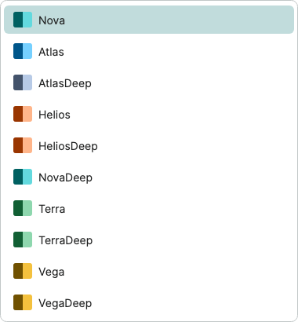

# ThemeColorPicker and Light / Dark switching

Historical command-line checks and consumer test projects have been removed. Check coverage and measurements in this guide are historical records. Start PreviewHost normally and open the relevant control page; validate target-platform behavior in the consuming application.

[简体中文](../zh-cn/theme-color-picker.md) · **English**

Palette and mode are independent settings: `OneTheme.ColorTheme` selects `One.*` color resources; `RequestedThemeVariant` selects Light / Dark. `ThemeColorPicker` specializes native ComboBox, while `ThemeButton` is a ToggleButton with built-in icons.

After loading OneTheme, pass an enum on the UI thread to switch palettes without finding a window, dictionary, or theme instance:

```csharp
using TheOne.Avalonia.Themes;

OneTheme.SetColor(ThemeColor.Atlas);
OneTheme.SetColor(ThemeColor.Nova); // Restore the default Nova palette.
```

This API updates the application palette, preserves property bindings, and leaves Light / Dark unchanged. Invalid enum values throw ArgumentOutOfRangeException; calling without OneTheme registered in Application.Styles throws InvalidOperationException.

<!-- visual-guide:start -->
## Appearance and example states

[Capture scope and visual index](../../controls/en/visual-index.md). These are actual source-rendered examples; use this page’s usage notes for interaction and binding contracts.

### ThemeColorPicker


Enum palette entry, independent of Light/Dark switching.

[View Dark comparison](../../controls/images/ThemeColorPicker-dark.png)

### ThemeColorPicker · Palette list



Visible portion of the real palette dropdown; scroll to reach more enum entries.

[View Dark comparison](../../controls/images/ThemeColorPickerPopup-dark.png)

### ThemeButton


Icon-only theme toggle; properties determine two/three-state behavior and scope.

[View Dark comparison](../../controls/images/ThemeButton-dark.png)

<!-- visual-guide:end -->

## Palette resources

```xml
<Application.Styles>
  <themes:OneTheme ColorTheme="Atlas" />
</Application.Styles>
<!-- themes: using:TheOne.Avalonia.Themes -->
```

`ThemeColor` contains `Nova`, `Atlas`, `AtlasDeep`, `Helios`, `HeliosDeep`, `NovaDeep`, `Terra`, `TerraDeep`, `Vega`, and `VegaDeep`. The default label is restored to **Nova**. Default was renamed to Nova, retaining numeric value 0; other numeric values remain unchanged. Light / Dark semantic colors for the other nine palettes map from [Eremex palette resources](https://github.com/Eremex/controlthemes/tree/5f6cb3ad8b904cead6bd432f62596648cc9a1039/Source/Eremex.Avalonia.Themes.DeltaDesign/PaletteResources), without adding Eremex packages or templates.

Resources cover neutral surfaces, text, accents, selection, focus, borders, and status colors. Soft status backgrounds, card Footer, and gradients are TheOne derivations; chart base colors and six series retain shared resources. Switching palettes does not recreate views, change density, or switch Light / Dark. Fluent fallback controls also receive the updated accent.

## Dropdown selector

```xml
<one:ThemeColorPicker Width="170"
                     SelectThemeColor="{Binding Palette, Mode=TwoWay}" />
<!-- one: using:TheOne.Avalonia.Controls -->
```

The VM's `Palette` is a `ThemeColor`. Without a binding, the selector connects to the `OneTheme` directly registered in `Application.Styles`. Each entry shows its name and Light / Dark accent swatches. Native pointer, arrow-key, and Enter selection retain ComboBox borders, item spacing, disabled behavior, and three densities.

This is an enum selector: `ItemsSource` and `OneTheme.ColorThemes` contain `ThemeColor` values, and `SelectedItem` is an enum rather than a ThemeColorOption wrapper. `SelectedColor` provides a strongly typed property; native SelectedItem also exposes the selected enum.

`SelectThemeColor` binds two-way by default. User selection updates the application OneTheme; programmatic changes to `OneTheme.ColorTheme` synchronize attached selectors. Change palettes on the UI thread. Without an application OneTheme, selection remains available but does not alter other theme libraries. Applications using a separate OneTheme in local Styles should set its ColorTheme explicitly.

```csharp
using TheOne.Avalonia.Themes;

OneTheme.SetColor(ThemeColor.Vega);
// Read-only enum list, also usable directly by ComboBox: OneTheme.ColorThemes.
```

## Switching and refresh

### Persisting and restoring preferences

`SelectThemeColor` is a `StyledProperty<ThemeColor>` with TwoWay binding by default. `SelectedColor` remains compatible and synchronized. Bind one of these properties per control, avoiding conflicting configuration sources. On first attachment an explicit Nova binding (enum value 0) is applied; an unbound picker follows the current application palette. Reattachment follows the current application instead of restoring stale state.

```xml
<!-- Declare the view's actual VM x:DataType; Palette is a ThemeColor. -->
<one:ThemeColorPicker SelectThemeColor="{Binding Palette}" />
```

The control exposes the preference without reading or writing files. Store `Palette.ToString()` using your application settings. After registering OneTheme, on the UI thread and before creating the main window, restore it:

```csharp
var palette = Enum.TryParse<ThemeColor>(savedName, out var value) && Enum.IsDefined(value)
    ? value : ThemeColor.Nova;
OneTheme.SetColor(palette);
// Initialize VM.Palette with the same value; persist subsequent changes asynchronously.
```

Persist and restore `Application.Current.RequestedThemeVariant` separately for Light / Dark. Avoid synchronous disk I/O in selection callbacks.

### Refresh boundaries

Solid brushes retain their identity per resource key and repaint existing glyphs when colors change, avoiding unrelated text measurement. PreviewHost forwards editor palette notifications only when editor resource values change; One.* backgrounds, Light / Dark and custom syntax resource overrides still update. Gantt semantic aliases and workflow canvas, notes, selection shadows and minimap follow the active palette without rebuilding nodes or changing documents, selection or viewport.

NavMenu reuses icon, text and tooltip containers while scrolling, and does not rewrite unchanged row indentation resources. Initial loading, first palette creation and actual text layout still have costs; batching resource notifications does not promise a fixed latency on every device.

Light / Dark color snapshots and immutable gradients are cached per palette. Published solid brushes retain their identity and update their colors before the batched notification. One.*Color values and Fluent accents still receive normal resource notifications. Treat theme-owned brushes as read-only; override resource keys for customization. Switching does not remove or rebuild the resource tree.

ColorTheme and resource queries immediately return the new palette; visual resource notifications coalesce at the next Render priority. Consecutive calls in one dispatcher turn refresh only the final palette. Repeating the current value, or returning to the published palette before refresh, produces no redundant notification. Code inspecting control brushes synchronously should wait until the next render pass for their final visual state. This avoids synchronously walking the visible UI for every intermediate choice.

## Icon-only ThemeButton

```xml
<one:ThemeButton Scope="Application" />
```

ThemeButton now inherits ToggleButton and shows one built-in moon / sun icon without text, retaining tooltips and accessible names. `IsChecked=true` represents the effective Dark mode; false represents Light. External mode changes synchronize checked state. Clicking or pressing Space switches mode without changing ColorTheme; disabled behavior remains native.

The default `Scope="Window"` updates the nearest window's RequestedThemeVariant. `Application` updates the application setting; explicitly themed windows retain their local settings. Configure the button in OneWindow's title bar through `ThemeButtonScope`. See [windows](../../controls/en/windows.md) for window and owner behavior.

Changing the base class from Button to ToggleButton is an inheritance change. Styles targeting ThemeButton should account for ToggleButton states. Its default appearance has a dedicated control theme, and its icons do not depend on Content.

## PreviewHost and verification

PreviewHost opens the standalone top-level Home item by default. The top ThemeColorPicker selects resources; the title-bar ThemeButton switches Light / Dark only. Home and necessary inline snippets use the `TheOne.Avalonia.CodeEditor` NuGet package for read-only highlighting, wrapping and copying. Short property and business-API examples appear directly in their Description entries. Pages no longer have a bottom source expander or embed the complete demo-source inventory.

These scoped checks cover the palette selector, ThemeButton, code panel, and Home navigation, including native input, live resources, Light / Dark, densities, narrow viewports, and actual rendering. They do not run other controls' full regression suites.

<!-- generated-contracts:start -->
## Control-specific properties, Classes usage and business APIs

This section lists project-added control-specific properties, public Classes usage, practical business actions and related models, without repeating inherited native APIs, constructors, property Get/Set wrappers or public identifiers. Registration defaults differ from themed values, and explicit local values take precedence. PreviewHost shows Classes through labeled examples rather than template-selector/setter inventories; properties and business actions in Description include short usage snippets. Shared ControlSizing and Motion settings are centralized on Home. Only Button, Input and Select share comparison pages; other controls retain independent complete demos.

### ThemeButton

[Complete source contract](../../api/en/TheOne.Avalonia.Controls.ThemeButton.md)

| Property | Type | Access/binding/inheritance | Registration/model default | Meaning and constraints |
| --- | --- | --- | --- | --- |
| [`Scope`](../../../TheOne.Avalonia/Controls/ThemeButton.cs#L30) | `TheOne.Avalonia.Controls.ThemeButtonScope` | writable; OneWay | `0 / default` | Scope of Light/Dark switching; does not change the ThemeColor palette enum. Values: `Window`, `Application` |

### ThemeColorPicker

[Complete source contract](../../api/en/TheOne.Avalonia.Controls.ThemeColorPicker.md)

| Property | Type | Access/binding/inheritance | Registration/model default | Meaning and constraints |
| --- | --- | --- | --- | --- |
| [`SelectThemeColor`](../../../TheOne.Avalonia/Controls/ThemeColorPicker.cs#L60) | `TheOne.Avalonia.Themes.ThemeColor` | writable; TwoWay | `0 / default` | The selected palette, suitable for a persisted two-way enum binding. Validation: `value => Enum.IsDefined(value)` Values: `Nova`, `Atlas`, `AtlasDeep`, `Helios`, `HeliosDeep`, `NovaDeep`, `Terra`, `TerraDeep`, `Vega`, `VegaDeep` |
| [`SelectedColor`](../../../TheOne.Avalonia/Controls/ThemeColorPicker.cs#L70) | `TheOne.Avalonia.Themes.ThemeColor` | writable; TwoWay | `0 / default` | Compatibility alias of SelectedThemeColor; both represent the same palette enum. Prefer binding SelectedThemeColor. Validation: `value => Enum.IsDefined(value)` Values: `Nova`, `Atlas`, `AtlasDeep`, `Helios`, `HeliosDeep`, `NovaDeep`, `Terra`, `TerraDeep`, `Vega`, `VegaDeep` |

### OneTheme

[Complete source contract](../../api/en/TheOne.Avalonia.Themes.OneTheme.md)

| Property | Type | Access/binding/inheritance | Registration/model default | Meaning and constraints |
| --- | --- | --- | --- | --- |
| [`ColorTheme`](../../../TheOne.Avalonia/Themes/OneTheme.axaml.cs#L30) | `TheOne.Avalonia.Themes.ThemeColor` | writable; OneWay | `0 / default` | Color palette; changing this does not change the requested Light / Dark variant. Validation: `value => Enum.IsDefined(value)` Values: `Nova`, `Atlas`, `AtlasDeep`, `Helios`, `HeliosDeep`, `NovaDeep`, `Terra`, `TerraDeep`, `Vega`, `VegaDeep` |
| [`ColorThemes`](../../../TheOne.Avalonia/Themes/OneTheme.axaml.cs#L36) | `System.Collections.Generic.IReadOnlyList<TheOne.Avalonia.Themes.ThemeColor>` | read-only; CLR / n/a | `Array.AsReadOnly(Enum.GetValues<ThemeColor>())` | Read-only runtime/derived state, updated by the control/model for display or command conditions; not a two-way input. |

### ThemeColor

[Complete source contract](../../api/en/TheOne.Avalonia.Themes.ThemeColor.md)

No additional CLR/attached properties are declared on this type; see its base for inherited members.

See [shared theme configuration](../../theme/en/README.md#shared-configuration) for common sizing and motion settings, demonstrated centrally on PreviewHost Home.

### Classes usage

No added public appearance classes; use the default theme and control-specific properties.
These are individually supported public classes. Hover, pressed, disabled and selected states are control-owned; do not assign template classes manually. See the labeled PreviewHost examples for their appearance.

### Business APIs

| Type | Action signature | Purpose |
| --- | --- | --- |
| [`OneTheme`](../../api/en/TheOne.Avalonia.Themes.OneTheme.md) | `static void OneTheme.SetColor(ThemeColor color)` | Switches the application's OneTheme palette on the UI thread, preserving Light / Dark and property bindings. |

### Related models

| Model | Properties/enum values |
| --- | ---: |
| [`TheOne.Avalonia.Controls.ThemeButtonScope`](../../api/en/TheOne.Avalonia.Controls.ThemeButtonScope.md) | 2 |
| [`TheOne.Avalonia.Themes.OneTheme`](../../api/en/TheOne.Avalonia.Themes.OneTheme.md) | 2 |
| [`TheOne.Avalonia.Themes.ThemeColor`](../../api/en/TheOne.Avalonia.Themes.ThemeColor.md) | 10 |

[Complete source contract (including constructors, property accessors and identifiers for precise lookup)](../../api/en/README.md)
<!-- generated-contracts:end -->
